```{r setup, include=FALSE}
knitr::opts_chunk$set(echo = FALSE, fig.align = "center",
                      message = FALSE, warning = FALSE)
knitr::opts_chunk$set(fig.dim=c(9, 6), fig.retina=2, out.width="100%")
```

# ¿Qué entendemos por crecimiento y desarrollo económicos?

## ¿Qué vamos a estudiar en este curso?

- El [crecimiento y el desarrollo económicos]{.emph} son los **principales objetivos** de la mayoría de los países del mundo. Ocupa gran parte de la agenda de sus gobiernos.

- ¿Qué significa esto? **Concenso** en la literatura: **Mejorar el ingreso, el bienestar y la capacidad económica**.

- ¿Cómo medimos y evaluamos?

  - **Nivel de bienestar material alto (calidad física de vida) y accesible a todos**: entorno saludable, vivienda, buena alimentación, acceso a diversidad de productos, ocio y entretenimiento, ....

  - **Intangibles**: libertades y los derechos políticos, desarrollo intelectual y cultural, estabilidad de la familia, baja tasa de delincuencia, no discriminación, ...

- ¿Por donde empezamos? **PIB**. Conexiones importante con el desarrollo:

  - Impacto de los niveles medios de logros económicos.

  - Influencia de la distribución de los logros económicos entre los ciudadanos de un país.

## ¿Qué vamos estudiar?

Dos **destacados economistas** hablando sobre el desarrollo económico:


> Por problema de desarrollo económico entendemos simplemente el problema de explicar los niveles de renta per cápita y sus tasas de crecimiento que observamos en los distintos países y a lo largo del tiempo. Es posible que esta definición parezca alicorta y quizá lo sea, pero analizando la renta inevitablemente analizaremos también otros muchos aspectos de las sociedades, por lo que sugeriría que renunciásemos a juzgar el alcance de esta definición hasta tener una idea más clara de adónde nos lleva (Robert Lucas, 1998).

\ 

*Los rasgos universales del desarrollo económico (la salud, la esperanza de vida, la alfabetización, etc.) derivan de una manera natural del crecimiento del PNB per cápita quizá con el simple paso del tiempo.*

## ¿Qué vamos estudiar?

Dos **destacados economistas** hablando sobre el desarrollo económico:

> Nunca deberíamos perder de vista el fin último del ejercicio, tratar a los hombres y a las mujeres como un fin, mejorar la condición humana, aumentar las opciones de los individuos... Existiría una unidad de intereses si hubiera una rígida conexión entre la producción económica (medida por medio de la renta per cápita) y el desarrollo humano (reflejado en los indicadores humanos, como la esperanza de vida o la tasa de alfabetización o en logros como el respeto a uno mismo, que no son fáciles de medir). Pero estos dos grupos de indicadores no están muy relacionados entre sí (Paul Streeten, 1994).

\ 

*La correlación entre el PNB y otros aspectos deseados del desarrollo no es automática (o puede no existir). El PNB per cápita debe complementarse con otros indicadores directamente para tomar en cuenta el carácter "multidimensional" del desarrollo.*

# Crecimiento y distribución del ingreso mundial

## Distribución del ingreso mundial

:::{.center-x}
**2020**: Mundo 84.4t US\$, población 7.75b personas, ingreso promedio 10,900 US\$
:::

Clasificaciones (Banco Mundial, 2020) [https://data.worldbank.org/](https://data.worldbank.org/)

- **Países de bajos ingresos**: <\$ 1,035 US. Muchos países africanos (como Afganistán, Myanmar y Nepal). Alrededor del borde superior: Tayikistán, Tanzania.
  - 665m personas, ingreso total 0.55t US\$, ingreso promedio 827 US\$.

- **Países de ingreso medio bajo**: 1,035 - 4,045 US\$. Sus miembros incluyen India, Nicaragua, Nigeria y Tailandia. Alrededor del borde superior: Indonesia o Filipinas.
  - 3.33b personas, ingreso total 7.33t US\$, ingreso promedio 2,200 US\$. 


## Distribución del ingreso mundial

- **Países de ingreso medio alto**: 4,046 - 12,535 US\$. Sus miembros incluyen China, los países más ricos de América Latina (Argentina, Chile, Brasil), Líbano, Sudáfrica, Turquía. Alrededor del borde superior: Costa Rica, Mauricio.

  - 2.510m personas, ingreso total 23.10t US\$, ingreso promedio 9,200 US\$.

- **Países de altos ingresos**: > 12,535 US\$. Sus miembros incluyen EE.UU., Europa occidental y del norte, Japón, Singapur, algunos países de Medio Oriente.
  
  - 1210m personas, ingreso total 53.26t, ingreso promedio 44,020 US\$.

\ 

:::{.emph}
Más de **50%** de la población mundial (ingreso bajo + ingreso medio bajo) tienen el **9.3%** del ingreso mundial.

Suiza (86,601 US\$) es más de **150 veces** más rico que la República Democrática del Congo (557 US\$), más de **44 veces** más rico que Bangladesh (1.968 US\$).
:::

## Población y PIB per cápita (método TC) 2009

```{r fig1, echo=FALSE, out.width="75%"}
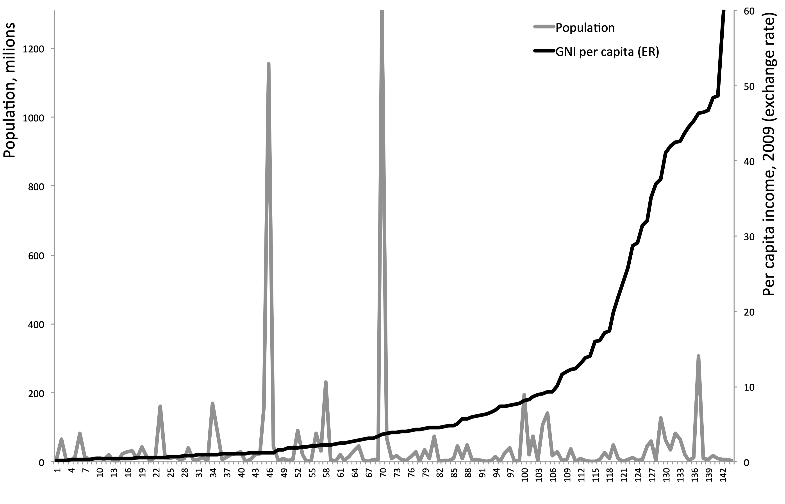
```

## Problemas de medición

*Expresar el ingreso en una moneda común (US\$) y en términos per cápita (misma escala) facilita la comparación. No obstante, esta medida no es fiable ya que estima de una manera sesgada la realidad*.

- **Subdeclaración de ingresos** (Parente, Rogerson y Wright, 2000): 

  - Incentivos al subreporte de ingresos para evasión de impuestos (monitoreo imperfecto).
  
  - Producción de subsistencia en áreas rurales y principalmente para autoconsumo.

- **Precios no reflejados en los tipos de cambio**:

  - Bienes no transables (servicios e infraestructura).

- **Precios distorsionados** (no reflejan preferencias ni escaseces relativas): 

  - Poder de mercado (monopolios u oligopolios) y empresas del sector público.

- **Externalidades** (valor de mercado $\neq$ valor social): 

  - Contaminación, daño ambiental, agotamiento de recursos.

## Correcciones a Paridad del Poder Adquisitivo (PPA)

:::{.emph}
El **Programa de Comparación Internacional** busca eliminar diferencia en precios de los mismos bienes en diferentes países mediante el cálculo del precio "correcto" (a PPA) de los bienes y servicios incluidos en el PIB o PNB.
:::

- 5 rondas: 1980, 1985, 1993, 2005 y 2011, y cuenta con 180 países.

- Versión simplificada de la **Metodología**:

  - Se recogen datos de precios de una canasta de $N_i$ bienes y servicios en cada uno de los $N_j$ países de referencia y se calcula el precio relativo con EE.UU.
  $$p_{i,j}/p_{i,EEUU}$$

  - Se estima la cantidad de cada bien o servicio valorada a su precio de EE.UU. 
  $$\frac{q_{i,j} p_{i,j}}{p_{i,j}/p_{i,EEUU}} \rightarrow q_{i,j} p_{i,EEUU}$$

## Corrección a Paridad del Poder Adquisitivo (PPA)

- Versión simplificada de la **Metodología** (cont...):

  - Se construyen precios internacionales de una canasta de bienes y servicios promediando los precios en los diferentes países. (expresados en dólares).
  $$(p_{i,j}/p_{i,EEUU})_{int} = \sum_{j=1}^{N_j} w_j (p_{i,j}/p_{i,EEUU})$$

  - Se estima el ingreso nacional de los países valorando su producción a estos precios internacionales.
  $$PIB_{PPA} = \sum_{i=1}^{N_i} (q_{i,j} p_{i,EEUU}) (p_{i,j}/p_{i,EEUU})_{int}$$

- Para detalles de la metodología de ajuste PPA ver: [https://www.worldbank.org/en/programs/icp](https://www.worldbank.org/en/programs/icp) 

## PIB per cápita (PPA vs. TC) 2009

```{r fig2, echo=FALSE, out.width="65%"}
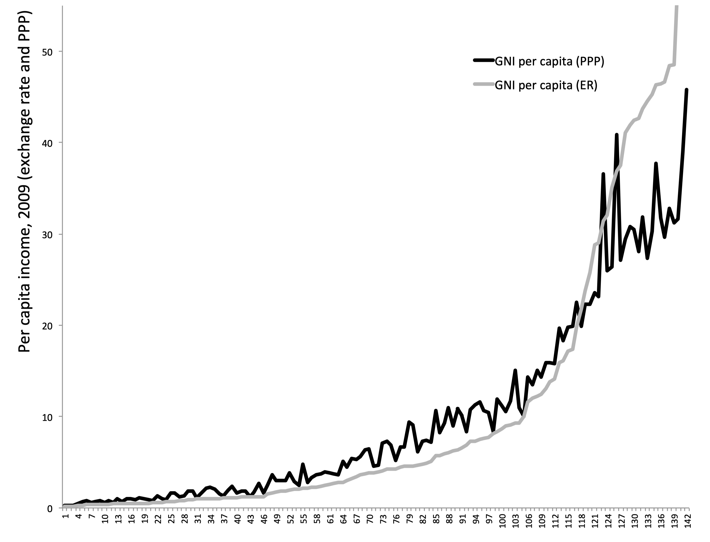
```

## La distribución mundial del ingreso

:::{.emph}
La **distribución mundial del ingreso** se ha mantenido más o menos **estable**. El 10% más rico y más pobre relativo al promedio mundial apenas ha cambiado en los últimos 30 años.
:::

:::{.center-x}
**PIB per cápita PPA**
:::

|  | 1990 | 1995 | 2000 | 2005 | 2010 | 2015 | 2020 |
|--|--|--|--|--|--|--|--|
| 10% más rico / Prom. Mundial    | 4.03 | 4.10 | 3.81 | 3.93 | 3.50 | 3.41 | 3.48
| 10% más pobre / Prom. Mundial   | 0.14 | 0.14 | 0.13 | 0.13 | 0.13 | 0.13 | 0.14 

- Las disparidades entre estados dentro EE.UU. no se aproximan ni siquiera a estas cifras internacionales (Parente y Prescott,  2000)
  
  - En 2010, el estado más rico de los EE. UU. fue Alaska y el más pobre fue Mississippi, y la proporción de ingresos per cápita resultó en un poco más de 2! 
  
## La distribución mundial del ingreso

:::{.emph} 
PIB mundial per cápita creció 1.5% anual durante 1970-2010 y 2.0% durante 2010-2015. Hubo **bastante movimiento dentro de la distribución** de ingresos mundial.
:::

El **Este Asiático** baila a su propio ritmo.

- 1960-1990: *Japón* 5.3%, *Corea* 6.1%, *Hong Kong* 6.6%, *Indonesia* 3.8%, *Malasia* 4.2%, *Singapur* 6.4%, *Tailandia* 5.1%

- 1990-2010 algo más lento: *Japón* <1% (menos que el promedio mundial), el resto se quedó entre 3 y 4%.

- 2011-2015: *Japón* 1.05%, *Indonesia* 4%, *Malasia* 3.7%, *Tailandia* 3%, resto entre 1 y 2%.

- *China!* 1980-1990: 7.6%; 1990-2010: 9.5%; 2011-2016: 6.9%.

- *India*, otro de rápido crecimiento. 1960-1990: 2.6%; 1990-2000: 3.6%; 2000-2010: 6.2%; 2011-2015: 5.4%. 

## La distribución mundial del ingreso

En **América Latina** no se ve mucho dinamismo:

- 1960-1980: crecimiento en torno al 2.9% anual.

- 1980-1990, la *década perdida* para América Latina: Caídas de más de 0.7% año tras año, caída general de alrededor de 10%. 

  - *Argentina* -2.9%$, *Brasil* -0.5%, *México* -0.3%, *Perú* -3.0%, *Uruguay* -0.7%.

  - Sólo *Chile* (2.1%) y *Colombia* (1.4%) tuvieron un PIB per cápita superior en 1990 que en 1980.

- 1990-2010 todavía lento: crecimiento en torno al promedio mundial (excepto *Chile* 4.7% y *Argentina* 3.6%).

- 2000-2010 mucho mejor (el super ciclo del precio de los *commodities*): crecimiento promedio muy superior a 2%.

  - *Argentina* 3.3%, *Brasil* 2.4%, *Chile* 2.6%, *Perú* 4.3%, *Uruguay* 3.0%. *México* aún rezagado, 0.8%.

## La distribución mundial del ingreso

En **África Subsahariana** se ve estancamiento:

- 1980-1990 caídas al 1% anual.

- 1990-2000 caídas al 0.4% anual.

- 2000-2010 algo mejor. Crecimiento promedio de 2.2%.

- 2011-2015 crecimiento promedio de 1.4%. 
  
- Algunos ejemplos:
 
  - *Nigeria* (-1.6%) y *Tanzania* (-2.0%) en los 1980s, estancamiento 1990s y sólida recuperación durante 2000-2010 (3.9 y 4.0%, respectivamente).

  - *Kenia* apenas creció en la década de 1980, mostró caídas en la década de los 1990s, y alguna recuperación entre 2000-2010; en general, 0.2% durante 30 años. 

## La distribución mundial del ingreso

- Algunos ejemplos (cont...): 

  - *Uganda* se estancó durante la década de 1980 (-0.1%), antes de acelerar el ritmo y hacer progreso sustancial durante 1990-2010, creciendo a más de 3.5% anualmente.

  - *Ruanda*, paralizada por un crecimiento negativo en los 1980s (-1.2%) y 1990 (-0.7%), antes de una notable recuperación en 2000-2010 (4.8%)

  - La tasa de crecimiento negativa de *Burundi* de 3.2% en la década de 1990 apenas se vio compensada por el casi estancamiento de 2000-2010 (0.4%).

  - La *República Democrática del Congo* en caída libre entre 1980-1990 (-2.2%) y 1990-2000 (-8.5%!), antes del modesto 1.8% durante 2000-2010.

  - *Zimbabue* se estancó en los 1980s (0.7%) y 1990s (-0.3%), antes de entrar en caída libre (-4.8%) durante 2000-2010.


## La distribución mundial del ingreso

- **OCDE**: 20 miembros originales y 14 adiciones. Todos los países desarrollados y algunos países de ingresos medios.

  - 1970-1990: crecimiento de la OCDE un poco más de 2.4%.

  - 1990-2000: 1.8%, algo superior a la media mundial

  - 2000-2010: por debajo de la media mundial, 0.8%.

  - 2010-2015: de nuevo por debajo del promedio mundial,  1%.

- *Estados Unidos* refleja razonablemente bien a la OCDE:

  - 2.2% durante 1970-1990.

  - Un poco menos de 2.2% en 1990-2000.

  - 0.7% en 2000-2010.
  


## Movimiento relativo a los Estados Unidos

:::{.center-x}
**Variación porcentual anual del ingreso PPA de diferentes países en relación con la de EE.UU.**
:::
```{r fig3, echo=FALSE, out.width="70%"}
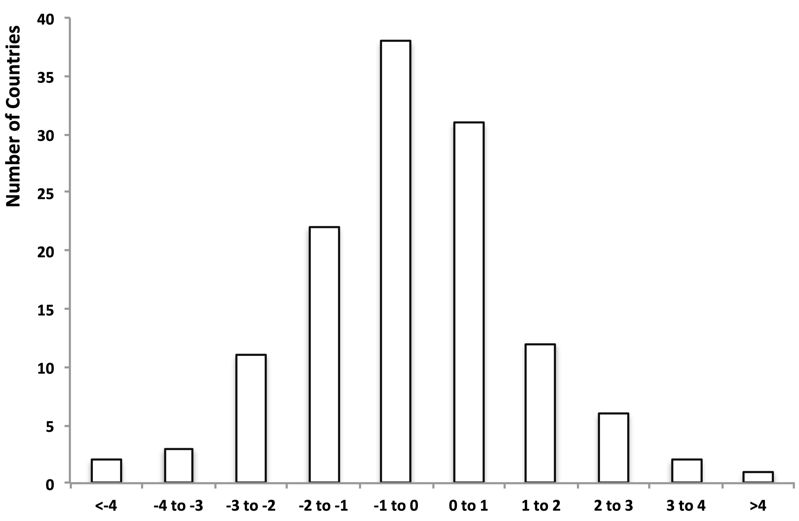
```

## ¿Cuánto tiempo se requiere para duplicar el ingreso?

Por definición, duplicar una variable que crece a tasa $x \%$ en $T$ periodos requiere:
$$[1+(x / 100)]^{T}=2$$

Entonces:
$$T \ln _{e}[1+(x / 100)]=\ln _{e} 2$$

Pero como $\ln _{e} 2 \simeq 0.7$, y para $x/100$ pequeño $\ln _{e}(1+x/100) \simeq x/100$, por tanto:
$$T \simeq 70/x$$

\ 

:::.{emph}
Una buena aproximación: toma **70 dividido la tasa de crecimiento anual** años para duplicar el ingreso.
:::

## ¿Cuánto tiempo se requiere para duplicar el ingreso?

Algunos ejemplos:

- *Holanda*: creciendo al 0.2% durante 1347-1807 se duplicaría cada **350** años.

- *Reino Unido* se duplicaría cada **150** años (1700-1870)

- *Estados Unidos* tardó **47** años a mediados del siglo XIX, y tomó menos de **35** años a mediados del siglo XX.

- *Brasil* se duplicó en **18** años (desde 1961)

- *Corea* se duplicó en **11** años (desde 1966)

- *China* se duplica cada **7-9** años (desde 1980)

## Matriz de movilidad 1982-2009

:::: {.columns}

::: {.column width="50%"}

Siguiendo a Quah (1993):

**Cat 1**: ingreso $<1/4$ prom. mundial

**Cat 2**: ingreso entre $1/4$ y $1/2$ prom. mundial

**Cat 3**: ingreso entre $1/2$ y $1$ prom. mundial 

**Cat 4**: ingreso entre $1$ y $2$ prom. mundial  

**Cat 5**: ingreso $>2$ prom. mundial

:::

::: {.column width="50%"}


```{r fig4, echo=FALSE, out.width="70%"}
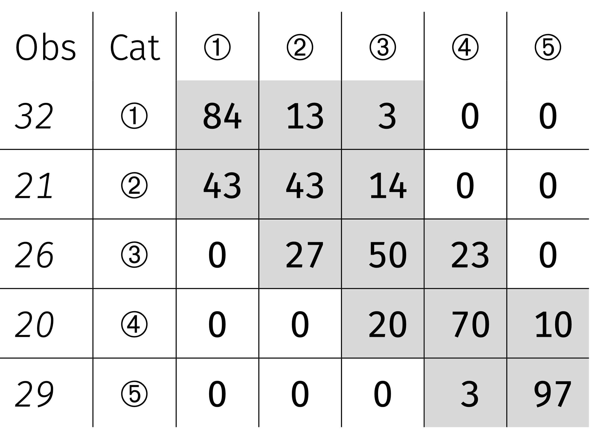
```
:::

::::

# Mirando dentro de los países

## Desigualdad e ingreso per cápita

La desigualdad entre países se agrava dentro de los países: países con ingreso per cápita entre 0-4,000 PPA:

| Country | GDP pc (2000) | Share Bottom 40% | Share Top 20% |
|--|:--:|:--:|:--:|
| Malawi | 546 | 13 | 56 |
|Uganda | 765 | 16 | 50 |
|Tanzania | 866 | 19 | 42 |
|Bangladesh | 893 | 22 | 40 |
|Senegal | 1,492 | 17 | 48 |
|Pakistan | 1,898 | 21 | 42 |
|Nicaragua | 2,157 | 12 | 55 |
|Sri Lanka | 3,106 | 17 | 48 |
|Bolivia | 3,402 | 7 | 63 |
|Guatemala | 3,350 | 11 | 59 |

## Desigualdad e ingreso per cápita

La desigualdad entre países se agrava dentro de los países: países con ingreso per cápita entre 4,000-13,000 PPA:

| Country | GDP pc (2000) | Share Bottom 40% | Share Top 20% |
|--|:--:|:--:|:--:|
| El Salvador | 5,183 | 10 | 55 |
| Peru | 5,444 | 11 | 57 |
| Costa Rica | 5,520 | 13 | 50 |
| Thailand | 5,568 | 11 | 59 |
| Panama | 5,840 | 8 | 60 |
| Colombia | 6,617 | 9 | 61 |
| Brazil | 7,911 | 7 | 65 |
| Costa Rica | 8,113 | 13 | 51 |
| Venezuela | 9,924 | 12 | 52 |
| Mexico | 12,095 | 12 | 56 |

## Desigualdad e ingreso per cápita

La desigualdad entre países se agrava dentro de los países: países con ingreso per cápita entre $>$ 13,000 PPA:

| Country | GDP pc (2000) | Share Bottom 40% | Share Top 20% |
|--|:--:|:--:|:--:|
| Korea | 16,015 | 21 | 37 |
| Spain | 25,129 | 19 | 42 |
| UK | 28,575 | 18 | 44 |
| Sweden | 29,126 | 23 | 37 |
| Switzerland | 34,713 | 20 | 41 |
| USA | 39,578 | 16 | 46 |
| Norway | 43,642 | 24 | 37 |

## Desigualdad e ingreso per cápita: ahora el rango completo

```{r fig5, echo=FALSE, out.width="70%"}
knitr::include_graphics("figs/fig1_inequality_income.png")
```

## Desigualdad e ingreso per cápita: ¿en la parte baja se ve una u-invertida?

```{r fig6, echo=FALSE, out.width="70%"}
knitr::include_graphics("figs/fig2_inequality_income_up.png")
```

## Cambios desiguales y compensatorios

:::{.emph}
**Hipótesis de la U invertida de Kuznets (1995)**: La desigualdad puede aumentar y después disminuir a medida que pasamos de ingresos per cápita más bajos a más altos.
:::

- Los datos inducen a pensar que el desarrollo económico es un proceso inherentemente desigual.

  - Es posible que al principio éste beneficie más que proporcionalmente a los grupos más ricos de la sociedad.
  
  - Ingreso per cápita muy bajo: Es difícil reducir la prop. de individuos bajo un umbral de ingreso.
  
  - Ingreso per cápita más altos: Mejoras económicas tienden a estar distribuidas de una manera más igualitaria (aumenta la proporción del ingreso correspondiente a los quintiles más pobres).


- Este proceso no es inevitable:

  - Medidas de acceso a infraestructura y recursos (como servicios sanitarios y la educación), generan que el crecimiento económico se distribuya de una manera más uniforme.
  
- Necesidad de analizar con cuidado relación equidad y crecimiento: Existe una creciente desigualdad en muchos países (ejemplo EE.UU.).

## Desigualdad de ingresos en EEUU 1910-2010

```{r fig7, echo=FALSE, out.width="80%"}
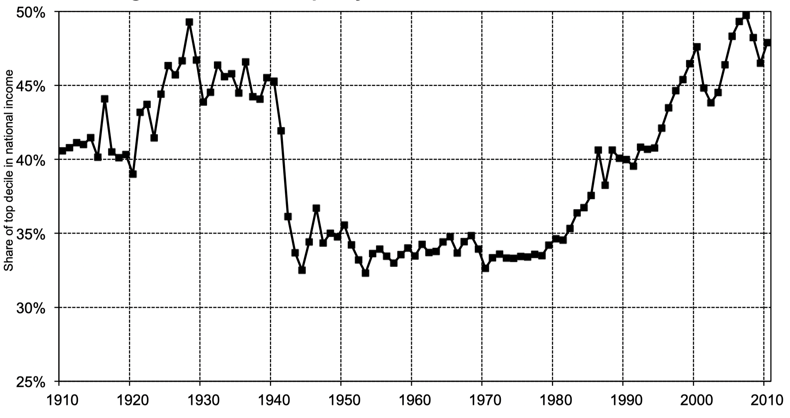
```
Fuente: Piketty (2014)

# Las numerosas caras del subdesarrollo

## Desarrollo humano

- La **dependencia** excesiva del **PIB (o PNB) per cápita** como indicador del desarrollo puede **inducir a errores**.

- Países relativamente prósperos puede salir mal parados en algunos de los indicadores del desarrollo básicos.

| Country | 1993 income | Share Bottom 40% | Share Top 20% |
|--|:--:|:--:|:--:|
| Sri Lanka | 2,990 | 22 | 39 |
| Guatemala | 3,350 | 8 | 63 |

\ 

| Country | Life exp | Inf. Mort. Rate | % Safe water | % Adult literacy |
|--|:--:|:--:|:--:|
| Sri Lanka | 72 | 18 | 60 | 89 |
| Guatemala | 65 | 48 | 62 | 54 |

- La distribución claramente importa, pero no lo es todo: por ejemplo, Pakistán:

| GDPpc | Share Botom 40% | Life exp | Inf. Mort. Rate | % Adult literacy |
|--|:--:|:--:|:--:|:--:|
| 1,898 | 21 | 62 | 91 | 36 |

## Índice de desarrollo humano

- El Programa de las *Naciones Unidas para el Desarrollo (PNUD)* publica el **Human Development Report** desde 1990 con el**Índice de Desarrollo Humano (IDH)**.

- Tres componentes del índice:

  - La esperanza de vida al nacer: *Refleja indirectamente la mortalidad de los lactantes y de los niños*

  - Educación, combinar años de escolaridad promedio/esperados: *Media ponderada del % de adultos que saben leer y escribir (2/3) y tasas de escolarización en ed. primaria, secundaria y terciaria (1/3).*

  - Logaritmo del Ingreso per cápita: *Se ajusta a partir de un umbral (5.000 US$) para darle menos peso a países de ingreso más alto.*

- ¿Cómo combinar peras con manzanas? Crear índices normalizados en cada dimensión:
$$
I_{\mathrm{dim}}=\frac{x-\text { mínimo }}{\text { máximo }-\text { mínimo }}
$$

- Ejemplo: Expectativa de Vida $EV \in [20,83]$. Si $EV \rightarrow 20 \Rightarrow I\rightarrow 0$, mientras $EV \rightarrow 83 \Rightarrow I \rightarrow 1$  .

## Índice de desarrollo humano (cont...)

- IDH una media geométrica de los tres indicadores (con idénticos ponderadores):
$$\mathrm{HDI}=I_{EVida}^{1/3} I_{Educación}^{1/3} I_{Ingresos}^{1/3} \ \ \ \ \in [0,1]$$
- Interpretación: **Proporción del desarrollo último que ha logrado el país**.

- Ventajas: Sencillez y variaciones por dimensión.
  
- Esquema de ponderación es arbitrario, pero es una forma (entre muchas) de combinar indicadores de desarrollo.

- Diferencial de clasificación IDH vs. Ingreso per cápita:
  
  - 2010: Sri Lanka +10, Pakistán -4, Guatemala -13.
  
## Aún así, una alta correlación entre el IDH y el PIB per cápita

```{r fig8, echo=FALSE, out.width="65%"}
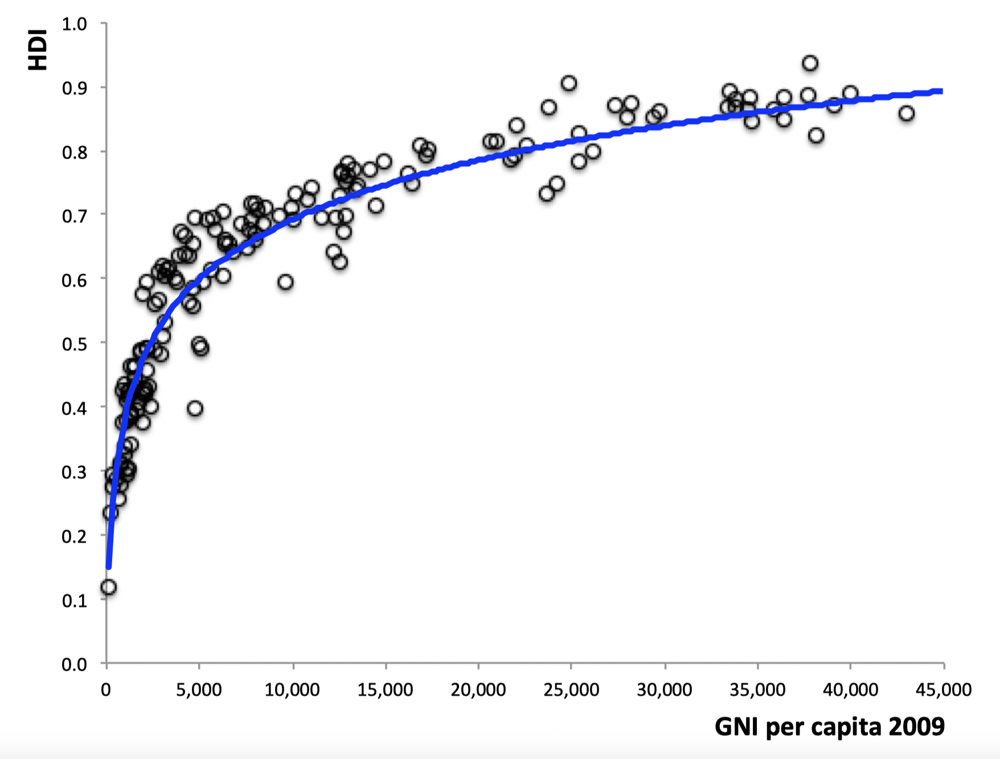
```

## Lo mismo se cumple para los indicadores que lo componen

```{r fig9, echo=FALSE, out.width="70%"}
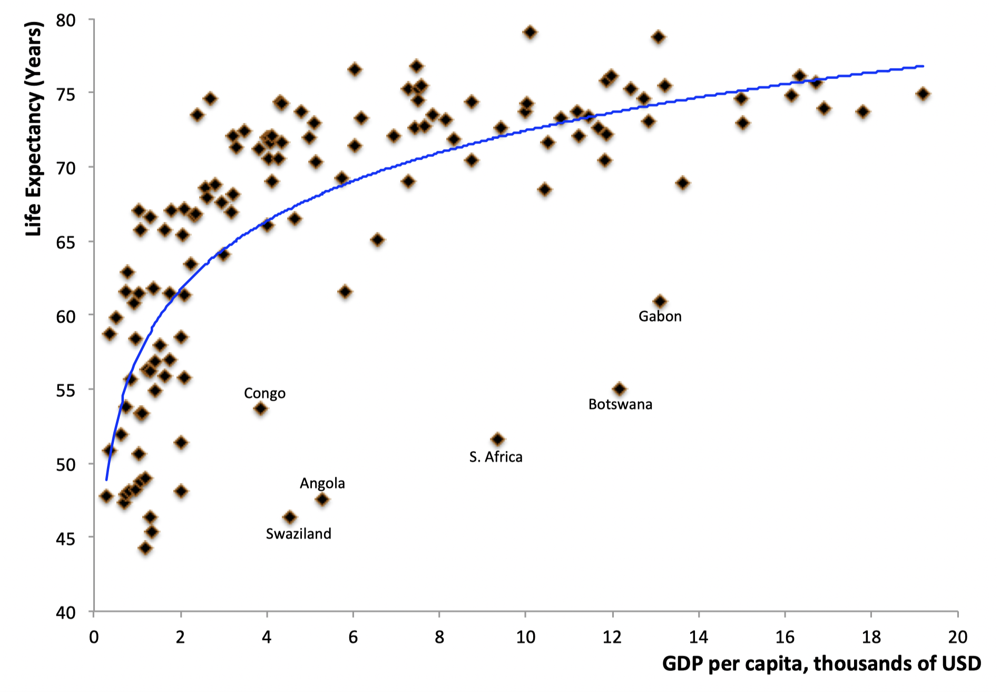
```

## Lo mismo se cumple para los indicadores que lo componen

```{r fig10, echo=FALSE, out.width="70%"}
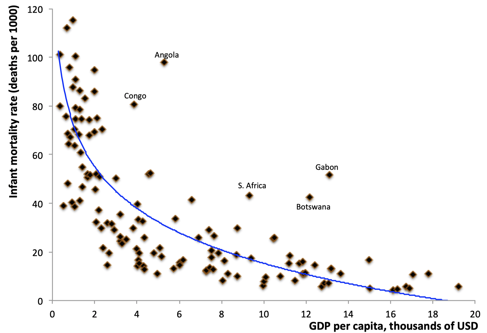
```

## Lo mismo se cumple para los indicadores que lo componen

```{r fig11, echo=FALSE, out.width="65%"}
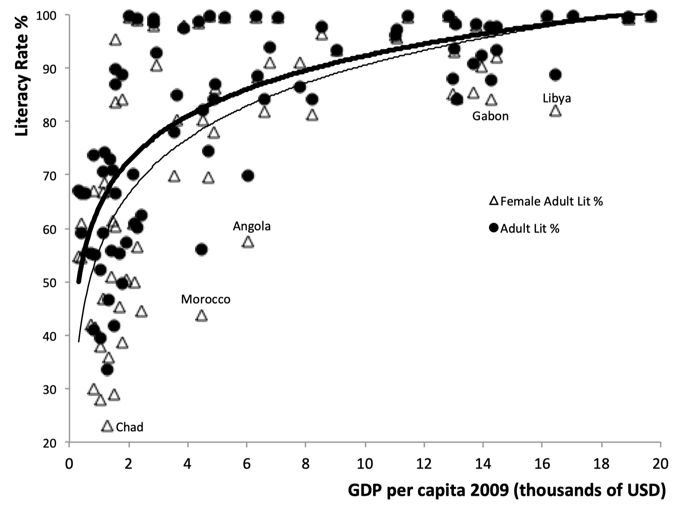
```

# Características estructurales de los países en vías de desarrollo

## Características demográficas

:::{.emph}
Los países muy pobres se caracterizan por tener tanto unas **elevadas tasas de natalidad** como unas **elevadas tasas de mortalidad**. A medida que se desarrollan, las tasas de mortalidad descienden y las tasas de natalidad a menudo siguen siendo altas.
:::

Consecuencias:

- Aumento de la cantidad de producción (más trabajadores) vs. aumento de la población que hace que sea necesario repartir esa producción entre más personas.

  - Efecto negativo predomina si la economía no está dotada de una gran cantidad de capital (físico o humano).  

- La población total es muy joven (elevada la presencia de niños en la población).

  - Total dependencia económica. Consecuencias negativas: pobreza, trabajo infantil y bajo nivel de escolaridad.

## Características demográficas

:::{.center-x}
**Tasas de crecimiento de la población e ingreso per cápita**
:::
```{r fig12, echo=FALSE, out.width="63%"}
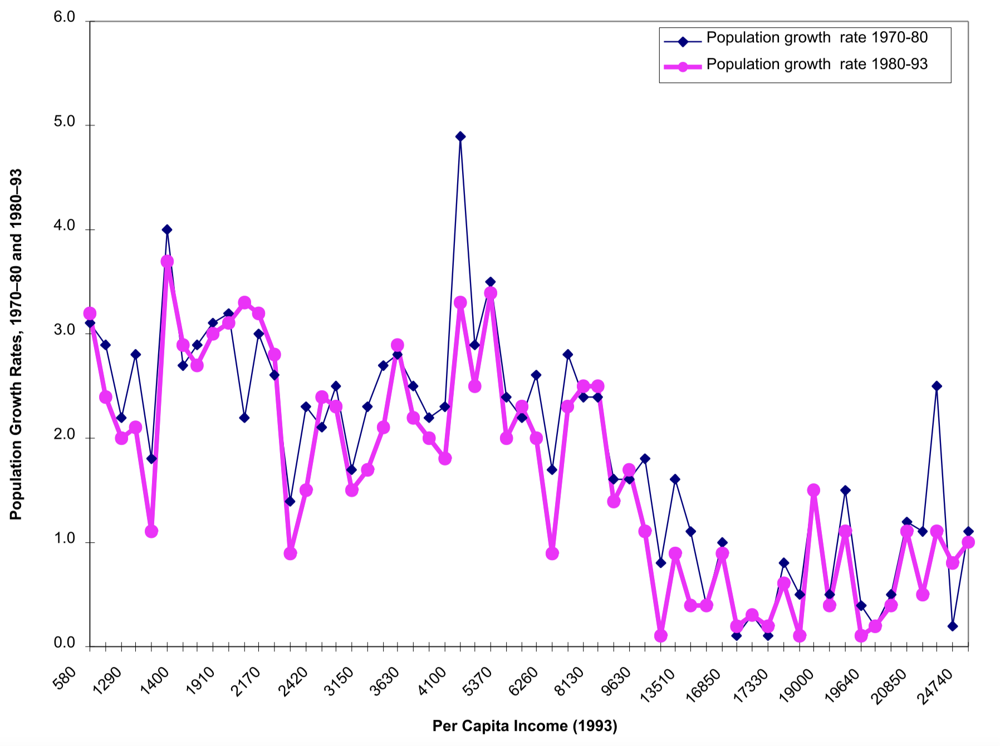
```

## Estructura ocupacional y productiva

:::{.emph}
La **agricultura** representa una proporción significativa de la producción en los países en vías de desarrollo. La **proporción de la población activa** que vive en **zonas rurales** y trabaja en **actividades agrícolas** es elevada.
:::

- La actividad agrícola es una parte importante de la vida de las personas de los países en vías de desarrollo.

  - Contratación de mano de obra campesina, arriendo de la tierra y funcionamiento de los mercados de crédito.

- Aspectos negativos:

  - La intensidad de uso del capital es mínima y la tierra está sobreexplotada.

  - Es una actividad de alto riesgo económico (clima, disponibilidad de agua, disponibilidad de fertilizantes y pesticidas, ...)

  - En general los agricultores no pasan de la mera subsistencia o viven con un mínimo de confort.


## Estructura ocupacional y productiva

:::{.center-x}
**Proporción de la población activa que trabaja en la agricultura e ingreso per cápita**
:::
```{r fig13, echo=FALSE, out.width="73%"}
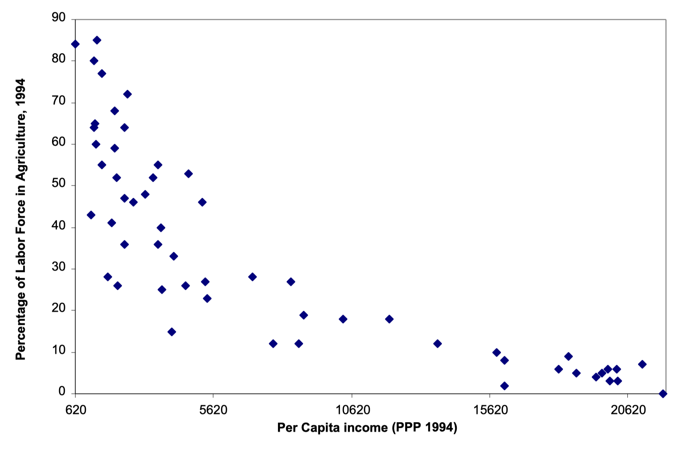
```

## Rápida migración de las zonas rurales a las urbanas

:::{.emph}
Una enorme cantidad de mano de obra **emigra de las zonas rurales a las urbanas**, lo cual es resultado de la fuerza de **expulsión de la agricultura** (pobreza y falta de tierra) como de la **fuerza de atracción de zonas urbanas** (salarios altos y mayor protección).
:::

- El crecimiento urbano supera el crecimiento demográfico total, lo cuál genera presiones sobre las ciudades.

  - La migración no es negativa, pero muchos procesos se aceleran y esta aceleración genera enormes tensiones.

- Observar una alta proporción de la población en países en vías de desarrollo en el sector servicios revela estas tensiones.

  - En países desarrollados una elevada proporción de la población trabaja enm el sector servicios (mayor ingreso, mayor demanda por servicios).

  - ¿porqué observamos algo similar en país en vías de desarrollo? El sector servicios de estos países es sintomático del desarrollo de un sector no organizado o informal 
  
  - Problema de clasificación: limpiabotas, pequeños comerciantes,  intermediarios, ... son servicios.


## Rápida migración de las zonas rurales a las urbanas

:::{.center-x}
**Mano de obra no agrícola que trabaja en los servicios e ingreso per cápita**
:::
```{r fig14, echo=FALSE, out.width="70%"}
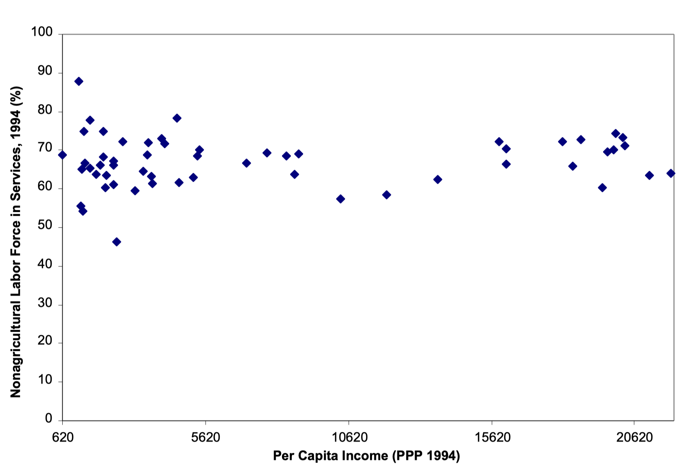
```

## El comercio internacional

:::{.emph}
Todos los países participan en el **comercio internacional**. La diferencia entre países en vías de desarrollo y países desarrollados está en la **composición del comercio**. Los primero son exportadores de **productos básicos** (materias primas, los cultivos, y textiles y artículos de la industria ligera), mientras los segundos exportan **bienes manufacturados** (desde bienes de capital hasta bienes de consumo durables).
:::

Explicación: *teoría de la ventaja comparativa*. Los países se especializan en la exportación de los bienes con ventaja relativa de costos.

- Abundancia relativa de trabajo no cualificado $\rightarrow$ exportación de bienes con uso intensivo de este factor.

Consecuencias:

- Los precios de los productos básicos son propensos a experimentar grandes fluctuaciones (ingresos inestables.).

- A medida que los productos básicos pierdan importancia en la cesta de consumo sus precios tenderán a descender (términos de intercambio a la baja).

- La tecnología suele asimilarse utilizándola.


## El comercio internacional

:::{.center-x}
**Proporción del total de exportaciones correspondiente a las exportaciones de productos básicos**
:::
```{r fig15, echo=FALSE, out.width="75%"}
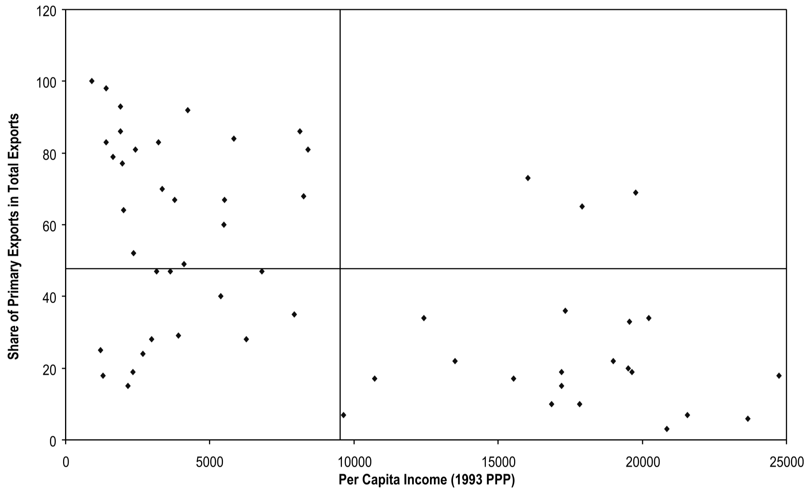
```

## El comercio internacional

:::{.center-x}
**Variaciones de la relación real de intercambio, 1980-93**
:::
```{r fig16, echo=FALSE, out.width="62%"}
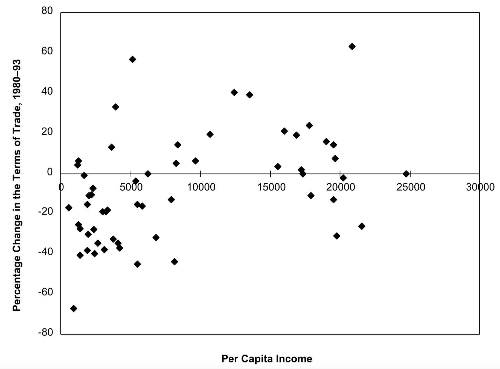
```

## El comercio internacional

:::{.center-x}
**Proporción del total de importaciones correspondiente a las importaciones de productos básicos**
:::
```{r fig17, echo=FALSE, out.width="62%"}
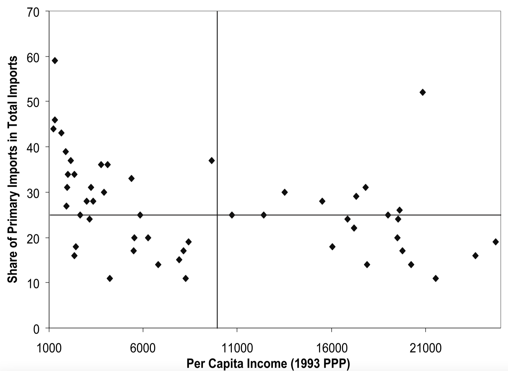
```

# Crecimiento dispar y aspiraciones

## Aspiraciones y crecimiento dispar

- En la era de la información, los estándares de vida de todos están en total exposición (y además en una carrera  acelerada):

  - Se generan aspiraciones y frustraciones sociales.

  - No está claro si esta exposición conduce a una mejora (incentivo) o a la desesperación (desincentivo).

\ 

- Ghatak-Ghosh-Kotwal, semanario económico y político, 19 de abril de 2014

> "[El término anterior es uno] en el que el crecimiento se aceleró, los indues comenzaron a ahorrar e invertir más, la inversión extranjera llegó rápidamente, [y] la pobreza disminuyó drásticamente... [Pero] el crecimiento también puede desatar poderosas aspiraciones así como frustraciones, y los partidos políticos que pueden aprovechar estas emociones cosechan los beneficios".

## Elecciones generales en India 2014


- Mishra, The Guardian, 16 de mayo de 2014 

> "[G]ente con aspiraciones dramáticamente elevadas pero en su mayoría incumplibles se han vuelto vulnerables a los demagogos que prometen una regeneración nacional. Es un tigre con furia desevocada... que Modi ha tratado de montar desde Gujarat a Nueva Delhi.

\ 

- Tocqueville, 1856

> "Los franceses encontraron su posición tanto más intolerable cuanto mejor se hizo."

