```{r setup, include=FALSE}
knitr::opts_chunk$set(echo = FALSE, fig.align = "center",
                      message = FALSE, warning = FALSE)
knitr::opts_chunk$set(fig.dim=c(9, 6), fig.retina=2, out.width="100%")
```

## ¿Qué vamos a estudiar en este curso?

- El [crecimiento y el desarrollo económicos]{.emph} son los **principales objetivos** de la mayoría de los países del mundo. 

- ¿Qué significa esto? **Mejorar el ingreso, el bienestar y la capacidad económica**.

- ¿Cómo medimos y evaluamos?

  - **Nivel de bienestar material alto (calidad física de vida) y accesible a todos**: entorno saludable, vivienda, buena alimentación, acceso a diversidad de productos, ocio y entretenimiento, ....

  - **Intangibles**: libertades y los derechos políticos, desarrollo intelectual y cultural, estabilidad de la familia, baja tasa de delincuencia, no discriminación, ...

- ¿Por donde empezamos? Historicamente el **PIB**. Ahora reconocemos la multidiminesionalidad del desarrollo.

## ¿Debate Lucas vs. Streeten?

Dos **destacados economistas** hablando sobre el desarrollo económico:

:::: {.columns}

::: {.column width="50%"}
[Rober Lucas (1998)]{.emph}: Enfoque en el ingreso per cápita.

\ 

*Los rasgos universales del desarrollo económico (la salud, la esperanza de vida, la alfabetización, etc.) derivan de una manera natural del crecimiento del PNB per cápita quizá con el simple paso del tiempo.*
:::

::: {.column width="50%"}
[Paul Streeten, 1994]{.emph}:  Énfasis en mutidiminsionalidad.

\ 

*La correlación entre el PIB y otros aspectos deseados del desarrollo no es automática (o puede no existir). El PIB per cápita debe complementarse con otros indicadores directamente para tomar en cuenta el carácter "multidimensional" del desarrollo.*
:::

::::

# Crecimiento y distribución del ingreso mundial {background-color="#CED3DC"}

## PIB Per Cápita: Desafíos de Medición y Comparación

[Definición:]{.emph} *El valor promedio del ingreso de cada habitante de un país en un período determinado*
$$PIB_{pc} = \frac{PIB}{Población}$$


Comparaciones internacionales:

- Método de Tipo de Cambio: 

    - Convierte monedas locales usando tipos de cambio de mercado
    - Sesgos del método: (1) Subregistro de ingresos en países en desarrollo (subreporte, autoconsumo), (2) Precios de bienes no transables más bajos en países pobres 

- Método PPA:

    - Valora productos a "precios internacionales" (canasta).
    - Reduce disparidades significativamente: Países pobres parecen relativamente más ricos.

## Existe enorme variación en el PIB per cápita entre países

```{r fig1, echo=FALSE, out.width="65%"}
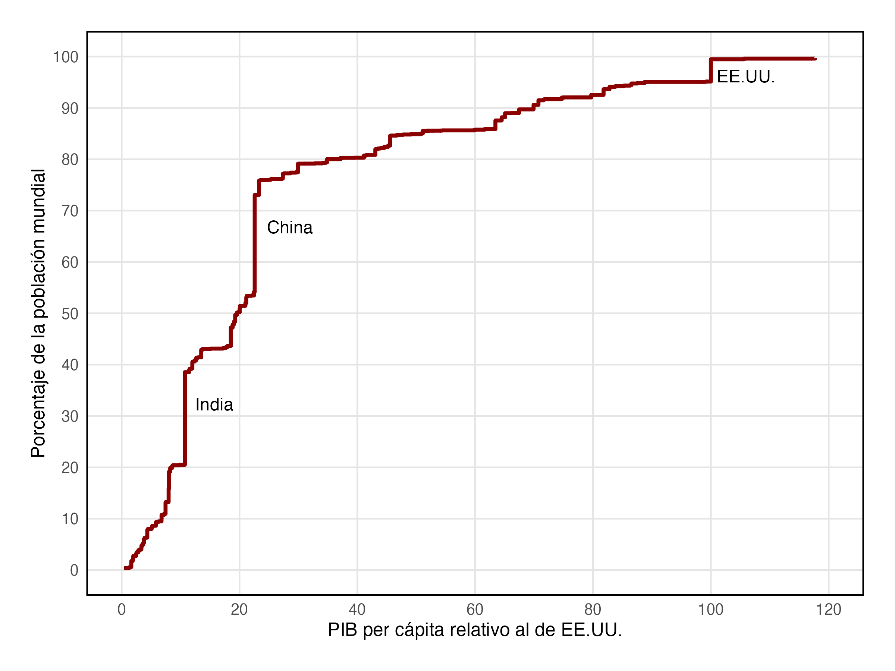
```

Más de 70% de la población mundial tienen el 20% del ingreso mundial.

## La distribución mundial del ingreso muestra una considerable inequidad
```{r fig2, echo=FALSE, out.width="65%"}
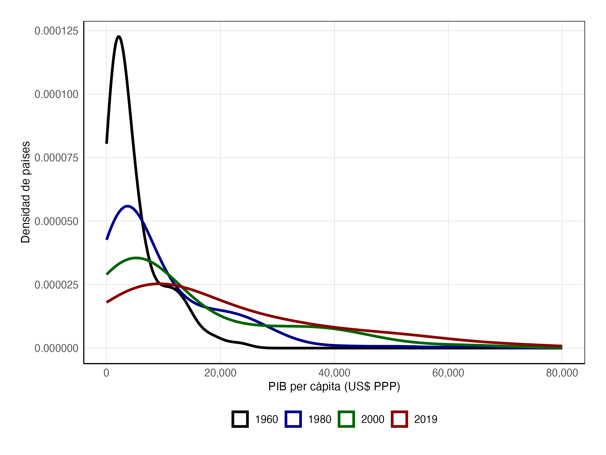
```

Suiza es más de 150 veces más rico que la República Democrática del Congo, más de 44 veces más rico que Bangladesh.

## La inequidad en la distribución se ha mantenido estable en el tiempo

```{r fig3, echo=FALSE, out.width="65%"}
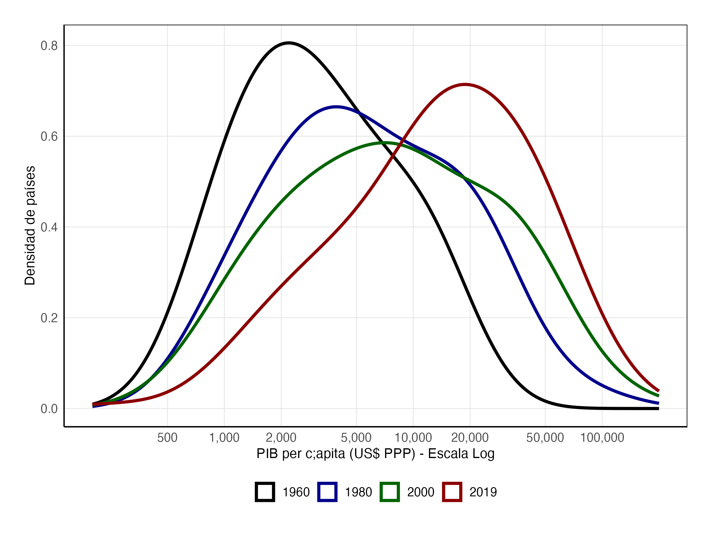
```

Mintras la brecha abosulta se incrementado, la brecha relativa entre países se ha mantenido mas o menos estable.

## Las tasas de crecimiento también varían considerablemente entre países

:::{.center-x}
Variación porcentual anual del ingreso PPA de diferentes países en relación con la de EE.UU.
:::
```{r fig4, echo=FALSE, out.width="65%"}
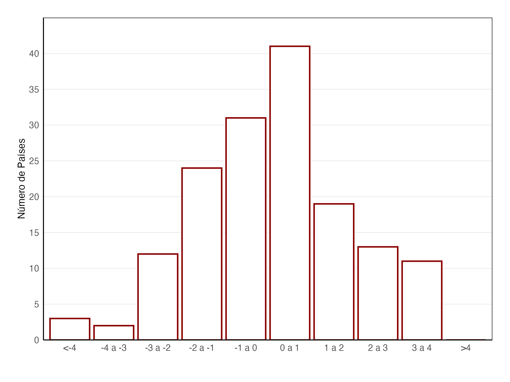
```

Hemos observado crecimiento consiste (países desarrollados), milagros del crecimiento (países del Asia), y desastres del crecimiento (países del África)

## El poder del crecimiento compuesto

Por definición, duplicar una variable que crece a tasa $x \%$ en $T$ periodos requiere:
$$[1+(x / 100)]^{T}=2$$

Entonces:
$$T \ln _{e}[1+(x / 100)]=\ln _{e} 2$$

Pero como $\ln _{e} 2 \simeq 0.7$, y para $x/100$ pequeño $\ln _{e}(1+x/100) \simeq x/100$, por tanto:
$$T \simeq 70/x$$

[Una buena aproximación: **70 dividido la tasa de crecimiento anual** años.]{.emph}

- Crecimiento 1%: 70 años
- Crecimiento 2%: 35 años
- Crecimiento 3%: 23 años

## ¿De donde vienen las diferencias de ingreso entre países?

```{r crec_hist, echo=FALSE, out.width="65%"}
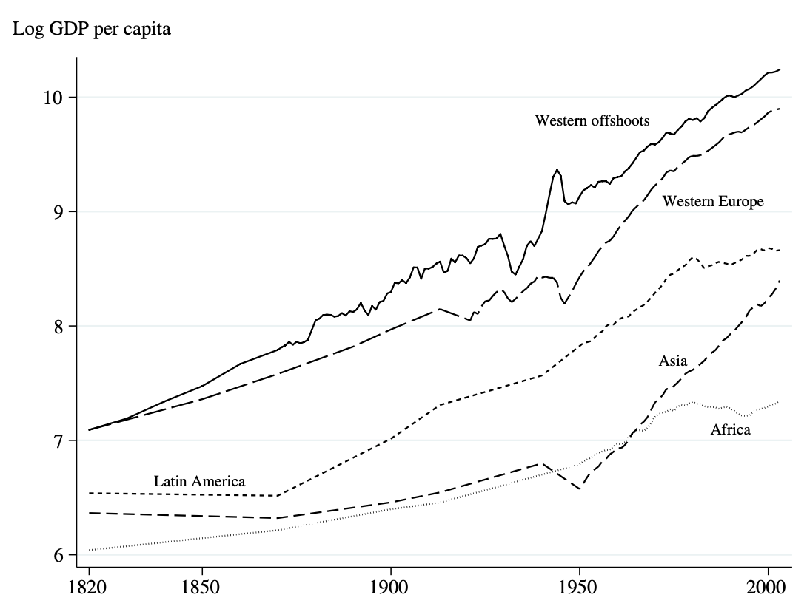
```

## La posición relativa de los países ha ido cambiando de acuerdo a su crecimiento

:::: {.columns}

::: {.column width="30%"}
Siguiendo a Quah (1993):

1. ingreso <1/4 prom. mundial

2. ingreso entre 1/4 y 1/2 prom. mundial

3. ingreso entre 1/2 y 1 prom. mundial

4. ingreso entre 1 y 2 prom. mundial

5. ingreso >2 prom. mundial
:::

::: {.column width="70%"}

:::{.center-x}
Matriz de Movilidad
:::
```{r fig5, echo=FALSE, out.width="80%"}
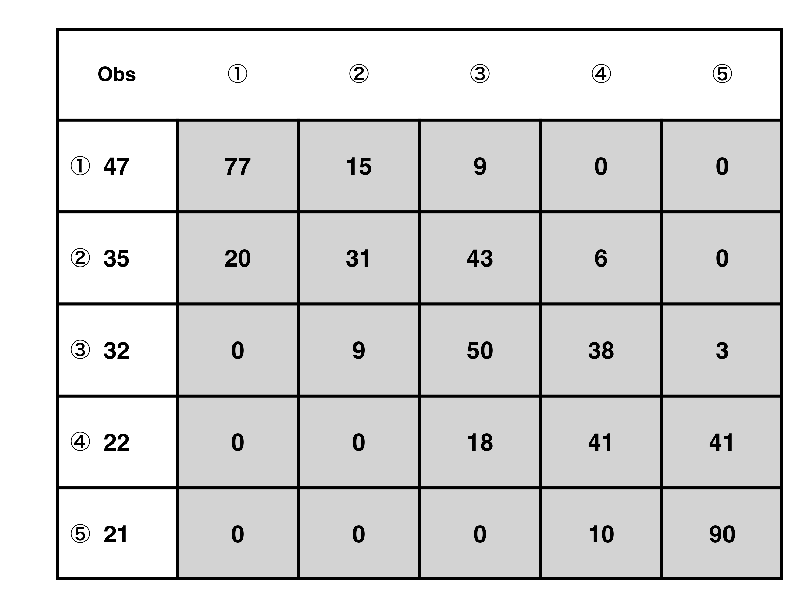
```
:::

::::

# Más allá del PIB per cápita {background-color="#CED3DC"}

## Índice de Desarrollo Humano

- El Programa de las *Naciones Unidas para el Desarrollo (PNUD)* publica el **Human Development Report** desde 1990 con el**Índice de Desarrollo Humano (IDH)**.

- Tres componentes del índice:

  - La esperanza de vida al nacer

  - Educación, combinar años de escolaridad promedio/esperados

  - Logaritmo del Ingreso per cápita

- ¿Cómo combinar peras con manzanas? Crear índices normalizados en cada dimensión:
$$
I_{\mathrm{dim}}=\frac{x-\text { mínimo }}{\text { máximo }-\text { mínimo }}
$$

- Ejemplo: Expectativa de Vida $EV \in [20,83]$. Si $EV \rightarrow 20 \Rightarrow I\rightarrow 0$, mientras $EV \rightarrow 83 \Rightarrow I \rightarrow 1$  .

## Índice de Desarrollo Humano (cont...)

- IDH una media geométrica de los tres indicadores (con idénticos ponderadores):
$$\mathrm{HDI}=I_{EVida}^{1/3} I_{Educación}^{1/3} I_{Ingresos}^{1/3} \ \ \ \ \in [0,1]$$
- Interpretación: **Proporción del desarrollo último que ha logrado el país**.

- Ventajas: Sencillez y variaciones por dimensión.
  
- Esquema de ponderación es arbitrario, pero es una forma (entre muchas) de combinar indicadores de desarrollo.

## Alta correlación entre el IDH y el PIB per cápita

```{r fig7, echo=FALSE, out.width="65%"}
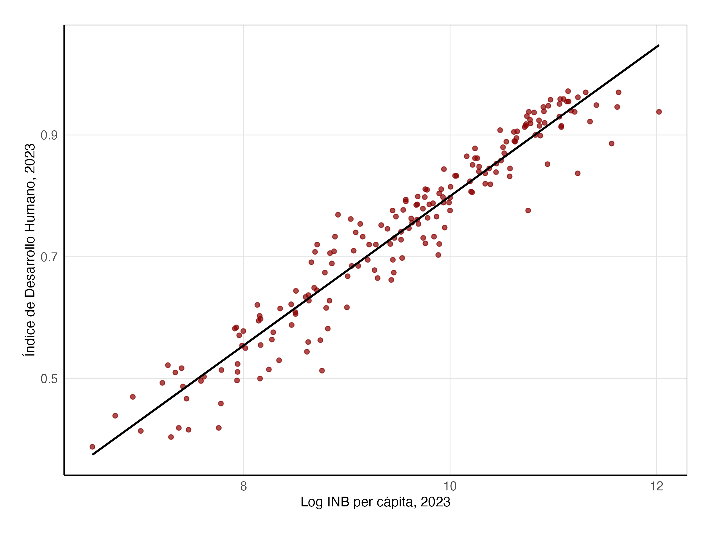
```

## Lo mismo se cumple para los indicadores que lo componen

```{r fig8, echo=FALSE, out.width="65%"}
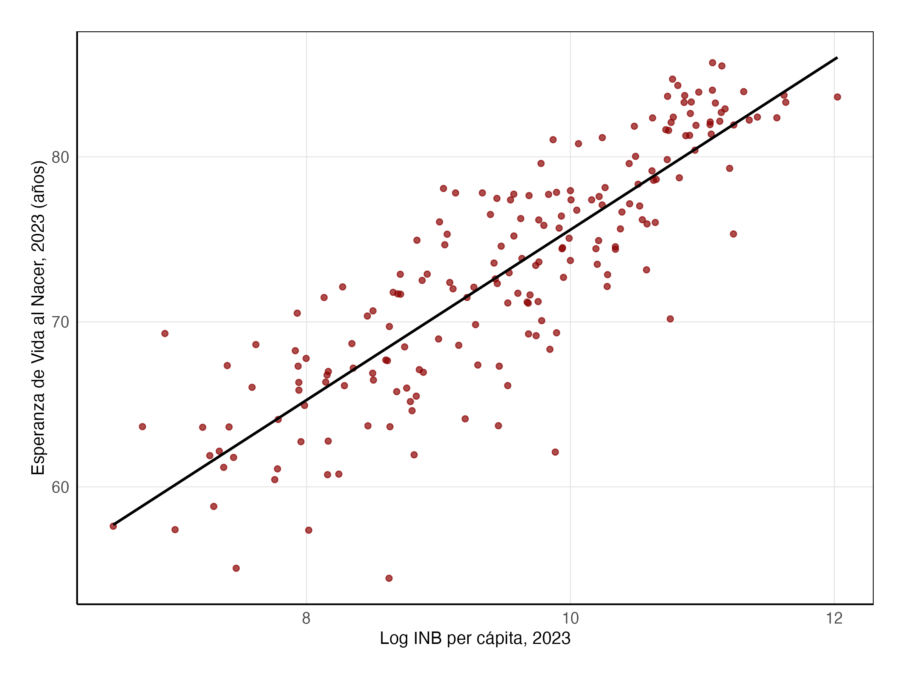
```

## Lo mismo se cumple para los indicadores que lo componen

```{r fig10, echo=FALSE, out.width="65%"}
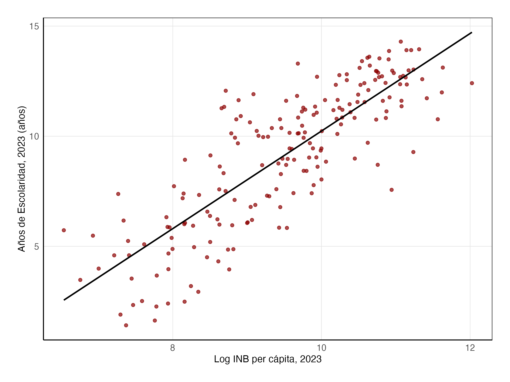
```

## Al final, altos niveles de ingreso reflejan altos estándares de vida.

```{r fig6, echo=FALSE, out.width="65%"}
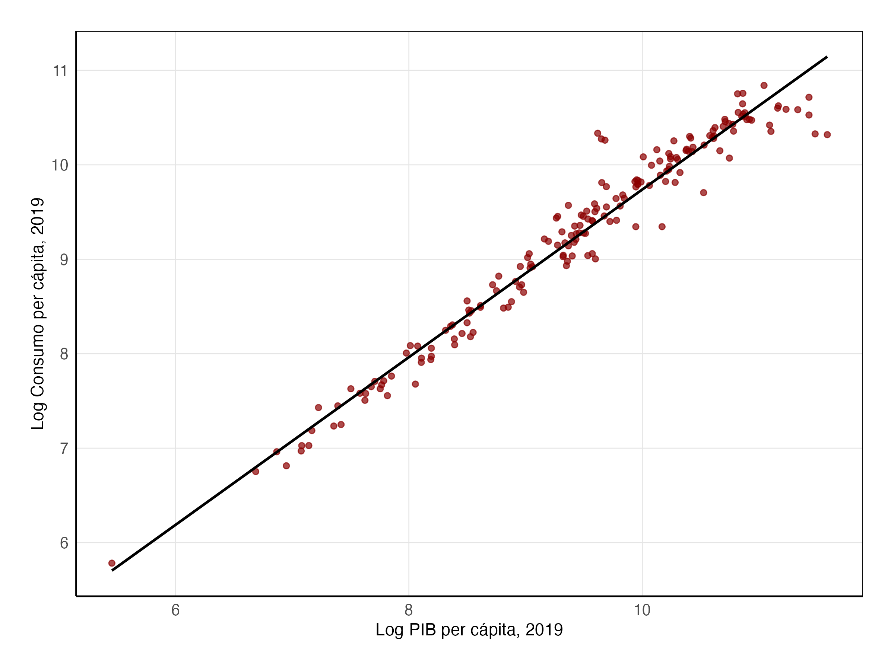
```

# Mirando dentro los países {background-color="#CED3DC"}

## Desigualdad e ingreso per cápita: ahora el rango completo

```{r fig_ineq1, echo=FALSE, out.width="70%"}
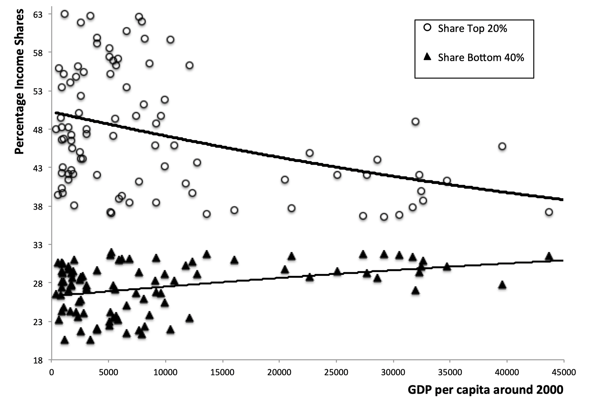
```

## Desigualdad e ingreso per cápita: ¿en la parte baja se ve una u-invertida?

```{r fig_ineq2, echo=FALSE, out.width="70%"}
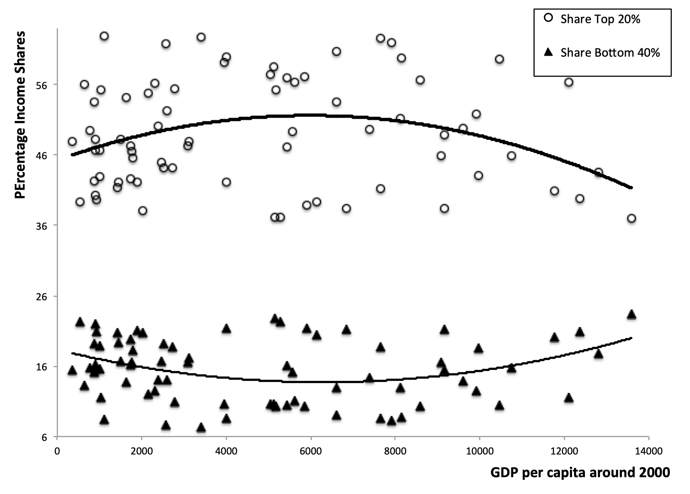
```

## Cambios desiguales y compensatorios

:::{.emph}
**Hipótesis de la U invertida de Kuznets (1995)**: La desigualdad puede aumentar y después disminuir a medida que pasamos de ingresos per cápita más bajos a más altos.
:::

- Los datos inducen a pensar que el desarrollo económico es un proceso inherentemente desigual.

  - Es posible que al principio éste beneficie más que proporcionalmente a los grupos más ricos de la sociedad.
  
  - Ingreso per cápita muy bajo: Es difícil reducir la prop. de individuos bajo un umbral de ingreso.
  
  - Ingreso per cápita más altos: Mejoras económicas tienden a estar distribuidas de una manera más igualitaria.

- Este proceso no es inevitable:

  - Medidas de acceso a infraestructura y recursos (como servicios sanitarios y la educación), generan que el crecimiento económico se distribuya de una manera más uniforme.
  
# Hechos estilizados del crecimiento (Kaldor, 1961) {background-color="#CED3DC"}

## La tasa de crecimiento promedio del PIB per cápita ha sido positiva y relativamente constante

:::: {.columns}

::: {.column width="50%"}
:::{.center-x}
EEUU
:::
```{r fig11, echo=FALSE, out.width="100%"}
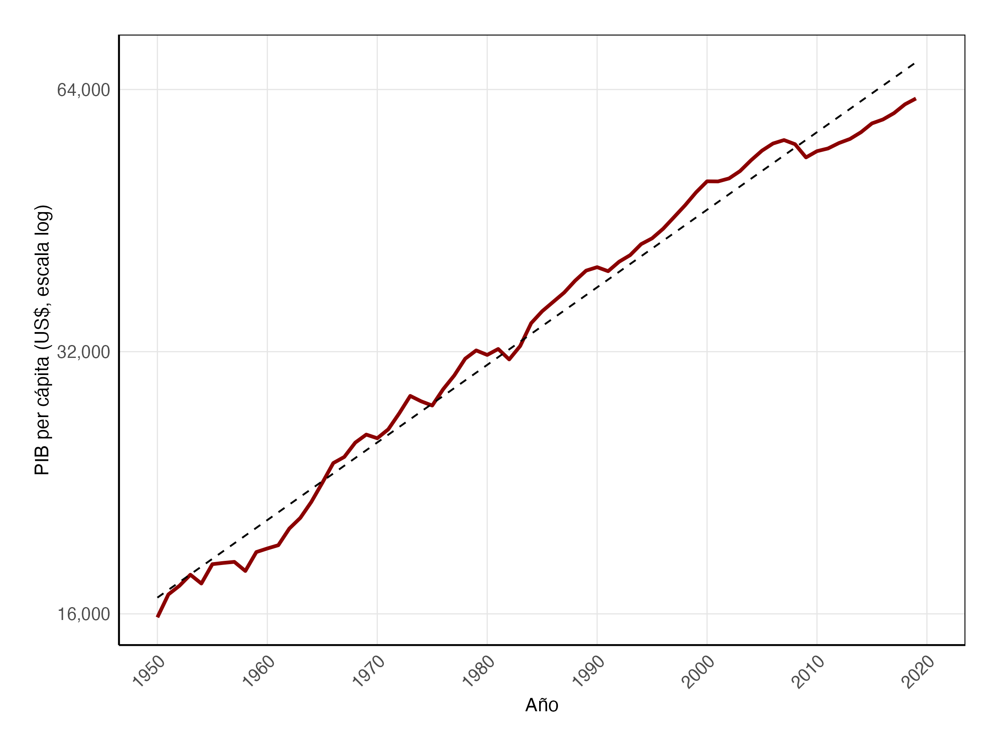
```
:::

::: {.column width="50%"}

:::{.center-x}
Chile
:::
```{r fig12, echo=FALSE, out.width="100%"}
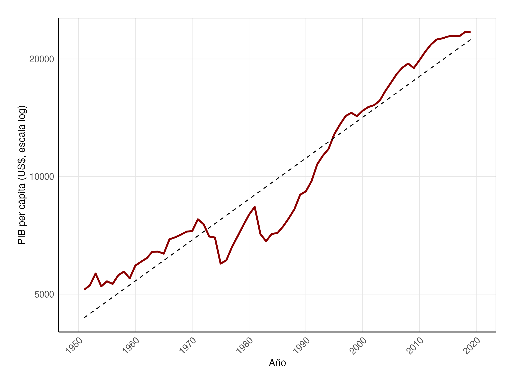
```
:::

::::

## La tasa real de retorno del capital no muestra tendencia (datos para EEUU)

```{r fig13, echo=FALSE, out.width="65%"}
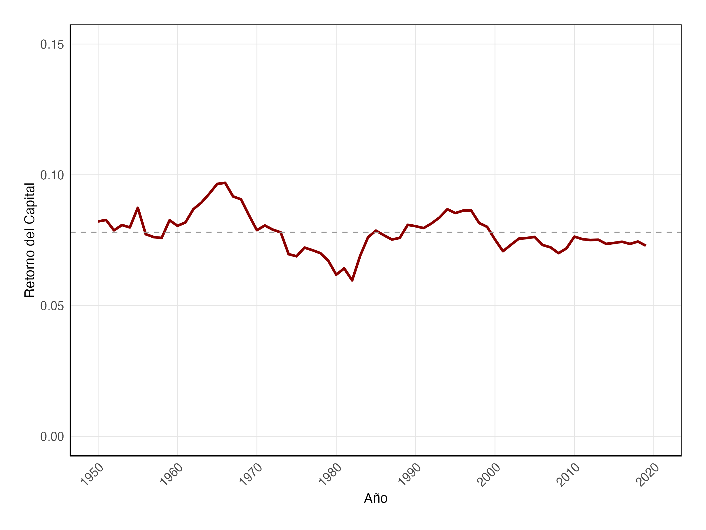
```

## La participación del PIB obtenida por la compensación laboral (por ejemplo, salarios) no muestra tendencia (datos para EEUU)

```{r fig14, echo=FALSE, out.width="65%"}
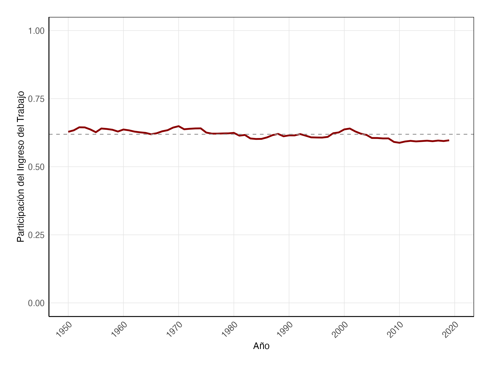
```

## La participación del PIB destinada a la formación de capital no muestra tendencia (datos para EEUU)

```{r fig15, echo=FALSE, out.width="65%"}
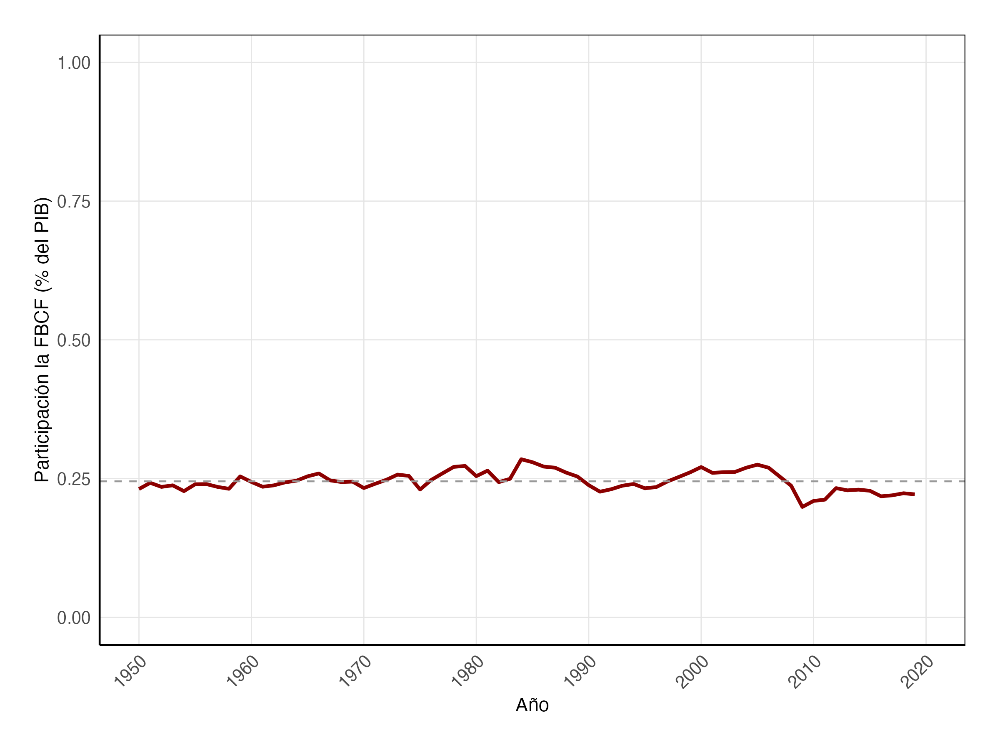
```