```{r setup, include=FALSE}
knitr::opts_chunk$set(echo = FALSE, fig.align = "center",
                      message = FALSE, warning = FALSE)
knitr::opts_chunk$set(fig.dim=c(9, 6), fig.retina=2, out.width="100%")
```

# Introducción {background-color="#CED3DC"}

## Introducción

:::{.emph}
Un aumento de la tasa de crecimiento de un punto porcentual puede significar el estancamiento o la prosperidad en el plazo de una generación!!
:::

**Robert Lucas** afirmó lo siguiente en sus **Marshall Lectures** de la Universidad de Cambridge:

> Las tasas de crecimiento de la renta real per cápita son ... diversas, incluso cuando se analiza un largo periodo ... Las rentas de la India se duplicarán cada 50 años; las de Corea cada 10. La situación de un indio será, en promedio, dos veces mejor que la de su abuelo; la de un coreano, 32 veces mejor ...

> No entiendo cómo se pueden observar cifras como éstas sin ver que representan posibilidades. ¿Podría tomar el Gobierno de la India alguna medida que permitiera que la economía india creciera como la de Indonesia o la de Egipto? En caso afirmativo, ¿cuál exactamente? En caso negativo, ¿qué hay en la "naturaleza de la India" que lo impida? Las consecuencias que tienen este tipo de cuestiones para el bienestar humano son sencillamente inmensas: cuando se piensa en ellas, resulta difícil pensar en ninguna otra cosa.

## Crecimiento económico moderno

::::{.columns}

::: {.column width="50%"}
- El crecimiento económico es un **fenómeno relativamente moderno** (Kuznets, 1996)

- **Simple cálculo**: creciendo a 2%, el PIB per cápita se duplica en 35 años.

- **Maddison (2008) y Bolt and Van Zanden (2013)**: Los países de la OCDE se multiplicaron por 3 en 1850-1930, y por 5.2 entre 1930-2010.
:::

::: {.column width="50%"}
:::{.center-x}
**PIB per cápita de algunos países de la OCDE, 1850-2010**
:::

:::{.small}
| Country | 1850 | 1930 | 2010 | 1930/1850 |  2010/1930 |
| :--- | :---: | :---: | :---: | :---: | :---: |
| Austria | 1,650 | 3,586 | 24,096 |  2.2 |  6.7 |
| Belgium | 1,847 | 4,979 | 23,557 | 2.7  | 4.7  |
| Canada | 1,330 | 4,811 | 24,941 | 3.6  | 5.2  |
| Denmark | 1,767 | 5,341 | 23,513 |  3.0 | 4.4 |
| Finland | 911 | 2,666 | 23,290 |  2.9 | 8.7 |
| France | 1,597 | 4,532 | 21,477 | 2.8  | 4.7  |
| Germany | 1,428 | 3,973 | 20,661 |  2.8 | 5.2 |
| Japan | 681 | 1,850 | 21,935 | 2.7 | 11.9 |
| Netherlands | 2,355 | 5,603 | 24,303 | 2.4 | 4.3 |
| Norway | 956 | 3,627 | 27,987 | 3.8 | 7.7 |
| Sweden | 1,076 | 4,238 | 25,306 | 3.9 | 6.0 |
| United Kingdom | 2,330 | 5,441 | 23,777 | 2.3 | 4.4 |
| United States | 1,849 | 6,213 | 30,491 | 3.4 | 4.9 |
:::

:::
::::

## Crecimiento económico moderno


::::{.columns}
::: {.column width="40%"}
- A pesar de altas tasas de crecimiento de varios países en desarrollo, hay aún **mucho por hacer para ponerse al día**.

- Estos países no solo necesitan crecer, deben **crecer a tasas que superen con creces la experiencia histórica**. 

- El mundo desarrollado ya existe, y su **acceso a recursos económicos** no solo es mucho mayor que el de los países en desarrollo, sino que el **poder** que otorga este acceso está a la vista.
:::

:::{.column width="60%"}

:::{.center-x}
**PIB per cápita de algunos países en vías de desarrollo en relación al de EE.UU.**
:::

:::{.small}
| Country       | 1982  | 1996  | 2009  | | Country      | 1982  | 1996  | 2009  |
| :---          | :---: | :---: | :---: |:---:| :---         | :---: | :---: | :---: |
| Argentina     | 34.8  | 28.8  | 31.6  | | India        | 3.7   | 4.4   | 7.2   |
| Bangladesh    | 2.4   | 2.2   | 3.1   | | Indonesia    | 5.7   | 8.6   | 9.1   |
| Botswana      | 15.8  | 22.4  | 29.1  | | Malaysia     | 20.9  | 28.3  | 30.5  |
| Brazil        | 27.6  | 22.3  | 22.5  | | Mexico       | 42.7  | 29.7  | 29.8  |
| Chile         | 19.4  | 27.8  | 31.3  | | Nigeria      | 5.4   | 4.1   | 4.8   |
| China         | 2.3   | 5.8   | 14.8  | | Pakistan     | 5.1   | 5.5   | 5.7   |
| Cote d'Ivoire | 9.9   | 5.2   | 3.7   | | Rwanda       | 3.3   | 1.9   | 2.5   |
| Egypt         | 10.5  | 10.1  | 12.3  | | South Africa | 34.8  | 22.0  | 22.3  |
| Ethiopia      | 2.3   | 1.5   | 2.0   | | Sri Lanka    | 6.5   | 7.3   | 10.4  |
| Ghana         | 3.3   | 2.8   | 3.4   | | Thailand     | 9.5   | 17.1  | 17.4  |
:::

:::
::::

# Punto de partida de la teoría del crecimiento económico {background-color="#CED3DC"}

## Stock de capital: fuerte correlación con el ingreso per cápita

:::{.center-x}
**logaritmo del PIB per cápita y logaritmo del valor del capital per cápita, 2014**
:::
```{r fig1, echo=FALSE, out.width="70%"}
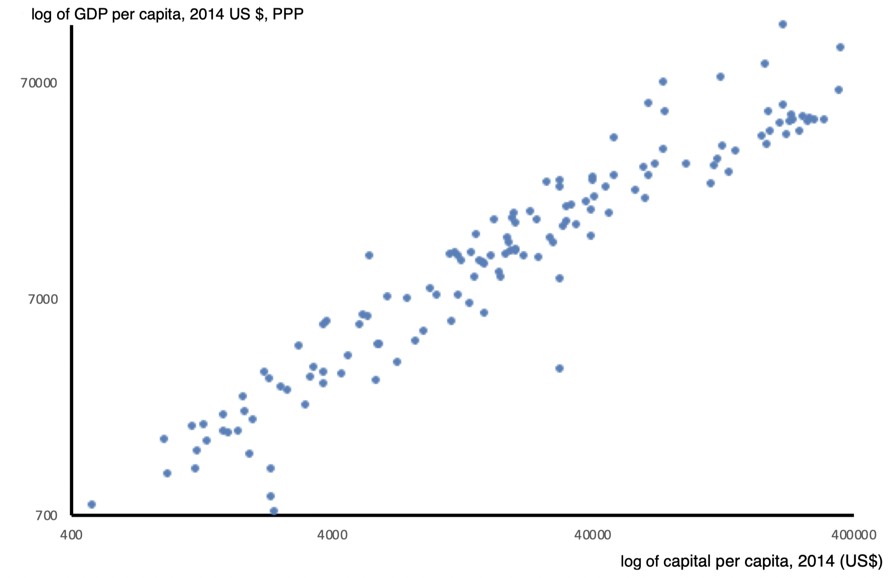
```


## Stock de capital: fuerte correlación con el ingreso per cápita

:::{.center-x}
**logaritmo del PIB per cápita y logaritmo del valor del capital per cápita, 2014**
:::
```{r fig2, echo=FALSE, out.width="66%"}
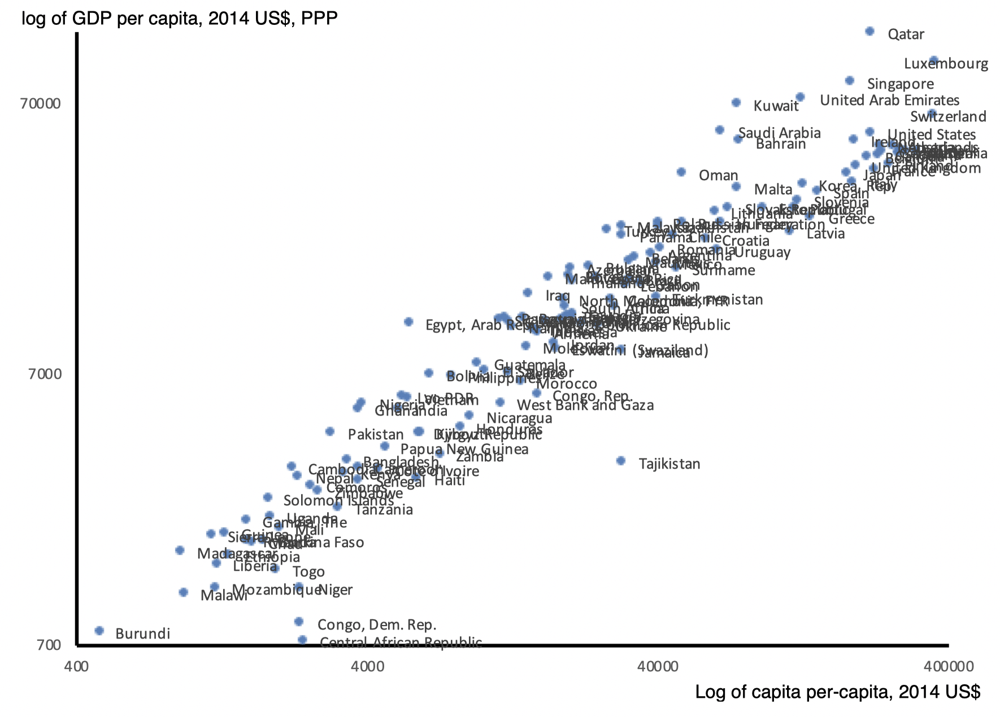
```


## Stock de capital: fuerte correlación con el ingreso per cápita

- Si esta correlación es fuerte, ¿no es la acumulación de capital la respuesta?

- Temas a considerar:

  - Capacidad y motivos de ahorro.

  - Cómo se traducen los ahorros en producción.

- Eso nos lleva a la [teoría del crecimiento económico]{.emph}.

# El Modelo de Solow {background-color="#CED3DC"}

## Producción

Asumimos que el PIB real se produce de acuerdo a
$$Y_t = K_t^{\alpha} (A_tL_t)^{1-\alpha}$$
donde

- $K_t$ es el stock de capital físico (ej. edificios, equipos)
- $L_t$ es el número de trabajadores/personas
- $A_t$ es el nivel de productividad; qué tan eficientemente usamos capital y trabajo
- $\alpha$ nos dice qué tan importante es el capital en relación al trabajo

## Rendimientos constantes

Esta función de producción tiene **rendimientos constantes a escala**. Si duplicas los insumos rivales $K_t$ y $L_t$, el producto se duplica ($A_t$ es no-rival, se discute más adelante),
$$(zK_t)^{\alpha} (A_t z L_t)^{1-\alpha} = z^{\alpha}z^{1-\alpha} K_t^{\alpha} (A_tL_t)^{1-\alpha} = zY$$
entonces tenemos rendimientos constantes porque $\alpha + (1-\alpha) = 1$.

## PIB per cápita

El PIB per cápita se define como $y_t = Y_t/L_t$. Podemos escribir esto como:
$$y_t = \frac{Y_t}{L_t} = \frac{K_t^{\alpha}(A_tL_t)^{1-\alpha}}{L_t} = \left(\frac{K_t}{A_t L_t}\right)^{\alpha} A_t.$$

- $K_t/A_tL_t$ es a veces llamado "capital por unidad de eficiencia". La tasa de retorno del capital dependerá de esta razón, y a lo largo de una SCB esta razón terminará siendo constante.
- Esto significa que el término de productividad "extra" $A_t$ impulsará el crecimiento del PIB per cápita.

## La tasa de crecimiento

Tomamos logaritmos y derivadas de $y_t$. Empezamos con logaritmos:
$$\log y_t = \alpha (\log K_t - \log A_t - \log L_t) + \log A_t.$$
y luego tomamos la derivada respecto al tiempo
$$g_y = \alpha (g_K - g_A - g_L) + g_A.$$

- El término en paréntesis representa Crecimiento transicional impulsado por la acumulación de capital; esto genera transiciones lentas.
- El término de crecimiento de productividad $g_A$ permanece e impulsa el crecimiento a lo largo de la SCB.

## Salarios y el retorno del capital

Esto se conecta con las otras partes de la SCB. Asumimos que un gran número de empresas competitivas en la economía producen producto usando la función anterior, y tratan de maximizar beneficios
$$\pi_t = Y_t - w_tL_t - r_tK_t.$$
donde $w_t$ es el salario y $r_t$ es el retorno del capital. Sus condiciones de primer orden (ej. salario igual producto marginal) son
$$w_t = \frac{\partial Y_t}{\partial L_t} = (1-\alpha)\frac{Y_t}{L_t}$$
$$r_t = \frac{\partial Y_t}{\partial K_t} = \alpha \frac{Y_t}{K_t}.$$

## Participación del trabajo en el PIB

Las condiciones de primer orden implican
$$\frac{w_tL_t}{Y_t} = 1-\alpha.$$
La función de producción está diseñada para asegurar que la participación del trabajo en el PIB sea constante, para coincidir con los hechos de la SCB.

## El retorno del capital

De la condición de primer orden el retorno del capital es
$$r_t = \frac{\alpha Y_t}{K_t}.$$
A lo largo de una SCB $r_t$ es constante, por lo que debe ser que $Y_t/K_t$ es constante. ¿Cuál es esa razón?
$$\frac{Y_t}{K_t} = \frac{K_t^{\alpha}(A_tL_t)^{1-\alpha}}{K_t} = \left(\frac{A_tL_t}{K_t}\right)^{1-\alpha}.$$
Esto es lo que nos dice que la razón $K/AL$ debe ser constante a lo largo de una SCB; asegura que $r_t$ sea constante a lo largo de una SCB.

# Dinámica del Modelo {background-color="#CED3DC"}

## Trabajo y Productividad

Dos de los elementos en la función de producción se asumen que simplemente crecen exógenamente a una tasa dada. Más adelante veremos qué determina estas tasas de crecimiento.

Trabajo:
$$L_t = L_0 e^{g_Lt}$$

Productividad:
$$A_t = A_0e^{g_At}$$

## Acumulación de capital

El modelo de Solow se basa en un supuesto adicional respecto a cómo se acumula el capital:
$$\dot{K} = I_t - \delta K_t = s Y_t - \delta K_t$$

- $\dot{K}$ es el cambio en el stock de capital (implícitamente por unidad de tiempo)
- $I_t$ es la formación bruta de capital
- $s$ es la fracción del PIB usada para formación bruta de capital
- $\delta$ es la tasa de depreciación, la fracción de capital que se deteriora cada período

## La tasa de crecimiento del capital

Usamos la acumulación y la dividimos por $K_t$
$$g_K = s \frac{Y_t}{K_t} - \delta.$$
donde $g_K = dK/K_t$ es la tasa de crecimiento del capital.

Sabemos que $Y_t/K_t = (A_tL_t/K_t)^{1-\alpha}$ de antes, entonces
$$g_K = s \frac{K_t^{\alpha}(A_tL_t)^{1-\alpha}}{K_t} - \delta = s \left(\frac{A_tL_t}{K_t}\right)^{1-\alpha} - \delta.$$

## La tasa de crecimiento del capital

$$g_K = s \left(\frac{A_tL_t}{K_t}\right)^{1-\alpha} - \delta.$$
La tasa de crecimiento del capital depende:

- *negativamente* de la razón $K_t/A_t L_t$. Mientras mayor sea el stock de $K$ relativo a $AL$, más lenta es la tasa de crecimiento.
- *positivamente* de $s$. Mientras más recursos destinemos a construir capital, más rápido crece.
- *negativamente* de $\delta$. Mientras más rápido se deteriora el capital, más lento crece.

## La dinámica del capital

```{r dinamica_capital, echo=FALSE, out.width="70%"}
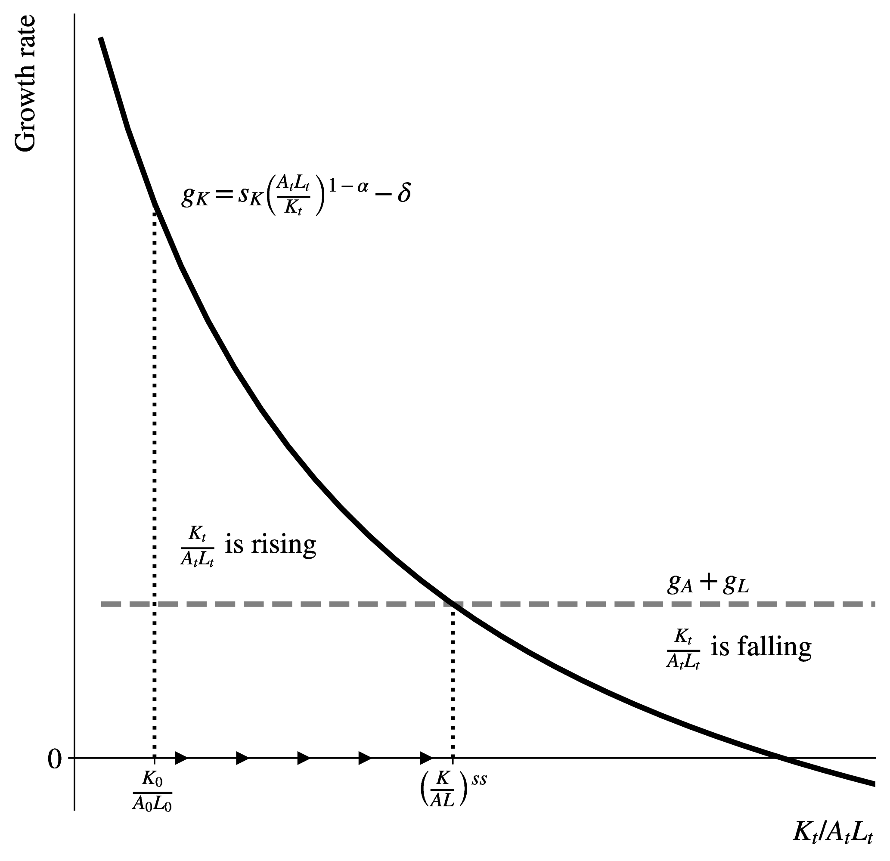
```

## Estado Estacionario

La dinámica asegura que la razón evolucione hacia un punto central donde $g_K = g_A + g_L$. Ese punto es un *Estado Estacionario* para $K/AL$. Resolvemos para esa razón:
$$g_A + g_L = s \left(\frac{AL}{K}\right)^{1-\alpha} - \delta.$$
lo cual produce
$$\left(\frac{K}{AL}\right)^{ss} = \left(\frac{s}{g_A + g_L + \delta}\right)^{\frac{1}{1-\alpha}}.$$

## Estado Estacionario

$$\left(\frac{K}{AL}\right)^{ss} = \left(\frac{s}{g_A + g_L + \delta}\right)^{\frac{1}{1-\alpha}}.$$
Mientras que la razón $K/AL$ es constante en el Estado Estacionario, el *tamaño* de la razón en ese Estado Estacionario es

- Mayor cuando $s$ es grande. Si destinamos más recursos a la acumulación de capital, el stock de capital será relativamente grande en Estado Estacionario.
- Menor cuando $g_L$ es grande. Si la población crece rápidamente, es difícil para el capital "mantenerse al día" y la razón es menor en Estado Estacionario.
- Menor cuando $g_A$ es grande. Si la productividad crece rápidamente, también es difícil para el capital "mantenerse al día". No te confundas, esto no significa que el crecimiento de la productividad sea malo para la economía.

## Crecimiento en Estado Estacionario

Recuerda que sin importar qué, la tasa de crecimiento del PIB per cápita está determinada por
$$g_y = \alpha(g_K - g_A - g_L) + g_A.$$
La dinámica de $K/AL$ lleva a un Estado Estacionario donde $g_K = g_A + g_L$, entonces
$$g_y^{ss} = g_A.$$

:::{.callout-important}
## La fuente del crecimiento de largo plazo
En el largo plazo la tasa de crecimiento del PIB per cápita está determinada *sólo* por la tasa de crecimiento de la productividad, $g_A$.
:::

# Senda de Crecimiento Balanceado (SCB) {background-color="#CED3DC"}

## Senda de crecimiento equilibrado

La economía termina en un Estado Estacionario. ¿Es este Estado Estacionario consistente con una senda de crecimiento equilibrado?

- La tasa de crecimiento del PIB per cápita es constante, $g_y^{SCB} = g_A$. $\checkmark$
- La participación del trabajo en el PIB es constante $wL/Y = 1-\alpha$. $\checkmark$
- La participación del PIB usada para acumulación de capital es $s$. $\checkmark$
- La tasa de interés real, $r_t$, es constante. ??

## Tasa de interés real

¿Cuál es $r$? Sabemos que
$$r_t = \frac{\alpha Y_t}{K_t}.$$
y
$$\frac{Y_t}{K_t} = \frac{K_t^{\alpha}(A_tL_t)^{1-\alpha}}{K_t} = \left(\frac{A_tL_t}{K_t}\right)^{1-\alpha}.$$
entonces en Estado Estacionario $Y/K$ es constante y
$$r^{ss} = \alpha \frac{g_A + g_L + \delta}{s}.$$
$r$ es constante en Estado Estacionario, consistente con SCB. $\checkmark$

## Solow y SCB

Los elementos clave del modelo de Solow son
$$Y_t = K_t^{\alpha} (A_tL_t)^{1-\alpha}$$
y
$$g_K = s \frac{Y_t}{K_t} - \delta.$$
lo cual lleva a:

:::{.callout-important}
## Solow y SCB
La dinámica de acumulación de capital asegura que la economía termine en Estado Estacionario, y en ese Estado Estacionario la economía está en una SCB.
:::

## Otras tasas de crecimiento

$K/AL$ es constante en Estado Estacionario, pero otras cosas importantes están creciendo:

- PIB total. $g_Y = g_y + g_L$ entonces $g_Y^{ss} = g_A + g_L$
- Capital total. $g_K^{ss} = g_A + g_L$
- Consumo per cápita, $c = (1-s)y$ entonces $g_c^{ss} = g_A$
- Capital per cápita, $k = K/L$, entonces $g_k^{ss} = g_A$

# Niveles en Equilibrio de Estado Estacionario {background-color="#CED3DC"}

## El nivel del PIB per cápita

La SCB es definitiva sobre las tasas de crecimiento, pero no sobre el nivel del PIB per cápita. En todo momento tenemos
$$y_t = \left(\frac{K_t}{A_tL_t}\right)^{\alpha} A_t.$$
entonces en Estado Estacionario
$$y_t^{SCB} = \left(\frac{s}{g_A + g_L + \delta}\right)^{\frac{\alpha}{1-\alpha}} A_t,$$
y nota que esto aún crece en el tiempo debido a que $A_t$ crece.

## El nivel del PIB per cápita

Tendemos a pensar en términos del *logaritmo* del PIB per cápita en las figuras,
$$\log y_t^{SCB} = \frac{\alpha}{1-\alpha} \log \left(\frac{s}{g_A + g_L + \delta} \right) + \log A_0 + g_A t.$$
dado que $\log A_t = \log A_0 + g_A t$.

Nota que esta es la ecuación de una *línea*, con $\log y_t^{SCB}$ como la "variable y" y $t$ como la "variable x".

## El nivel del PIB per cápita

El intercepto y la pendiente de esta línea:
$$\log y_t^{SCB} = \underset{\text{Intercepto}}{\left(\frac{\alpha}{1-\alpha} \log \left(\frac{s}{g_A + g_L + \delta} \right) + \log A_0\right)} + \underset{\text{Pendiente}}{g_A} t.$$
El intercepto determina el nivel del PIB per cápita a lo largo de la SCB. Nota que:

- Si $s$ es mayor, el nivel del PIB p.c. es mayor, aunque la tasa de crecimiento (pendiente) no lo sea.
- Si el nivel inicial de productividad, $A_0$, es mayor, el PIB p.c. es mayor, aunque la tasa de crecimiento (pendiente) no lo sea.

# Crecimiento Transicional {background-color="#CED3DC"}

## Cambios en la economía

¿Qué pasa si un parámetro como $s$ cambia? Esto *mueve* la SCB y la economía se ajusta lentamente hasta que alcanza la nueva SCB. Para entender, trabajemos a través de preguntas distintas:

- ¿Qué pasa con la dinámica de $K/AL$ inmediatamente después del cambio?
- ¿Qué pasa con $K/AL$ en el largo plazo (Estado Estacionario)?
- ¿Qué pasa con el nivel de la SCB en respuesta al cambio?
- ¿Qué implican las dinámicas de $K/AL$ sobre cómo la economía alcanza la SCB?

## Dinámica de $K/AL$

Si $s$ aumenta, $g_K$ se desplaza hacia arriba *inmediatamente*, y el Estado Estacionario es mayor en el largo plazo.

```{r dinamica_kal_aumento_s, echo=FALSE, out.width="70%"}
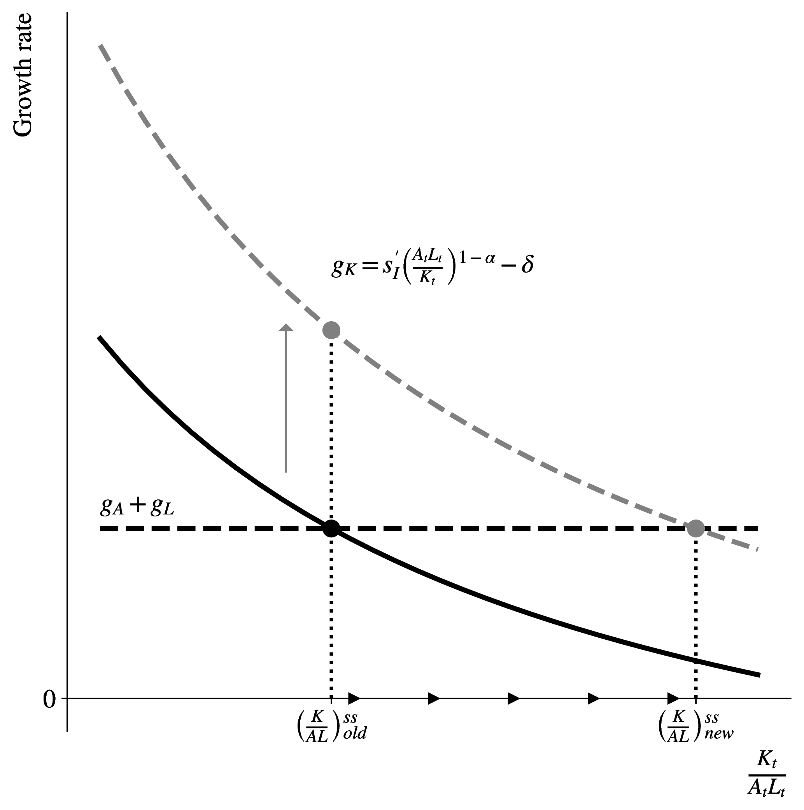
```

## La tasa de crecimiento

Dado que $g_K$ sube inmediatamente, $g_y$ sube inmediatamente. En el largo plazo, $g_y$ vuelve a $g_A$.

```{r tasa_crecimiento_aumento_s, echo=FALSE, out.width="70%"}
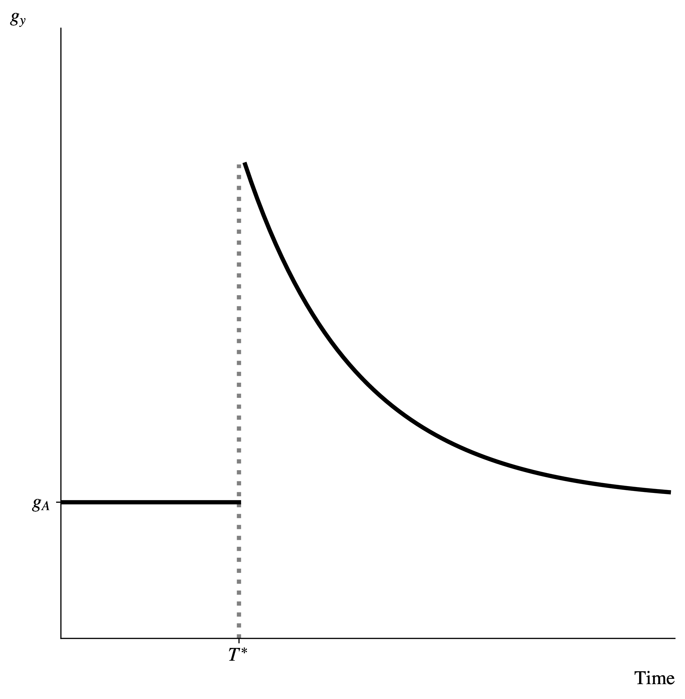
```

## El nivel del PIB per cápita

El aumento en $s$ desplaza la SCB *hacia arriba*. $g_y$ implica una transición lenta hacia la nueva SCB.

```{r nivel_pib_aumento_s, echo=FALSE, out.width="70%"}
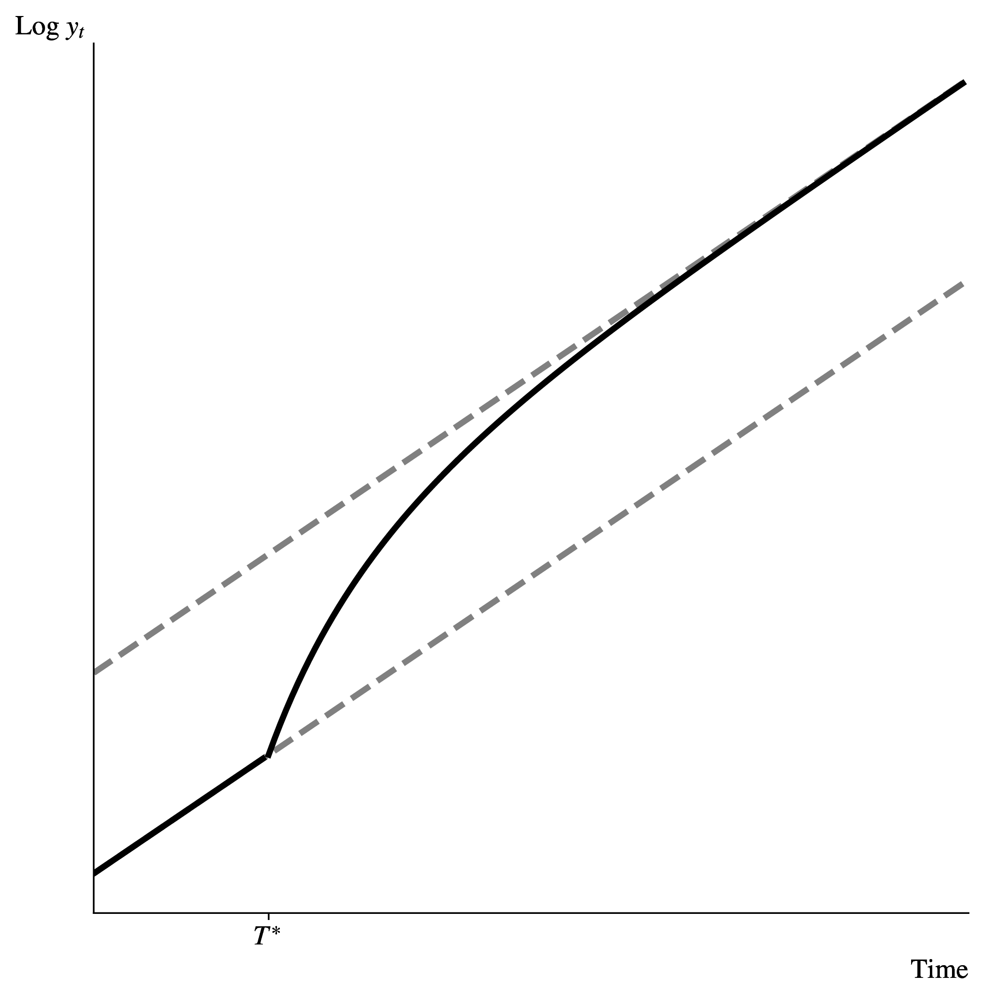
```

## Crecimiento transicional

El aumento en $s$ es un ejemplo de **Crecimiento transicional**.

- $g_y$ está por encima de $g_A$ por un tiempo, pero eventualmente $g_y \Rightarrow g_A$
- El Crecimiento transicional ocurre cuando una economía se mueve hacia el Estado Estacionario
- Este crecimiento es transitorio porque la dinámica asegura que $g_K \Rightarrow g_A + g_L$
- Las diferencias en tasas de crecimiento entre países tienden a ser transitorias

$$g_y = \underset{\text{Transicional}}{\alpha (g_K - g_A - g_L)} + \underset{\text{Largo plazo}}{g_A}$$

# Evaluando el Modelo de Solow {background-color="#CED3DC"}

## Alemania después de la Segunda Guerra Mundial

```{r alemania_postguerra, echo=FALSE, out.width="70%"}
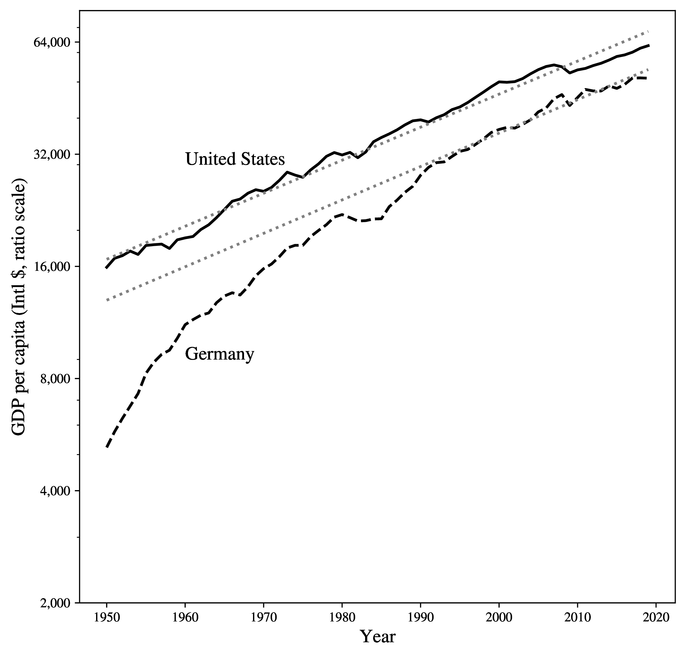
```

## Alemania después de la Segunda Guerra Mundial

Los datos de Alemania son consistentes con:

- Una pérdida sustancial de $K$ en la guerra relativo a $L$
- La razón "inicial" $K/AL$ en 1946 es muy baja y debajo del Estado Estacionario
- La dinámica del capital implica una alta $g_K$
- El Crecimiento transicional $\alpha(g_K - g_A - g_L)$ es muy alto por un tiempo
- El Crecimiento transicional se disipa cuando Alemania alcanza la SCB
- La SCB de Alemania es menor que la de EE.UU., entonces permanece alguna diferencia en parámetros ($s$, $A_0$, $g_L$) creando una diferencia de nivel

## Corea del Sur y China

```{r corea_china, echo=FALSE, out.width="70%"}
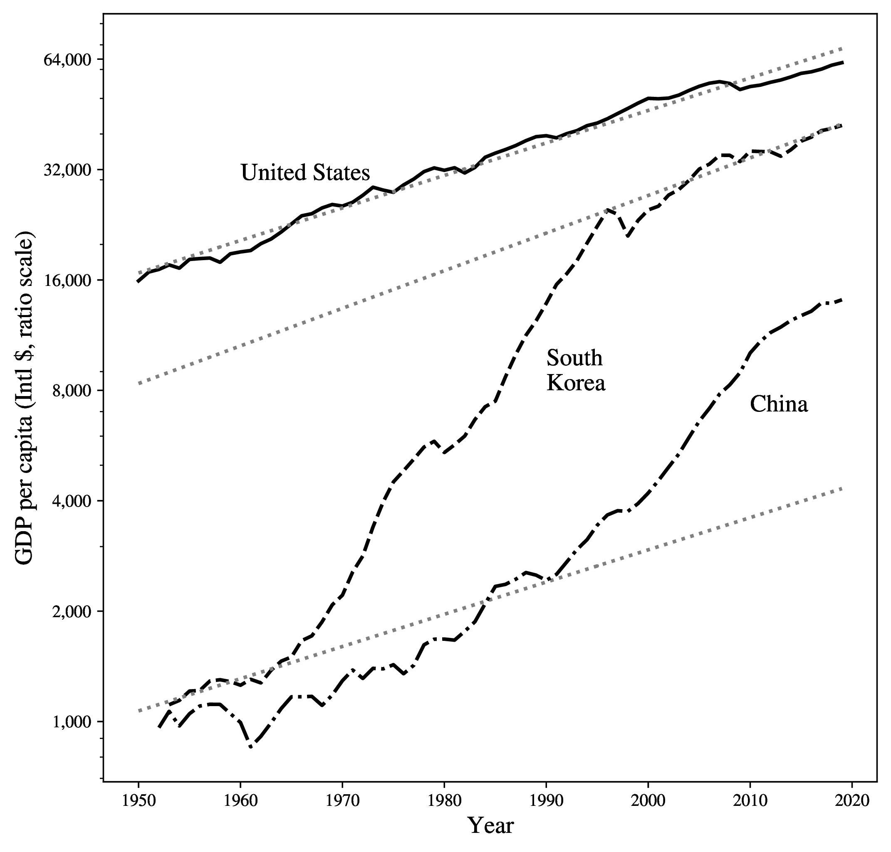
```

## Corea del Sur y China

Los datos del Este Asiático son consistentes con:

- Corea del Sur y China están en una SCB "baja" en los años 1950 y 1960
- Alrededor de 1970 algo desplaza la SCB de Corea del Sur hacia arriba
- El $K/AL$ de Corea del Sur está por tanto debajo del Estado Estacionario alrededor de 1970
- Ocurre Crecimiento transicional porque $\alpha(g_K - g_A - g_L)$ es positivo
- Para el 2000 Corea del Sur ha convergido a la nueva SCB y la tasa de crecimiento coincide con la de EE.UU.
- Alrededor de 1990 algo desplaza la SCB china hacia arriba y $K/AL$ está debajo del Estado Estacionario
- Está ocurriendo Crecimiento transicional en China, pero no sabemos bien si ha alcanzado la nueva SCB aún.

## ¿Qué cambió la SCB del Este Asiático?

```{r este_asiatico_scb1, echo=FALSE, out.width="70%"}
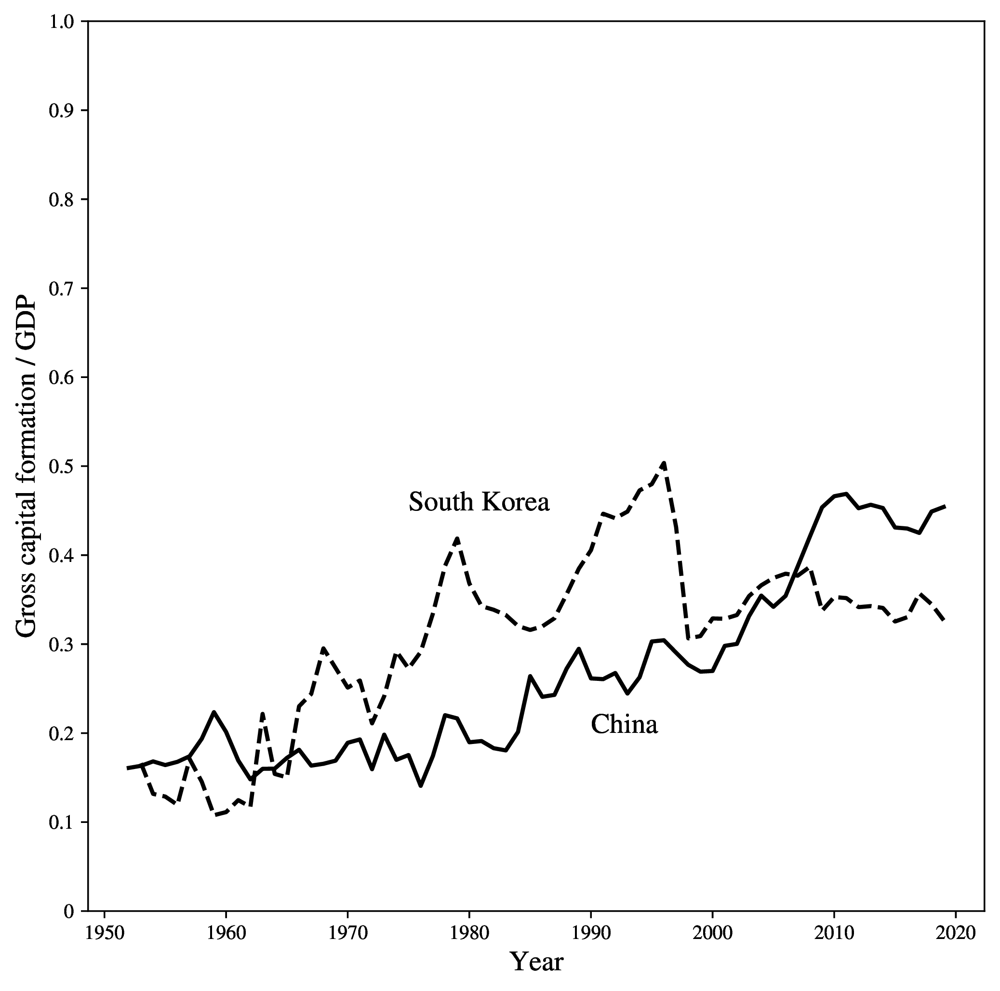
```

## ¿Qué cambió la SCB del Este Asiático?

```{r este_asiatico_scb2, echo=FALSE, out.width="70%"}
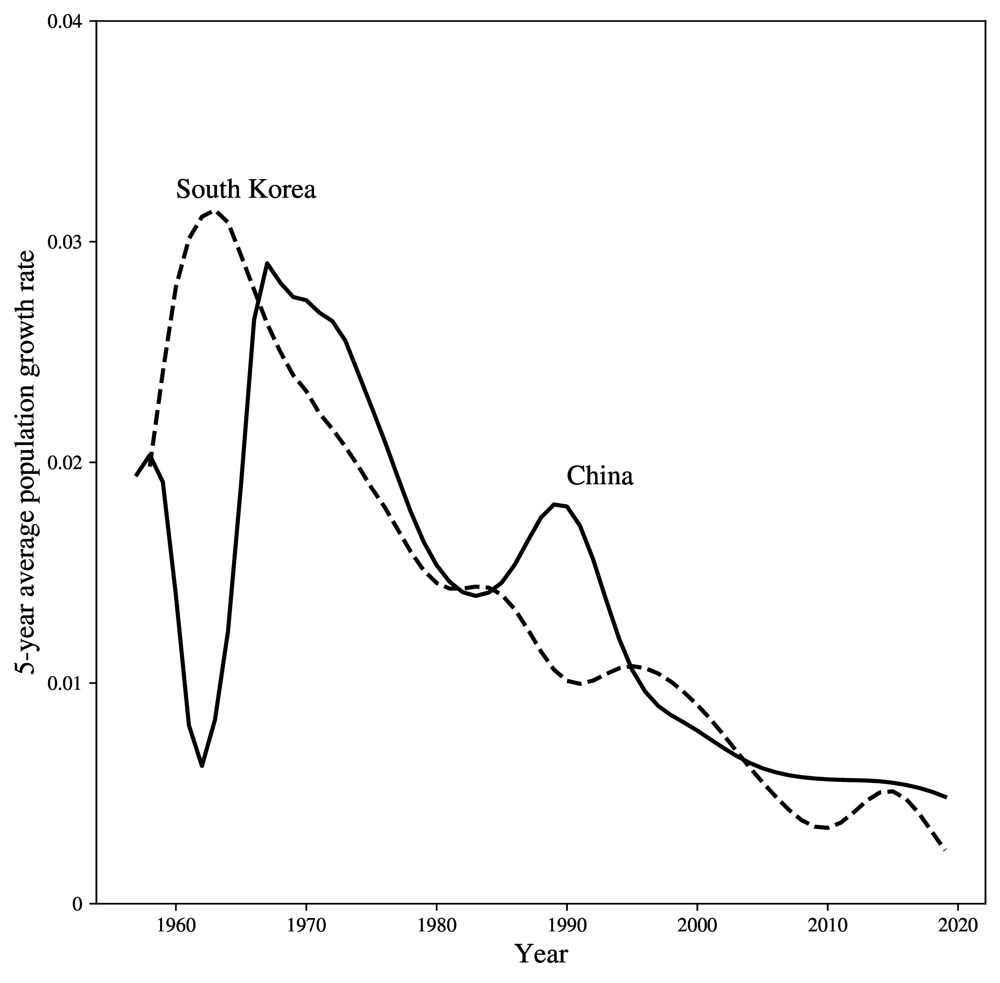
```

## Diferencias en niveles

Recuerda que el nivel del PIB per cápita en la SCB es
$$\log y_t^{SCB} = \underset{\text{Intercepto}}{\left(\frac{\alpha}{1-\alpha} \log \left(\frac{s}{g_A + g_L + \delta} \right) + \log A_0\right)} + \underset{\text{Pendiente}}{g_A} t.$$
de manera que el intercepto nos dice sobre diferencias en niveles del PIB per cápita, incluso si la tasa de crecimiento (pendiente) es la misma.

- Manteniendo todo lo demás constante, un $s$ mayor debería implicar un nivel mayor del PIB per cápita
- Manteniendo todo lo demás constante, un $g_L$ menor debería implicar un nivel mayor del PIB per cápita

Otros parámetros importan pero son más difíciles de medir.

## PIB per cápita y tasa de inversión

```{r pib_tasa_inversion, echo=FALSE, out.width="70%"}
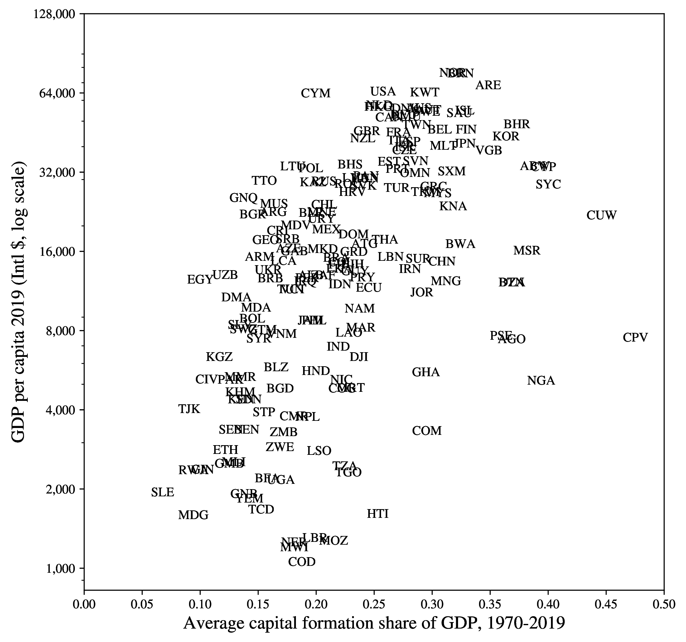
```

## PIB per cápita y tasa de crecimiento poblacional

```{r pib_crecimiento_poblacional, echo=FALSE, out.width="70%"}
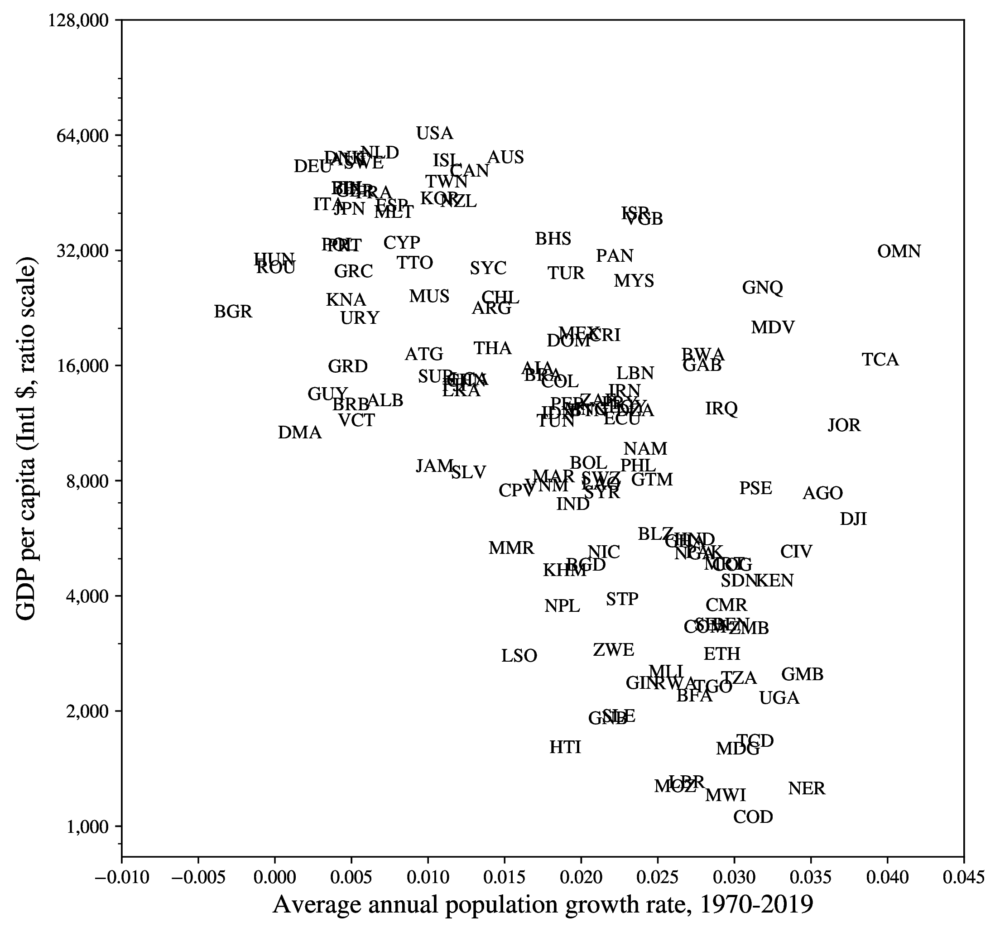
```

# Capital Humano {background-color="#CED3DC"}

## La Función de Producción con Capital Humano

- Suponga ahora que la función de producción toma la forma:
$$Y_t= K_t^{\alpha} H_t^{\beta} (A_t L_t)^{1-\alpha-\beta}$$
donde la nueva variable $H$ representa el capital humano.
- El PIB per cápita queda entonces definido como:
$$y_t = \frac{Y_t}{L_t} = \left(\frac{K_t}{A_tL_t}\right)^{\alpha} \left(\frac{H_t}{A_tL_t}\right)^{\beta} A_t$$
Ahora el PIB per cápita depende, ademas del ratio $\left(\frac{K_t}{A_tL_t}\right)$ y de $A_t$, del ratio $\left(\frac{H_t}{A_tL_t}\right)$
- La tasa de crecimiento del PIB per cápita es ahora:
$$g_y = \alpha (g_K - g_A - g_L) + \beta (g_H - g_A - g_L) + g_A$$

## Dinámica de Acumulación

- Tanto el capital físico como el humano se acumulan mediante la inversión y deprecian en el tiempo.
$$\dot{K}_t = I_{K,t} - \delta K_t$$
$$\dot{H}_t = I_{H,t} - \delta H_t$$
Por simplicidad suponemos que la tasa de depreciación es la misma.
- La familias destinan parte de su ahorro a financiar acumulación de capital físico y parte a financiar acumulación de capital humano.
$$I_t = S_t = s_K Y_t + s_H Y_t$$
En ambos casos se destina una fracción constante del ingreso
- Las tasas de crecimiento de ambos tipos de capital son:
$$g_{K} = s_K \frac{Y_t}{K_t} - \delta$$
$$g_{H} = s_H \frac{Y_t}{H_t} - \delta$$

## Senda de Crecimiento Balanceado

- Los ratios producto a stock de capital (físico y humano) son:
$$\frac{Y_t}{K_t} = \left(\frac{K_t}{A_t L_t}\right)^{\alpha-1} \left(\frac{H_t}{A_t L_t}\right)^{\beta}$$
$$\frac{Y_t}{H_t} = \left(\frac{K_t}{A_t L_t}\right)^{\alpha} \left(\frac{H_t}{A_t L_t}\right)^{\beta-1}$$
- En Estado Estacionario estos ratios son constante y por tanto se cumple que $g_K=g_H=g_A+g_L$
- Igualando las tasa de crecimiento tenemos:
$$s_K \frac{Y_t}{K_t} - \delta = s_H \frac{Y_t}{H_t} - \delta \rightarrow \frac{K_t}{A_t L_t} / \frac{H_t}{A_t L_t} = \frac{s_K}{s_H}$$

## Senda de Crecimiento Balanceado

- Usamos las definiciones de las tasa de crecimiento, los ratios $\frac{Y_t}{K_t}$ y $\frac{Y_t}{H_t}$, y la condición anterios para resolver por los valores de Estado Estacionario del stock de capital (físico y humano) por trabajo efectivo.
$$\left(\frac{K_t}{A_t L_t}\right)^* = \left[ \frac{s_K^{1-\beta} s_H^{\beta}}{g_A + g_L + \delta}\right]^{\frac{1}{1-\alpha-\beta}}$$
$$\left(\frac{H_t}{A_t L_t}\right)^* = \left[ \frac{s_K^{\alpha} s_H^{1-\alpha}}{g_A + g_L + \delta}\right]^{\frac{1}{1-\alpha-\beta}}$$
- El PIB per cápita en la SCB es:
$$y_t^* =\underset{y_0}{\underbrace{\left[ \frac{s_K^{1-\beta} s_H^{\beta}}{g_A + g_L + \delta}\right]^{\frac{\alpha}{1-\alpha-\beta}} \left[ \frac{s_K^{\alpha} s_H^{1-\alpha}}{g_A + g_L + \delta}\right]^{\frac{\beta}{1-\alpha-\beta}} A_0}} e^{g_A t}$$

# Convergencia {background-color="#CED3DC"}

## Tasas de crecimiento y niveles iniciales

Si la *única* cosa que difiere entre países fuera el $K_0/A_0L_0$ inicial, entonces:

- Países con bajo $K_0/A_0 L_0$ tendrían un *nivel* bajo de PIB per cápita
- Países con bajo $K_0/A_0 L_0$ tendrían una alta tasa de crecimiento del PIB per cápita debido al crecimiento transitorio
- Entonces esperaríamos ver que las tasas de crecimiento estuvieran negativamente relacionadas con el nivel del PIB per cápita

## Convergencia en países ricos

Esto es para un conjunto de países actualmente ricos desde 1870 a 2018

```{r convergencia_ricos, echo=FALSE, out.width="70%"}
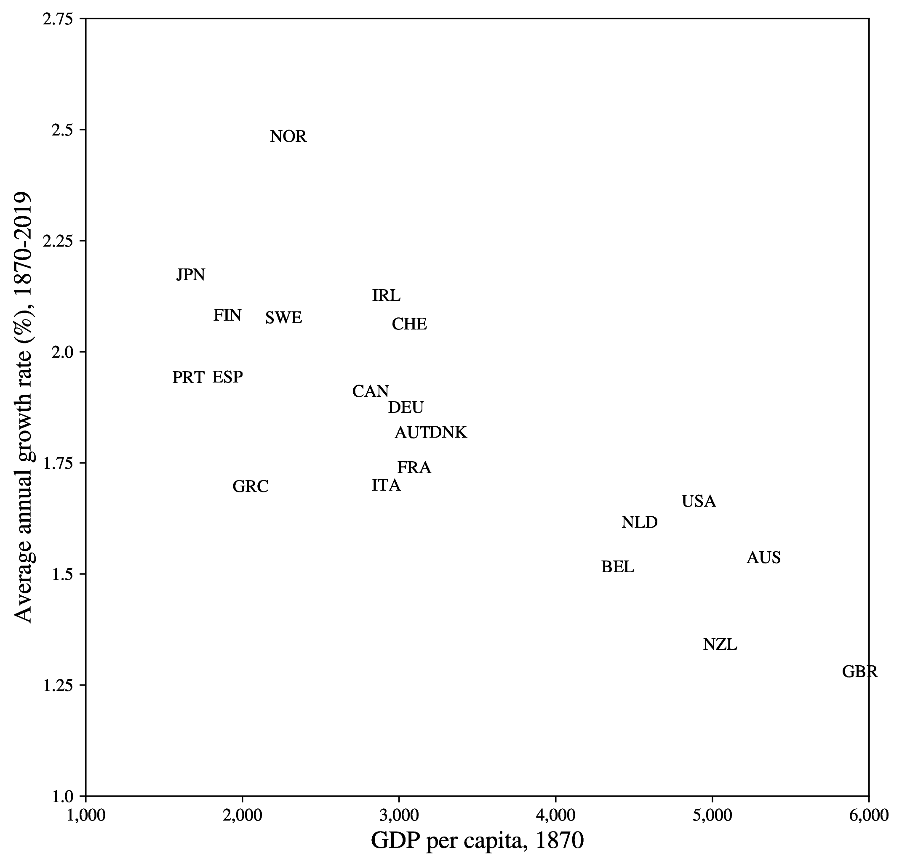
```

¿Por qué tiene que funcionar esto?

## Convergencia en todos los países (absoluta)

Pero para países en general no funciona

```{r convergencia_absoluta, echo=FALSE, out.width="70%"}
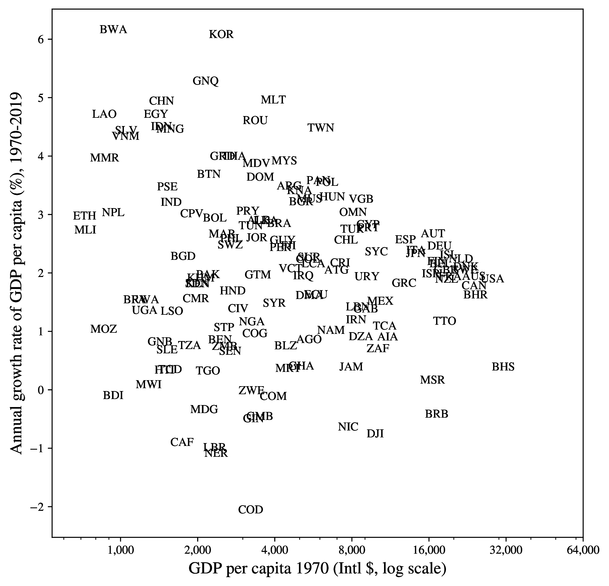
```

Esto no funciona porque los estados estacionarios son diferentes. No todos se dirigen hacia la misma SCB.

## Convergencia condicional

Pero sí funciona (de alguna manera) si comparamos la tasa de crecimiento de cada país con qué tan lejos empezaron respecto de su *propio estado estacionario*.

```{r convergencia_condicional, echo=FALSE, out.width="70%"}
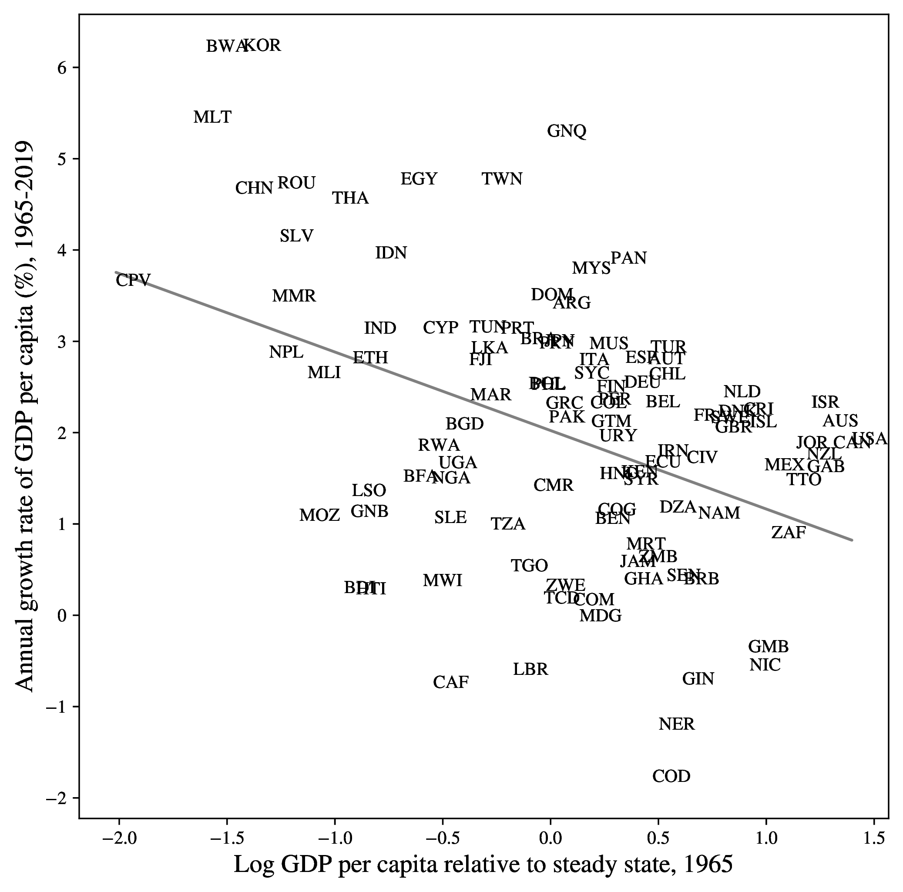
```

# Distribución Mundial {background-color="#CED3DC"}

## ¿Qué tan desigual es el PIB per cápita entre países?

PIB per cápita del percentil 90 al percentil 10

```{r desigualdad_pib_p90_p10, echo=FALSE, out.width="70%"}
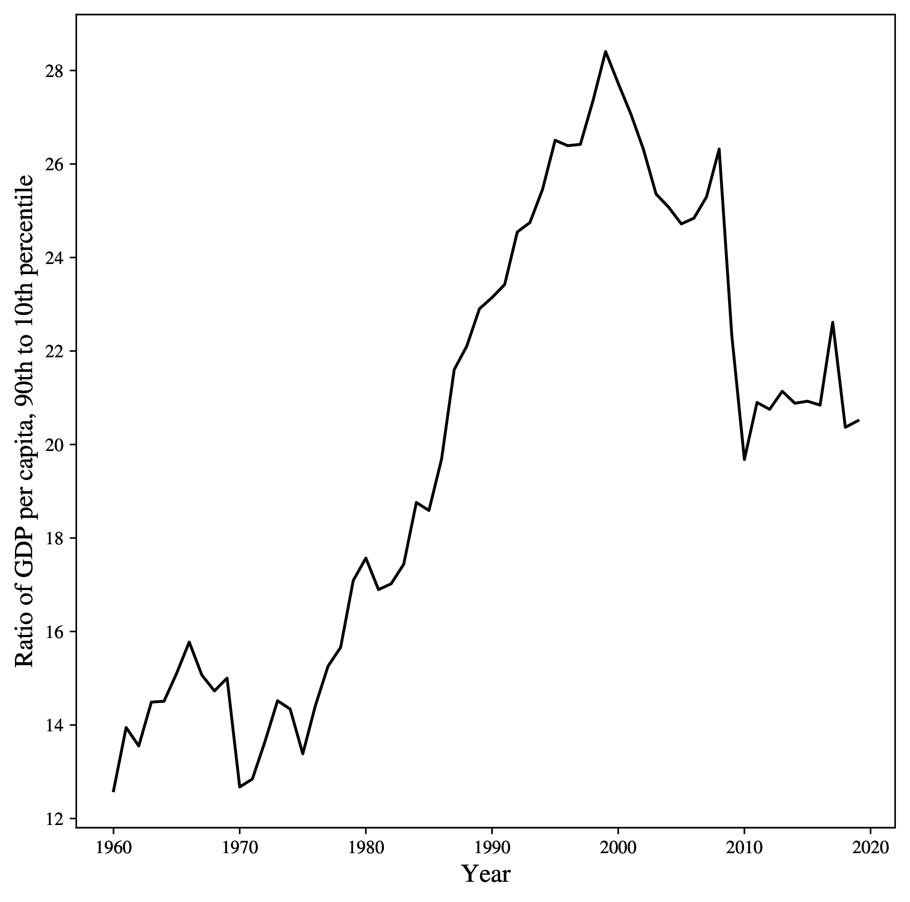
```

## ¿Qué tan alto es el PIB per cápita en general?

Número de personas viviendo en diferentes niveles de PIB per cápita

```{r distribucion_pib_niveles, echo=FALSE, out.width="70%"}
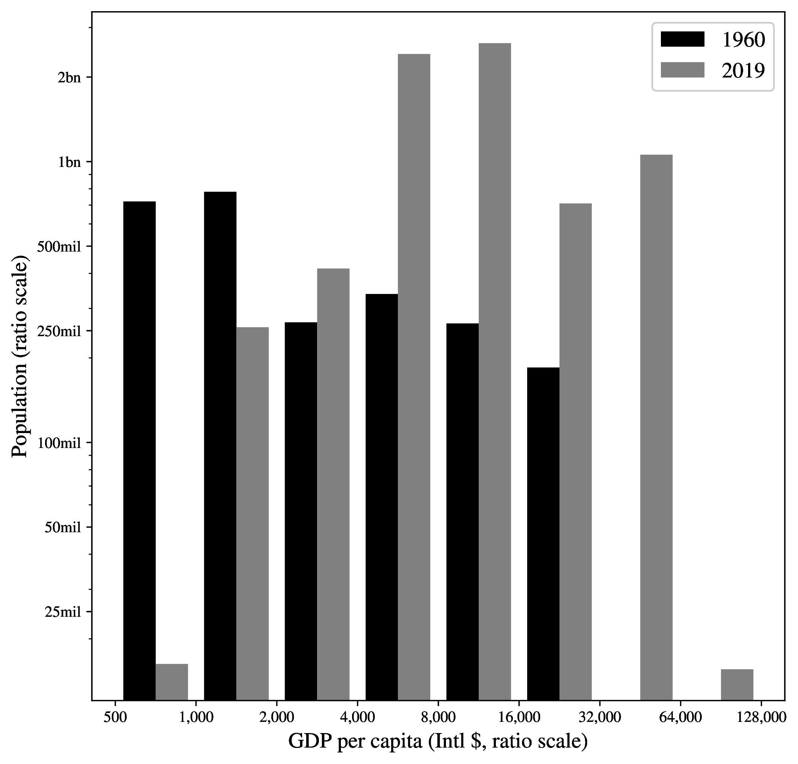
```

## ¿Cuántas personas viven en pobreza absoluta?

Número de Personas Viviendo en Pobreza Extrema o fuera de ella, 1820-2015

```{r pobreza_extrema, echo=FALSE, out.width="70%"}
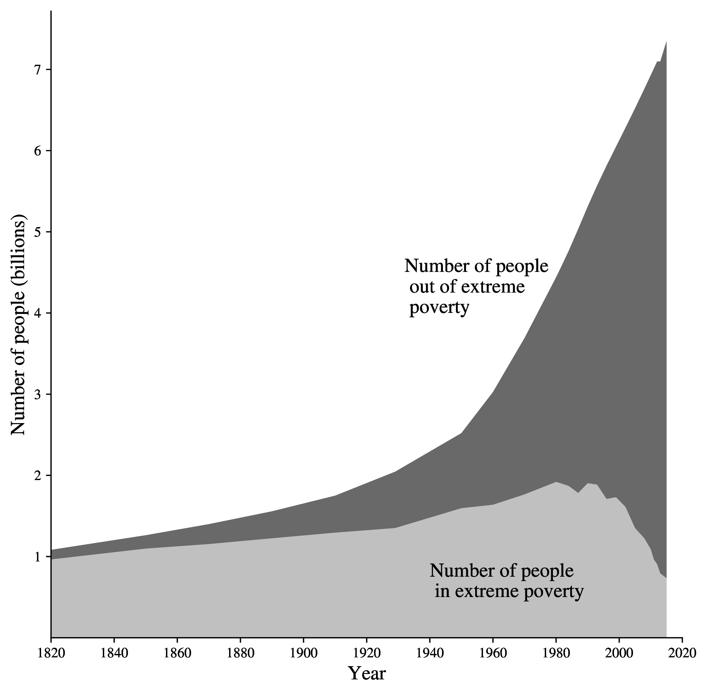
```

# Contabilidad del Crecimiento {background-color="#CED3DC"}

## ¿Qué impulsa el crecimiento?

El crecimiento en un momento del tiempo es una combinación de crecimiento transitorio y crecimiento de largo plazo:
$$g_y = \underset{\text{Transicional}}{\alpha (g_K - g_A - g_L)} + \underset{\text{Largo plazo}}{g_A}$$

- Podemos poner números a cada término.
- Podemos medir $g_y$, $g_K$, y $g_L$.
$$L_{t} = Empleo_t \times HorasTrabajadas_t$$
$$K_t = FBCF_t + (1-\delta) K_{t-1}$$
con $K_0$ y $\delta$ dados.
- Podemos inferir $g_A$ de la ecuación; debe cumplirse (residuo de Solow).
$$g_A = \frac{g_y - \alpha (g_K - g_L)}{1-\alpha}$$
- Asumimos $\alpha = 0.53$ y $\delta = 0.028$ (estimación PWT para Chile, promedio 5 décadas).

## ¿Qué impulsa el crecimiento?

:::{.center-x}
Contabilidad del Crecimiento para Chile 1952-2019
:::

:::{.small}
|  | 1950s | 1960s | 1970s | 1980s | 1990s | 2000s | 2010s |
| :--- | :---: | :---: | :---: | :---: | :---: | :---: | :---: |
| **Crecimiento Anual:** | (1) | (2) | (3) | (4) | (5) | (6) | (7) |
| $g_y$ | 3.4 | 4.1 | 1.0 | -0.3 | 4.2 | 2.6 | 2.3 |
| **Descomposición del crecimiento:** | | | | | | | |
| $g_A$ | 4.3 | 3.4 | -0.7 | 0.4 | 4.5 | 1.0 | 0.3 |
| $\alpha (g_K - g_A - g_L)$ | -1.0 | 0.7 | 1.7 | -0.8 | -0.2 | 1.7 | 1.9 |
| **Descomposición del crecimiento transicional:** | | | | | | | |
| $g_K$ | 3.1 | 5.8 | 3.7 | 2.9 | 6.1 | 5.5 | 5.0 |
| $g_A$ | 4.3 | 3.4 | -0.7 | 0.4 | 4.5 | 1.0 | 0.3 |
| $g_L$ | 0.6 | 1.0 | 1.3 | 3.9 | 2.1 | 1.4 | 1.0 |
:::

Note que $y_t=Y_t/L_t$ donde $L_t$ es el empleo, por lo que en realidad hemos descompuesto el crecimiento del PIB por trabajador.

## ¿Qué impulsa el crecimiento?

- ¿Qué sucede si queremos analizar el PIB per cápita?
$$y_t^{PC}=\frac{Y_t}{POB_t}=\frac{Y_t}{L_t} \times \frac{L_t}{POB_t}$$
Ajustar por el crecimiento de la participación del empleo en la población.
$$g_y^{PC} = \underset{\text{Transicional}}{\alpha (g_K - g_A - g_L)} + \underset{\text{Largo plazo}}{g_A} +  \underset{\text{Participación}}{(g_{L}-g_{POB})}$$

:::{.small}
|  | 1950s | 1960s | 1970s | 1980s | 1990s | 2000s | 2010s |
| :--- | :---: | :---: | :---: | :---: | :---: | :---: | :---: |
| **Crecimiento Anual:** | (1) | (2) | (3) | (4) | (5) | (6) | (7) |
| $g_y^{PC}$ | 1.8 | 2.8 | 0.6 | 2.0 | 4.8 | 2.9 | 2.1 |
| **Descomposición:** | | | | | | | |
| $g_A$ | 4.3 | 3.4 | -0.7 | 0.4 | 4.5 | 1.0 | 0.3 |
| $\alpha (g_K - g_A - g_L)$ | -1.0 | 0.7 | 1.7 | -0.8 | -0.2 | 1.7 | 1.9 |
| $(g_L - g_{POB})$ | -1.6 | -1.2 | -0.3 | 2.3 | 0.6 | 0.3 | -0.1 |
:::

## ¿Cuáles han sido los aportes de $K$, $L$ y $A$ al nivel de desarrollo?

- Una manera alternativa de ver la contabilidad del crecimiento es utilizando los niveles. Interpretación: *aportes al nivel de desarrollo*.
- Partimos con la función de producción: $Y_t = K^{\alpha} (A_t L_t)^{1-\alpha}$ y por tanto el PIB per cápita es:
$$y^{PC}_t = \frac{Y_t}{POB_t} = \left( \frac{K_t}{A_t L_t} \right)^{\alpha} A_t \left( \frac{L_t}{POB_t} \right) = \underset{\text{Aporte Capital}}{\left( \frac{K_t}{Y_t} \right)^{\frac{\alpha}{1-\alpha}}} \underset{\text{Aporte Prog.Tec.}}{A_t} \underset{\text{Aporte Part. Lab.}}{\left( \frac{L_t}{POB_t} \right)}$$
- Nuevamente usamos el concepto del residuo de Solow para calcular $A_t$.

## ¿Cuáles han sido los aportes de $K$, $L$ y $A$ al nivel de desarrollo?

¿Cómo a evolucionado el nivel de desarrollo de Chile y cuál ha sido el factor que más aportó?

```{r contabilidad_crecimiento_chile, echo=FALSE, out.width="70%"}
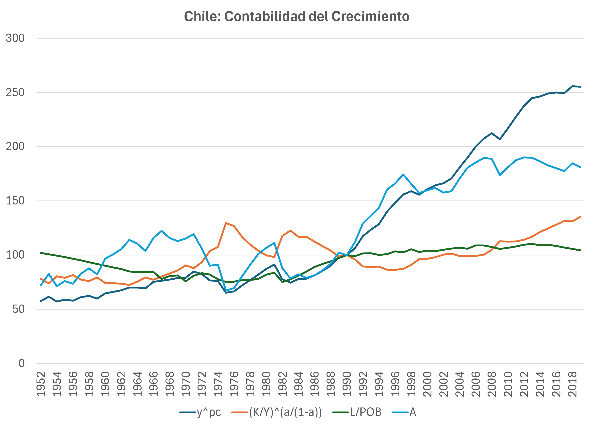
```

## ¿Por qué algunos países son ricos?

- ¿Qué parte de la producción - capital, productividad - es la razón por la que algunos países son ricos?
- Usamos las mismas ideas. La función de producción:
$$Y_i = K_i^{\alpha} (A_i h_i L_i)^{1-\alpha}.$$
- Ahora incluimos $h_i$, que es capital humano por trabajador. Lo introducimos de forma algo diferente para poder contabilizar.
- La producción total es:
$$Y_i = \left(\frac{K_i}{A_i h_i L_i} \right)^{\alpha} A_i h_i L_i,$$
dividimos por la población ($POB_i$) para obtener el PIB per cápita:
$$y^{PC}_i = \left(\frac{K_i}{Y_i}\right)^{\alpha/(1-\alpha)} A_i h_i \frac{L_i}{POB_i}.$$

## ¿Por qué algunos países son ricos?

- Definamos el capital humano como:
$$h_i = e^{\mu E_i},$$
donde $E_i$ son años de educación y $\mu$ es el retorno a cada año de educación (ej. $\mu \approx 0.10$).
- La educación no es el *único* aspecto del capital humano, pero los años de escolaridad podemos medirlos fácilmente.
- Ahora comparamos países (con respecto a un Benchmark):
$$\frac{y_i}{y_{US}} = \left[\frac{(K/Y)_i}{(K/Y)_{US}}\right]^{\alpha/(1-\alpha)} \frac{A_i}{A_{US}} \frac{h_i}{h_{US}} \frac{(L_i/N_i)}{(L_{US}/N_{US})}.$$
Podemos evaluar por qué el país $i$ es más rico o pobre que Estados Unidos. Razones: (1) capital/producto, (2) productividad $A_i/A_{US}$, (3) capital humano, y (4) participación de la fuerza laboral

## ¿Por qué algunos países son ricos?

:::{.center-x}
Contabilidad del Desarrollo
:::

```{r contabilidad_desarrollo, echo=FALSE, out.width="70%"}
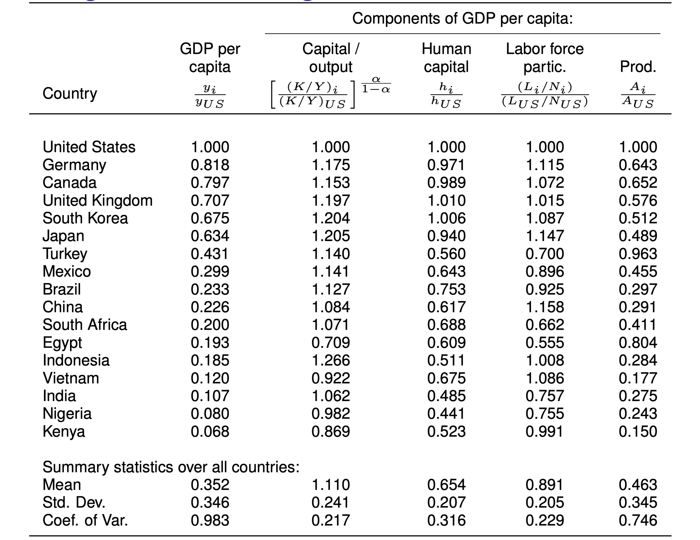
```

# Economía de las Ideas {background-color="#CED3DC"}

## Ideas

Usamos el término "idea" para referirnos a cualquier

- .. plan, plano, receta, diseño, o idea de negocio
- .. que nos dice cómo combinar factores de producción (trabajo, capital)
- .. para producir algún producto que alguien esté dispuesto a pagar

Las ideas no solo son sobre "tecnología":

- La última versión de ChatGPT es una idea, sí
- ..pero también lo es identificar un buen lugar para ubicar un Starbucks
- ..y también lo es un concepto de restaurante que atraiga clientes

## Midiendo ideas

Es difícil medir esto. *Una* forma es observar las solicitudes formales de propiedad sobre las ideas, las patentes.

- Las patentes tienden a inclinarse hacia ideas tecnológicas
- Las patentes no cubren todas las ideas (piensa en el Starbucks, o la receta de Coca-Cola)
- Cada patente no es igual. Algunas son simples, otras son transformativas.

## Datos de patentes en Estados Unidos

:::{.center-x}
Patentes Otorgadas en Estados Unidos, por País de Origen
:::
```{r patentes_eeuu, echo=FALSE, out.width="70%"}
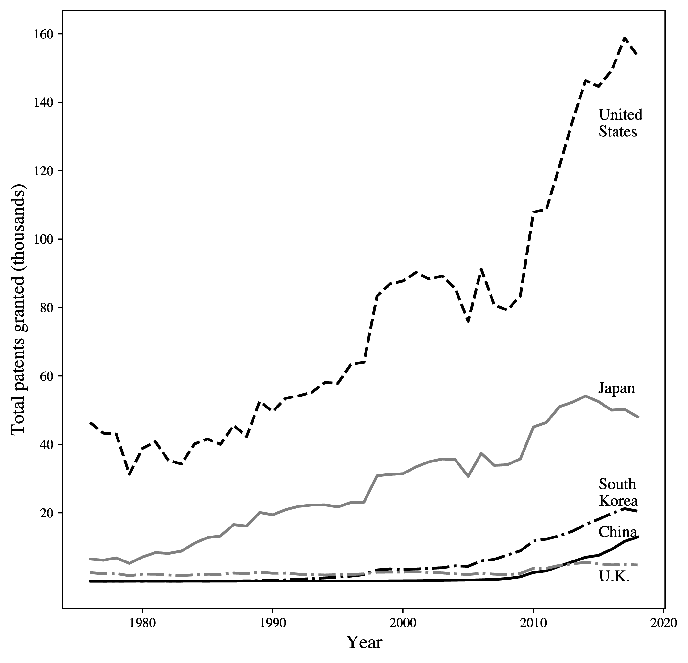
```

## Midiendo el esfuerzo

Un concepto crucial es que crear ideas requiere esfuerzo.

- Principalmente tiempo. Posiblemente capital en términos de laboratorios, computadoras, etc.
- Típicamente llamamos a este esfuerzo I+D
- I+D usa trabajo productivo y capital; las empresas e individuos están tomando una decisión deliberada de hacer esto versus hacer otra cosa (como por ejemplo producir bienes)
- En última instancia, el proceso de crecimiento depende de esta elección

## Esfuerzo en I+D

:::{.center-x}
Número de Trabajadores en I+D, por País
:::
```{r trabajadores_id_numero, echo=FALSE, out.width="70%"}
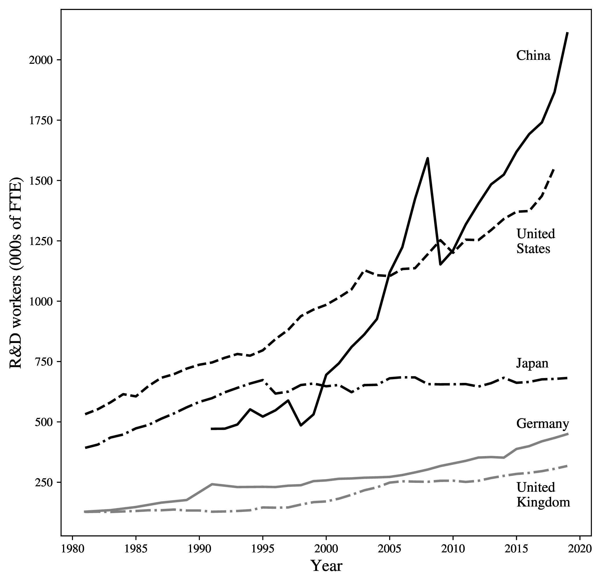
```

## Esfuerzo en I+D

:::{.center-x}
Trabajadores en I+D como Porcentaje del Empleo, por País
:::
```{r trabajadores_id_porcentaje, echo=FALSE, out.width="70%"}
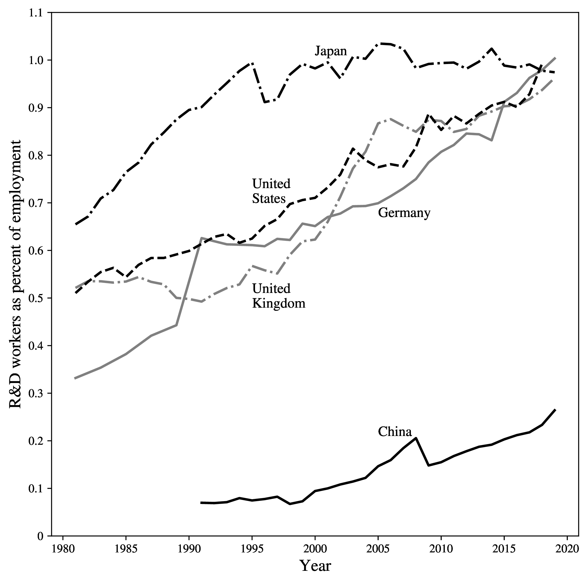
```

## No-rivalidad

La cualidad clave de las ideas para el crecimiento es que son **no-rivales**.

- Una persona usando la idea no impide que otra la use
- Pueden copiarse/usarse con costo cero o cercano a cero

Contrasta esto con cosas como el trabajo y capital que son **rivales**.

- Si tú usas un bien rival, yo no puedo
- Toma tiempo y/o recursos copiar un insumo rival

## ¿Por qué hacer I+D?

Las economías están poniendo más esfuerzo en I+D. ¿Por qué?

- Las ideas son no-rivales pero toma tiempo/esfuerzo crearlas *la primera vez*
- Una vez creada, la idea puede reutilizarse sin disminuirla
- La producción usando una idea tiene rendimientos crecientes
- ..lo que significa altos costos fijos y bajo/cero costo marginal

## Intuición de rendimientos crecientes

Piensa en una estructura simple para posibles innovadores

- Alguien puede pagar un costo fijo, $F$, para crear una idea.
- Con esa idea pueden generar ganancias operativas $V = pY - cY$
- Solo tiene sentido innovar y operar si $V \geq F$

¿Qué implica esto para el precio, $p$, que los innovadores deberían cobrar?

## Rendimientos crecientes

:::{.center-x}
Funciones de Costos con Rendimientos Crecientes
:::
```{r costos_rendimientos_crecientes, echo=FALSE, out.width="70%"}
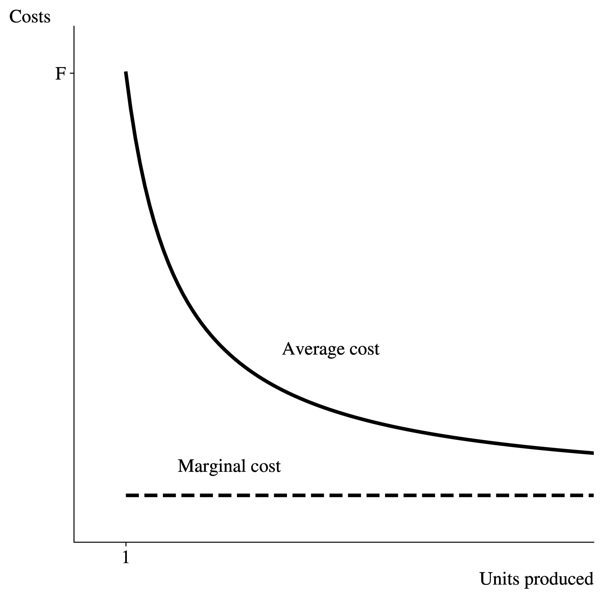
```

## Competencia imperfecta

La única forma en que alguien innovará y operará es si $p > c$

- Los mercados competitivos (permitiendo entrada de copias) llevarán $p = c$
- Los mercados competitivos maximizan la producción de productos existentes, pero $p < AC$ (costo medio) y las ganancias son negativas
- La innovación requiere $p > c$ lo que implica *competencia imperfecta*
- Los innovadores necesitan poder de mercado para asegurar $V \geq F$

## Exclusividad

La **exclusividad** es lo que te permite impedir que alguien use o copie tu producto o idea

- La exclusividad está estrechamente relacionada con los derechos de propiedad
- La exclusividad casi siempre es creada por política/ley, no es inherente
- Títulos, patentes, derechos de autor, etc. son formas de crear exclusividad
- La exclusividad significa que otras personas necesitan pagar por tu idea no-rival

# Escala de Producción {background-color="#CED3DC"}

## La importancia de la escala

¿Por qué Houston (área metropolitana de 7 millones) tiene mejor comida que Tulsa (área metropolitana de 1 millón)?

- Hay más restauranteros potenciales con antecedentes más variados. Hay más ideas novedosas para probar (ej. un food truck de fusión nigeriana/mexicana)
- Hay más clientes potenciales con gustos más variados. Las ideas raras de nicho pueden prosperar (ej. *alguien* amará la comida nigeriana/mexicana)

## Escala y rivalidad

Piensa en insumos rivales como capital o recursos naturales:

- Más gente nos permite hacer (o extraer) más del insumo
- La cantidad de insumo *per cápita* baja con más gente
- Hay una carrera entre producción y dilución de insumos rivales

Con insumos no-rivales como las ideas:

- Más gente aún nos permite hacer más del insumo
- Pero el stock per cápita de ideas per cápita *no baja*
- No hay "carrera" entre I+D y dilución de ideas no-rivales

## Ideas y escala

Tomemos en serio la no-rivalidad de las ideas:

- Más gente significa más ideas
- Más ideas significa mayor PIB per cápita
- El PIB per cápita está *positivamente* correlacionado con el tamaño de población/mercado
- La tasa de crecimiento del PIB per cápita está *positivamente* correlacionada con la tasa de crecimiento de población

## Población y niveles de vida

:::{.center-x}
Población Mundial y PIB per cápita, 1820-2019
:::
```{r poblacion_pib_percapita, echo=FALSE, out.width="70%"}
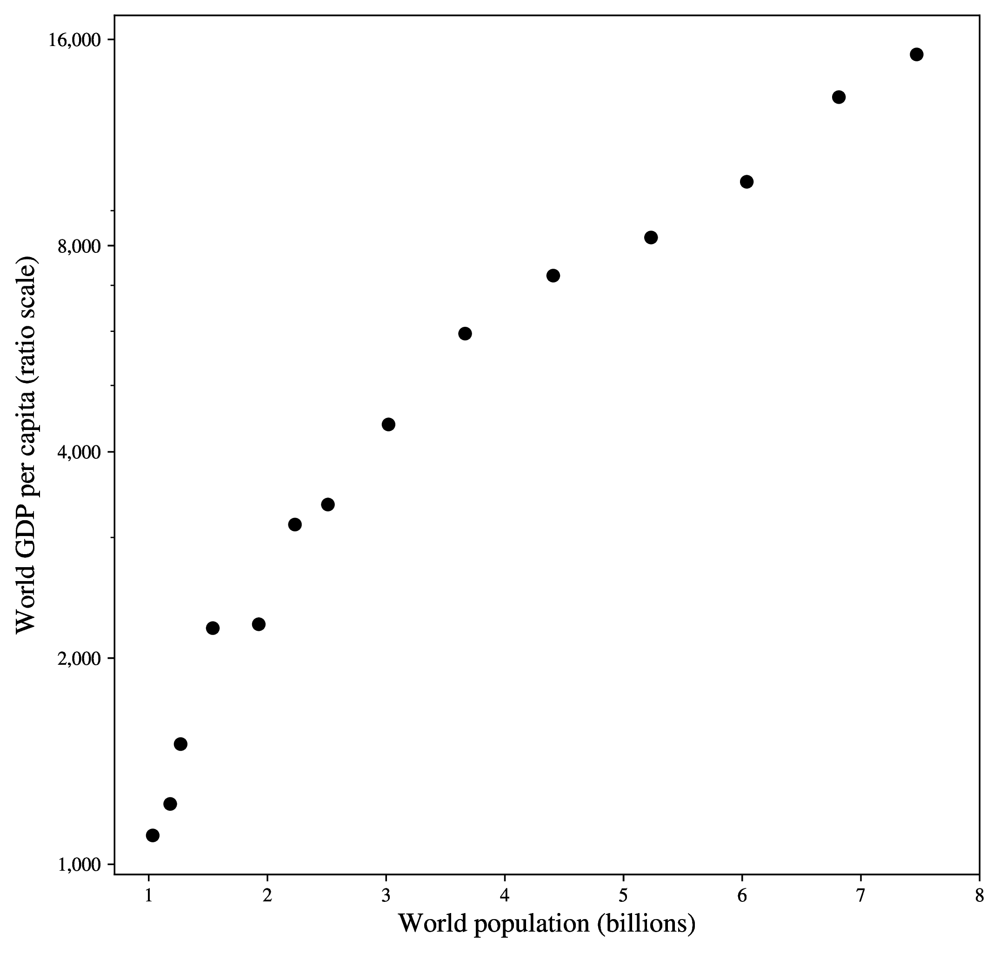
```

## Población y niveles de vida

:::{.center-x}
Tasa de Crecimiento de la Población Mundial y PIB per cápita, 1820-2019
:::
```{r crecimiento_poblacion_pib, echo=FALSE, out.width="70%"}
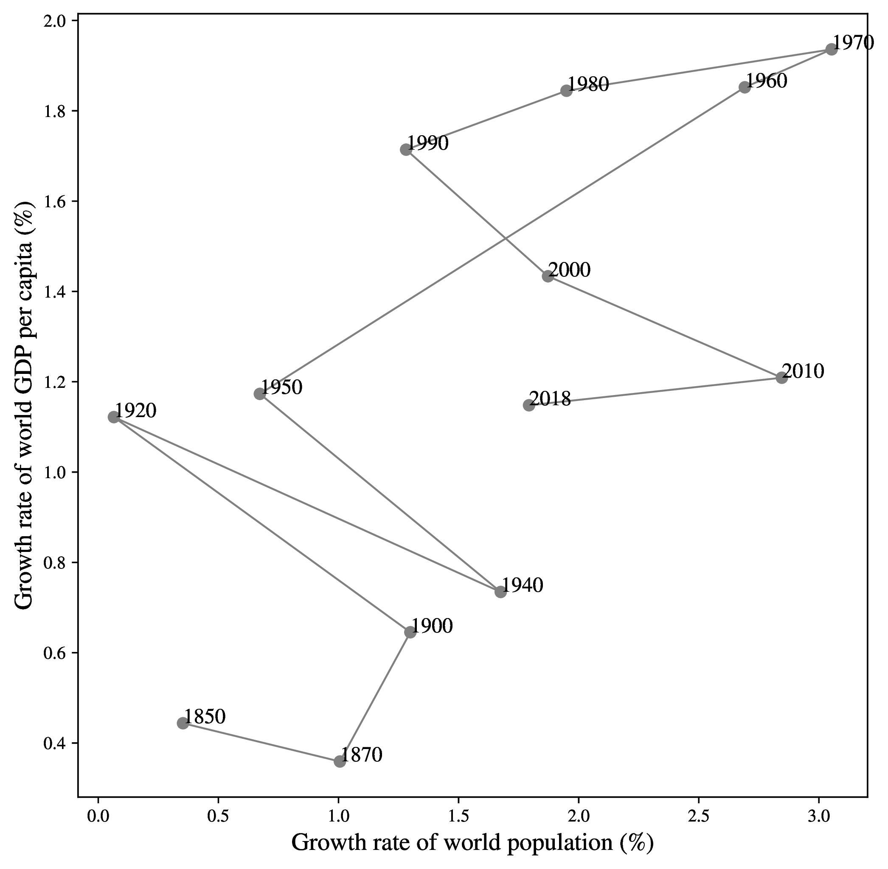
```

## Tamaño del mercado

El tamaño de población/mercado importa para implementar ideas:

- Asume que la entrada hace $F \approx V$, entonces $F \approx (p-c)Y$:
- Mientras mayor sea la población, más unidades se pueden vender, $Y$,
- Esto permite un markup $p-c$ menor
- ..o para un markup $p-c$ dado, se puede soportar un $F$ mayor

Mercados más grandes permiten markups menores (bajo $p-c$) o ideas "más difíciles" (mayor $F$)

# El Modelo de Crecimiento de Romer {background-color="#CED3DC"}

## Crecimiento de la productividad

La productividad es central para el PIB per cápita en el modelo de Solow:

- La tasa de crecimiento, $g_A$, determina la tasa de crecimiento de largo plazo
- El nivel de productividad, $A_0$, es importante para el nivel del PIB per cápita

Entender qué impulsa el crecimiento de la productividad es por tanto central para entender el crecimiento económico

## El modelo de crecimiento de Romer

Queremos un modelo de crecimiento que:

- Tenga todos los elementos del modelo de Solow
- Sea específico sobre qué significa $A$ en ese modelo
- Explique las dinámicas de $A$ y $g_A$
- Explique por qué $g_A$ es constante a lo largo de la Senda de Crecimiento Balanceado (SCB)
- Requiera esfuerzo para crear las nuevas ideas que impulsan $A$ y $g_A$
- Explique la elección involucrada en hacer ese esfuerzo

## La parte de Solow

Mucho del modelo comienza con elementos familiares. La función de producción es
$$Y_t = K_t^{\alpha}(A_t L_{Yt})^{1-\alpha}$$
donde $L_{Yt}$ son trabajadores empleados en producir bienes y servicios. $L_{Rt}$ son personas dedicadas a I+D produciendo ideas, y
$$L_t = L_{Yt} + L_{Rt}.$$
denotando la proporción de trabajadores en I+D en el trabajo total como
$$s_R = \frac{L_{Rt}}{L_t}.$$

## La parte de Solow

Partes estándar:

- El capital se acumula de la misma forma que en Solow (depende de $K/AL$)
- El crecimiento poblacional es el mismo que en Solow (exógeno e igual a $g_L$)

Asumiendo que $g_A$ termina siendo constante (lo cual veremos) entonces la economía termina en Estado Estacionario con una razón $K/AL$ constante como es usual.

## Acumulación de ideas

La parte relevante de este modelo de Romer es la acumulación de ideas. Comenzamos la función de producción de ideas.
$$\dot{A} = \theta L_{Rt}^{\lambda} A_t^{\phi}.$$
El cambio en ideas (= productividad), $\dot{A}$, depende de

- $\theta$: Un parámetro que gobierna qué tan rápido se acumulan las ideas
- $L_{Rt}$: el número de trabajadores en I+D. Más investigadores, más ideas se encuentran
- $A_t$: el stock existente de ideas. Esto podría hacer que nuevas ideas sean más fáciles o difíciles de encontrar.

## Acumulación de ideas

Misma ecuación:
$$\dot{A} = \theta L_{Rt}^{\lambda} A_t^{\phi}.$$
Dos parámetros interesantes.

- $0 < \lambda < 1$ mide qué tan sensible es $\dot{A}$ a $L_{Rt}$.
- Si $\lambda$ está cerca de cero, entonces los investigadores se amontonan entre sí (las ideas se repiten, muchos con la misma idea)
- $-\infty < \phi < 1$ mide el efecto de la productividad en la acumulación de ideas
- Veremos por qué $\phi < 1$ es crucial para resultados estables
- Si $0 < \phi < 1$ mayor productividad hace las nuevas ideas más fáciles (ej. IA)
- Si $\phi < 0$ mayor productividad hace las nuevas ideas más difíciles (ej. el cálculo es más difícil que la rueda)

## Dinámica: Tasa de crecimiento de ideas

Divide ambos lados por $A$
$$g_A = \frac{\dot{A}}{A_t} = \theta s_R^{\lambda} \frac{L_t^{\lambda}}{A_t^{1-\phi}}.$$
La tasa de crecimiento, $g_A$, depende de una razón

- $L_t^{\lambda}/A_t^{1-\phi}$ mide cuantos investigadores por idea empleamos
- $g_A$ es mayor mientras más grande sea esta razón
- Como el crecimiento del capital, el crecimiento de la productividad depende negativamente del nivel de productividad

## Dinámica: Tasa de crecimiento de ideas

Dado esto:
$$g_A = \theta s_R^{\lambda} \frac{L_t^{\lambda}}{A_t^{1-\phi}}.$$
Queremos graficar la tasa de crecimiento de ambas partes de la razón $L_t^{\lambda}/A_t^{1-\phi}$:

- La tasa de crecimiento del numerador es $\lambda g_L$. Dada.
- La tasa de crecimiento del denominador es $(1-\phi)g_A$. Endógena a la razón.

Como con $K/AL$, graficaremos la tasa de crecimiento del numerador y denominador contra la razón

## Dinámica: Tasa de crecimiento de ideas

```{r dinamica_ideas, echo=FALSE, out.width="70%"}
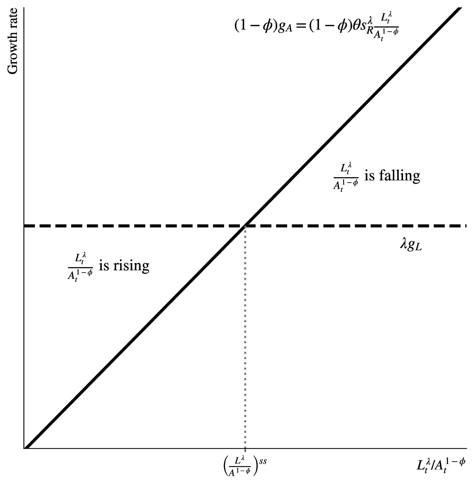
```

## Estado Estacionario

Sin importar la razón inicial $L_0^{\lambda}/A_0^{1-\phi}$, las dinámicas:

- Empujan la razón hacia un Estado Estacionario donde las curvas se cruzan
- Esto pasa porque $g_A$ sube con la razón, pero $g_L$ se mantiene constante
- En Estado Estacionario $(1-\phi)g_A = \lambda g_L$
- Como con el capital, la tasa de crecimiento de la parte endógena depende de la tasa de crecimiento de la parte exógena de la razón.

:::{.callout-important}
## Tasa de crecimiento de largo plazo
La tasa de crecimiento de largo plazo de la productividad es
$$g_A^{EE} = \frac{\lambda}{1-\phi}g_L$$
:::

## Crecimiento de largo plazo

Acabamos de ver, dadas nuestras dinámicas para las ideas, que
$$g_A^{EE} = \frac{\lambda}{1-\phi}g_L$$
La tasa de crecimiento de la productividad depende de la *tasa de crecimiento de la población*. Esta es la no-rivalidad de las ideas eliminando el efecto dilución del crecimiento poblacional (como en el capital).

Nota lo que *no* influye en la tasa de crecimiento:

- Intensidad de I+D, $s_R$
- El tamaño de la fuerza laboral, $L$
- El nivel del PIB per cápita

## Shocks

Como con Solow, podemos investigar choques a los parámetros. ¿Qué pasa si comprometemos más recursos a I+D?

- Específicamente, ¿qué pasa si $s_R$ sube?
- En el largo plazo, sabemos que la tasa de crecimiento $g_A$ no será diferente
- Pero en el corto plazo, eso aumentará el número de trabajadores de I+D, elevando $g_A$
- ¿Cómo luce la dinámica con la que la economía retorna a su equilibrio de largo plazo?
- ¿Qué pasa al nivel de productividad?

## Dinámicas de $g_A$

:::{.center-x}
Las Dinámicas de un Aumento en $s_R$
:::
```{r dinamica_aumento_sr, echo=FALSE, out.width="70%"}
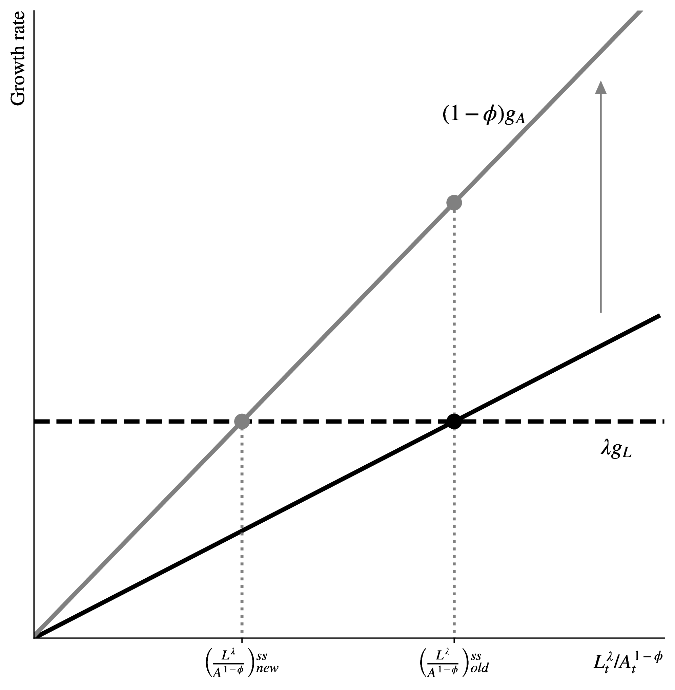
```

## Dinámicas de $g_A$

:::{.center-x}
La Tasa de Crecimiento de la Productividad a lo Largo del Tiempo
:::
```{r tasa_crecimiento_productividad, echo=FALSE, out.width="70%"}
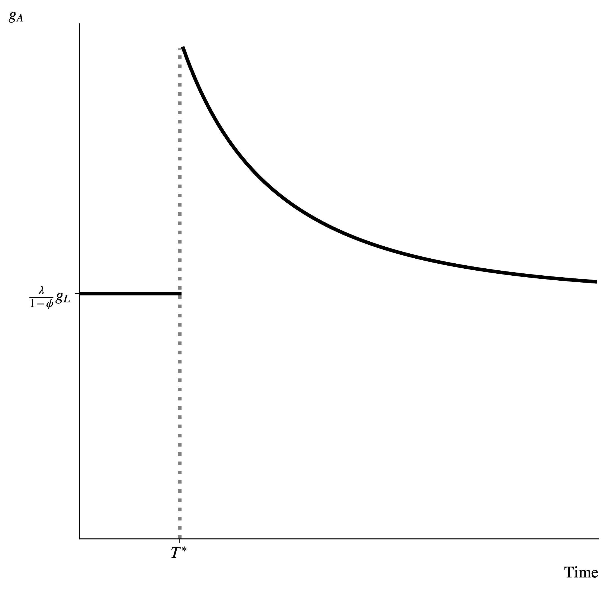
```

## Efectos de nivel

:::{.center-x}
El Nivel de Productividad a lo Largo del Tiempo
:::
```{r nivel_productividad, echo=FALSE, out.width="70%"}
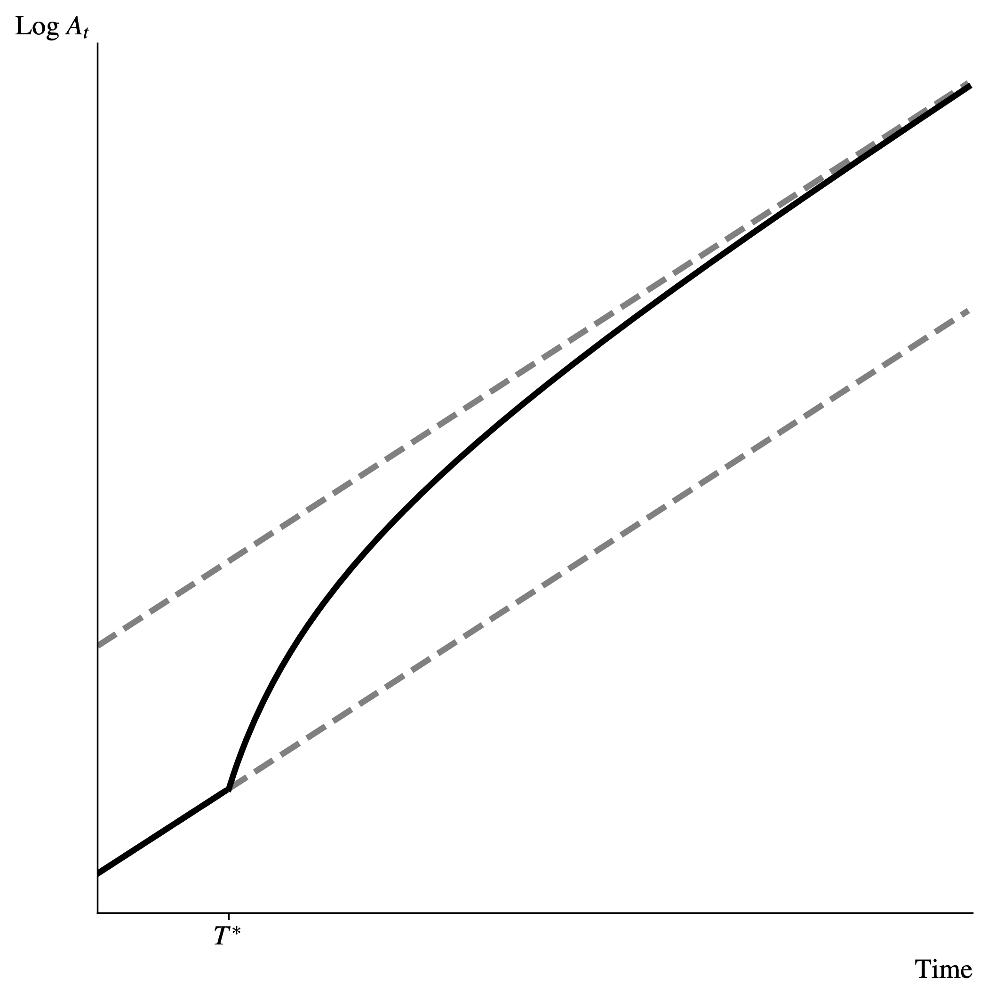
```

## El nivel de productividad

$s_R$ influye en el nivel de $A$. Hagamos esto explícito. Sabemos que en Estado Estacionario:
$$g_A^{EE} = \theta s_R \frac{L_t^{\lambda}}{A_t^{1-\phi}},$$
y podemos convertir esto en un nivel de productividad a lo largo de la SCB
$$A_t^{SCB} = \left(\frac{\theta s_R L_t^{\lambda}}{g_A^{EE}}\right)^{\frac{1}{1-\phi}}$$
en términos logarítmicos esto es
$$\ln A_t^{SCB} = \frac{1}{1-\phi}\frac{\theta s_R^{\lambda}}{g_A^{EE}} + \frac{\lambda}{1-\phi} \ln L_0 + \frac{\lambda}{1-\phi} g_L t$$
El nivel de $A$ depende del tamaño inicial de la economía, determinado por $L_0$.

## El nivel del PIB per cápita

Recuerda que el nivel del PIB per cápita es
$$y_t^{SCB} = \left(\frac{s_I}{g_A + g_L + \delta}\right)^{\frac{\alpha}{1-\alpha}} (1-s_R) A_t$$
lo cual depende de $A_t$ *y* $(1-s_R)$. Si usas $A_t^{SCB}$ para esto se vuelve complicado pero
$$\ln y_t^{SCB} = \frac{\alpha}{1-\alpha} \log \left(\frac{s_I}{g_A + g_L + \delta} \right) + \ln (1-s_R) + \frac{1}{1-\phi}\frac{\theta s_R^{\lambda}}{g_A^{EE}} + \frac{\lambda}{1-\phi} \ln L_0 + \frac{\lambda}{1-\phi} g_L t$$
y el PIB per cápita depende del tamaño inicial del mercado, $L_0$.

## El rol de $s_R$

Volviendo al nivel del PIB per cápita, vemos dos efectos de $s_R$

- Si $s_R$ sube, eso eleva la productividad, y por tanto el PIB per cápita
- Si $s_R$ sube, eso *reduce* los trabajadores dedicados a la producción, reduciendo el PIB per cápita
- Hay un valor intermedio de $s_R$ que maximiza el PIB per cápita
- No es cierto que $s_R = 1$ (todo I+D todo el tiempo) sea lo mejor porque no habrá producción para consumo.

# Decisión de I+D en el Modelo de Romer {background-color="#CED3DC"}

## La elección de I+D

Todos los resultados de largo plazo se mantienen independientemente de la elección de $s_R$. Pero $s_R$ determina el nivel de productividad y PIB per cápita. ¿Qué determina $s_R$?

- ¿Cómo las empresas deciden cuánto I+D realizar? Costo fijo versus flujo de ganancias
- ¿Qué determina el costo fijo?
- ¿Qué determina el flujo de ganancias?

Esto requiere una descripción explícita de un mercado imperfecto que permita poder de mercado y ganancias.

## El costo de I+D

Para una empresa potencial, el costo fijo de encontrar una nueva idea para implementar es
$$F_t = w_t \frac{L_{Rt}}{\dot{A}},$$

- $w_t$ es el salario que tienen que pagar a los investigadores para hacer I+D
- $L_{Rt}/\dot{A}$ representa cuántos trabajadores *por idea* se contratan
- Las empresas potenciales toman esta razón como dada, determinada en el agregado
- Por tanto $F$ es salario/trabajador por trabajador/idea = salario/idea

## El beneficio de I+D

Para una empresa potencial, si tienen una idea pueden generar un flujo de ganancias cada período. Les importa el valor presente descontado de esas ganancias, $V$, y lo compararán con $F$.
$$V_0 = \pi_0 + \frac{\pi_0(1+g_{\pi})}{1+r} + \frac{\pi_0(1+g_{\pi})^2}{(1+r)^2} + \frac{\pi_0(1+g_{\pi})^3}{(1+r)^3}+ ...$$
donde $\pi_0$ son las ganancias hoy, $r$ es la tasa de retorno, y $g_{\pi}$ la tasa de crecimiento de las ganancias.
$$V_0 = \pi_0 \sum_{t=0}^{\infty} \left(\frac{1+g_{\pi}}{1+r}\right)^{t}.$$
lo cual se resuelve como (use la idea de series geométricas)
$$V_0 = \frac{\pi_0}{r-g_{\pi}}.$$

## El beneficio de I+D

Dada el valor presente de las ganancias en el mercado
$$V_0 = \frac{\pi_0}{r-g_{\pi}}$$
una idea es más valiosa:

- Si las ganancias iniciales son grandes - esto se relaciona con el poder de mercado
- Si $r$ es bajo. $r$ es la tasa de descuento del futuro y/o retorno de activos alternativos (costo de oportunidad).
- $g_{\pi}$ es alto - esto se relaciona con el crecimiento de la economía

## Las decisiones de los innovadores

Tenemos muchas empresas potenciales, y mientras $V_0 > F$ continuarán haciendo I+D. Asumimos que dichas empresas potenciales entran al mercado con una nueva idea hasta que $V_0 = F$,
$$\frac{\pi_t}{r-g_{\pi}} = w_t \frac{L_{Rt}}{\dot{A}}.$$
Buscamos resolver esto para $s_R$, que recordemos que $L_{Rt} = s_R L_t$, entonces realmente buscamos resolver por $L_{Rt}$. Pero necesitamos

- Ganancias iniciales
- Tasa de crecimiento de las ganancias
- Salarios

## Estructura de Mercado

La estructura general de esta economía es más compleja que Solow. Una visión general:

- En la cima hay un conjunto de empresas que producen bienes finales (ej. Jumbo). Almacenan bienes intermedios que los consumidores compran (ej. Coca Cola Zero, cepillos de dientes, camisetas).
- Las empresas de bienes finales son competitivas (sin ganancias) y no hay innovación aquí. Solo almacenan bienes.
- A las empresas de bienes finales les gusta almacenar una variedad de bienes
- Las empresas de bienes intermedios suministran los bienes individuales a las empresas de bienes finales (piensen en las distintas marcas/bienes)
- Las empresas intermedias son monopolistas y obtienen ganancias
- Una nueva idea representa una nueva variedad de bien intermedio que puede obtener esas ganancias

## Empresas de bienes finales

Las empresas de bienes finales producen el PIB usando la siguiente función de producción:
$$Y = L_{Y}^{1-\alpha} \sum_{j=1}^{A} x_{j}^{\alpha}.$$

- $L_Y$ son trabajadores de producción (no trabajadores de I+D)
- $x_j$ es la cantidad de cada producto que almacenan
- $A$ es el *número* de productos que almacenan
- $\alpha$ captura cuánto les gusta la variedad.

Nota que $Y$ es PIB porque las ventas de bienes intermedios $x_j$ a la empresa de bienes finales explícitamente no se contabilizan en el PIB.

## Maximización de bienes finales

Asumimos que las empresas de bienes finales maximizan ganancias. Son competitivas entonces las ganancias terminan en cero, pero aún así lo intentan. Para hacer esto igualan el producto marginal al costo marginal. Para el trabajo:
$$w = (1-\alpha) \frac{Y}{L_Y},$$
y para un producto intermedio individual $j$
$$p_j = \alpha L_Y^{1-\alpha} x_j^{\alpha-1}.$$
esta es la ecuación de una curva de demanda para el producto $j$. Mientras mayor $p_j$, menor la demanda.

## Empresas de bienes intermedios

Cada empresa intermedia produce su bien usando la función de producción (simple) $x_j = K_j$, esto es usando solo capital el cual cuesta $r$ por unidad de capital. Sus ganancias son:
$$\pi_j = p_j x_j - r x_j.$$
Las empresas son monopolistas, entonces saben cómo $p_j$ responde a su elección de $x_j$. Es decir, saben cómo se ve la curva de demanda de las empresas de bienes finales.

Igualan el ingreso marginal al costo marginal
$$p + \frac{\partial p}{\partial x}x = r.$$

## Empresas de bienes intermedios

Toma la condición IMg = CMg
$$p + \frac{\partial p}{\partial x}x = r.$$
divide por $p$
$$1 + \frac{\partial p}{\partial x}\frac{x}{p} = \frac{r}{p}.$$
y la razón del lado izquierdo es la elasticidad del precio con respecto a la cantidad, que de las empresas de bienes finales es igual a $\alpha - 1$. Entonces
$$1 + (\alpha-1) = \frac{r}{p}$$
y
$$p = \frac{1}{\alpha}r.$$

## Empresas de bienes intermedios

Dado el resultado de precios
$$p = \frac{1}{\alpha}r$$
esta ecuación muestra que existe un *markup* en el precio sobre el costo marginal. Si $\alpha$ tiende a uno, a la empresa de bienes finales no le importa la variedad, y el markup es menor (y viceversa).

Este poder de mercado es lo que impulsará las ganancias y hará que valga la pena innovar para crear un nuevo bien intermedio.

## Resultados Agregados

Dados los resultados *micro* de las empresas de bienes finales e intermedios.

- Cada empresa intermedia tiene una tecnología idéntica, entonces $p_j = r/\alpha$ para todas
- Porque son idénticas, demandan cantidades idénticas de capital, $x_j = K/A$

entonces las empresas de bienes finales producen
$$Y = L_Y^{1-\alpha} A x^{\alpha}.$$
lo cual se resuelve como
$$Y = L_Y^{1-\alpha} A \left(\frac{K}{A} \right)^{\alpha} = K^{\alpha} (AL_Y)^{1-\alpha}.$$
A pesar de la complejidad, el PIB tiene una función de producción similar al de Solow (ahora $A$ es el número de ideas/variedades)

## Salarios y ganancias

Dada la condición de primer orden de las empresas de bienes finales:
$$w_t L_{Yt} = (1-\alpha)Y_t,$$
$(1-\alpha)$ del PIB se gasta en trabajadores. El otro $\alpha$ debe gastarse en bienes intermedios (las empresas de bienes finales no tienen ganancias). Los ingresos de cualquier empresa intermedia dada son entonces
$$p_j x_j = \frac{\alpha Y_t}{A_t}$$
o las $A$ empresas se dividen el $\alpha Y_t$ en ganancias totales

## Ganancias por empresa

¿Cuáles son las ganancias para una empresa?
$$\pi_t = p_t x_t - r_t x_t = (p_t - \alpha p_t) x_t = (1-\alpha) p_t x_t,$$
y reemplaza con los ingresos de la empresa $p_j x_j = \frac{\alpha Y_t}{A_t}$
$$\pi_t = (1-\alpha) \alpha \frac{Y_t}{A_t}.$$
son las ganancias por empresa que produce bienes intermedios. Estas son las ganancias iniciales que entran en la valuación de una idea.

## Tasa de crecimiento de las ganancias

¿Qué tan rápido crecen las ganancias? Las ganancias son
$$\pi_t = (1-\alpha) \alpha \frac{Y_t}{A_t}.$$
entonces las ganancias crecen a la tasa (a lo largo de la SCB) de
$$g_{\pi} = g_Y - g_A.$$
pero sabemos que a lo largo de la SCB $g_Y = g_L + g_A$ entonces
$$g_{\pi} = g_L$$
o las ganancias crecen tan rápido como el tamaño del mercado (escala = población).

## Solución de I+D: Resolviendo por $s_R$

Tenemos todas las piezas para volver a esta condición para innovación:
$$\frac{\pi_t}{r-g_{\pi}} = w_t \frac{L_{Rt}}{\dot{A}}.$$
entonces
$$\frac{\alpha(1-\alpha) \frac{Y_t}{A_t}}{r-g_L} = (1-\alpha)\frac{Y_t}{L_{Yt}} \frac{L_{Rt}}{g_A A_t}.$$
lo cual se resuelve para
$$\frac{s_R}{1-s_R} = \frac{\alpha(1-\alpha)}{(1-\alpha)}\frac{g_A}{r-g_L}.$$

## Resolviendo para $s_R$

Dada la solución
$$\frac{s_R}{1-s_R} = \frac{\alpha(1-\alpha)}{(1-\alpha)}\frac{g_A}{r-g_L}.$$
$s_R$ es mayor:

- si $g_A$ es mayor: Si las innovaciones llegan rápidamente, vale la pena contratar trabajadores de I+D
- si $r$ es menor: Si el futuro importa más, vale la pena hacer I+D
- si $g_L$ es mayor: Si el mercado crece rápidamente, vale la pena hacer I+D
- si $\alpha(1-\alpha)$ (ganancias como porcentaje del PIB) es mayor
- si $(1-\alpha)$ (salarios como porcentaje del PIB) es menor

# El Modelo Schumpeteriano de Crecimiento {background-color="#CED3DC"}

## Modelo schumpeteriano de crecimiento

Modelo propuesto por Aghion and Howitt (1992), es muy parecido al modelo de Romer, pero con algunas diferencias clave destacas en **negrita**

- Tiene todos los elementos del modelo de Solow
- Es específico sobre **qué significa** $A$ en el modelo
- $A$ **representa calidad de bienes, no número**
- Explica las dinámicas de $A$ y $g_A$
- Explica por qué $g_A$ es constante a lo largo de la SCB
- Requiere esfuerzo para crear las nuevas ideas que impulsan $A$ y $g_A$
- Explica la elección involucrada en hacer ese esfuerzo
- **Es explícito sobre el rol de la competencia**

## La parte de Solow

El modelo tiene muchos elementos ya familiares. La producción de producción es
$$Y_t = K_t^{\alpha}\left(A_t L_{Yt}\right)^{1-\alpha},$$
donde $L_{Yt}$ son trabajadores empleados en producir bienes y servicios. $L_{Rt}$ son personas dedicadas a I+D produciendo ideas, y
$$L_t = L_{Yt} + L_{Rt}.$$
denotando la proporción de trabajadores en I+D con respecto al total como
$$s_R = \frac{L_{Rt}}{L_t}.$$

## La parte de Solow

Partes estándar:

- El capital se acumula de la misma forma que en el modelo de Solow (depende de $K/AL$)
- El crecimiento poblacional es el mismo que en Solow (exógeno e igual a $g_L$)

Asumiendo que $g_A$ termina siendo constante (lo cual veremos) entonces la economía termina en Estado Estacionario con una razón $K/AL$ constante como es usual.

## Acumulación de Ideas: Escaleras schumpeterianas

Aquí el concepto de innovación está en mejorar una idea existente

- Por ejemplo, una nueva versión de un iPhone, o un nuevo modelo de auto
- Una innovación es un paso hacia arriba en la escalera de calidad
- Los pasos son discretos, entonces la innovación es "irregular"
- I+D aumentará la probabilidad de realizar un paso en la escalera
- Esto significa que el crecimiento real será irregular (cero un año, positivo el siguiente). Todo dependerá si el paso se da o no.
- Pero la tendencia de crecimiento del PIB per cápita será suave

## Mejorando una idea

La mecánica schumpeteriana para la acumulación de ideas está gobernada por:
$$A_t = (1+\gamma)^{N_t},$$
El nivel de productividad en el tiempo $t$ depende de

- $N_t$: El número de pasos que hemos dado anteriormente en la escalera de calidad
- $\gamma$: el tamaño del paso de cada innovación, el cual suponemos que es constante.

## Dando pasos en la escalera de calidad

El proceso para dar pasos en la escalera de calidad depende del esfuerzo de investigación:
$$E[dN] = \theta \frac{L_{Rt}^{\lambda}}{A_t^{1-\phi}},$$
donde

- $L_{Rt}$ es el trabajo dedicado a I+D
- $A_t$ es la posición en la escalera en el periodo $t$
- $\theta$ escala el proceso
- $\lambda$ y $\phi$ funcionan exactamente como en el modelo de Romer

## Dando pasos en la escalera

Una distinción clave en esta ecuación
$$E[dN] = \theta \frac{L_{Rt}^{\lambda}}{A_t^{1-\phi}},$$
es que esta es la *expectativa* del número nuevo de pasos dados, $dN$:

- El esfuerzo de I+D aumenta la probabilidad de dar pasos
- El nivel existente, $A_t$, puede hacer más o menos probable que el paso sea dado.

## Dinámicas: Tasa de crecimiento de la productividad

Para obtener la tasa de crecimiento para la productividad, $g_A$ usemos logaritmos:
$$\log A_t = N_t \log (1+\gamma) \approx N_t \gamma,$$
y tomemos la derivada con respecto al tiempo para encontrar
$$g_A = \frac{\dot{A}}{A_t} = \gamma dN.$$
La tasa de crecimiento depende del tamaño del paso, y el número de nuevos pasos.

## Crecimiento esperado

Dado que el número de nuevos pasos es incierto, también lo es la tasa de crecimiento de $A$.
$$E[g_A] = \gamma E[dN].$$
lo que implica que
$$E[g_A] = \gamma \theta \frac{s_R^{\lambda}L_t^{\lambda}}{A_t^{1-\phi}}.$$
Esta ecuación se ve muy parecida a la del modelo de Romer ahora, pero con la distinción de que en este caso tenemos el operador de expectativas.

## ¿Cómo se ve el crecimiento?

```{r crecimiento_schumpeteriano, echo=FALSE, out.width="70%"}
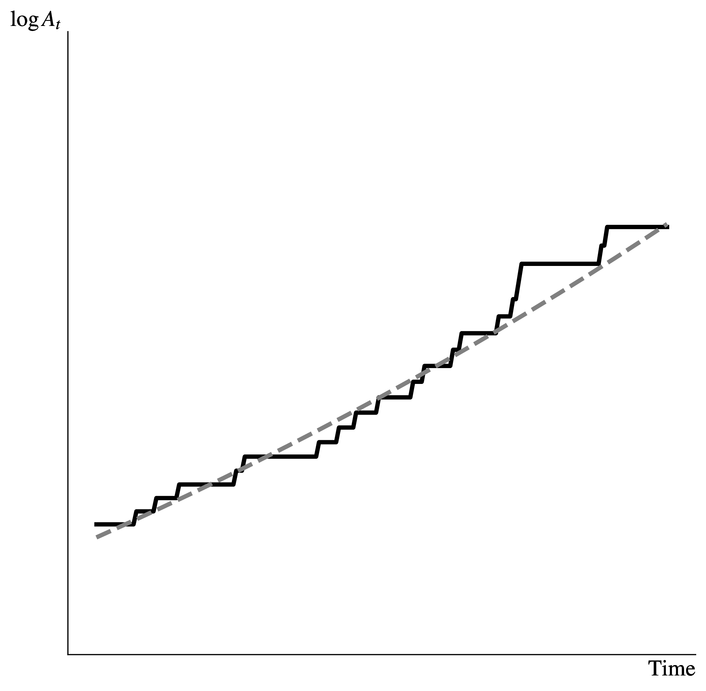
```

## Dinámicas del crecimiento de la productividad

A pesar del operador de expectativas, la tasa de crecimiento de largo plazo termina como el modelo de Romer
$$E[g_A]^{EE} = \frac{\lambda}{1-\phi}g_L.$$
La tasa de crecimiento *esperada* solo depende de qué tan rápido crece la población (que tan rápido crece la escala).

## El rol del tamaño del paso

Nota que en este Estado Estacionario
$$E[g_A]^{EE} = \frac{\lambda}{1-\phi}g_L.$$
El tamaño del paso de innovación, $\gamma$, no importa en absoluto. ¿Por qué?

- Un $\gamma$ grande significa grandes saltos en productividad, $A_t$, cuando ocurre innovación. Eso debería hacer la tasa de crecimiento mayor.
- Pero ese mismo salto en $A_t$ también hace $E[dN]$ *menor* porque eleva el nivel existente de productividad
- Estos dos efectos se cancelan en Estado Estacionario. La tasa a la que subes la escalera depende de cuánto esfuerzo pongas, $g_L$, no de qué tan separados están los pasos, $\gamma$.

## El rol del tamaño del paso

Pero nota que en Estado Estacionario la tasa de $E[dN]$
$$E[dN]^{EE} = \frac{E[g_A]^{EE}}{\gamma} = \frac{\lambda}{1-\phi}\frac{g_L}{\gamma}.$$
sí depende de $\gamma$.

- Para un nivel dado de esfuerzo, si los pasos son más grandes, damos menos de ellos.

## Dinámicas comparativas

Toda la lógica y análisis sobre cambios en $s_R$, $\theta$, y $g_L$ son iguales en el modelo Schumpeteriano que en el de Romer

- No hay efecto de largo plazo en la tasa de crecimiento de $s_R$. Sí afecta el nivel de $A_t$
- El tamaño de $g_L$ cambia la tasa de crecimiento de largo plazo y el nivel de $A_t$
- El diagrama y análisis de cambios es idéntico al modelo de Romer

# Decisión de I+D en el Modelo Schumpeteriano {background-color="#CED3DC"}

## Decisión de I+D

Como Romer, todos los resultados de largo plazo se mantienen independientemente de la elección de $s_R$. Pero $s_R$ determina el nivel de productividad y PIB per cápita. ¿Qué determina $s_R$?

- ¿Cómo toman decisiones de I+D las empresas? Costo fijo versus flujo de ganancias
- ¿Qué determina el costo fijo?
- ¿Qué determina el flujo de ganancias?

Esto requiere una descripción explícita de un mercado imperfecto que permita poder de mercado y ganancias.

## El costo de I+D

Para una empresa potencial, el costo fijo de encontrar una nueva idea para implementar es
$$F_t = w_t \frac{L_{Rt}}{E[dN]}.$$

- $w_t$ es el salario que tienen que pagar a la gente para hacer I+D
- $L_{Rt}/E[dN]$ es cuántos trabajadores toma *por paso*
- Las empresas potenciales toman esta razón como dada, determinada en el agregado
- Por tanto $F$ es salarios/trabajador por trabajador/idea = salarios/idea

## El beneficio de I+D

Aquí es donde el modelo Schumpeteriano se vuelve interesante.

- Una empresa que posee el "paso" más alto en la escalera será la que suministre todos los bienes intermedios al proveedor de bienes finales. Mostraremos por qué después.
- Una empresa potencial hará I+D para tratar de encontrar el siguiente "paso", y tomar el control como proveedor.
- Esta es la "destrucción creativa" sobre la que escribió Schumpeter, mientras una empresa reemplaza a otra
- En Romer, todas las empresas continuaron existiendo para siempre una vez creadas - sin destrucción
- Pero las empresas potenciales tienen que considerar la posibilidad de que serán destruidas
- Su eventual reemplazo significa que las empresas valoran una idea un poco menos, ceteris paribus

## El beneficio de I+D

Para una empresa potencial, pueden ganar ganancias de una idea pero también pueden ser reemplazadas. Les importa el valor presente descontado de esas ganancias, $V$, y lo compararán con $F$.
$$V_0 = \pi_0 + \frac{\pi_0(1+g_{\pi})(1-E[dN])}{(1+r)} + \frac{\pi_0(1+g_{\pi})^2(1-E[dN])^2}{(1+r)^2}+ ...$$

- $\pi_0$ son las ganancias hoy
- $r$ es la tasa de retorno
- $g_{\pi}$ es la tasa de crecimiento de las ganancias
- Los términos $(1-E[dN])$ son la posibilidad de que la empresa sea reemplazada en el futuro. Nota que esta probabilidad sube con el tiempo. Eventualmente *serán* reemplazadas.

## El beneficio de I+D

Podemos reducir ese valor de I+D
$$V_0 = \pi_0 + \frac{\pi_0(1+g_{\pi})(1-E[dN])}{(1+r)} + \frac{\pi_0(1+g_{\pi})^2(1-E[dN])^2}{(1+r)^2}+ ...$$
a
$$V_0 = \pi_0 \sum_{t=0}^{\infty} \left(\frac{1+g_{\pi}-E[dN]}{1+r}\right)^{t},$$
y luego
$$V_0 = \frac{\pi_0}{r-g_{\pi}+E[dN]}.$$

## Las decisiones de los innovadores

Tenemos muchas empresas potenciales, y mientras $V_0 > F$ continuarán haciendo I+D. Asumimos que entran hasta que $V_0 = F$,
$$\frac{\pi_t}{r-g_{\pi}+E[dN]} = w_t \frac{L_{Rt}}{E[dN]}.$$
Finalmente queremos resolver esto para $s_R$, que recordamos es $L_{Rt} = s_R L_t$. Como antes, estamos resolviendo para $L_{Rt}$. Pero necesitamos:

- Ganancias iniciales
- Tasa de crecimiento de las ganancias
- Salarios

# Estructura de Mercado Schumpeteriana {background-color="#CED3DC"}

## Visión general

La estructura general de esta economía es tanto más difícil como más fácil que Romer.

- En la "cima" hay un conjunto de empresas de bienes finales (ej. Target). Almacenan *un* bien intermedio que los consumidores compran (ej. solo Diet Coke)
- Las empresas de bienes finales son competitivas (sin ganancias) y no hay innovación aquí. Solo almacenan bienes.
- Hay empresas de bienes intermedios que compiten para suministrar el único bien intermedio.
- El producto de cada empresa intermedia tiene un valor de $A$ que influye en la productividad de la empresa de bienes finales (ej. el producto es más valioso para los consumidores)
- La empresa intermedia con el valor más alto de $A$ suministrará el bien intermedio

## Empresas de bienes finales

Las empresas de bienes finales producen PIB usando
$$Y = L_Y^{1-\alpha} A_j^{1-\alpha} x_j^{\alpha}.$$

- $L_Y$ son trabajadores de producción (no trabajadores de I+D)
- $x_j$ es la cantidad del producto que almacenan
- $A_j$ es el *nivel* de calidad del producto que almacenan
- $\alpha$ captura qué tan importante es el producto versus el trabajo

Nota que este $Y$ es PIB porque las ventas de bienes intermedios a la empresa de bienes finales explícitamente no se contabilizan en el PIB.

## Maximización de bienes finales

Asumimos que las empresas de bienes finales maximizan ganancias. Son competitivas entonces las ganancias terminan en cero, pero aún así lo intentan. Para hacer esto igualan el producto marginal al costo marginal. Para el trabajo:
$$w = (1-\alpha)\frac{Y}{L_Y}$$
y para el producto intermedio $j$
$$p_j = \alpha L_Y^{1-\alpha} A_j^{1-\alpha} x_j^{\alpha-1}.$$
La característica importante aquí es que la empresa de bienes finales pagará *más* por un producto de mayor calidad, $A_j$, todo lo demás igual.

## Empresas de bienes intermedios

Cada empresa intermedia produce su bien usando la función $x_j = K_j$, usando solo capital, que cuesta $r$ por unidad de capital. Sus ganancias son:
$$\pi_j = p_j x_j - r x_j.$$

**ASUMIMOS** por el momento que la empresa más alta en la escalera tecnológica ($N$) actúa como el único monopolista. Veremos por qué después.

Saben cómo $p_j$ responde a su elección de $x_j$. Es decir, saben cómo se ve la curva de demanda de las empresas de bienes finales. Igualan el ingreso marginal al costo marginal
$$p + \frac{\partial p}{\partial x}x = r.$$

## Empresas de bienes intermedios

Toma la condición IM = CM
$$p + \frac{\partial p}{\partial x}x = r.$$
divide por $p$
$$1 + \frac{\partial p}{\partial x}\frac{x}{p} = \frac{r}{p}.$$
y la razón del lado izquierdo es la elasticidad del precio con respecto a la cantidad, que de las empresas de bienes finales es igual a $\alpha - 1$. Entonces
$$1 + (\alpha-1) = \frac{r}{p}$$
y obtenemos el markup normal de
$$p = \frac{1}{\alpha}r.$$

# Resultados Agregados del Modelo Schumpeteriano {background-color="#CED3DC"}

## Sumando

Dados los resultados *micro* de las empresas de bienes finales e intermedios.

- La mejor empresa intermedia suministra eso, $p_N = r/\alpha$
- Porque hay una empresa intermedia, usa todo el capital $x_N = K$

entonces las empresas de bienes finales producen
$$Y = L_Y^{1-\alpha} A_N^{1-\alpha} x_N^{\alpha}.$$
lo cual se resuelve como
$$Y = K^{\alpha} (A_N L_Y)^{1-\alpha}.$$
Otra vez esto se ve igual que Solow, con $A_N$ el paso en la escalera tecnológica.

## Salarios y ganancias

Resolvamos las cosas que necesitamos saber. Comienza con el salario. Dada la condición de primer orden de las empresas de bienes finales:
$$w_t L_{Yt} = (1-\alpha)Y_t,$$
$(1-\alpha)$ del PIB se gasta en trabajadores. El otro $\alpha$ debe gastarse en el bien intermedio (las empresas de bienes finales no tienen ganancias). Los ingresos de la única empresa intermedia son entonces
$$p_N x_N = \alpha Y_t$$

## Ganancias por empresa

¿Cuáles son las ganancias para la empresa intermedia?
$$\pi_t = p_t x_t - r_t x_t = (p_t - \alpha p_t) x_t = (1-\alpha) p_t x_t,$$
y reemplaza con los ingresos de la empresa $p_N x_N = \alpha Y_t$
$$\pi_t = (1-\alpha) \alpha Y_t.$$
son las ganancias por empresa intermedia. Estas son las ganancias iniciales que entran en la valuación de una idea.

## Tasa de crecimiento de las ganancias

¿Qué tan rápido crecen las ganancias? Las ganancias son
$$\pi_t = (1-\alpha) \alpha Y_t.$$
entonces las ganancias crecen a la tasa (a lo largo de un SCB) de
$$g_{\pi} = g_Y$$
pero sabemos que a lo largo de un SCB $g_Y = g_L + g_A$ entonces
$$g_{\pi} = g_L + g_A$$
o las ganancias en el modelo Schumpeteriano crecen tanto con el mercado como cuando se toman pasos en la escalera.

# Solución de I+D del Modelo Schumpeteriano {background-color="#CED3DC"}

## Resolviendo para $s_R$

Tenemos todas las piezas para volver a esta condición para innovación:
$$\frac{\pi_t}{r-g_{\pi}+E[dN]} = w_t \frac{L_{Rt}}{E[dN]}.$$
entonces
$$\frac{\alpha(1-\alpha) Y_t}{r-g_A-g_L+E[dN]} = (1-\alpha) \frac{Y_t}{L_{Yt}} \frac{L_{Rt}}{E[dN]}.$$
lo cual se resuelve para
$$\frac{s_R}{1-s_R} = \frac{\alpha(1-\alpha)}{(1-\alpha)}\frac{E[dN]}{r-g_A-g_L+E[dN]}.$$

## Resolviendo para $s_R$

Dado
$$\frac{s_R}{1-s_R} = \frac{\alpha(1-\alpha)}{(1-\alpha)}\frac{E[dN]}{r-g_A-g_L+E[dN]}.$$
y sabemos que $E[g_A] = \gamma E[dN]$ dada la estructura de la tecnología, entonces podemos arreglar esto como
$$\frac{s_R}{1-s_R} = \frac{\alpha(1-\alpha)}{(1-\alpha)}\frac{E[dN]}{r-g_L+E[dN](1-\gamma)}.$$
$s_R$ es mayor:

- Si $r$ es menor. Si el futuro importa más, vale la pena hacer I+D
- Si $g_L$ es mayor. Si el mercado crecerá rápidamente, vale la pena hacer I+D
- Si $\alpha(1-\alpha)$ (ganancias como porcentaje del PIB) es mayor
- Si $(1-\alpha)$ (salarios como porcentaje del PIB) es menor

## Doble rol de la innovación

A diferencia del modelo de Romer hay dos efectos distintos de la innovación, $E[dN]$, aquí:
$$\frac{s_R}{1-s_R} = \frac{\alpha(1-\alpha)}{(1-\alpha)}\frac{E[dN]}{r-g_L+E[dN](1-\gamma)}.$$
¿Qué pasa si $E[dN]$ es mayor?

- En el denominador, esto *reduce* $s_R$
- Esto captura que mayor $E[dN]$ significa mayor posibilidad de ser reemplazado
- En el numerador, esto *eleva* $s_R$
- Esto captura que mayor $E[dN]$ hace más fácil reemplazar al proveedor existente
- En neto, el numerador "gana" matemáticamente
- Económicamente, la ganancia inmediata de ganancias por innovación supera la posibilidad distante de reemplazo

# Innovaciones Drásticas {background-color="#CED3DC"}

## Innovación drástica

Asumimos que la empresa con la mejor tecnología era el único proveedor monopolista del bien intermedio. ¿Bajo qué condiciones tiene sentido esa suposición?

- Si el "tamaño del paso" de la innovación, $\gamma$, es suficientemente grande, esto se cumplirá
- La empresa de bienes finales valora el intermedio por el nivel de $A_j$ que proporciona
- El costo de producir el intermedio es el mismo para empresas con diferentes niveles de $A_j$
- La empresa de bienes finales pagará más por $A_N$ que por $A_{N-1}$
- La empresa con la tecnología $A_N$ puede bajar su precio hasta que $A_{N-1}$ no pueda obtener ganancias
- Eso deja a la empresa $A_N$ como el único proveedor
- Esto solo funciona si el tamaño del paso es suficientemente grande

## Competencia

Formalmente, permite que las empresas $A_N$ y $A_{N-1}$ se involucren en competencia Bertrand. Fijan precios por separado, pero entienden el comportamiento de la otra, y actúan estratégicamente. Fijan su precio sabiendo cómo reaccionará la otra empresa.

Compara las curvas de demanda para sus productos. Para una cantidad dada de $x_j$, ¿cuál es el precio relativo que la empresa de bienes finales pagará por la mejor tecnología?
$$\frac{p_N}{p_{N-1}} = \frac{\alpha L_Y^{1-\alpha} A_N^{1-\alpha} x^{\alpha-1}}{\alpha L_Y^{1-\alpha} A_{N-1}^{1-\alpha} x^{\alpha-1}} = \left(\frac{A_N}{A_{N-1}}\right)^{1-\alpha} = (1+\gamma)^{1-\alpha}.$$
lo que depende de qué tan grande es el tamaño del paso.

## Interacciones estratégicas

Piensa en la interacción:

- La empresa rezagada quiere mantenerse en el negocio. Puede tratar de bajar su precio y robar el negocio de la empresa líder.
- La empresa rezagada baja su precio, la empresa líder seguirá, manteniendo una razón de $(1+\gamma)^{1-\alpha}$ para que la empresa de bienes finales elija su producto
- La empresa rezagada baja otra vez, y el líder sigue, y así sucesivamente
- La empresa rezagada tiene que parar de bajar cuando $p_{N-1} = r$, o cuando el precio que cobra iguala CM y los deja con ganancias cero
- Sabemos que la empresa líder cobrará a lo más $p_N = (1+\gamma)^{1-\alpha}r$ por la empresa rezagada empujando el precio hacia abajo

## Estrategia para $N$

Sabemos que la empresa $N$ cobrará a lo más $p_N = (1+\gamma)^{1-\alpha}r$

- Si cobran exactamente esto entonces la empresa rezagada aún puede vender algunas unidades a la empresa de bienes finales
- Si la empresa líder baja el precio aún más, puede tomar todo el negocio.
- ¿Bajará más la empresa líder?
- El precio que maximiza ganancias de la empresa líder es $p_N = r/\alpha$ como monopolista
- Si $r/\alpha < (1+\gamma)^{1-\alpha}r$ las ganancias son mayores con el precio menor
- La empresa líder fijará $p_N = r/\alpha$ si $(1+\gamma) > (r/\alpha)^{1/(1-\alpha)}$.
- Si el tamaño del paso $\gamma$ es "drástico", entonces la empresa líder baja $p_N$ hasta que la empresa rezagada sale del negocio.
- La suposición de un único monopolista es una suposición de que la innovación es "drástica" y que $\gamma$ es grande

# Difusión y Crecimiento {background-color="#CED3DC"}

## Diferencias de productividad

Para países en desarrollo, I+D de vanguardia es limitado

- Modela la productividad como difusión o adopción en lugar de innovación
- La distancia a la frontera importa; brechas más grandes significan más oportunidades
- El capital humano importa; canal adicional que permite adopción

¿Cómo evoluciona la productividad cuando la difusión impulsa el crecimiento?

## Configuración de producción

La producción es como el modelo de Romer con variedades
$$Y_t = (h_t L_t)^{1-\alpha} \int_{0}^{D_t} x_{jt}^{\alpha} dj.$$
Como Romer, cada variedad $D_t$ usa cantidad similar de capital
$$\int_{0}^{D_t} x_{jt} dj = K_t.$$
El PIB entonces es igual a
$$Y_t = K_t^{\alpha}(D_th_tL_t)^{1-\alpha}.$$
Todo sobre el capital funciona como en Solow/Romer.

## Dinámicas de difusión

La difusión de ideas/variedades ocurre según
$$dD = \psi h A_t^{\gamma} D_t^{1-\gamma}.$$

- $\psi$ es un parámetro de escala
- $A_t$ es el nivel de productividad en economías *líderes*
- $D_t$ es el nivel actual de variedades usadas
- $\gamma$ dicta qué tan importante es el líder para la difusión
- El capital humano, $h$, puede aumentar la difusión

## Dinámicas de difusión

La tasa de crecimiento de la difusión es por tanto
$$g_D = \psi h \left(\frac{A_t}{D_t}\right)^{\gamma}.$$

- La razón $A/D$ dicta el ritmo de crecimiento de variedades
- Similar a modelos anteriores donde la razón de stocks dicta una tasa de crecimiento
- Nota que mientras $D$ sube, $g_D$ baja, similar a las dinámicas de Solow/Romer

## Dinámicas de difusión

```{r dinamica_difusion, echo=FALSE, out.width="70%"}
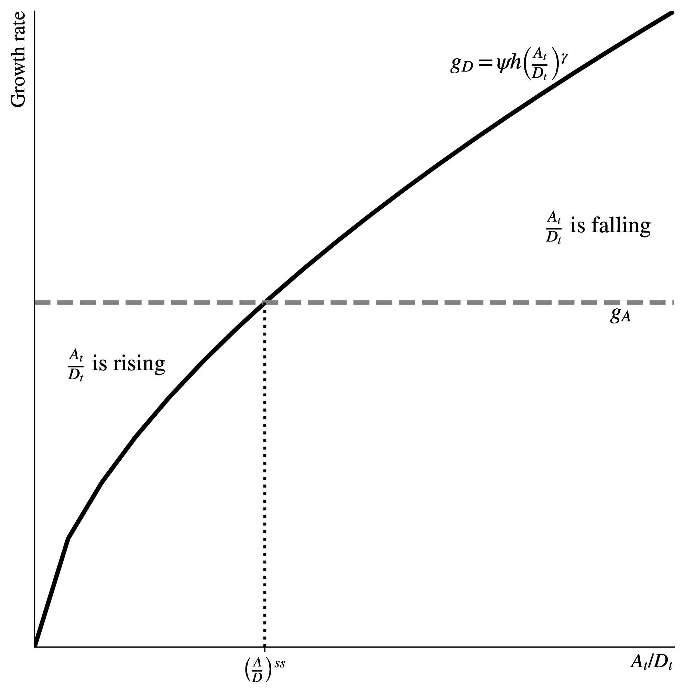
```

## Equilibrio de Estado Estacionario

Dada cualquier razón inicial $A/D$

- La tasa de crecimiento $g_D = g_A$
- Los seguidores solo pueden crecer tan rápido como los líderes
- Mientras alcanzan se desaceleran
- El nivel de $D$ determina qué tan cerca de la frontera está un país

## Equilibrio de Estado Estacionario

¿Cuál es la razón $A/D$ de estado estacionario?
$$\left(\frac{A}{D}\right)^{ss} = \left(\frac{g_A}{\psi h}\right)^{1/\gamma}.$$
Esta razón es *menor* y el seguidor está *más cerca* cuando

- $h$ es alto. Más CH significa más fácil adoptar nuevas tecnologías
- $g_A$ es bajo. Si el líder crece lentamente, es más fácil mantener el paso

## Senda de Crecimiento Balanceado (SCB)

En cualquier momento dado el nivel de $D_t$ es
$$D_t = \left(\frac{\psi h}{g_A}\right)^{1/\gamma} A_t,$$
lo que significa que la SCB para PIB per cápita en el seguidor es
$$y_t^{SCB} = \left(\frac{s_I}{g_A + g_L + \delta} \right)^{\frac{\alpha}{1-\alpha}} h \left(\frac{\psi h}{g_A}\right)^{1/\gamma} A_t.$$
y el seguidor corre "paralelo" a la SCB del líder.

## Capital Humano

Nota que con esta SCB
$$y_t^{SCB} = \left(\frac{s_I}{g_A + g_L + \delta} \right)^{\frac{\alpha}{1-\alpha}} h \left(\frac{\psi h}{g_A}\right)^{1/\gamma} A_t.$$

- El capital humano es más importante que solo vía habilidades ($h$)
- El término $h^{1/\gamma}$ influye en la difusión
- La contabilidad del desarrollo puede subestimar la importancia del capital humano

# Comercio y Globalización {background-color="#CED3DC"}

## Importando ideas

Piensa en el comercio internacional como una forma de importar ideas vía variedades.
$$Y_t = (h_t L_t)^{1-\alpha} \int_0^{D_t+M_t} x_{jt} dj.$$
donde $D_t$ son las variedades domésticas y $M_t$ son variedades importadas. El comercio puede elevar el PIB agregando nuevos tipos de bienes.

## Producción doméstica

En el lado doméstico,
$$D_tz_t = K_t.$$
El país usa $K_t$ en capital para producir $z_t$ unidades de las $D_t$ variedades que puede hacer.
$$K_t - D_tx_t = D_t (z_t - x_t)  = M_tx_t.$$
Pero el país solo *usa* $x_t$ unidades de esas variedades, dejando $D_t(z_t-x_t)$ para exportación, que se intercambian por $M_t x_t$ unidades de variedades extranjeras.

## Balanza comercial

Interpretando el comercio:

- Puedes pensar en $D_t (z_t - x_t)$ como una cantidad literal de bienes enviados a países extranjeros.
- Puedes pensar en $M_t x_t$ como la cantidad de bienes importados de esos países
- O puedes pensar en $D_t (z_t - x_t)$ como capital que es propiedad del país doméstico en un país extranjero (IED saliente)
- y entonces $M_tx_t$ es la cantidad de capital propiedad de un país extranjero en el país doméstico (IED entrante)

Esto asume comercio equilibrado todo el tiempo. Agregar déficits o superávits involucra trabajo adicional en el lado del consumo.

## Comercio y PIB

Cualesquiera que sean las interpretaciones tenemos
$$K_t = x_t(D_t + M_t),$$
lo que nos permite escribir el PIB como
$$Y_t = K_t^{\alpha}(D_th_tL_t)^{1-\alpha}\left(1+\frac{M_t}{D_t}\right)^{1-\alpha}.$$
Las variedades domésticas actúan como un término de productividad. Pero también tenemos esta razón $M_t/D_t$ que puede impulsar la productividad. Nota que
$$\frac{\text{Importaciones}}{\text{PIB}} = \frac{M_tx_t}{Y_t} = \frac{M_t}{D_t+M_t}\frac{K_t}{Y_t}$$
entonces si importaciones/PIB suben, el PIB debería ser mayor. El comercio es inequívocamente bueno para el PIB en esta configuración debido a las variedades.

## Comercio y PIB

```{r comercio_pib, echo=FALSE, out.width="70%"}
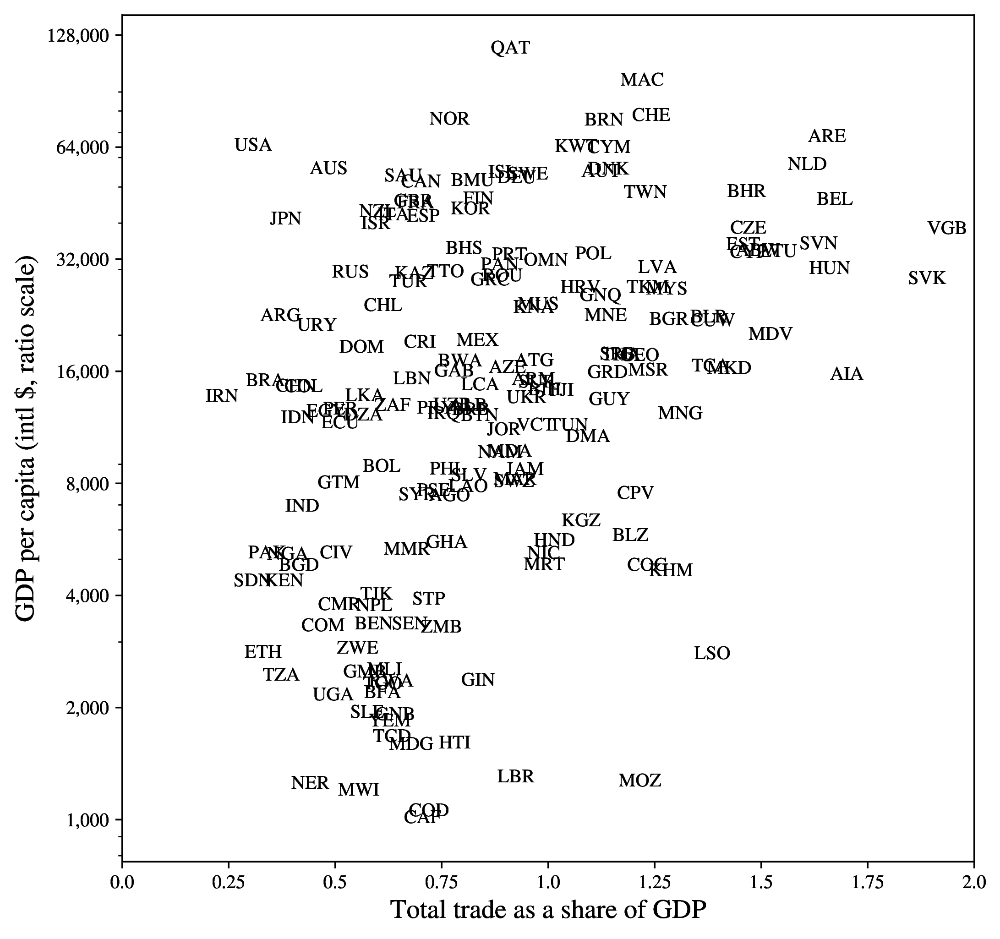
```

# Mala Asignación {background-color="#CED3DC"}

## Uso de factores

Forma alternativa de pensar sobre diferencias de productividad es vía asignaciones.

- En el modelo de Romer, asumimos que cada variedad era "igual" en términos de asignación
- Cada una usaba $K/A$ del stock de capital, porque cada una era igualmente productiva, $x_i = K_i$
- ¿Pero qué si algunas empresas/variedades obtienen más capital y algunas menos?
- PIB general menor porque el producto marginal de las variedades diferiría
- Esto aparecería en la medición como menor $A$ agregado dados los factores usados

## Producto marginal

Sea la producción como esto
$$Y = L^{1-\alpha} \int_{0}^{D} x_{j}^{\alpha} dj.$$
donde $D$ es el número de variedades, como usual. ¿Cuál es el producto marginal de cualquier variedad dada?
$$MP_j = L^{1-\alpha} \alpha x_j^{\alpha-1}$$
y como cada variedad usa capital, $x_j = K_j$, el producto marginal es
$$MP_j = L^{1-\alpha} \alpha K_j^{\alpha-1} = \left(\frac{L}{K_j}\right)^{1-\alpha}$$

## Comparar productos marginales

Toma dos variedades, $i$ y $j$. Si $K_i > K_j$ entonces

- $MP_i < MP_j$ porque PM declina con el capital usado
- Mueve una unidad de capital de $i$ a $j$. Pierdes $MP_i$, ganas $MP_j$. Aumento neto en PIB.
- Si podemos elevar el PIB solo reasignando capital (no acumulándolo) entonces hay una mala asignación
- Malas asignaciones - diferentes PM - hacen el PIB menor para un conjunto dado de $K$, $L$
- Por tanto las malas asignaciones deben aparecer como menor $A$ medido

## ¿Por qué malas asignaciones?

Si hay malas asignaciones y $MP_i \neq MP_j$, ¿por qué?

- El capital no es sustituible. Estamos equivocados que $K_i$ podría usarse como $K_j$ (edificio de oficinas versus taladro)
- Las políticas (impuestos, subsidios) favorecen una variedad sobre la otra. Las empresas estatales pueden obtener capital más barato, por ejemplo.
- Costos de transporte y reubicación. No es posible mover una fábrica entera de Ohio a Alabama.
- Diferencias en poder de mercado. ¿$i$ enfrenta competidores, $j$ es monopolista?
