```{r setup, include=FALSE}
knitr::opts_chunk$set(echo = FALSE, fig.align = "center",
                      message = FALSE, warning = FALSE)
knitr::opts_chunk$set(fig.dim=c(9, 6), fig.retina=2, out.width="100%")
```

# Introducción

## Introducción

:::{.emph}
Un aumento de la tasa de crecimiento de un punto porcentual puede significar el estancamiento o la prosperidad en el plazo de una generación!!
:::

**Robert Lucas** afirmó lo siguiente en sus **Marshall Lectures** de la Universidad de Cambridge:

> Las tasas de crecimiento de la renta real per cápita son ... diversas, incluso cuando se analiza un largo periodo ... Las rentas de la India se duplicarán cada 50 años; las de Corea cada 10. La situación de un indio será, en promedio, dos veces mejor que la de su abuelo; la de un coreano, 32 veces mejor ...

> No entiendo cómo se pueden observar cifras como éstas sin ver que representan posibilidades. ¿Podría tomar el Gobierno de la India alguna medida que permitiera que la economía india creciera como la de Indonesia o la de Egipto? En caso afirmativo, ¿cuál exactamente? En caso negativo, ¿qué hay en la "naturaleza de la India" que lo impida? Las consecuencias que tienen este tipo de cuestiones para el bienestar humano son sencillamente inmensas: cuando se piensa en ellas, resulta difícil pensar en ninguna otra cosa.

## Crecimiento económico moderno

::::{.columns}

::: {.column width="50%"}
- El crecimiento económico es un **fenómeno relativamente moderno** (Kuznets, 1996)

- **Simple cálculo**: creciendo a 2%, el PIB per cápita se duplica en 35 años.

- **Maddison (2008) y Bolt and Van Zanden (2013)**: Los países de la OCDE se multiplicaron por 3 en 1850-1930, y por 5.2 entre 1930-2010.
:::

::: {.column width="50%"}
:::{.center-x}
**PIB per cápita de algunos países de la OCDE, 1850-2010**
:::

:::{.small}
| Country | 1850 | 1930 | 2010 | 1930/1850 |  2010/1930 |
| :--- | :---: | :---: | :---: | :---: | :---: |
| Austria | 1,650 | 3,586 | 24,096 |  2.2 |  6.7 |
| Belgium | 1,847 | 4,979 | 23,557 | 2.7  | 4.7  |
| Canada | 1,330 | 4,811 | 24,941 | 3.6  | 5.2  |
| Denmark | 1,767 | 5,341 | 23,513 |  3.0 | 4.4 |
| Finland | 911 | 2,666 | 23,290 |  2.9 | 8.7 |
| France | 1,597 | 4,532 | 21,477 | 2.8  | 4.7  |
| Germany | 1,428 | 3,973 | 20,661 |  2.8 | 5.2 |
| Japan | 681 | 1,850 | 21,935 | 2.7 | 11.9 |
| Netherlands | 2,355 | 5,603 | 24,303 | 2.4 | 4.3 |
| Norway | 956 | 3,627 | 27,987 | 3.8 | 7.7 |
| Sweden | 1,076 | 4,238 | 25,306 | 3.9 | 6.0 |
| United Kingdom | 2,330 | 5,441 | 23,777 | 2.3 | 4.4 |
| United States | 1,849 | 6,213 | 30,491 | 3.4 | 4.9 |
:::

:::
::::

## Crecimiento económico moderno


::::{.columns}
::: {.column width="40%"}
- A pesar de altas tasas de crecimiento de varios países en desarrollo, hay aún **mucho por hacer para ponerse al día**.

- Estos países no solo necesitan crecer, deben **crecer a tasas que superen con creces la experiencia histórica**. 

- El mundo desarrollado ya existe, y su **acceso a recursos económicos** no solo es mucho mayor que el de los países en desarrollo, sino que el **poder** que otorga este acceso está a la vista.
:::

:::{.column width="60%"}

:::{.center-x}
**PIB per cápita de algunos países en vías de desarrollo en relación al de EE.UU.**
:::

:::{.small}
| Country       | 1982  | 1996  | 2009  | | Country      | 1982  | 1996  | 2009  |
| :---          | :---: | :---: | :---: |:---:| :---         | :---: | :---: | :---: |
| Argentina     | 34.8  | 28.8  | 31.6  | | India        | 3.7   | 4.4   | 7.2   |
| Bangladesh    | 2.4   | 2.2   | 3.1   | | Indonesia    | 5.7   | 8.6   | 9.1   |
| Botswana      | 15.8  | 22.4  | 29.1  | | Malaysia     | 20.9  | 28.3  | 30.5  |
| Brazil        | 27.6  | 22.3  | 22.5  | | Mexico       | 42.7  | 29.7  | 29.8  |
| Chile         | 19.4  | 27.8  | 31.3  | | Nigeria      | 5.4   | 4.1   | 4.8   |
| China         | 2.3   | 5.8   | 14.8  | | Pakistan     | 5.1   | 5.5   | 5.7   |
| Cote d'Ivoire | 9.9   | 5.2   | 3.7   | | Rwanda       | 3.3   | 1.9   | 2.5   |
| Egypt         | 10.5  | 10.1  | 12.3  | | South Africa | 34.8  | 22.0  | 22.3  |
| Ethiopia      | 2.3   | 1.5   | 2.0   | | Sri Lanka    | 6.5   | 7.3   | 10.4  |
| Ghana         | 3.3   | 2.8   | 3.4   | | Thailand     | 9.5   | 17.1  | 17.4  |
:::

:::
::::

# Punto de partida de la teoría del crecimiento económico

## Stock de capital: fuerte correlación con el ingreso per cápita

:::{.center-x}
**logaritmo del PIB per cápita y logaritmo del valor del capital per cápita, 2014**
:::
```{r fig1, echo=FALSE, out.width="70%"}
knitr::include_graphics("figs/fig1_gdp_capital.png")
```


## Stock de capital: fuerte correlación con el ingreso per cápita

:::{.center-x}
**logaritmo del PIB per cápita y logaritmo del valor del capital per cápita, 2014**
:::
```{r fig2, echo=FALSE, out.width="66%"}
knitr::include_graphics("figs/fig2_gdp_capital_countries.png")
```


## Stock de capital: fuerte correlación con el ingreso per cápita

- Si esta correlación es fuerte, ¿no es la acumulación de capital la respuesta?

- Temas a considerar:

  - Capacidad y motivos de ahorro.

  - Cómo se traducen los ahorros en producción.

- Eso nos lleva a la [teoría del crecimiento económico]{.emph}.

## Punto de partida de la teoría del crecimiento: ahorro = inversión

::::{.columns}

:::{.column width="60%"}

```{r fig0, echo=FALSE, out.width="100%"}
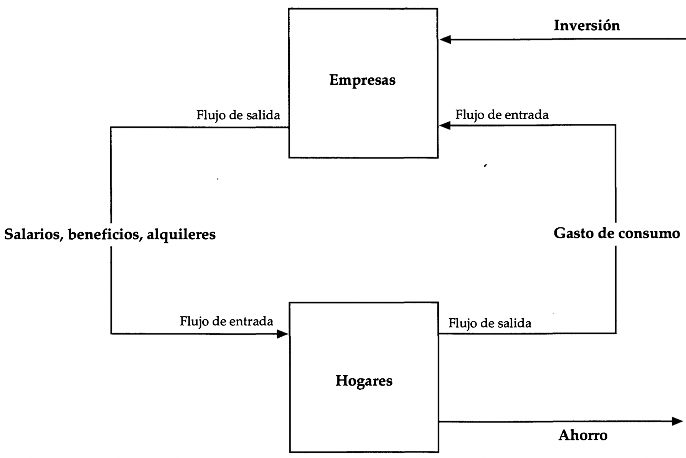
```

:::

:::{.column width="40%"}

**Identidad contable**

- Producción: $Y(t)=C(t)+S(t)=C(t)+I(t)$

- Capital: $K(t+\Delta t)-K(t)= ( I(t) -\delta K(t) ) \Delta t$

- Ecuación de [Harrod-Domar]{.emph}:
**$$s / \theta== g + n + \delta $$**

- Definiciones:

  - $y(t) = Y(t) / P(t)$,
  
  - $g = \dot{y}(t)/y(t)$, 

  - $n = \dot{P}(t) / P(t)$,

  - $s=S(t)/Y(t)$, 

  - $\theta = K(t) / Y(t)$

:::
::::


## Punto de partida en la teoría del crecimiento

:::{.emph}
*El crecimiento puede afectar a los parámetros que lo predicen (tasa de ahorro, tasa de crecimiento de la población, relación capital-producto). **Esas variables pueden ser determinadas endógenamente***.
:::
\ 

- El **ingreso per cápita** y su distribución pueden afectar el **ahorro**.

  - Ingreso cercano a subsistencia: $s$ bajo.
  
  - Ingresos clase media: desigualdad $\rightarrow$ aspiraciones $\rightarrow s\uparrow$ .
  
  - Ingresos altos: aspiraciones menos importantes y consumo corriente atractivo $\rightarrow s\downarrow$.
  
- **Transición demográfica**: Relación de $n$ con el nivel de desarrollo (U invertida).

  - Países pobres: tasas de mortalidad muy altas y tasas de natalidad altas $\rightarrow n$ bajas.
  
  - Nivel de vida $\uparrow$: tasas de mortalidad $\downarrow$ $\rightarrow n\uparrow$
  
  - Nivel de desarrollo a largo plazo $\uparrow$: las tasas de natalidad $\downarrow$ $\rightarrow n$ nuevamente bajas.

# El Modelo de Solow (endogeneidad de $K/Y$)

## El modelo de Solow: idea central


**Idea básica**: El capital y el trabajo generan conjuntamente el producto. 

- Abundancia de trabajo (e.r.c. el capital): un poco más de capital cundirá mucho $K/Y\downarrow$.

- Escasez de trabajo (e.r.c. el capital): se utilizará intensivamente el capital $K/Y\uparrow$.


- **Supuesto 1**: Los agentes ahorran una fracción constante $s$ de su ingreso:
$$S(t) = I(t) = sY(t)$$

- **Supuesto 2:**: La población crece a tasa $n$:
$$n = \dot{P}(t) / P(t)$$

- Stock de capital per cápita: 
$$\dot{K}(t)= sY(t) - \delta K(t) \rightarrow \dot{k}(t)=sy(t)-(n+\delta) k(t)$$
con $k=K/P$ y $y=Y/P$. 

## La función de producción

- La **función de producción** representa los conocimientos técnicos de la economía para mezclar insumos.
$$Y=F(K, L)$$
$K$ y $L$ son una larga lista de insumos, pero por ahora piensen en ellos como dos números.

- Rendimientos a escala:

  - Rendimientos constantes a escala: $F(\lambda K, \lambda L)=\lambda F(K, L)$ para todo $\lambda>0$.

  - Rendimientos crecientes a escala: $F(\lambda K, \lambda L)>\lambda F(K, L)$ para todo $\lambda>1$.

  - Rendimientos decrecientes a escala: $F(\lambda K, \lambda L)<\lambda F(K, L)$ para todo $\lambda>1$.

- **Supuesto 3:** La función de producción muestra rendimientos constantes a escala.


## La función de producción

**Supuesto 4:**: La función de producción muestra rendimientos marginales decrecientes de los insumos individuales.

::::{.columns}

:::{.column width="50%"}
```{r fig3, echo=FALSE, out.width="90%"}
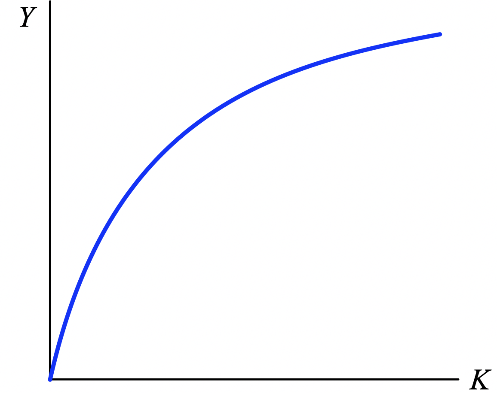
```

*Para valor fijo de $L$*
:::

:::{.column width="50%"}
```{r fig4, echo=FALSE, out.width="90%"}
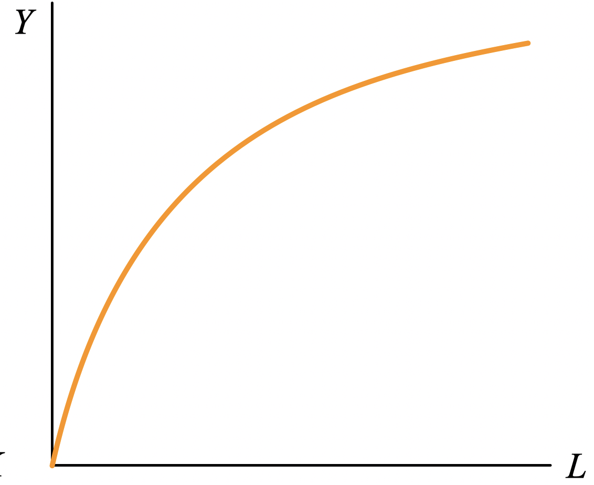
```

*Para un valor fijo de $K$*
:::

::::

## La función de producción

- Una función de producción muy utilizada es la función Cobb-Douglas:
$$Y=A K^{\alpha} L^{\beta}$$
con $0<\alpha<1,0<\beta<1$.

- Rendimientos a escala con la función Cobb-Douglas

  - $\alpha+\beta=1$ (rendimientos constantes a escala, nuestro caso principal)

  - $\alpha+\beta<1$ (rendimientos decrecientes a escala)

  - $\alpha+\beta>1$ (rendimientos crecientes a escala)

- Propiedad (suponiendo mercados competitivos):
$$PMK (K/Y) = q K/Y = \alpha \ \ \ \ PML (L/Y) = w L/Y = \beta$$


## La función de producción en su forma per cápita

- Partamos con la función Cobb-Douglas $Y=A K^{\alpha} L^{\beta}$ y dividamos entre $L$ para obtener:
$$\frac{Y}{L}=A \frac{K^{\alpha}}{L^{1-\beta}}=A\left(\frac{K}{L}\right)^{\alpha } \Rightarrow y=A k^{\alpha}$$
donde $y=Y / L$ y $k=K / L$ siempre que $\alpha+\beta=1$ (RCE).

- Caso general: $Y=F(K, L)$. Con RCE $F(\lambda K, \lambda L)=\lambda F(K, L)$. Definiendo $\lambda=1 / L$ en esta ecuación, obtenemos
$$F\left(\frac{K}{L}, 1\right)=\frac{1}{L} F(K, L)=\frac{Y}{L}, \text { o } y=f (k)$$
donde $y=Y / L, k=K / L$ y $f(k)=F(k, 1)$


## La relación $K/Y$

::::{.columns}
:::{.column width="50%"}
**Redimientos marginales decrecientes**:

A medida que $k\uparrow \rightarrow K/Y\downarrow$ debido a que hay una escasez relativa de trabajo.
:::

:::{.column width="50%"}
```{r fig5, echo=FALSE, out.width="85%"}
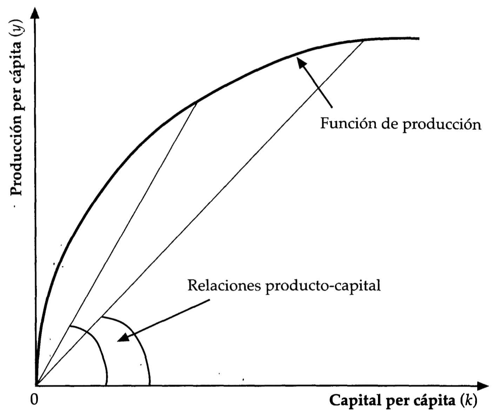
```
:::
::::

## Algunas consideraciones respecto de la función de producción

::::{.columns}
:::{.column width="50%"}
- Recuerde: $y=f(k)$ y en el caso Cobb-Douglas: $$y=A k^{\alpha}$$

- Observación: Tome el caso Cobb-Douglas y obtenga: $$\ln y=\ln A+\alpha \ln k$$

- **En el diagrama de dispersión anterior la relación lineal es bastante impresionante**.
:::

:::{.column width="50%"}
```{r fig6, echo=FALSE, out.width="150%"}
knitr::include_graphics("figs/fig2_gdp_capital_countries.png")
```
:::
::::

## Algunas consideraciones respecto de la función de producción

- Existe **mucha variación residual** alrededor de la relación lineal en el gráfico de dispersión anterior.

- **Variaciones de productividad**:
$$Y=A K^{\alpha} L^{\beta}$$
$A$ varía considerablemente de un país a otro.

  - Flujo limitado de tecnología entre países.

  - Altos costos fijos: infraestructura, redes en la producción, etc.

  - Ineficiencia distributiva: mercados de capitales imperfectos, clientelismo político, etc.


## Algunas consideraciones respecto de la función de producción

- **Capital humano limitado**: 
$$Y=F(K,\text{mano de obra de diferentes calidades})$$ 

  - En el caso Cobb-Douglas se podría postular:
$$Y=A K^{\alpha}(e L)^{\beta}$$
donde $e$ son los años de escolaridad por persona. **Vínculo con un $A$ más bajo** a través de unidades de eficiencia.

  - Alternativamente: 
  $$Y=A K^{\alpha} U^{\beta} H^{\gamma}$$ donde $U$ es mano de obra no calificada y $H$ es capital humano. Suponemos sustitución imperfecta entre tipos de trabajo.

## La ecuación fundamental del modelo de Solow

**Recodemos ...**

- Los agentes ahorran una fracción constante de su ingreso:
$$S(t)=s Y(t)$$

- El ahorro es igual a la inversión:
$$S(t)=I(t)$$

- La inversión incrementa el stock de capital:
$$\dot{K}(t)=I(t)-\delta K(t)=s Y(t)- \delta K(t)$$
con $\delta$ la tasa de depreciación.

- Esta es la ecuación de acumulación del stock de capital.

## La ecuación fundamental del modelo de Solow

- Ecuación de acumulación:
$$\dot{K}(t)=s Y(t)- \delta K(t)$$

- Para convertir a magnitudes per cápita dividimos entre el trabajo: $k=K / L, y=Y / L$ :
$$\dot{k}(t)= \frac{\dot{K(t)}}{L(t)} - n k(t) = s y(t) - (n+\delta) k(t)$$ 
(usamos $n$ para indicar la tasa de crecimiento de la población).

- Combinamos con la función de producción per cápita $y=f(k)$ :
**$$\dot{k}(t)=s f(k(t))- (n+\delta) k(t)$$**

- Esta es la **ecuación fundamental** para el modelo de crecimiento. Con ella podemos estudiar la dinámica del stock de capital

## La dinámica del stock de capital

::::{.columns}
:::{.column width="50%"}
**Solución de Solow**:

- Ecuación fundamental:
$$\dot{k}(t)=s f(k(t))- (n+\delta) k(t)$$

- En términos de variaciones porcentuales (tasa de crecimiento)
$$\frac{\dot{k}(t)}{k(t)}=s \frac{f(k(t))}{k(t)}- (n+\delta)$$
:::

:::{.column width="50%"}
```{r fig1_solow_plot, echo=FALSE, out.width="100%"}
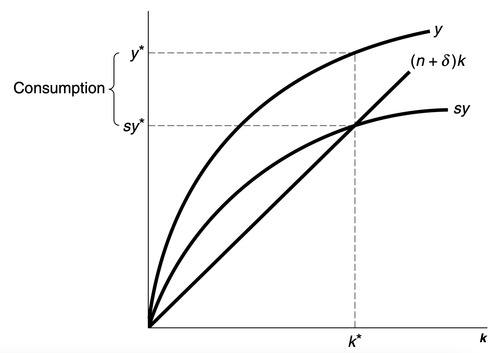
```
:::
::::

## La dinámica del stock de capital

::::{.columns}
:::{.column width="50%"}
**Convergencia desde un capital bajo:**

- Si $k(0) < k^{*}$, entonces:

  - $\dot{k}>0$. $k(t) \rightarrow^{+} k^{*}$ para cualquier $k(0)$
  
  - Donde: $$\frac{f\left(k^{*}\right)}{k^{*}}=\frac{n+\delta}{s}$$
  
  **Convergencia desde un capital alto:**

- Si $k(0) > k^{*}$, entonces:

  - $\dot{k}<0$. $k(t) \rightarrow^{-} k^{*}$ para cualquier $k(0)$
  
  - Donde: $$\frac{f\left(k^{*}\right)}{k^{*}}=\frac{n+\delta}{s}$$
  
:::

:::{.column width="50%"}
```{r fig2_solow_plot_convergence, echo=FALSE, out.width="80%"}
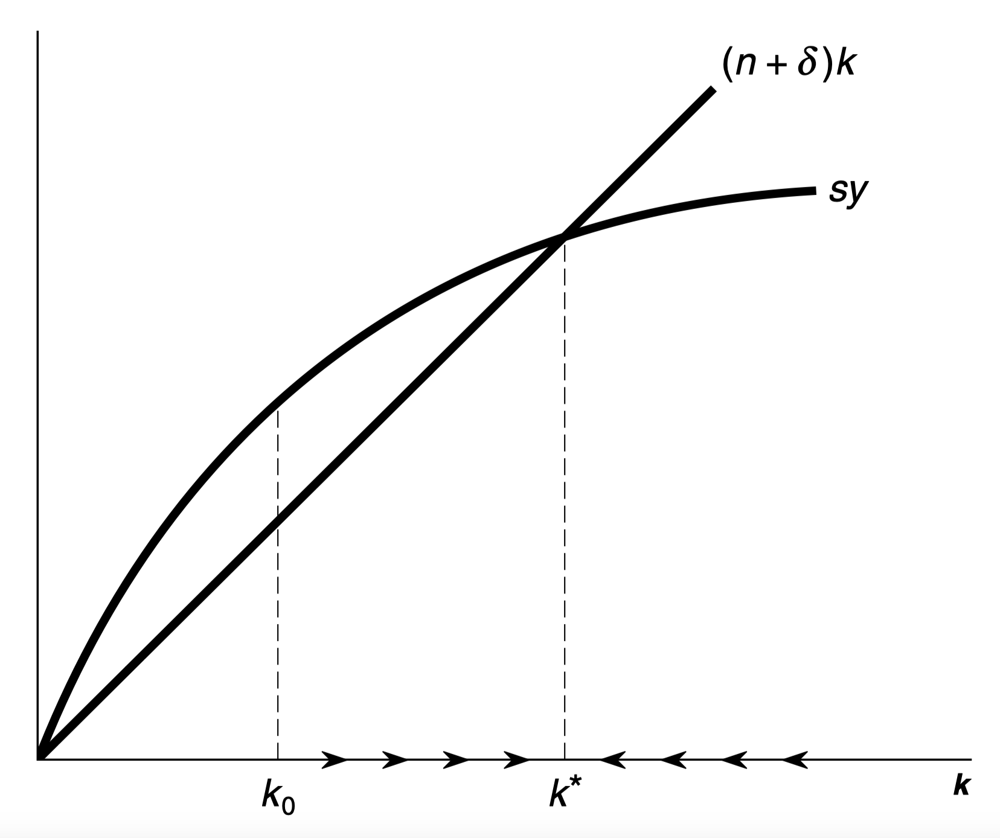
```
:::
::::


## El estado estacionario

- La **relación capital-trabajo** en estado estacionario es constante:
$$\frac{y^{*}}{k^{*}}=\frac{f\left(k^{*}\right)}{k^{*}}=\frac{n+\delta}{s}$$

- $k^{*}=K(t) / L(t)$ es constante $(\dot{k} = 0)$, pero $K(t)$ y $L(t)$ siguen creciendo a una tasa de $n$.

- Lo mismo ocurre con el producto, $y^{*}=f(k^{*})$ es constante, por lo que $Y(t)$ crece también a tasa $n$.

  - El argumento depende fundamentalmente de los **rendimientos decrecientes de los insumos**.

\ 

:::{.emph}
**Predicción del modelo de Solow 1:** 

No hay crecimiento a largo plazo por encima del crecimiento de la población. Cualquier crecimiento extra sólo viene del progreso técnico, como veremos más adelante.
:::

## El estado estacionario: estática comparativa

- ¿Cómo $s, n$ y $\delta$ afectan a $k^{*}$:

```{r fig4_comparative_statics, echo=FALSE, out.width="90%"}
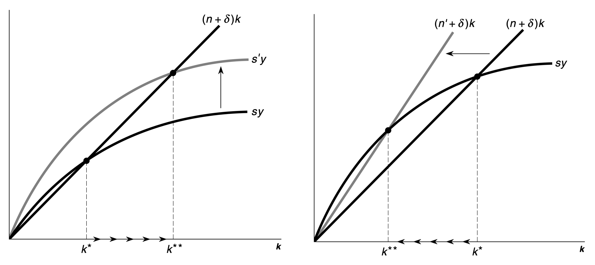 
```


## El estado estacionario para el caso Cobb-Douglas

- Estado estacionario $k^{*}$ resuelve:
$$\frac{f\left(k^{*}\right)}{k^{*}}=\frac{n+\delta}{s}$$

- En el caso de la función Cobb-Douglas, $f(k)=A k^{\alpha}$, tenemos:
$$\frac{f\left(k^{*}\right)}{k^{*}}=A k^{* \alpha-1}=\frac{n+\delta}{s}$$
y por tanto:
$$k^{*}=\left(\frac{s A}{n+\delta}\right)^{1 /(1-\alpha)}$$

- Se puede verificar directamente las propiedades que antes establecimos geométricamente 

  - Esto es, encuentre el signo de las derivadas parciales de $k^{*}$ con respecto a $s$, $n$ y $\delta$.

# Dinámica de transición

```{r dinamica_transicion, echo=FALSE, out.width="100%"}
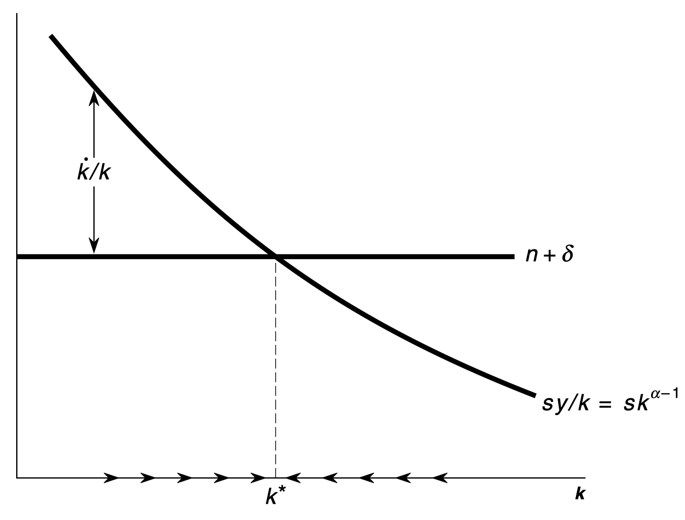 
```

# Fuentes de crecimiento: exógeno vs. endógeno


## Fuentes de crecimiento

**Crecimiento exógeno versus crecimiento endógeno**

- Crecimiento exógeno: proviene de “fuera” del modelo.

  - Progreso tecnológico continuo.

- Crecimiento endógeno: proviene del “adentro” del modelo.

  - Progreso tecnológico inducido

  - Ausencia de rendimientos decrecientes
  

## Crecimiento exógeno en el modelo de Solow: progreso tecnológico 

- **Supuesto X**: Función de producción es ahora:
$$Y(t)=F(K(t), e(t) L(t))$$
donde $e(t)$ es la eficiencia del trabajo, entonces $e(t) L(t)$ es el trabajo efectivo.

- Progreso tecnológico exógeno: 
$$\dot{e}(t)/e(t)=\pi, \pi>0$$

- Dividamos la ecuación de acumulación por $e(t) L(t)$ en lugar de $L(t)$ :
$$\dot{\hat{k}}(t)=s f(\hat{k}(t))-(n+\delta+\pi) \hat{k}(t)$$
donde $\hat{k}=K / e L$ está medido en **unidades efectivas per cápita**.

- Todo lo demás es idéntico a los visto antes.


## El estado estacionario (en unidades efectivas de de trabajo)

::::{.columns}
:::{.column width="50%"}
- En estado estacionario:
$$\frac{f\left(\hat{k}^{*}\right)}{\hat{k}^{*}}= \frac{n+\delta+\pi}{s}$$


- Note que: 
$$y^{*}(t)=\hat{y}^{*}e(t)$$
entonces, el la tasa de crecimiento per cápita a largo plazo es $\pi$.

:::

:::{.column width="50%"}
```{r fig5_solow_plot_convergence_with_agrowth, echo=FALSE, out.width="95%"}
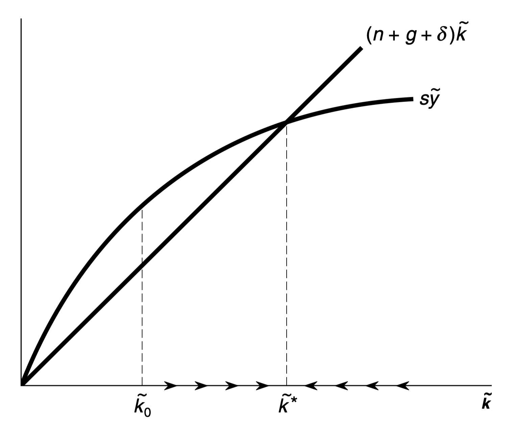
```
:::
::::


## El estado estacionario (en unidades efectivas de de trabajo)

- En el caso de la función Cobb-Douglas, $\hat{y}=f\left(k^{*}\right)=A \hat{k}^{\alpha}$, tenemos:
$$\hat{k}^{*}=\left(\frac{s A}{n+\delta+\pi}\right)^{1 /(1-\alpha)}$$

- La producción de estado estacionario en unidades efectivas de trabajo es:
$$\hat{y}^{*}=A^{1 /(1-\alpha)}\left(\frac{s}{n+\delta+\pi}\right)^{\alpha /(1-\alpha )}$$

- Como antes, la producción real per cápita y el capital crecen a una tasa de $\pi$.


## El estado estacionario (en unidades efectivas de de trabajo)

::::{.columns}
:::{.column width="50%"}
- Trayectoria de la producción per cápita en estado estacionario:
$$\begin{aligned}
y^{*}(t)&=\hat{y}^{*}(1+\pi)^{t} \\
&=A^{1 /(1-\alpha)}\left(\frac{s}{ n+\delta+\pi}\right)^{\alpha /(1-\alpha)}e(t)
\end{aligned}$$

- Note que fuera de la trayectoria de estados estacionario, el producto per cápita puede crecer más (o menos) que $\pi$.
:::

:::{.column width="50%"}
```{r fig6_path_y, echo=FALSE, out.width="95%"}
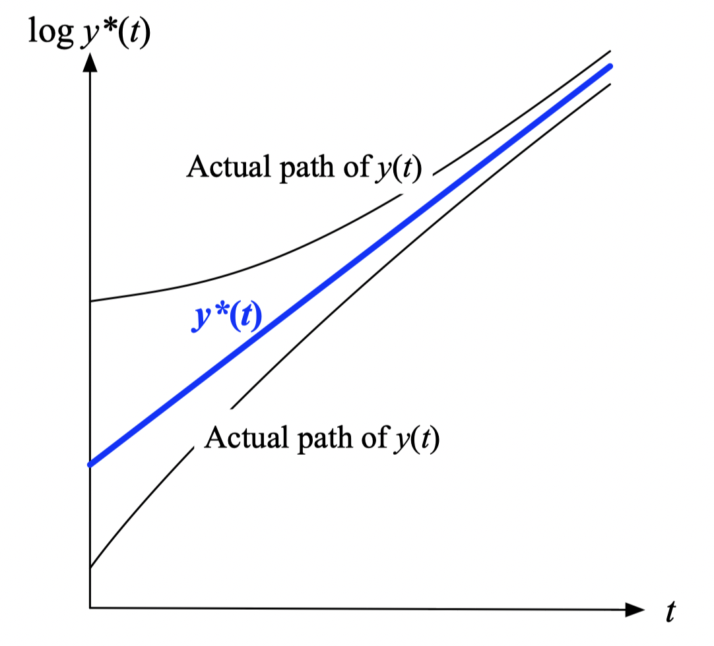
```
:::
::::

## El estado estacionario: estática comparativa

- Trayectoria de la producción per cápita en estado estacionario:
$$y^{*}(t)=\hat{y}^{*}e(t)=A^{1 /(1-\alpha)}\left(\frac{s}{n+\delta+\pi}\right)^{\alpha /(1-\alpha)}e(t)$$

```{r fig7, echo=FALSE, out.width="75%"}
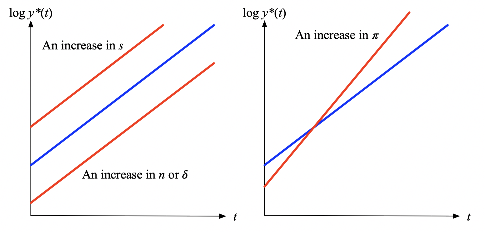
```

## El modelo AK, un primer paso a los modelo de crecimiento endógeno

- Observemos cómo se mueve el estado estacionario con $\alpha$.

  - Cuando $\alpha \rightarrow 1$, de forma que $y(t)=A k(t)$,  el modelo se comporta de manera muy diferente:
$$\dot{k}(t)=s A k(t) - (n+\delta+\pi) k(t)$$

  - Realizando manipulaciones algebraicas:
$$\text { Tasa de crecimiento }= g = \frac{\dot{k}(t)}{k(t)}=s A-(n+\delta+\pi)$$

- Entonces:
$$s A = g+n+\delta$$

  - Ahora los **parámetros** tienen **efectos permanentes** sobre la tasa de crecimiento, a diferencia del modelo de Solow.
  

# Convergencia


## Convergencia no condicinal

- El modelo de crecimiento de Solow predice **convergencia no condicional**:

  - Los ingresos de los países tienden a acercarse cada vez más unos a otros.

  - Este resultado está basado fuertemente en el supuesto de rendimientos decrecientes...

  - ...así como en la igualdad de los parámetros $s, n, \pi$ entre países.

- Pareciera que la idea de convergencia no condicional es demasiado pedir:

  - No obstante, curiosamente la literatura se ha hecho la pregunta y ha tratado de responderla.


## Probando empíricamente convergencia no condicinal

- **Baumol (AER 1986)** estudió 16 países:

  - Los más ricos del mundo hoy en día.

  - En orden de más pobre a más rico en 1870: 
  
.center[{Japón, Finlandia, Suecia, Noruega, Alemania, Italia, Austria, Francia, Canadá, 
  
  Dinamarca, EE. UU., Países Bajos, Suiza, Bélgica, Reino Unido y Australia}]

- ¿Por qué solo 16? Angus Maddison y el **proyecto Maddison**.

\ 

:::{.emph}
La base de datos del proyecto Maddison proporciona información sobre el crecimiento económico comparativo y los niveles de ingresos a muy largo plazo. La versión 2020 de esta base de datos cubre 169 países y el período hasta 2018.

https://www.rug.nl/ggdc/historicaldevelopment/maddison/releases/maddison-project-database-2020?lang=en
:::

---

## Probando empíricamente convergencia no condicinal

::::{.columns}
:::{.column width="50%"}
- **Idea**: realizar una regresión de la tasa de crecimiento de 1870-1979 sobre los ingresos de 1870 (periodo base).
$$\ln y_{i}^{1979}-\ln y_{i}^{1870}=A+b \ln y_{i}^{1870}+\epsilon_{i}$$

- La hipótesis de convergencia no condicional se cumpliría si: $$b \simeq-1$$ 

- Baumol obtiene $\hat{b}=-0.995, R^{2}=0.88$.
:::

:::{.column width="50%"}
**Gráficamente**:
```{r fig1_conv1, echo=FALSE, out.width="110%"}
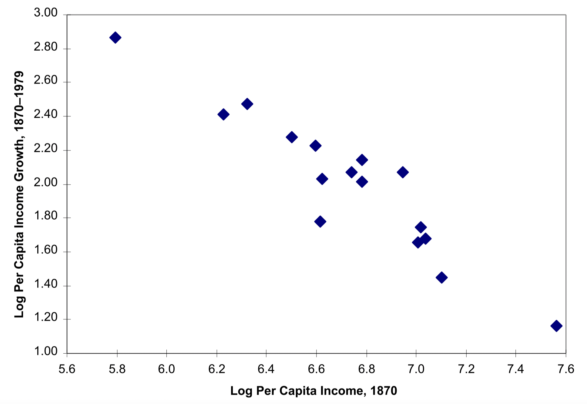
```
:::
::::

## Probando empíricamente convergencia no condicinal

- Crítica de **De Long (AER 1988)**:

  - Agrega siete países más a los 16 de Maddison.

  - En 1870, estos países tenían tanto derecho a ser miembros del **club de la convergencia** como cualquiera de los 16 incluidos por Baumol: 
  
  .center[{Argentina, Chile, Alemania Oriental, Irlanda, Nueva Zelanda, Portugal y España}]

  - Hasta 1913, Nueva Zelanda, Argentina y Chile figuraban en la lista de los diez principales receptores de inversiones extranjeras británicas y francesas (en términos per cápita).

  - Todos tenían un PIB per cápita superior al de Finlandia en 1870.

  - **Estrategia**: dejar Japón (¿por qué?) y agregar los 7.
  
## Probando empíricamente convergencia no condicinal

::::{.columns}
:::{.column width="50%"}
```{r fig2_conv1, echo=FALSE, out.width="100%"}
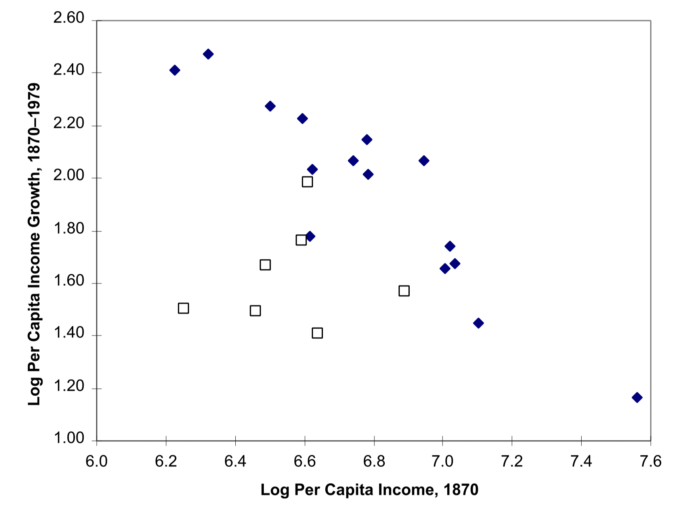
```
:::

:::{.column width="50%"}
- Pendiente sigue siendo negativa, aunque pierde significancia estadística.

- Controlando por error de medida: **desaparece toda relación**. Suponga que el verdadero valor $\ln y_{i}^{*1870}$ no es observado:
$$e_i = \ln y_{i}^{*1870} - \ln y_{i}^{1870}, \ \ \ Cov(\ln y_{i}^{1870},e_i)=0$$
Verdadera relación:
$$\ln y_{i}^{1979}-\ln y_{i}^{*1870}=A+b \ln y_{i}^{*1870}+\epsilon_{i}$$
Pero estimamos:
$$\ln y_{i}^{1979}-\ln y_{i}^{1870}=A+b \ln y_{i}^{1870} + (1+b) e_i+\epsilon_{i}$$
MCO de $b$ no cambia, pero $V((1+b) e_i+\epsilon_{i}) > V(\epsilon_{i})$
:::
::::


## Probando empíricamente convergencia no condicinal

**Más países**: Conjunto de datos de Maddison actualizado 2013, 60 países.

```{r fig3_conv1, echo=FALSE, out.width="60%"}
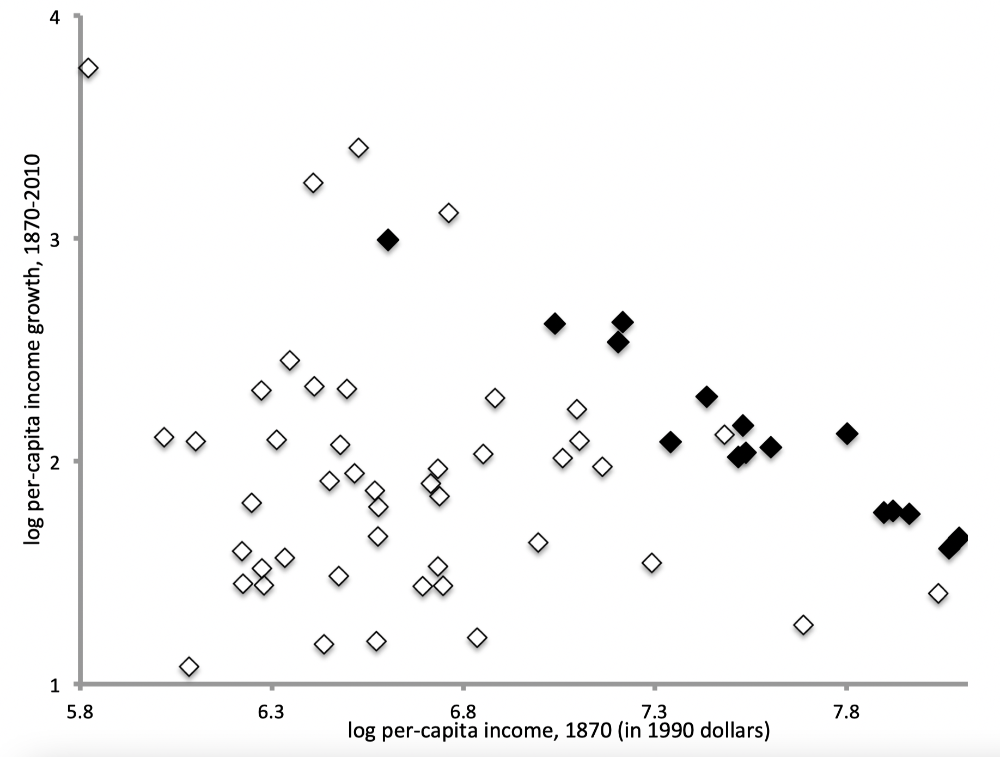
```

---

## Probando empíricamente convergencia no condicinal

**Aún más países**: Barro (QJE 1991), más de 100 países durante 1960-1985.

```{r fig4_conv1, echo=FALSE, out.width="65%"}
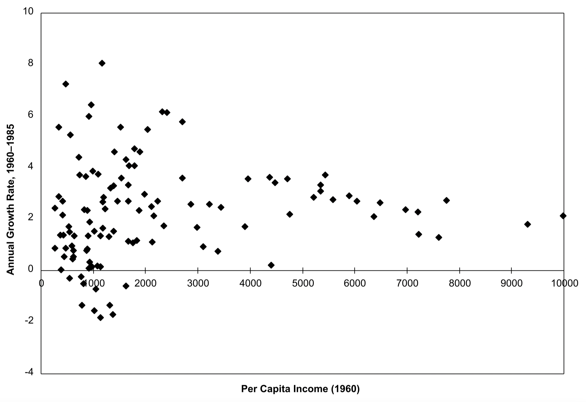
```

---

## Convergencia condicional

- El concepto de convergencia no condicional supone que todos los parámetros que determinan el nivel de ingreso de largo plazo son iguales.

:::{.emph}
**Convergencia condicional:** 

El concepto de convergencia tiene sentido solo después de "controlar por" $s$ y $n$ o cualquier parámetro que varíe sistemáticamente entre países
:::

- Dos enfoques para analizar empíricamente el concepto de convergencia condicional.

  - **Calibración**: Vamos a ver si el modelo de Solow es "suficiente" para explicar cuantitativamente las diferencias de ingreso (metodología propuesta por Kydland y Prescott, 1982).
  
  - **Regresión**: Vamos a ver si los datos soportan las predicciones del modelo de Solow respecto de los determinantes del estándar de vida de los países (Mankiew, Romer y Weil, 1992). 
  

## Convergencia condicional

Los países se diferencian en uno o más de los siguientes: nivel de conocimientos técnicos (y su evolución), la tasa de ahorro, la tasa de crecimiento demográfico y la tasa de depreciación. Distingamos:

::::{.columns}
:::{.column width="50%"}
**Convergencia en tasas de crecimiento:** 
```{r fig6_conv1, echo=FALSE, out.width="85%"}
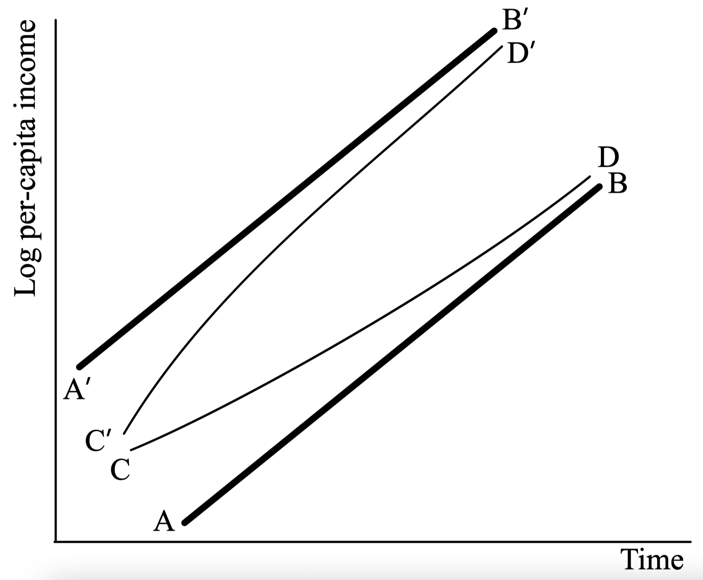
```
:::

:::{.column width="50%"}
**Divergencia:**
```{r fig7_conv1, echo=FALSE, out.width="85%"}
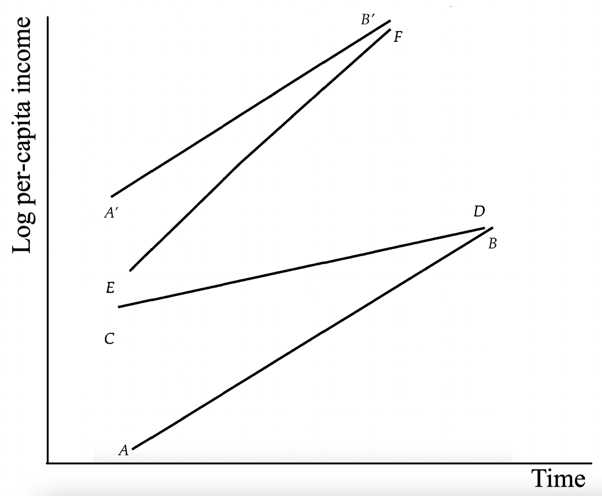
```
:::
::::


---

## Enfoque de calibración

- Recuerde la ecuación que determinaba el stock de capital en unidades efectiva de trabajo en estado estacionario era:
$$\frac{f\left(\hat{k}^{*}\right)}{\hat{k}^{*}} = \frac{n+\delta+\pi}{s}$$

- Usando la función de producción Cobb-Douglas: 
$$Y=A K^{\alpha}(e L)^{1-\alpha}$$
con $e(t)=(1+\pi)^{t}.$ 

- En unidades laborales efectivas:

$$\hat{y}=\frac{Y}{e L}=\frac{A K^{\alpha}(eL)^{1-\alpha}}{eL}=A \left( \frac{K} {eL}\right)^{\alpha}=A \hat{k}^{\alpha}(=f(\hat{k}))$$


## Enfoque de calibración

- Combinando ambas ecuaciones tenemos:
$$\frac{n+\delta+\pi}{s} = \frac{f\left(\hat{k}^{*}\right)}{\hat{k}^{*}}=A \hat{ k}^{* \alpha-1}$$

- Finalmente, resolvemos para $\hat{ k}^{*}$:
$$\hat{k}^{*}=\left(\frac{s A}{n+\delta+\pi}\right)^{1 /(1-\alpha)}$$
y para $\hat{y}^{*}$ usando la función de producción:
$$\hat{y}^{*}=A\left(\frac{s A}{n+\delta+\pi}\right)^{\alpha /(1-\alpha)}=A^{1 /(1 -\alpha)}\left(\frac{s}{n+\delta+\pi}\right)^{\alpha /(1-\alpha)}$$


## Enfoque de calibración

- Ahora suponga que dos países tienen $\pi$, $n$ y $\delta$ similares. El ratio de productos per cápita sería:
$$\frac{y_{1}}{y_{2}}=\left(\frac{A_{1}}{A_{2}}\right)^{1 / 1-\alpha}\left(\frac{ s_{1}}{s_{2}}\right)^{\alpha / 1-\alpha}$$

- $\alpha$ es la participación del ingreso del capital (¿recuerdan?).

  - Posibles valores: $0.25$ (Parente-Prescott) $-0.40$ (Lucas), entonces $\alpha /(1-\alpha) \leq 2 / 3$

- Suponga que el **país uno tiene el doble de tasa de ahorro $s$**. 

  - Entonces el ratio de ingresos es aprox. $2^{2/3}=1.587$, alrededor de $60\%$.

  - **¿Es suficiente?, la respuesta el no**. Entre 1990-2020, el ingreso per cápita promedio (PPA) del $10\%$ más rico fue alrededor de $30+$ veces el del $10\%$ más pobre.


## Enfoque de calibración

- Los diferenciales tecnológicos pueden darnos una mejor resultado en explicar diferencia en ingreso. Recuerde que:
$$\frac{y_{1}}{y_{2}}=\left(\frac{A_{1}}{A_{2}}\right)^{1 / 1-\alpha}\left(\frac{ s_{1}}{s_{2}}\right)^{\alpha / 1-\alpha}$$

- Es decir, las diferencias $A$ están más amplificadas que las diferencias $s$:
$$\frac{y_{1}}{y_{2}}=\left(\frac{A_{1}}{A_{2}}\right)^{1 /(1-\alpha)}$$

- Mismo ejercicio, suponga que el **país uno tiene el doble de nivel tecnológico**.

  - Entonces el ratio de ingresos es aprox. $2^{5/3}=3.174$, alrededor de $3+$ veces. 
  
  - Mejor, pero aún lejos. Se requerirían diferencias enormes en $A$ para capturar diferencias observadas en $y$.

  - **Variación en los ingresos demasiado alta en relación con la teoría básica**.


## ¿Qué significa $\alpha$?

- Recordemos que $\alpha$ representa la participación del ingreso del capital en el ingreso total.
$$\alpha = \frac{PMK \times k}{y}=\frac{q \times k}{y} \in (0,1)$$

  - Cuanto más grande es, mayor es la propagación que podemos calibrar o predecir.

  - Pero $\alpha$ mide la participación del capital físico, que no se acerca a 1.

  - Es el corazón de la dificultad con el modelo de Solow.

- También se pueden acumular otros insumos, como el capital humano.

  - Se debe considerar la participación de estos otros insumos en los ingresos totales.
  

## El modelo de Solow con tres insumos (Uzawa-Lucas)

- Suponga ahora que la función de producción es (usemos una Cobb-Douglas):
$$Y=A K^{\alpha} U^{\beta} H^{\gamma}$$
donde $U$ es mano de obra no calificada y $H$ es mano de obra educada.

- Mantenemos los supuestos de RCE en los 3 insumos y rendimientos marginales decrecientes en cada insumo.

- Note que existe sustitución imperfecta entre $U$, $H$ y $K$. Para producir se requieren los tres tres tipos de insumos.
 
- Ahora dividamos entre $U$ para expresar la producción por trabajador no calificado:
$$y=A k^{\alpha} h^{\gamma}$$
con $h=H/U$ y $k=K/U$.


## El modelo de Solow con tres insumos (Uzawa-Lucas)

- Ahora tenemos dos ecuaciones de acumulación:

  $$Ahorros: \ \ \ \dot{K}(t)=-\delta_{k} K(t)+s_{k} Y(t)$$

  $$Educación: \ \ \ \dot{H}(t)=-\delta_{h} H(t)+s_{h} Y(t)$$

- Supongamos por simplicidad que no existe progreso tecnológico. De nuevo, dividiendo por $U$ tenemos:
$$\dot{k}(t)=s_{k} y(t)-\left(n+\delta_{k}\right) k(t)$$
$$\dot{h}(t)=s_{h} y(t)-\left(n+\delta_{h}\right) h(t)$$

- En estado estacionario se cumple $\dot{k}(t)=\dot{h}(t)=0$, $y(t)=y^{*}$, luego:
$$k^{*}=\frac{s_{k} y^{*}}{n+\delta_{k}} \ \ \ \ \ \ \ \ \ h^{*}=\frac{s_{h} y^{*}}{n+\delta_{h}}$$


## El modelo de Solow con tres insumos(Uzawa-Lucas)

- Recuerda $y=A k^{\alpha} h^{\gamma}$. Combinando:
$$y^{*}=A k^{* \alpha} h^{* \gamma}=A\left(\frac{s_{k} y^{*}}{n+\delta_{k}}\right) ^{\alpha}\left(\frac{s_{h} y^{*}}{n+\delta_{h}}\right)^{\gamma},$$
$$y^{*}=A^{1 /(1-\alpha-\gamma)}\left(\frac{s_{k}}{n+\delta_{k}}\right)^{\alpha /(1 -\alpha-\gamma)}\left(\frac{s_{h}}{n+\delta_{h}}\right)^{\gamma /(1-\alpha-\gamma)}$$


## Enfoque de calibración (nuevamente)

- Ahora suponga que dos países tienen $n$, $\delta_k$ y $\delta_h$  similares. El ratio de productos per cápita sería:

$$\frac{y_1}{y_2}=\left(\frac{A_1}{A_2}\right)^{1 /(1-\alpha-\gamma)}\left(\frac{s_{1,k}}{s_{2,k}}\right)^{\alpha /(1 -\alpha-\gamma)}\left(\frac{s_{1,h}}{s_{1,h}}\right)^{\gamma /(1-\alpha-\gamma)}$$

- $\alpha$ y $\gamma$ son la participación del ingreso del capital y del capital humano (trabajo calificado) sobre el ingreso total, respectivamente.

  - Posibles valores: $\alpha = [0.25, 0.40]$ y $\gamma = [0.10, 0.20]$, entonces $(\alpha+\gamma) /(1-\alpha-\gamma) \leq 3 / 2$

- Suponga que el **país uno tiene el doble de tasa de ahorro $s$ en ambos capitales**. 

  - Entonces el ratio de ingresos es aprox. $2^{3/2}=2.828$, aproximadamente $\times 3$.
  
- Mismo ejercicio, suponga que el **país uno tiene el doble de nivel tecnológico**.

  - Entonces el ratio de ingresos es aprox. $2^{5/2}=5.656$, alrededor de $\times 5$. 
  
- Mucho mejor!! **Se requieren más componente para que la teoría logre capturar diferencias en ingreso**.  


# Crecimiento endógeno


## Capital físico y capital humano (Uzawa-Lucas nuevamente)

- ¿Qué sucede si $\alpha+\gamma=1$ en el modelo visto antes? En este caso:
$$y=A k^{\alpha} h^{1-\alpha}$$

- Implicancias (por simplicidad ignoremos el crecimiento de la población y la depreciación, la escencia no cambia):

  - Definimos $r=h/k$, entonces:
  $$y/k=Ar^{1-\alpha} \ \ \ \ \ \ \ \ y/h=Ar^{-\alpha}$$
  
  - Usando las ecuaciones de acumulación tenemos:
$$g_k(t)=\frac{\dot{k}(t)}{k(t)}=s_{k}Ar(t)^{1-\alpha}$$
$$g_h(t)=\frac{\dot{h}(t)}{h(t)}=s_{h}Ar(t)^{-\alpha}$$

## Capital físico y capital humano (Uzawa-Lucas nuevamente)

- Implicancias (continuación):

  - Si $g_k(t) \geq g_h(t)$, entonces $r=h/k \geq s_h/s_k$, pero como $r=h/k\downarrow$, tenemos que $r\rightarrow s_h/s_k$.
  
  - Si $g_k(t) \leq g_h(t)$, entonces $r=h/k \leq s_h/s_k$, pero como $r=h/k\uparrow$, tenemos que $r\rightarrow s_h/s_k$.
  
  - Usando lo anterior:
$$r=\frac{s_h}{s_k} \Rightarrow g_k(t)=g_h(t)$$

  - Usando la función de producción:
  $$y=A k^{\alpha} h^{1-\alpha}=y=\frac{A}{r^{\alpha}} h \frac{h+k}{h+k} = A\frac{r^{1-\alpha}}{1+r}\kappa = \tilde{A}\kappa$$
  con $\kappa=h+k$.
  
  - Si bien, la función de producción tiene retornos marginales decrecientes para $k$ y $y$, presenta retornos marginales constantes para una definición amplia de capital $\kappa$. **Este modelo presenta crecimiento sostenido como el AK**.
  

## ¿Qué logramos con este ejercicio?

**La convergencia contradice los hechos. Pero ...**

- La variación observada en el ingreso per cápita se ajusta a las variaciones en el ahorro.

- Usando un modelo que tiene tanto capital físico como humano tenemos las siguientes predicciones

  - **La convergencia condicional (una vez se controla por el capital humano)**: Condicionando por el nivel de capital humano, los países pobres tienden a crecer más deprisa.
  
  - **La divergencia condicional (una vez controlado por el nivel inicial de ingreso per
cápita)**: Condicionando por el nivel de renta per cápita, los países que tienen más capital
humano crecen más deprisa.

**A seguir**: teorías de la divergencia.
