# Trampas para el Desarrollo: Introducción {background-color="#CED3DC"}


## Los datos muestran muy poca convergencia

**Se observa muy poca convergencia, a menos que condicionemos en ...**

- ...tasas de ahorro, tasa de crecimiento poblacional, capital humano;

- variables políticas: como democracia, estabilidad;

- variables culturales: corrupción o ética laboral;

- variables religiosas ... y un largo etc.

[¿Realmente queremos una teoría del subdesarrollo basada en la presunción de que los individuos en diferentes partes del mundo tienen alguna diferencia intrínseca en su disposición —o capacidad— para ahorrar, trabajar o procrear?]{.emph}

**Esto no parece correcto!**

- Nos gustaría tener una teoría que, aunque no menosprecie ni minimice el papel de los factores sociales, culturales y políticos, no se detenga simplemente ahí.

## Causalidad bidireccional puede ser fundamental para nuestras vidas

[El **subdesarrollo** no se ve como una falla de algunos parámetros económicos fundamentales o valores socioculturales, sino mas bien como el **resultado de la interacción de un conjunto factores**, tal vez precipitados por un **sistema de creencias** o por **condiciones históricas**.]{.emph}

\ 

Razones para usar este enfoque:

1. Conduce a una teoría en la que la "convergencia" económica (de ingresos, riqueza, bienestar) entre países no es automática (o quizá no existe: divergencia).

2. No se basa en diferencias “fundamentales” entre pueblos o culturas. 

3. Tampoco permite el “cualquier cosa puede pasar”. Solo ciertas configuraciones de variables pueden ocurrir en la teoría (esto es, debemos eliminar primero la posibilidad de algunos/muchos resultados).

4. Implica un papel muy diferente para la política gubernamental (políticas temporales con efecto permanente).

## Pregunta central

[¿Si las personas de todo el mundo son intrínsecamente iguales (todos son seres humanos, con las mismas esperanzas y deseos), por qué las culturas y las economías, nacidas del mismo material intrínseco, funcionan de manera tan diferente?]{.emph}

\ 

Don conceptos centrales para responder a esta pregunta, ambos relacionados con la posible existencia de **múltiples equilibrios**:

- En un momento dado la sociedad podría verse atrapada en uno de varios posibles resultados, esto dependiendo de las **creencias** individuales sobre las acciones de los demás.

- Los **eventos históricos** (tecnologías iniciales, normas sociales o instituciones) pueden tener un impacto muy persistente/duradero, atrapando a la sociedad en el presente en uno de varios posibles resultados.

Note que este enfoque rompe con la idea de convergencia desde el principio: [La posibilidad de divergencia (o trampas del desarrollo), diferentes resultados dentro de la misma estructura, ocupa un lugar central]{.emph}.

# Trampas para el Desarrollo: Complementariedad y multiplicidad de equilibrios {background-color="#CED3DC"}

## QUERTY vs DVORAK

::: {.callout-important title="Definición: Complementariedad" icon=false}
Situación en la que la realización de alguna acción por parte de un número mayor de individuos anima a más individuos a adoptar dicha acción.
:::

:::: {.columns}

::: {.column width="50%"}
```{r querty, echo=FALSE, out.width="90%"}

```
:::

::: {.column width="50%"}
```{r dvorak, echo=FALSE, out.width="90%"}

```
:::

::::

*El ejemplo Qwerty ilustra una complementariedad. El número de adoptantes de un sistema depende de cuántos se espera que lo adopten. Dependiendo de la historia inicial, múltiples configuraciones de adopción son posibles.*

## Anticomplemetariedad: Congestión como un ejemplo de convergencia

:::{.center-x}
**Historia de dos carreteras**
```{r fig1, echo=FALSE, out.width="53%"}
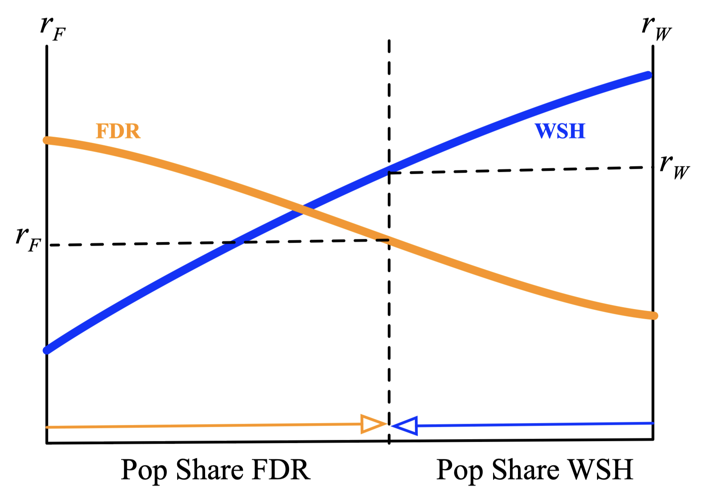
```
:::

\ 

**Definición**: $r_j(n)$, $j=F,W$, es el retorno neto dado el número de usuarios $n$. Clave: $r_j'(n)<0$

## Anticomplemetariedad: Congestión como un ejemplo de convergencia

:::{.center-x}
**Historia de dos carreteras**
```{r fig2, echo=FALSE, out.width="53%"}
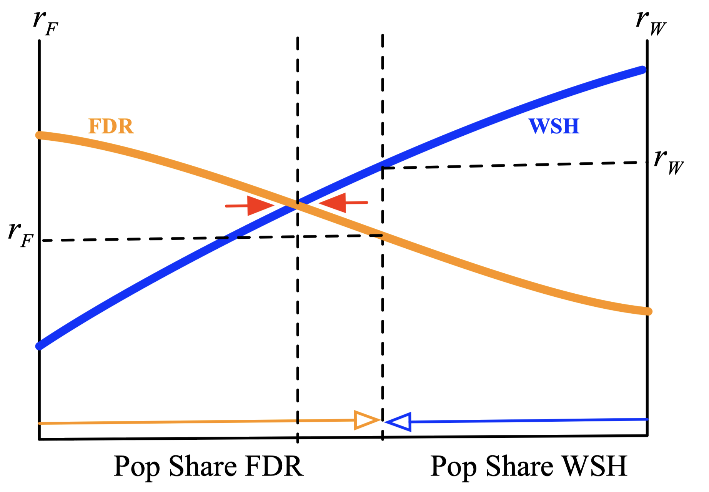
```
:::

\ 

**Definición**: $r_j(n)$, $j=F,W$, es el retorno neto dado el número de usuarios $n$. Clave: $r_j'(n)<0$  

## Complemetariedad: QWERTY como un ejemplo de divergencia

:::{.center-x}
**Historia de dos tecnologías**
```{r fig3, echo=FALSE, out.width="53%"}
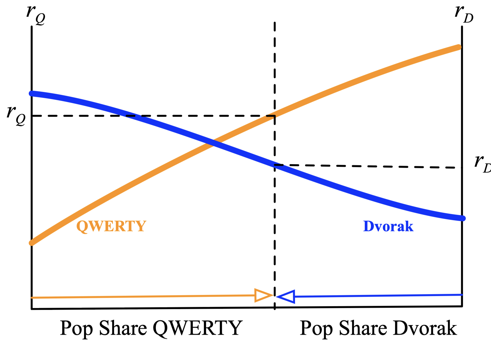
```
:::

\ 

**Definición**: $r_j(n)$, $j=Q,D$, es el retorno neto dado el número de usuarios $n$. Clave: $r_j'(n)>0$  


## Complemetariedad: QWERTY como un ejemplo de divergencia

:::{.center-x}
**Historia de dos tecnologías**
```{r fig4, echo=FALSE, out.width="53%"}
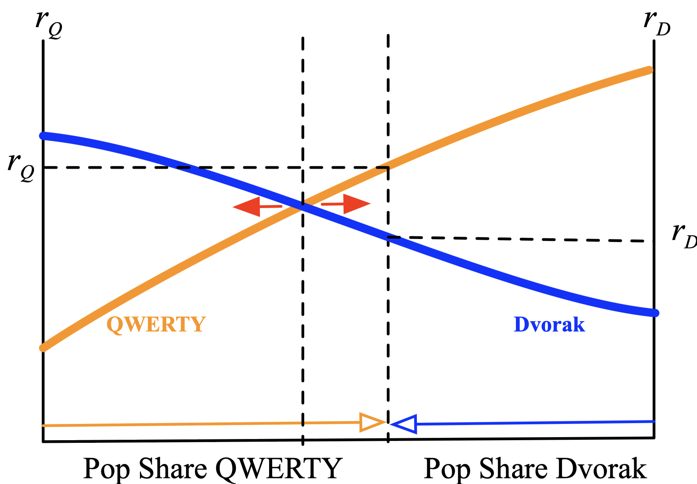
```
:::

\ 

**Definición**: $r_j(n)$, $j=Q,D$, es el retorno neto dado el número de usuarios $n$. Clave: $r_j'(n)>0$ 

## Otros ejemplos de complemetariedad

- **Plataformas**: Mac vs PC, iOS vs. Android, Facebook, AirBnB, Tinder, etc. 

  - Sitios con muchos usuarios son atractivos para nuevos usuarios por la complementariedad.

- **Infrastructura**: Sistema de transporte público donde $p=v+F/n$.
.   
  - Bajo número de usuarios $\rightarrow$ costo fijo por usuario alto $\rightarrow$ disuasión al uso $\rightarrow$  número de usuarios bajo.
  
- **Finanzas**: El mercado financiero es atractivo para las personas que buscan rendimientos seguros para sus activos.

  - Más usuarios $\rightarrow$ mayor flujo de dinero $\rightarrow$ mayor diversificación $\rightarrow$ más usuarios.
  
- **Corrupción**:

  - Evasión de impuestos alta $\rightarrow$ menor % de auditorias (costosas) $\rightarrow$ mayor incentivo a la evasión.

- **Normas sociales**:

  - Un mismo individuo puede comportarse de formas muy diferentes dependiendo de cómo se comportan los demás (diferentes sociedades y entornos).

## Mapa de Complementariedades

**Configuración básica:**

- Dos acciones o elecciones: llamémoslas QWERTY y DVORAK.

- $n$ = fracción de la población que **se espera** elija una determinada acción o elección (ejemplo: QUERTY)

- $x(n)$ = fracción de población que **quiere elegir** una acción (ejemplo QWERTY), bajo el expectativa de que $n$ lo hará.


**Complementariedad:** $x(n)$ es una función creciente. Cuanto mayor sea la fracción de personas $n$ que se espera que sean tomen una acción o elección, mayor será la fracción de personas $x(n)$ que querrán tomar dicha acción o elección. Matemáticamente, $x'(n)>0$.

  - Se puede generalizar esta idea a la **intensidad de las acciones o elecciones**, no solo binarias. Esto es, $x(n)$ es una función continua de $n$
  
  - El **mapa de complementariedad** es la representación de la conexión entre la “expectativa” $n$ con la “respuesta” $x(n)$. 
  
  - El **equilibrio** ocurre cuando $x(n) = n$. Entonces cada intersección del mapa con la diagonal es un equilibrio potencial.


## Mapa de Complementariedades: QWERTY Revisado

```{r fig6, echo=FALSE, out.width="100%"}
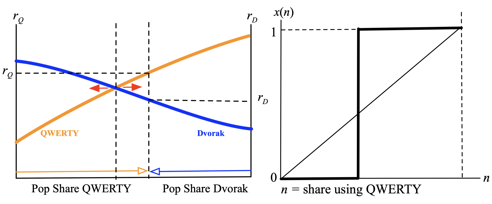
```

## Mapa de Complementariedades: Congestión revisado

```{r fig8, echo=FALSE, out.width="100%"}
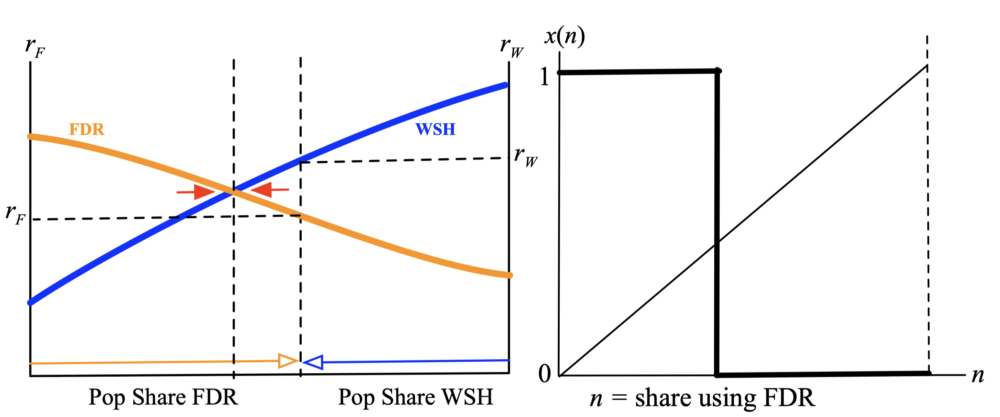
```

## Mapa de Complementariedades y multiplicidad de equilibrios

```{r fig9, echo=FALSE, out.width="100%"}
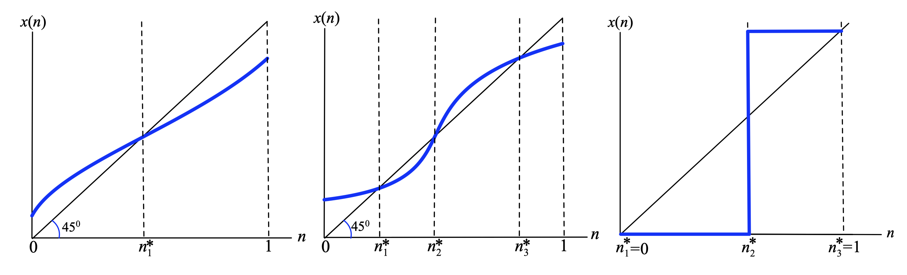
```

\ 

- **Equilibrios**: Intersecciones de $x(n)$ con la línea $45^{\circ}$.

- Resultados **únicos o múltiples**: ¿Cómo se relaciona esto con la convergencia y la divergencia?

## Equilibrios estables e inestables

```{r fig10, echo=FALSE, out.width="83%"}
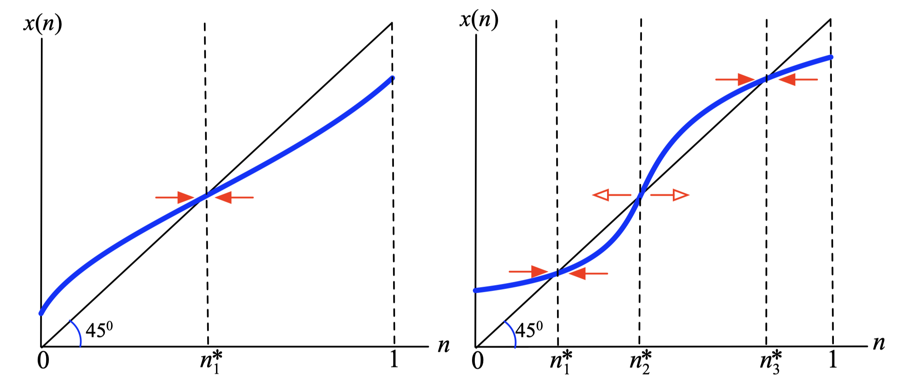
```

\ 

- **Estabilidad**: si el sistema retorna al equilibrio en el que se encuentra después de la perturbación. Si $x(n)$ cruza $45^{\circ}$ desde "arriba" (estable) o "abajo" (inestable).

- Discusión: Observe cómo las **políticas temporales** pueden tener **efectos permanentes**.


## Nota: multiplicidad de equilibrios como una falla de coordinación

**El dilema de los turistas** 

- Dos amigos están visitando la ciudad de Milan en Italia.

- Se pierden y no saben dónde está cada uno.

- Cada uno "cree" que el otro acudirá a un conocido lugar "turístico" con la esperanza de que el otro piense lo mismo.

- Hay dos lugares posibles: Santa Maria delle Grazie (la última cena) y  el Estadio Giuseppe Meazza.

- Matriz de pagos:

| | SMdG | EGM |
||::|::|
|SMdG | (2,2) | (0,0) |
| EGM |  (0,0) | (1,1) |

\ 

- **Lo mejor para ambos** sería encontrarse en Santa Maria delle Grazie, pero si la comunicación es limitada, es difícil que este resultado esté garantizado.


## Historia vs. expectativas

- Recuerde nuestra **configuración básica**:

  - Dos acciones o elecciones: llamémoslas QWERTY y DVORAK.

  - $n$ = fracción de la población que **se espera elija** QWERTY.

  - $x(n)$ = fracción de la población **que quiere elegir** QWERTY, bajo la expectativa de que $n$ lo hará.

- Basado en **expectativas**.


## Historia vs. expectativas

- Recuerde nuestra **configuración básica**:

  - Dos acciones o elecciones: llamémoslas QWERTY y DVORAK.

  - $n$ = fracción de la población que <s>se espera que elija</s> **eligió** QWERTY.

  - $x(n)$ = fracción de la población que quiere elegir QWERTY, bajo <s>la expectativa de que</s>  **observación de que**  $n$ lo hizo en el pasado.

  - Basado en la <s>expectativa</s> **historia**.

- Ejemplos:

  - **Expectativas**: Crisis de divisas, saqueos repentinos, moda....

  - **Historia**: Capital social, externalidades de red, discriminación...

*Generalmente tendremos una mezcla de historia y expectativas en todos los ejemplos*. 

## El mapa de complementariedad (nuevamente)

- Mapeo de $n$ la fracción **esperada (u observada)** para realizar una acción a $x(n)$ la fracción entonces incentivada a realizar esa acción.

- En este caso distinguimos entre **Equilibrios** (expectativas) o **estados estacionarios** (historia).

- Todo lo demás aplica a ambos conceptos. Note que la diferenciación es más un tema conceptual y de interpretación que metodológico.

## Ejemplo: unirse o no a la revolución

- Beneficios y costos:

  - Éxito: $B(x)$ a cada participante, con $x\in[0,1]$ la ubicación y $B'(x)<0$. 

  - Fracaso: $L$ a cada participante (ejemplo: encarcelamiento).

  - El espectador obtiene 0 recompensa sin importar lo que suceda.

- Probabilidad de éxito $p(n)$, donde $n$ es número de personas que se unen a la revolución.

  - $p'(n)>0$, $p(0)=0$ y $p(1)=1$. 

- ¿Si se espera que se unan $n$ personas, cuántas quieren unirse?
  
  - Unirse si: 
  $$p(n) B(x)-[1-p(n)] L>0$$


## Ejemplo: unirse o no a la revolución

```{r unirse_rev_1, echo=FALSE, out.width="83%"}
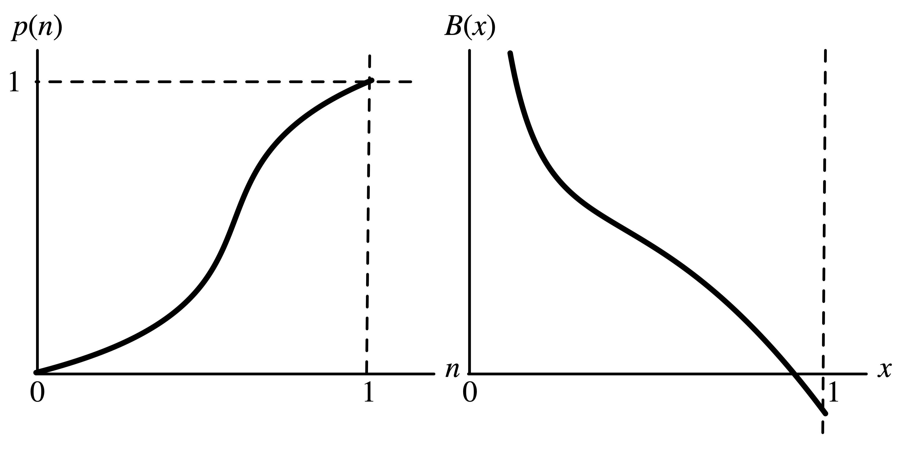
```

## Ejemplo: unirse o no a la revolución
  

:::: {.columns}

::: {.column width="50%"}
**Caso 1**: Beneficio uniforme $B(x)=B$

- Mapa de complementariedad es:
$$B>\frac{1-p(n)}{p(n)} L$$
- **Múltiples equilibrios**, con (y sin) revolución $n=1$ $(n=0)$.
:::

::: {.column width="50%"}
```{r unirse_rev_2, echo=FALSE, out.width="90%"}
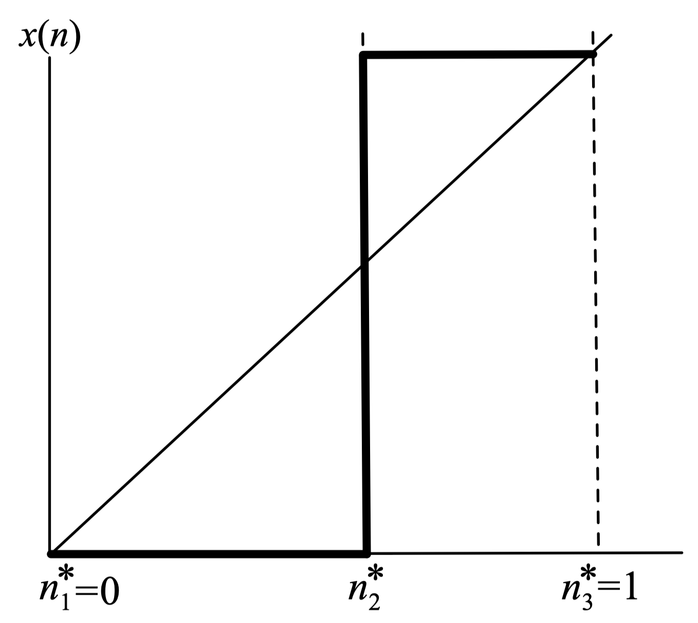
```
:::

::::

## Ejemplo: unirse o no a la revolución


:::: {.columns}

::: {.column width="50%"}
**Caso 2**: Beneficio uniforme $B(x)=\frac{1-x}{x}$ y $p(n)=n$

- Mapa de complementariedad es:
$$\frac{1-x(n)}{x(n)}>\frac{1-n}{n} L$$
- Entonces:
$$x(n) = \min\left\{1, \frac{n}{n + (1-n)L}\right\}$$
- Para cualquier parámetro $L>1$ tenemos que $x(n)<n$ cuando $n>0$. **La revolución no ocurre**.

- ¿Qué sucede para $L<1$?.
:::

::: {.column width="50%"}
```{r unirse_rev_3, echo=FALSE, out.width="90%"}
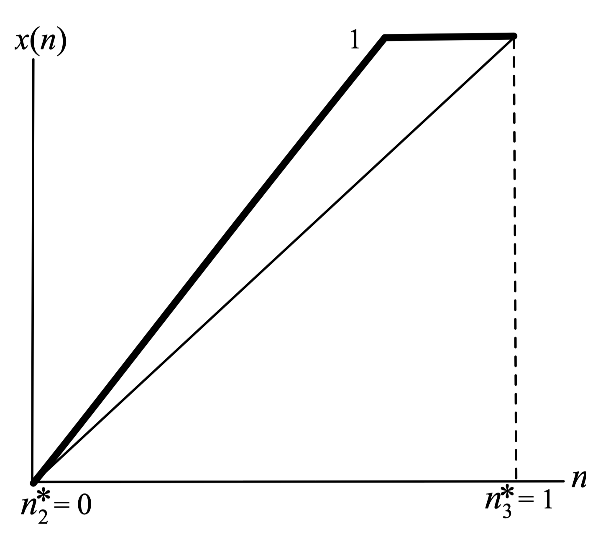
```
:::

::::

## Ejemplo: unirse o no a la revolución

:::: {.columns}

::: {.column width="50%"}
**Caso 3**: Beneficio uniforme $B(x)=\frac{1-x}{x}$ y $p(n)=n^2$

- Mapa de complementariedad es:
$$\frac{1-x(n)}{x(n)}>\frac{1-n^2}{n^2} L$$
- Entonces:
$$x(n) = \min\left\{1, \frac{n^2}{n^2 + (1-n^2)L}\right\}$$
- $L \leq 1$: en el equilibrio estable **La revolución no ocurre**.

- $L>1$: **múltiples equilibrios**, con (y sin) revolución cuando $x(n)<n$ $(x(n)>n)$ 
:::

::: {.column width="50%"}
```{r unirse_rev_4, echo=FALSE, out.width="90%"}
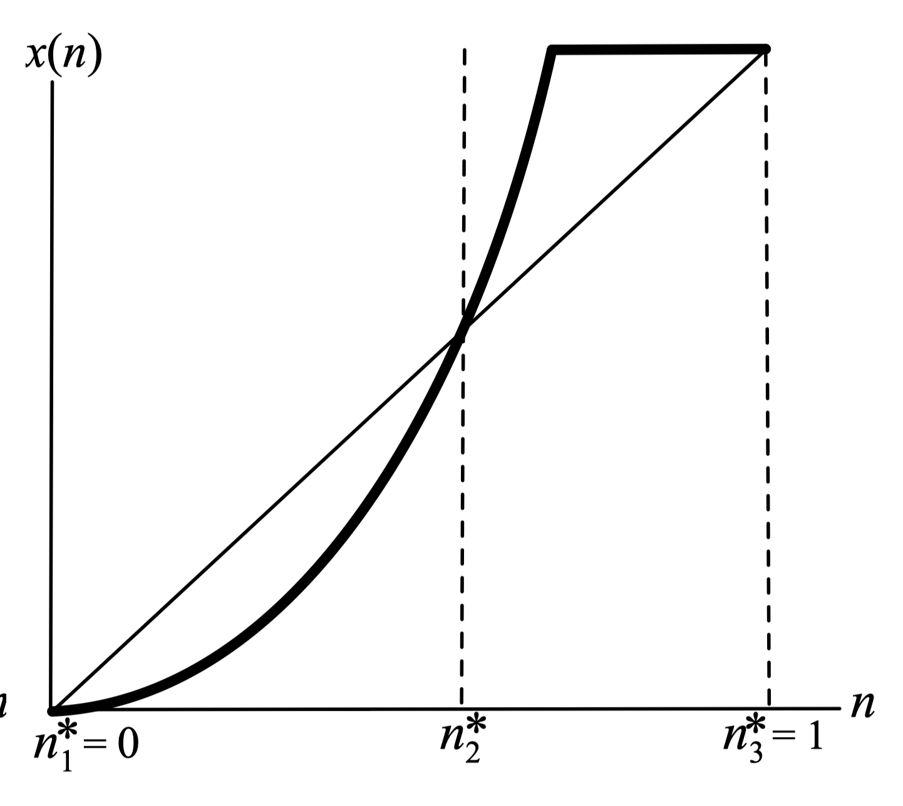
```
:::

::::

# Trampas para el Desarrollo: El subdesarrollo como un equilibrio entrampado  {background-color="#CED3DC"}

## Inversiones y complementariedades en la demanda

- Las complementariedades generalizadas pueden conducir a la economía a entramparse en un **equilibrio malo o de bajo nivel**, siendo que existe otro mejor si todos los agentes pudieran coordinar sus acciones para alcanzarlo.

- El subdesarrollo es el resultado de una [falla de coordinación]{.emph}, en la cual la inversión no ocurre porque otras inversiones no han sido hechas.

- Rosenstein-Rodan (1943) y Murphy-Shleifer-Vishny (1989): La expansión industrial aumenta los ingresos, lo cual genera demanda de otras industrias.

- La inversión industrial genera [**externalidades**]{.emph}:

  1. Beneficio de la empresa $\mapsto$ mayor ingreso nacional.

  2. Salarios más altos para los trabajadores, $\mapsto$ mayor ingreso nacional.

  3. La demanda de insumos (ganancias de otras empresas) $\mapsto$ mayor ingreso nacional.

- Una empresa que invierte lo hace fijándose en los **retornos privados** y no se preocupa directamente por estos **efectos nacionales**. 

## Inversiones y complementariedades en la demanda


**Vínculos intersectoriales y complementariedades** (Rosenstein-Rodan 1943, Hirschman 1958)

:::: {.columns}

::: {.column width="40%"}
- **vínculos hacia adelante**: 

  Inversión $\downarrow$ $\Rightarrow$ producción $\downarrow$ se propaga “hacia adelante” $\Rightarrow$ escasez de insumos para otros sectores $\Rightarrow$ inversión otros sectores $\downarrow$ (y viceversa).

- **vínculos hacia atrás**:

  Inversión $\downarrow$ $\Rightarrow$ producción $\downarrow$ se propaga “hacia atrás” $\Rightarrow$ sectores que usan mi producto como insumo tendrán baja demanda $\Rightarrow$ inversión en mi sector $\downarrow$ (y viceversa).
:::

::: {.column width="60%"}
```{r fig2_1, echo=FALSE, out.width="100%"}
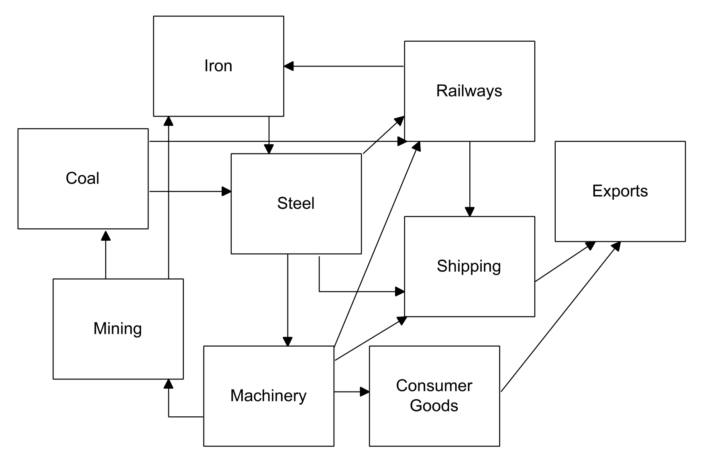
```
:::

::::

## Mapa de complementariedad para el proceso de industrialización

- Supongamos que una economía tiene muchas empresas.

- Cada empresas está indexadas por $x$ en el intervalos $[0,1]$:

- La empresa puede usar un método de **producción simple**, o puede **invertir** y aumentar su producción utilizando una **tecnología altamente productiva**.

- La nueva tecnología es productiva pero es **costosa de implementar**. Los empresas con $x$ de bajo tienen costos de instalación más bajos.

- Cada uno puede estar **inactivo o invirtiendo**.

  - Inactividad $\mapsto$ bajo beneficio (normalizamos a 0)

  - Inversión  $\mapsto$ ingresos $R(n)$ (depende de cuántas empresas $n$ inviertan, vínculos sectoriales)

- **Beneficios netos** de una empresa inversora 
$$x: \pi(n, x) \equiv R(n)-s(x)$$
donde $s(x)$ es el costo de instalación específico de la empresa $x$. 


## Mapa de complementariedad para el proceso de industrialización

Ordenemos las empresas de menor a mayor costo de instalación en $s(x)$. El **Mapa de complementariedad** es $n \mapsto R(n) \mapsto x(n)$ donde $x=x(n)$ es el índice más grande tal que $\pi(x, n)=R(n)-s(x) \geq 0$.

```{r fig2_2, echo=FALSE, out.width="85%"}
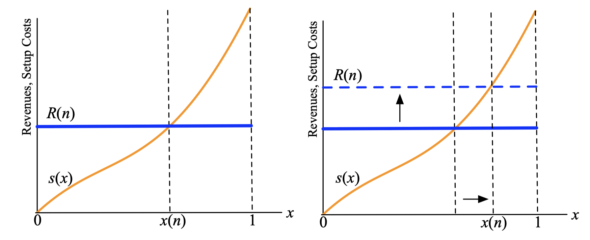
```

Siempre que $R(n)$ sea creciente en $n$, $x(n)$ también lo será.

## Mapa de complementariedad para el proceso de industrialización

```{r fig2_3, echo=FALSE, out.width="80%"}
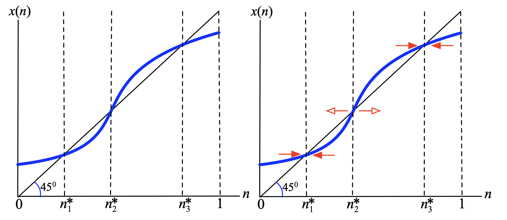
```

En el punto $n_{1}^{*}$, solo las empresas hasta $x\left(n_{1}^{*}\right)$ quieren invertir (equilibrio localmente estable).

En $n_{3}^{*}$ todas las empresas están mejor, pero ninguna empresa puede alcanzarlo unilateralmente desde $n_{1}^{*}$. Se requeriría un **big push**.

## Mapa de complementariedad para el proceso de industrialización

- Hemos discutido las **externalidades** creadas por cada empresa al **invertir**.  

  - Dado que las empresas invierten mirando la rentabilidad privada, los resultados en equilibrio podrían ser ineficientes y podrían existir múltiples equilibrios con diferentes niveles de eficiencia.
  
- Adam Smith en **La Riqueza de las Nacionaes** defiende la idea que los precios de mercado y los intereses privados serán suficientes para manejar todos los beneficios sociales.

  - ¿Puede calzar esta historia con nuestro mapa de complementariedad?

- Miremos el caso en que al argumento de Adam Smith funciona. 

  - Supongamos que solo hay una externalidad del acto de inversión: las ganancias de la empresa aumentan el ingreso nacional y estimulan otras inversiones.
  
  - Si bien las empresas no están interesadas en aumentar el ingreso nacional, su búsqueda de ganancias puede incentivarlos a actuar por el bien de la sociedad.


## Mapa de complementariedad para el proceso de industrialización

:::: {.columns}

::: {.column width="50%"}
- Mapa de complementariedad con una forma particular: 

  - $x(n)>n$: la empresa marginal $x(n)$ supera a la última empresa $n$ que se espera invierta, pero $n$ tiene un costo de instalación más bajo que $x(n)$ $\Rightarrow$ ganancia positiva $\Rightarrow$ ingreso nacional $\uparrow$
  
  - $x(n)<n$: la empresa $n$ que se espera invierta excede a la empresa marginal $x(n)$ $\Rightarrow$ ganancia negativa $\Rightarrow$ ingreso nacional $\downarrow$

**Intuición**: Las complementariedades duran mientras el beneficio de la industrialización sea positivo. 
:::

::: {.column width="50%"}
```{r fig2_4, echo=FALSE, out.width="100%"}
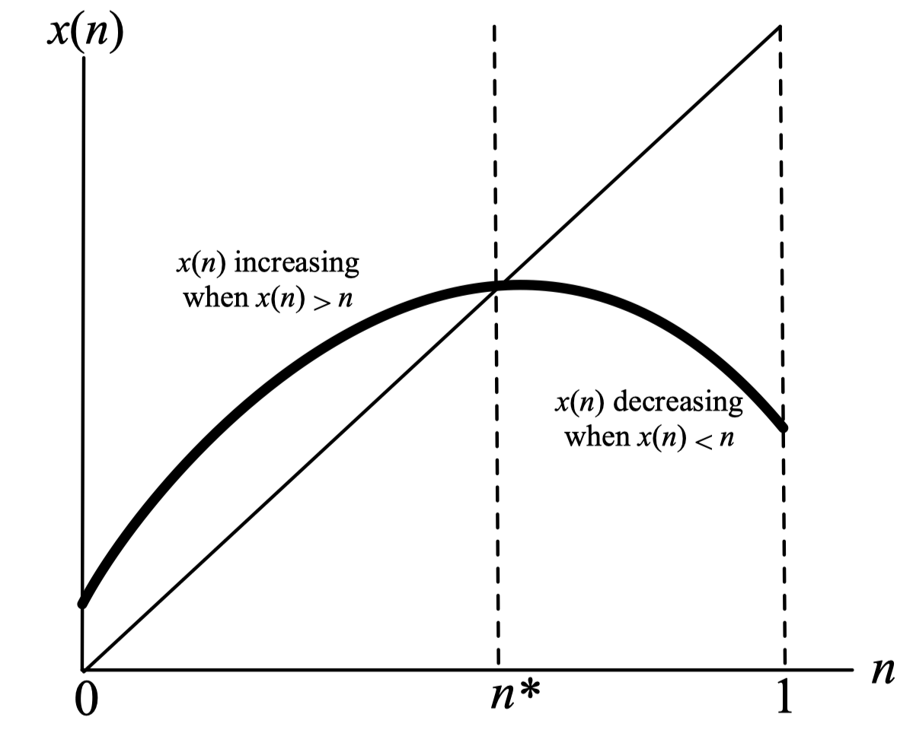
```
:::

::::

\ 

[Pero el beneficio privado no es la única contribución de nuestra empresa a otras empresas.]{.emph}

## Rompiendo un mal equilibrio: Debáte de política

[Los equilibrios o estados estacionarios **múltiples**  que surgen a partir de **complementariedades** tienen una característica distintiva: las **políticas temporales** pueden tener **efectos permanentes**.]{.emph}

\ 

- Estos modelos sientan una base (limitada) para los debates políticos (Rosenstein-Rodan, 1943,1961; Nurkse, 1952,1953; Hirschman, 1958):

- **Política del big push de Rosenstein-Rodan**: Una política capaz de aumentar simultáneamente la inversión en muchos sectores diferentes de la economía.
  
- **Características**: 
  
  (1) Requiere una inversión masiva (presumiblemente pública) en muchos sectores diferentes de la economía a la vez.
  
  (2) Es necesario tener una idea cuantitativa de la distribución de la inversión entre los sectores (mezcla correcta de inversiones).

## Rompiendo un mal equilibrio: Debáte de política

- Algunos problemas con la idea Rosenstein-Rodan:

  - Los requerimientos informacionales y el tamaño de las inversiones (en ese orden) son problemáticos.
  
  - La política no explota el hecho que el resultado deseado también es un equilibrio (incentivos que corrijan la falla de coordinación).

- **Propuesta de Hirschman**: En luigar de usar el big push (homologo de crecimiento equilibrado), usar una política deliberada de crecimeinto desequilibrado.

- Promover el desarrollo de ciertos sectores de la economía de tal manera que los vínculos generen inversiones espontáneas. 

- ¿Cómo elegir un sector líder?: 

  (1) Vínculos y fuerza de los vínculos.
  
  (2) Invertir en la actividad menos rentable (que tenga vínculos).


## Transiciones: ¿por qué la historia importa?

Externalidades rezagadas; nadie quiere ir primero...

```{r fig2_5, echo=FALSE, out.width="80%"}
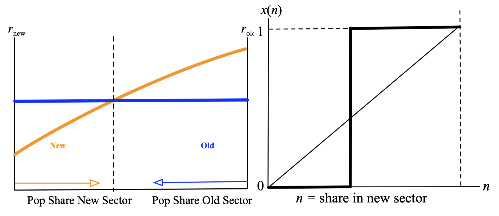
```

- **La historia es el punto inicial** ¿Quién se mueve de al equilibrio si los rendimientos tardan en acumularse? QWERTY vs. moda (historia vs. creencias) 


## Resumen

- Complementariedades y equilibrios (o estados estacionarios) múltiples.

  - Equilibrios típicamente rankeados según Pareto.

   - Dos sociedades fundamentalmente idénticas pueden comportarse de manera diferente.

- Las complementariedades cambian la forma en que pensamos acerca de la política pública.

  - Intervenciones temporales versus permanentes; p.ej.: amnistías, salario mínimo, multas temporales, big push, acción afirmativa.


# Trampas para el Desarrollo: Dependencia histórica {background-color="#CED3DC"}

## Dependencia histórica

Murray Gell-Mann, Premio Nobel de Física 1969: 

> Jorge Luis Borges escribió una historia sobre alguien que hizo un modelo con posibles historias alternativas para el universo, en forma de un jardín de senderos que se bifurcan... La historia que realmente se observa está co-determinada por simples leyes fundamentales y por una secuencia inconcebiblemente larga de accidentes o eventos fortuitos, que pueden ocurrir de varias maneras y sólo se puede predecir de antemano las probabilidades de ocurrencia de los diferentes resultados... algunos de estos accidentes producen una gran cantidad de impacto en el futuro. A esos los podemos llamar **accidentes congelados**. 

## Dependencia histórica

- **Retroalimentación macroeconómica**

  - Resultados que afectan parámetros aparentemente exógenos, como $s$ o $n$.

  - Desigualdad autosostenida.

- **Rendimientos crecientes a escala**

  - Costos fijos para iniciar un negocio o emprendimiento. 
  
  - Aprendizajes en la práctica (*learning by doing*).

- **Sesgos por el statu quo**

  - Afecta la dirección del cambio.

- **Industrias extractivas e instituciones coloniales**

  - Influencia sobre los esquemas políticos y legales posteriores.

## Retroalimentación macroeconómica: Endogeneidad de $s$


:::: {.columns}

::: {.column width="40%"}
```{r fig3_1, echo=FALSE, out.width="85%"}
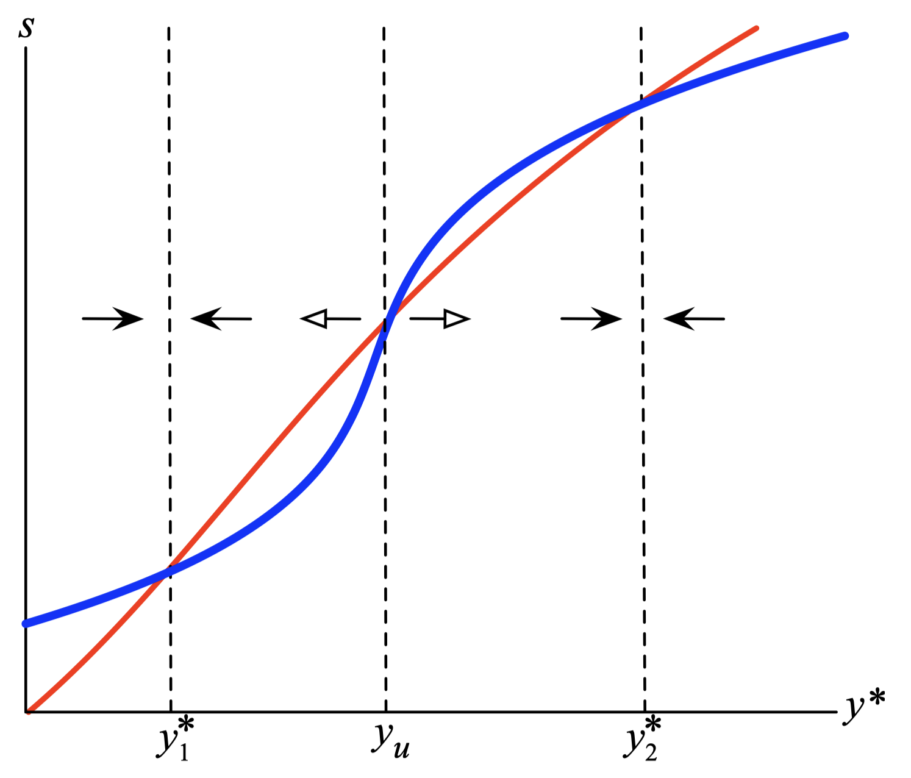
```
:::

::: {.column width="60%"}
- Línea Azul: Cómo se ve afectado $s$ por el ingreso en estado estacionario $y^{*}$.

  - bajo ingreso (subsistencia) $\Rightarrow$ bajo ahorro.

  - ingreso medio (aspiraciones) $\Rightarrow$ aumenta el ahorro.

  - ingreso alto (aspiraciones alcanzadas) $\Rightarrow$ baja el ahorro.

- Línea Roja: cómo el ingreso $y^{*}$ está determinado por $s$.

  - Modelo de Solow.
:::

::::

## Retroalimentación macroeconómica: Endogeneidad de $n$

:::: {.columns}

::: {.column width="40%"}
```{r fig3_2, echo=FALSE, out.width="85%"}
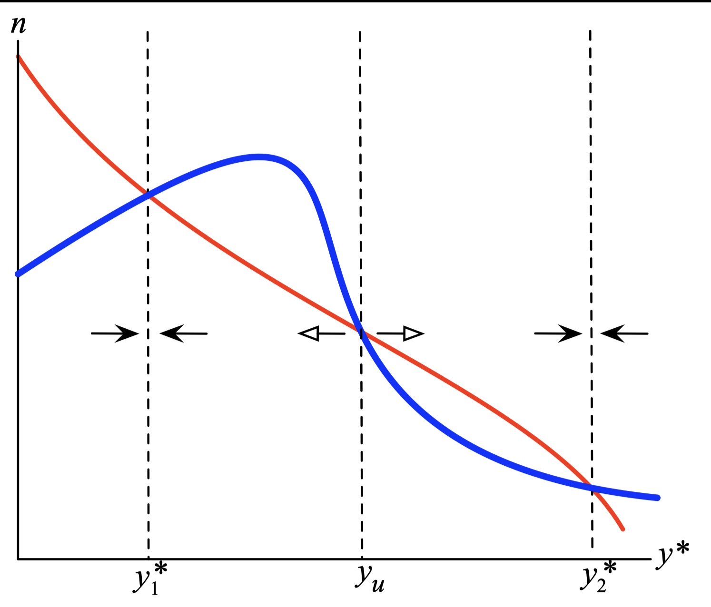
```
:::

::: {.column width="60%"}
- Línea Azul: Cómo $n$ se ve afectado por el ingreso de estado estacionario $y^{*}$.

  - bajo ingreso $\Rightarrow$ mortalidad alta y natalidad alta.
  
  - ingreso medio $\Rightarrow$ mortalidad cae y natalidad se ajusta lentamente.
  
  - ingreso alto $\Rightarrow$ mortalidad baja y natalidad baja.

- Línea Roja: Cómo $y^{*}$ está determinado por $n$. 

  - Modelo de Solow. 
:::

::::

## Rendimientos crecientes: Modelo de crecimiento

- Función de producción: $y=f(k)$, pero $f$ tiene dos tecnologías integradas.

- $f_{1}(k)=A k^{\alpha}$ y $f_{2}(k)=B k^{\beta}-C$, con $B \gg A$ y $C$ es un costo hundido.

```{r fig3_3, echo=FALSE, out.width="85%"}
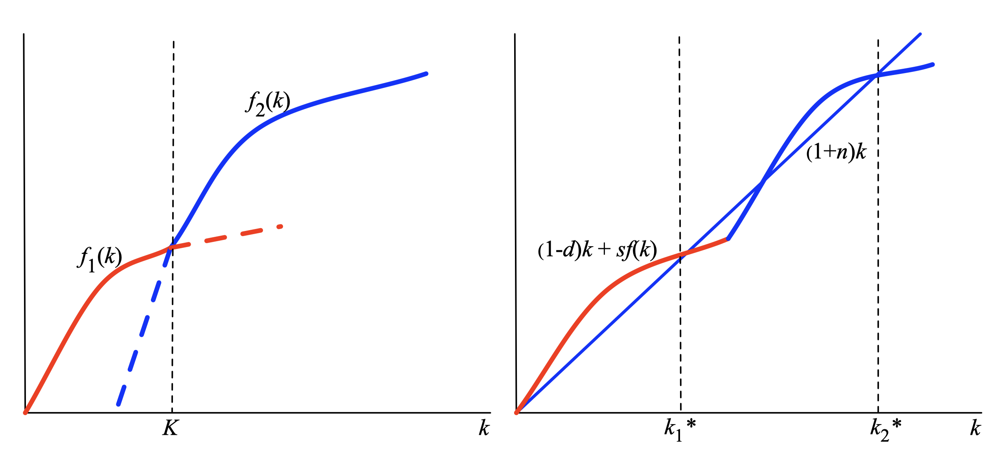
```

## Rendimientos crecientes: Iniciando un negocio

:::: {.columns}

::: {.column width="50%"}
```{r fig3_4, echo=FALSE, out.width="100%"}
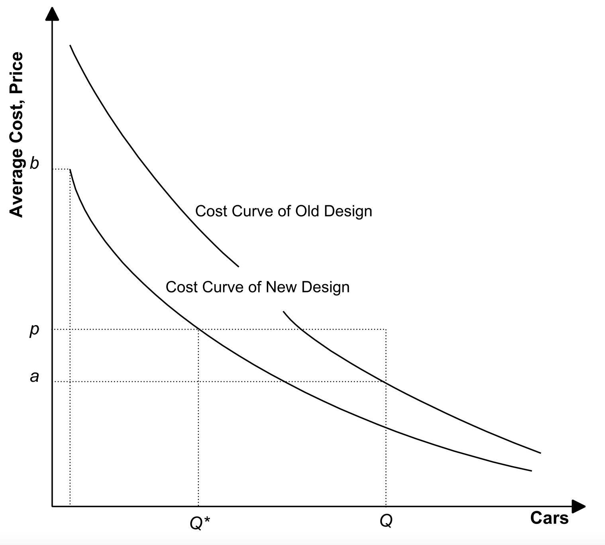
```
:::

::: {.column width="50%"}
**Ejemplo**: Empresa establecida (digamos autos convencionales) vs. Empresa nueva que busca entrar (nuevo autos híbridos).

- **Clave**: Retornos Crecientes a Escala $\rightarrow$ La escala permite reducir costos.

- Cuando una empresa entra tienen que soportar pérdidas por el periodo de **transición**. Si no lo hace no habrá entrada.


- Razones:

  - Altos costos para escala pequeña. 

  - Cambio gradual.

  - Mercados de capitales imperfectos.
:::

::::

## Rendimientos crecientes: Producción circular

- Función de producción:
$$Y=\left[Q_{1}^{\alpha}+Q_{2}^{\alpha}+\cdots+Q_{n }^{\alpha}\right]^{1 / \alpha}$$

  - El presupuesto de capital disponible es de $K$.

  - Una unidad de $K$ hace una unidad de cualquier intermedio: $Q_i=K$.

- Función de producción indirecta: dividir $K$ en partes iguales entre $n$, por lo que:
$$Y=\left[n\left(\frac{K}{n}\right)^{\alpha}\right]^{1 / \alpha}=n^{(1-\alpha) / \alpha} K$$

  - La productividad total de los factores (PTF) aumenta con el número de intermediarios.

- Imagine un costo fijo a pagar por cada nuevo bien intermedio utilizado.

  - Producción a pequeña escala $\Rightarrow$ pocos productos intermedios $\Rightarrow$ PTF es baja $\Rightarrow$ ingresos bajos $\Rightarrow$ demanda baja $\Rightarrow$ producción a pequeña escala

## Sesgo por Status Quo

- **Fernández y Rodrik (1991)**: Piensen en un proyecto que debe ser votado para su aprobación. Todo proyecto tiene ganadores y perdedores. 

- Suponga que no hay un mecanismo de compensación de ganadores a perdedores. 

- El **proyecto propuesto** paga $+1$ a un beneficiario y $-1$ a un perdedor. Si el proyecto no pasa todos quedan con 0.

- Se sabe que $70\%$ serán beneficiarios. Casos:

  1. Identidad del beneficiario desconocida: todos votan sí, proyecto pasa.
  $$0.7(1) + 0.3(-1) = 0.4 > 0$$

  2. Se conoce la identidad del beneficiario: $70 \%$ vote sí, se aprueba el proyecto.

  3. Identidad del beneficiario parcialmente conocida: Digamos que el $45\%$ sabe que se beneficiará. ¡Entonces el resto vota no!
  $$0.25(1) + 0.75(-1) = -0.5 < 0$$

- El proyecto (una vez dentro) será rechazado. Pero si no existe, no se vota.

## Instituciones

:::{.emph}
**Instituciones**: Reglas ambientales (formales o informales) para la conducción y ordenamiento de relaciones económicas, sociales y políticas.
:::

Ejemplos:

- Protegen los derechos de propiedad (aplicación de la ley).

- Proporcionan pensiones de vejez (seguridad social).

- Proporcionan un seguro contra una crisis bancaria (Banco Central, Super. de Bancos).

- Habilitan participaciones financieras en empresas (el mercado de valores).

- Garantizan que los contratos se cumplirán (tribunales).

- Supervisan elecciones seguras y justas (Comisiones Electorales, Ej. SERVEL).

- Generan normas de reciprocidad y sanciones (informales).

## Instituciones

- Las **buenas instituciones** económicas promueven la inversión y el crecimiento

- Pero la creación de instituciones está profundamente condicionada por la historia.

- Las **malas instituciones** (como las autocracias) se autogeneran o generan peores
instituciones (dictaduras), ya que los beneficiarios luchan por mantener sus beneficios.

- Sokoloff y Engerman (2000) a propósito de América del Norte y América del Sur:

> Voltaire, por ejemplo, pensó que el conflicto entre franceses y británicos en América del Norte, durante la Guerra de los Siete Años (1756-63), era una locura y lo caracterizó como dos países luachando por unos pocos acres de nieve. Los británicos victoriosos participarían más tarde en un acalorado debate público sobre qué territorio debe tomarse de los franceses como reparación, la isla caribeña de Guadalupe (con una superficie de 563 millas cuadradas) o Canadá!!

## Instituciones

**América del Sur**: 

- Enormes riquezas minerales, mucha mano de obra nativa.

- Economías extractivas (derechos mineros, tributos, etc.).

- Economías de plantación con mano de obra esclava; pocos grandes terratenientes.

- Derechos cedidos en forma controlada y restringida. 

  - Ejemplo: estrictas restricciones a la migración al Nuevo Mundo.

  - $\Rightarrow$ élite desigualmente situada que trató de aferrarse al poder.

- Restricciones al comercio y participación política.

  - Ejemplo: era necesario poseer una gran cantidad de tierra para poder votar.

## Instituciones

**América del Norte**: EE. UU. y Canadá

- Sin grandes cantidades de mano de obra nativa.

- Sin clima apropiado para plantaciones de azúcar excepto en el Sur (pero incluso ahí, el tamaño de las plantaciones de azúcar era relativamente pequeño).

- Trabajadores de ascendencia europea, igualdad en el capital humano.

- Latifundios relativamente pequeños, inmigración abierta.

- Dificultad para crear instituciones con poder político desigual.

- Votación restringida al principio, pero la franquicia se extendió rápidamente. 
  
## Instituciones
  
- Sokoloff y Engermann (2000) concluyen:

> "Estas primeras diferencias en el grado de desigualdad entre las economías del Nuevo Mundo pueden haber sido preservadas por los tipos de instituciones económicas y por los efectos de esas instituciones sobre el acceso a oportunidades económicas. Este camino de desarrollo institucional puede haber afectado el crecimiento económico. Donde había una desigualdad extrema, y las instituciones favorecían a las élites y limitaban el acceso de gran parte de la población a las oportunidades económicas, los miembros de las élites podían mantener mejor su estatus de élite a lo largo del tiempo, pero a costa de que la sociedad no se diera cuenta del potencial económico de los grupos desfavorecidos... [E]stos sesgos en los caminos del desarrollo institucional probablemente explican en gran medida la persistencia de la desigualdad a largo plazo en América Latina y en otras partes del Nuevo Mundo".

# Distribución del Ingreso y Desigualdad {background-color="#CED3DC"}

## El retorno de la desigualdad

- La crisis financiera de 2008 despertó un **nuevo interés por la desigualdad**. La pandemia del COVID-19 también dio un impulso al estudio de esta materia.

- Si bien este renovado interés es relativamente nuevo, la desigualdad tiene larga data y ha sido **históricamente alta**.

- De hecho ha venido creciendo de forma constante hasta finales del siglo XX (Wolff, Piketty, Saez, Atkinson, y muchos otros)

- **Libro reciente**: Piketty, T. (2014) Capital in the Twenty-First Century. Harvard University Press, Cambridge, MA. [http://piketty.pse.ens.fr/capital21c](http://piketty.pse.ens.fr/capital21c).

- El trabajo de Piketty:

  - Trajo la creciente desigualdad a la conciencia pública.

  - Resumió la evidencia de forma convincente y útil.

  - Fue un gran éxito en los Estados Unidos porque tocó un nervio dentro de la sociedad estadounidense. No obstante, el fenómeno es más extendido que solo EEUU.

## El retorno de la desigualdad

```{r fig4_3, echo=FALSE, out.width="73%"}
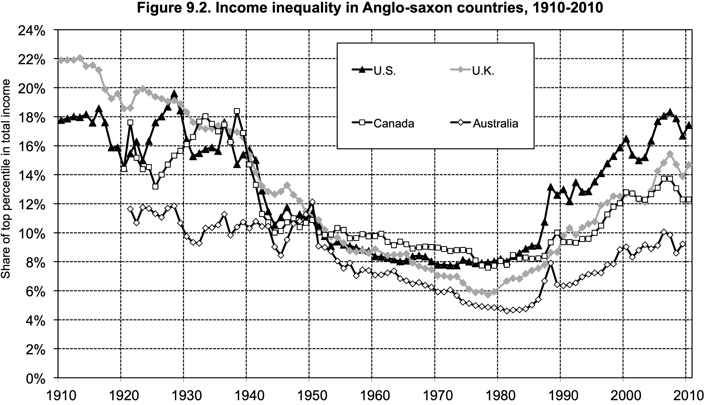
```

[*Fuente: Piketty (2014)*]{.small}

## El retorno de la desigualdad

```{r fig4_4, echo=FALSE, out.width="73%"}
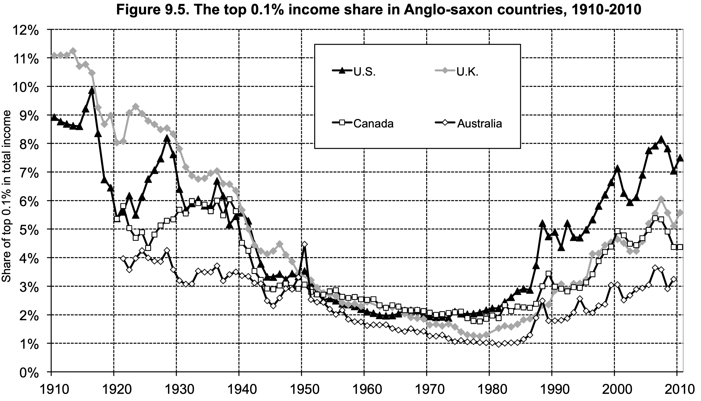
```

[*Fuente: Piketty (2014)*]{.small}

## Intrínseco vs. instrumental 

- El interes por el estudio de la desigualdad es tanto **intrínseco** como **instrumental** (o funcional).

- [**Interéses intrínsecos**]{.emph}:
  
  - Medición de la desigualdad: evaluar y comparar (rankear) distribuciones.

  - Evolución de la desigualdad en las sociedades (por ejemplo, Piketty)

- [**Interéses instrumentales**]{.emph}:
  
  - Desigualdad y varios resultados: crecimiento, nutrición, empleo.

  - Desigualdad y dependencia histórica.

  - Desigualdad e incentivos.

## Conceptualizar y medir la desigualdad

- Sea la siguiente [distribución del ingreso]{.emph} $\left(y_{1}, \ldots, y_{N}\right)$.

- Una medida de desigualdad asigna cada vector $\left(y_{1}, \ldots, y_{N}\right)$ a un número.

- Las clasificaciones/rankings importan, no los números absolutos/exactos.

- Enfoque axiomático.

- [**Principio de anonimato**]{.emph}: 
  
  - Los nombres no importan.

  - Reescribamos la distribución de ingresos como $$\left(y_{1}, N_{1} ; y_{2}, N_{2} ; \ldots ; y_{m}, N_{m}\right)$$ 
  
  - $m$ es el número de ingresos distintos, con $y_{1}<y_{2}<\cdots<y_{m}$.

  - $N_{i}$ es población con ingresos $y_{i}$.

  - Las permutaciones de ingresos entre las personas no deberían importar para juicios de desigualdad.

## Conceptualizar y medir la desigualdad

- [**Principio de población**]{.emph}: 
  
  - La clonación de toda la población (y sus ingresos) no altera la desigualdad.

  - Solo es relevante la participación de la población $n_{i}=\frac{N_{i}}{N}$ con $\sum_{i=1}^{m} n_{i}=1$.

  - Clonar solo un segmento de la población y mantener el resto inalterado bien puede afectar la desigualdad.

- [**Principio de Renta Relativa**]{.emph}:  
  
  - Escalar hacia arriba o hacia abajo los ingresos no afecta la desigualdad.

  - Las medidas de desigualdad de $\left(y_{1}, \ldots, y_{N}\right)$ y $\left(\lambda y_{1}, \ldots, \lambda y_{N}\right)$, $\lambda>0$, son las mismas.

  - Por supuesto, los ingresos absolutos son centrales en la evaluación general del desarrollo.

## Conceptualizar y medir la desigualdad

- [**Principio de Transferencias de Pigou-Dalton**]{.emph}: 
  
  - Una transferencia de ingresos de los individuos relativamente pobres a los relativamente ricos debe aumentar la desigualdad (*transferencias regresivas*).

  - El principio Se aplica siempre que podamos ver dos distribuciones de ingresos conectadas por una cadena de transferencias regresivas, hayan sucedido o no esas transferencias.

:::{.callout-important icon=false title="Resumen"}

Sea $I(\mathbf{y})$ una medida de desigualdad, donde $\mathbf{y}=\left(y_{1}, \ldots, y_{N}\right)$
  
- Anonimato: $I(\mathbf{y})=I(\sigma \mathbf{y})$, donde $\sigma$ es una permutación.

- Población: $I(\mathbf{y})=I(\mathbf{y}, \mathbf{y})$.

- Ingreso relativo: $I(\mathbf{y})=I(\lambda \mathbf{y})$ para todos los $\lambda>0$.

- Transferencias: $I(\mathbf{y})<I\left(y_{1}, \ldots, y_{i}-\delta, \ldots, y_{j}+\delta, \ldots, y_{N }\right)$
:::
  
## La Curva de Lorenz
  
:::{.emph}
Supongamos que ordenamos los miembros de una población en sentido ascendente según su ingreso. En el eje de abscisas representamos los porcentajes acumulados de la población ordenada en sentido ascendente según su ingreso. En el eje de ordenadas, medimos el porcentaje del ingreso nacional correspondiente a cada porcentaje de la población así ordenada. El gráfico resultante se denomina **curva de Lorenz**.
:::
  
```{r fig4_5, echo=FALSE, out.width="83%"}
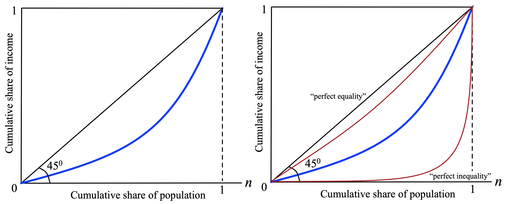
```

## La Curva de Lorenz

- Un ejemplo concreto ayuda:
  
```{r ejercicio_lorenz, echo=FALSE, out.width="95%"}
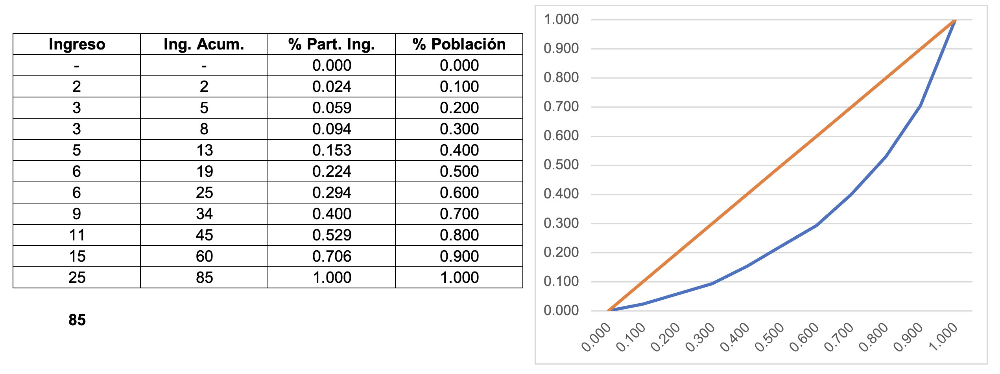
```

## El criterio de Lorenz
  
:::: {.columns}

::: {.column width="50%"}
- Establece que si la curva de Lorenz de una distribución $L(2)$ se encuentra siempre abajo (a la derecha) de la curva de Lorenz de otra $L(1)$, la primera debe considerarse más desigual que la segunda.
    
- Si $L(2)$ representa a la distribución $\left(y_{1}, y_{2}, \ldots, y_{n}\right)$, y $L(1)$ representa a la distribución $\left(z_{1}, z_{2}, \ldots, z_{m}\right)$, entonces:
$$\begin{equation}
    I\left(y_{1}, y_{2}, \ldots, y_{n}\right) \geq I\left(z_{1}, z_{2}, \ldots, z_{m}\right)
\end{equation}$$
      
:::

::: {.column width="50%"}
```{r fig4_6, echo=FALSE, out.width="90%"}
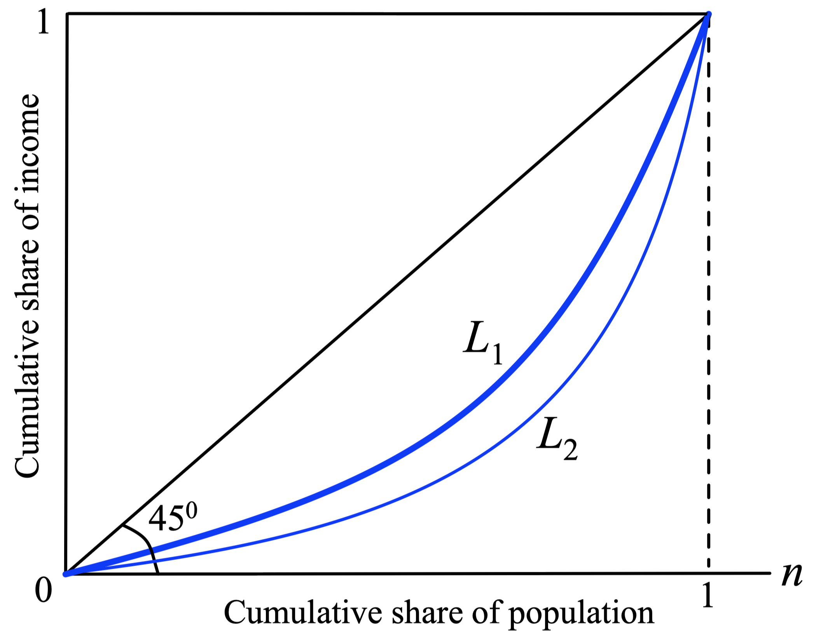
```
:::
::::
  
## El criterio de Lorenz
  
- Una medida de desigualdad $I$ es **consistente en el sentido de Lorenz** si concuerda con el criterio de Lorenz siempre que una curva de Lorenz se encuentre completamente debajo de la otra (incluso podría tocarse en partes, pero no se cruzan).

::: {.callout-important icon=false title="Teorema 1"}
*La medida de desigualdad $I$ es consistente en el sentido de Lorenz si y solo si satisface los principios de anonimato, de población, de ingreso relativo y de transferencias de Pigou-Dalton.*
:::

- **Ejemplo**. Suponga 3 grupos del mismo tamaño:
  
  - Situación 1: Ingresos $(10,20,30)$. 

  - situación 2: Ingresos $(14,44,62)$.

- Re-escale y tenga en cuenta que el principio de transferencias se puede aplicar aquí.

## El criterio de Lorenz
  
:::: {.columns}

::: {.column width="50%"}
```{r fig4_7, echo=FALSE, out.width="90%"}
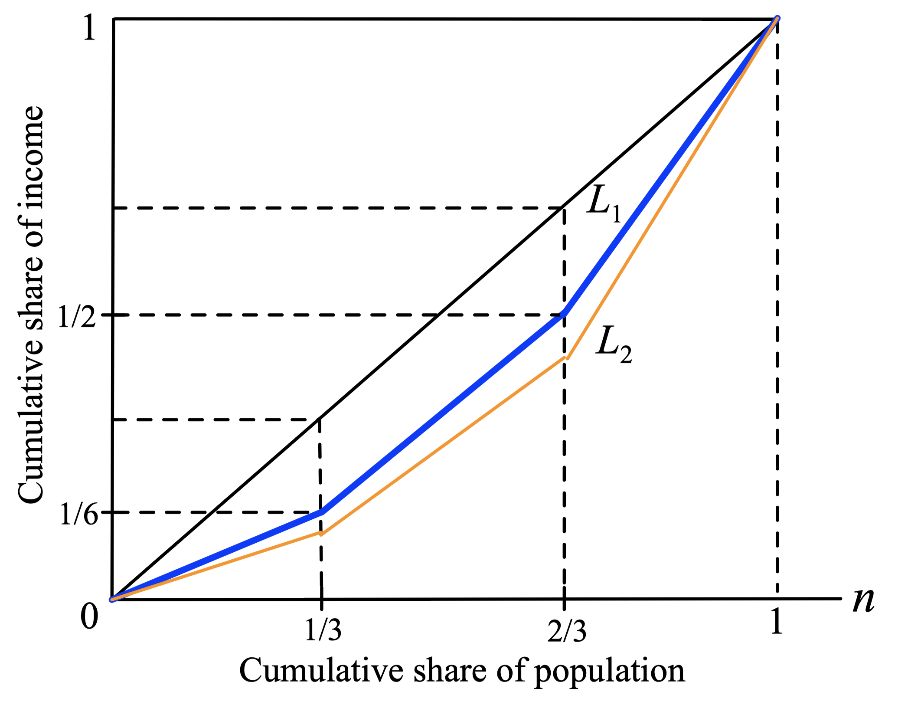
```
:::

::: {.column width="50%"}  
- Muy buena noticia, los axiomas y el criterio de Lorenz son lo mismo!!
    
- Ahora, note que también nos dice que los axiomas no cubren todos los casos, porque las curvas de Lorenz se pueden cruzar.
:::
::::

## El criterio de Lorenz
  
- **Ejemplo**: Compare las distribuciones $(75,125,200,600)$ y $(25,175,400,400)$.

:::{.center-x}
```{r cruce_lorenz, echo=FALSE, out.width="65%"}
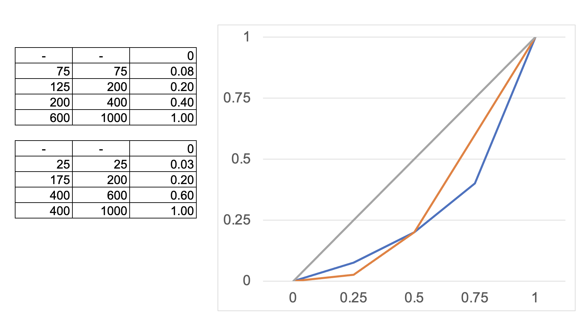
```
:::

- Pasamos de la 1ra a la 2da distribución con una transferencia regresiva y una progresiva. Los 4 principios no son suficientes para comparar. Tenemos que sopesar costos-beneficios de transf. regresivas y progresivas.

## Medidas completas de la desigualdad
  
- Las curvas de Lorenz representan gráficamente el grado de desigualdad de una sociedad. Dos problemas:
  
  - Los responsables de política económica y los investigadores les interesa resumir la desigualdad en una cifra.

  - Cuando las curvas de Lorenz se cortan, no pueden suministrar una ordenación útil de la desigualdad.

- También queremos medidas que aprovechen al máximo la información disponible:
  
- [**Notación**]{.emph}: 
  
  - $m$ grupos, cada grupo con $N_j$ individuos, $i=1,...,m$. Distribución: 
  $$\mathbf{y}=\left(y_{1}, \ldots y_{m}\right),\left(N_{1}, \ldots, N_{m}\right)$$
  
  - $n_{i}=\frac{N_{i}}{N}$ es la participación del grupo $i$ en la población. 

  - El ingreso medio es $\mu=\left(\sum_{i=1}^{m} N_{i} y_{i}\right) / N$.

## Medidas completas de la desigualdad
  
- [**Rango**]{.emph}: Usa información sólo del primer y el último nivel de ingreso. Simple pero limitada.
$$\left(y_{m}-y_{1}\right) / \mu$$
  
- [**Índices de Kuznets**]{.emph}: Los índices son esencialmente "segmentos" de la curva de Lorenz. Muy populares pero también limitados.
$$x \% \ más \ rico /  y \% \ más\  pobre$$ Por ejemplo, $20 \% / 80 \%$.

- [**La desviación absoluta medía**]{.emph}: La desigualdad es proporcional a la distancia con respecto al ingreso medio. Primera medida que usa información de toda la distribución. 
$$\frac{1}{\mu} \sum_{j=1}^{m} \frac{N_{j}}{N}\left|y_{j}-\mu\right|=\frac{1}{\mu} \sum_{j=1}^{m} n_{j}\left|y_{j}-\mu\right|$$
  ¿Es esta medida consistente en el sentido de Lorenz? Comprobar axiomas.


## Medidas completas de la desigualdad
  
- [**Coefficient of variation**]{.emph}: Una manera de evitar la insensibilidad de la desviación absoluta media es dar más peso a las mayores desviaciones de la media. La desviación típica hace precisamente eso.
$$\frac{1}{\mu} \sqrt{\sum_{j=1}^{m} \frac{N_{j}}{N}\left(y_{j}-\mu\right)^{2}}=\frac{1}{\mu} \sqrt{\sum_{j=1}^{m} n_{j}\left(y_{j}-\mu\right)^{2}}$$
  ¿Es esta medida consistente en el sentido de Lorenz? Comprobar axiomas.

- [**El coeficiente de Gini**]{.emph}: Parte de una base que es totalmente diferente. En lugar de tomar las desviaciones con respecto al ingreso medio, toma la diferencia entre todos los pares de ingreso.
$$\frac{1}{2 \mu} \sum_{j=1}^{m} \sum_{k=1}^{m} \frac{N_{j} N_{k}}{N^{2}}\left|y_{j}-y_{k}\right|=\frac{1}{2 \mu} \sum_{j=1}^{m} \sum_{k=1}^{m} n_{j} n_{k}\left|y_{j}-y_{k}\right|$$

¿Es esta medida consistente en el sentido de Lorenz? Comprobar axiomas.

## Medidas completas de la desigualdad
  
*El coeficiente de Gini y la curva de Lorenz: El coeficiente de Gíni es precisamente el cociente entre el área situada entre la curva de Lorenz y la recta de 45 °, y el área del triángulo situado debajo de la recta de 45°.*

\ 

- [**Variante del coeficiente de Gini**]{.emph}: Existen 13 variaciones de este índice. Esta es una de ellas.
$$\frac{1}{2 \mu} \sum_{j=1}^{m} \sum_{k=1}^{m} \frac{N_{j} N_{k}}{N(N-1)}\left|y_{j}-y_{k}\right|$$
  En este caso una sociedad de dos personas puede exhibir una desigualdad perfecta, pero falla el principio de población.

## Comparando el coeficiente de Gini con el coeficiente de variación
  
- $(G)$ y $(CoV)$ pueden no estar de acuerdo si las curvas de Lorenz se cruzan.

- Ejemplo: Compararemos dos distribuciones: $A=(3,12,12)$ y $B=(4,9,14)$.
$$\operatorname{CoV}(A)= \frac{1}{9} \sqrt{\frac{1}{3}(3-9)^{2}+\frac{2}{3}(12- 9)^{2}}=\frac{1}{9} \sqrt{18}$$
  $$\operatorname{CoV}(B)= \frac{1}{9} \sqrt{\frac{1}{3}(4-9)^{2}+\frac{1}{3}(14- 9)^{2}}=\frac{1}{9} \sqrt{\frac{50}{3}}$$
  Entonces el COV cae al pasar de $A$ a $B$.

- Ahora el Gini:
  $$G(A)= \frac{[2|3-12|+2|12-3|]}{2 \times 3^2 \times 9}=\frac{18}{81}$$
  $$G(B)= \frac{[|4-9|+|4-14|+|9-4|+|9-14|+|14-4|+|14-9|]}{2 \times 3^2 \times 9}=\frac{20}{81}$$
  Entonces el Gini sube al pasar de $A$ a $B$.

## GINI y CoV: Desacuerdos en la vida real

:::{.center-x}  
```{r fig4_15, echo=FALSE, out.width="50%"}
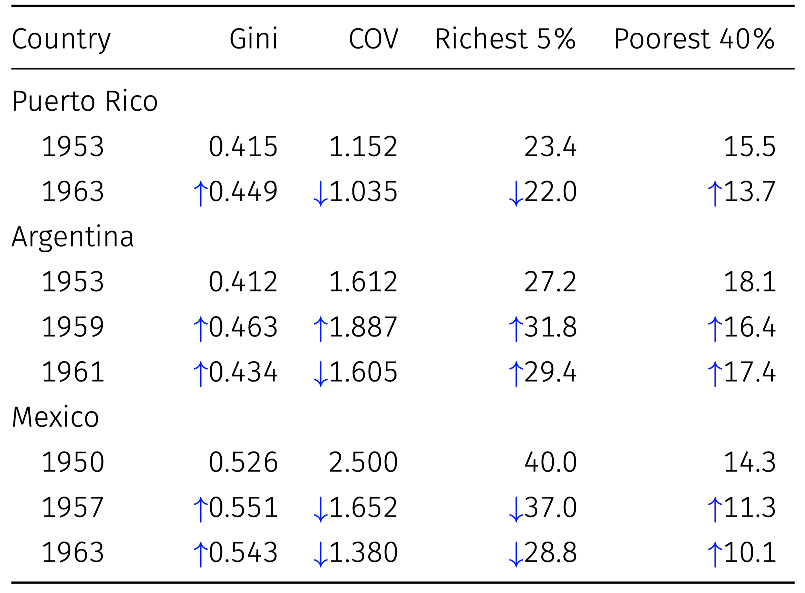
```
:::
- Desigualdad en tres países (Weisskoff (1970), Fields (1980)).

- Las flechas $\uparrow$ y $\downarrow$ muestran la dirección de la desigualdad relativa al año base.

## Más allá de la desigualdad económica
  
> "A medida que avanza la lucha, toda la sociedad se divide en dos campos hostiles, dos grandes clases directamente antagónicas... Las clases se polarizan, de modo que se vuelven internamente más homogéneas y se diferencian cada vez más entre sí en riqueza y poder." (Deutsch 1971, p.44)

```{r fig4_16, echo=FALSE, out.width="83%"}
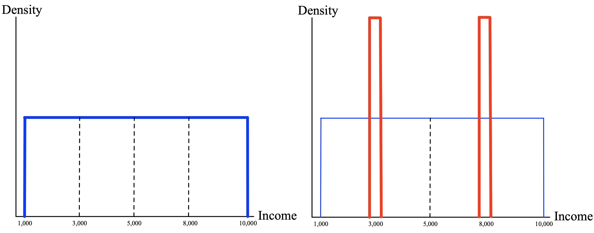
```

## Polarización
  
- como el Gini, la polarización suma alienaciones individuales (en un sentido de aislamiento).

- Pero las alienaciones individuales están determinadas por el tamaño del grupo: 
  
- $n_{i}\left|y_{i}-y_{j}\right|$ en lugar de $\left|y_{i}-y_{j}\right|$.

- Agreguando estas dos ideas tenemos el **Índice de Polarización**:
  $$P=\frac{1}{\mu} \sum_{i=1}^{m} \sum_{j=1}^{m} n_{i}^{2} n_{j}\left|y_{i}-y_{j}\right|$$
  
- Se puede aplicar para estudiar la conexión entre distribución y conflicto por ejemplo.

## Desigualdad y desarrollo: Interconecciones

- Los [individuos poseen dotaciones]{.emph}: bienes, factores de producción potenciales (trabajo, capital, tierra, etc), y participaciones en empresas.

```{r fig5_1, echo=FALSE, out.width="70%"}

```

- Dada la distribución actual de las dotaciones y las [interacciones económicas actuales en el mercado]{.emph} se genera una [nueva distribución]{.emph} de las dotaciones de mañana.

- La distribución actual de la riqueza da lugar, por medio de las interacciones económicas, a su futura distribución.  

  - El crecimiento económico y la desigualdad económica evolucionan conjuntamente.

## Desigualdad y desarrollo: El contexto macroeconómico

- Consideremos primero las relaciones empíricas entre la desigualdad y la renta per cápita.

- Hipótesis de la [U invertida de Kuznets]{.emph}: Dicurso presidencia AEA 1954.

:::: {.columns}

::: {.column width="50%"}
*Observación 1: Los porcentajes de la renta obtenidos por los grupos de renta más alta eran significativamente menores en los países desarollados que en los países en vías de desarrollo.*
:::

::: {.column width="50%"}
```{r fig5_2, echo=FALSE, out.width="85%"}
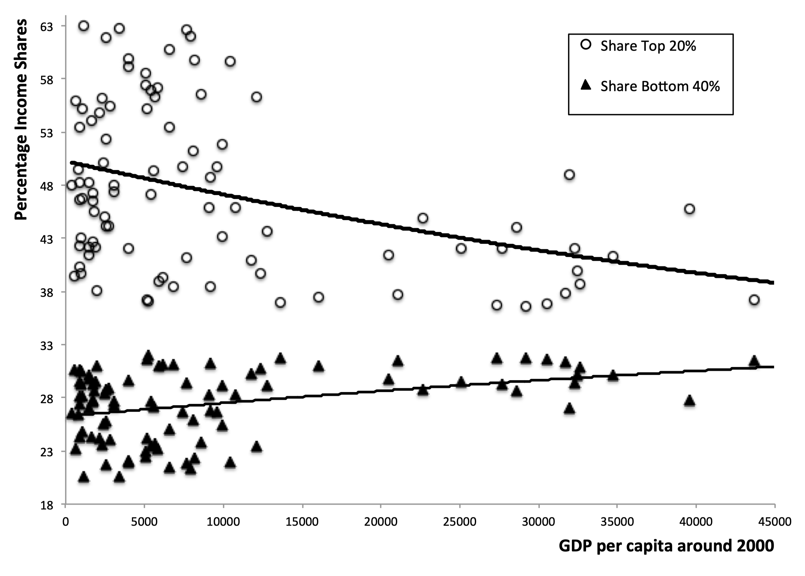
```
:::
::::

## Desigualdad y desarrollo: El contexto macroeconómico

- Consideremos primero las relaciones empíricas entre la desigualdad y la renta per cápita.

- Hipótesis de la [U invertida de Kuznets]{.emph}: Dicurso presidencia AEA 1954.


:::: {.columns}

::: {.column width="50%"}
*Observación 2: El progreso económico, medido por medio de la renta per cápita, va acompañado inicialmente de un aumento de la desigualdad, pero estas disparidades acaban desapareciendo a medida que los beneficios del desarrollo llegan a más personas.*
:::

::: {.column width="50%"}
```{r fig5_3, echo=FALSE, out.width="85%"}
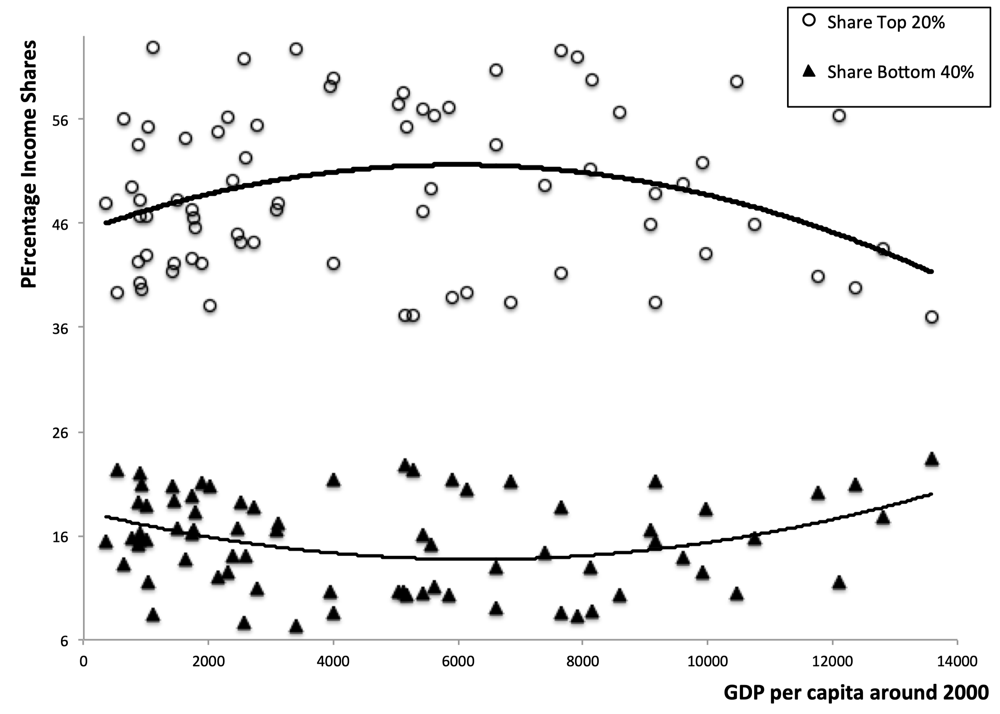
```
:::

::::

## El gran cambio de sentido

- Después de la década de 1970 se ha producido un verdadero recrudecimiento de la desigualdad económica: *La opinión de que “el crecimiento se encargará de la desigualdad” se ha evaporado.*

:::: {.columns}

::: {.column width="50%"}
**3 tipos de crecimiento** (que ocurren en diferentes medidas):

1. Acumulación de riqueza y habilidades y ganancias de productividad.

2. Crecimiento concentrado en algunos sectores (con demandas por habilidades particulares).

3. Crecimiento compensatorio de 2. Aumento de la demanda de todos los bienes de la economía.
:::

::: {.column width="50%"}
```{r fig5_4, echo=FALSE, out.width="90%"}
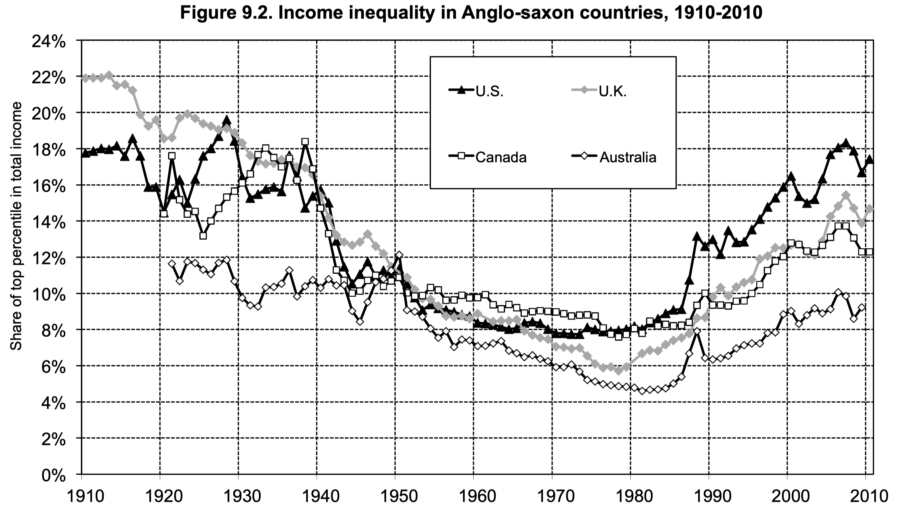
```
:::
::::

## Conceptos microeconómicos: Acumulación individual de riqueza

- Qué aspectos del comportamiento individual y la estructura del mercado son relevantes
un estudio detallado de la desigualdad y su evolución? 

  - **Volvamos a un modelo similar al de crecimiento pero a nivel individual**.

- Ecuación de acumulación individual:
$$k_{t+1}=y_{t}-c_{t}+k_{t}$$
donde $k$ es la riqueza (o capital), $y$ es el ingreso, y $c$ es el consumo. 

- El ingreso evoluciona en función de la riqueza y de factores que el individuo no controla:
$$y_{t}=f\left(k_{t}, \theta_{t}\right)$$
donde $\theta_{t}$ es un vector de variables de estado:

  - Shocks aggregados (a nivel de la economía).

  - Shocks idiosincráticos (a nivel individual pero exógenos al individuo).

## Conceptos microeconómicos: Acumulación individual de riqueza

- Algunos ejemplos:

  - Ingreso puro de capital: $f\left(k_{t}\right)=r\left(\theta_{t}\right) k_{t}$.

  - Salarios + ingreso de capital: $f\left(k_{t}\right)=w\left(\theta_{t}\right)+r\left(\theta_{t}\right) k_{t}$.

  - Acumulación de habilidades sobre ocupaciones (reinterpretamos $k$ como capital humano):
$$\begin{aligned}
f(k) &=w_{u}(\theta) \text { for } k<\bar{x} \\
&=w_{s}(\theta) \text { for } k>\bar{x}
\end{aligned}$$

  - También podríamos interpretar la ecuación anterior para un emprendedor. En este caso $\bar{x}$ son costos de instalación (ingresos por emprendimientos por ejemplo).

- Las oportunidades de generación de ingresos pueden **parecer exógenas al individuo**, pero en realidad son el **resultado endógeno en una economía** con muchos actores.

  - **Ejemplo**: La oferta laboral de todos afecta el salario que enfrenta cada individuo.

## Taxonomía para las fuentes de desigualdad

:::{.emph}
Cuando pensamos en desigualdad, podemos visualizar varias copias de las ecuaciones descritas antes evolucionando una al lado de la otra (un par de ecuaciones para cada persona). Dicha evolución genera distribuciones de ingresos, riquezas, habilidades, etc. 
:::

1. **Ahorros**: Diferencias en las tasas de ahorro entre individuos harán que sus ingresos relativos cambien con el tiempo.

2. **Rendimientos de los activos**: Variaciones en la tasa de rendimiento del capital entre personas y niveles de riqueza.

3. **Elección ocupacional**: La desigualdad de ingresos afecta el acceso a los mercados de capitales, y con ello a la conexión entre la riqueza y capital humano, la elección ocupacional (calificada) o el emprendimiento.

4. **Demanda**: Las distribuciones de ingresos afectan el patrón y la composición de la demanda de productos y, por lo tanto, los ingresos individuales (vía retornos a las habilidades).

5. **Políticas y política**: Las distribuciones de ingresos afectan las decisiones del gobierno sobre impuestos al trabajo y a los ingresos de capital. Grupos de presión políticos pueden ser relevantes. 

# Pobreza

## Pobreza

- La [pobreza]{.emph} es una característica del subdesarrollo económico.

- Problemas que lleva aparejada: analfabetismo, desnutrición, mala salud y unas perspectivas futuras sombrías.

- Privar al ser humano de gozar de salud, educación y disfrutar de un nivel de nutrición suficiente, destruye sus aspiraciones y sus esperanzas.

- El mundo ha generado un gran crecimiento del ingreso per cápita, pero su historial en lo que se refiere a la pobreza es bastante patético

- Al igual que la desigualdad, la pobreza tiene:

	- [Valor intrínseco]{.emph}: La mayoría de la gente diría que la erradicación de la pobreza es un objetivo fundamental del desarrollo económico.

	- [Valor funcional]{.emph}: Tiene enormes consecuencias sobre el propio funcionamiento de la economía.
	
## Elementos básicos de la pobreza

- [**Umbral de pobreza**]{.emph}: nivel mínimo de participación económica "aceptable" en una determinada sociedad y en un determinado momento.

- Típicamente este umbral se basa en nutrición: gastos necesarios para garantizar un consumo mínimo de calorías.

- Promover el concepto de umbral más allá de la nutrición, para tener en cuenta otros gastos, plantea una serie de problemas.

## Elementos básicos de la pobreza

- [**Gasto total o consumo de diversos artículos?**]{.emph}: 

	- Pobre es aquel que su cesta de consumo es inferior a un umbral o su gasto total (o su ingreso total) is inferior a un mínimo necesario para consumir.
	
	- Dos enfoques con resultados distintos. Ejemplo: Los alimentos enlatados pueden ser bastante populares en ciertos niveles de renta, incluso aunque su valor nutritivo sea discutible.
	
	- Es posible que la elasticidad ingreso sea alta, mientras que la elasticidades nutrientes no tanto.
	
	- El ingreso representa la capacidad para consumir, no el propio consumo. Ahora, en la práctica es más fácil utilizar umbrales de pobreza basados en el ingreso o el gasto (agregado), dada la escasez de datos

## Elementos básicos de la pobreza

- [**¿Absoluta o relativa?**]{.emph}:

	- La pobreza tiene algún  componente absoluto (la gente necesita unos niveles suficientes de alimentos, de ropa y de vivienda), pero también existen diferencias de opinión de lo que se considera "suficiente".

	- No está claro que la expresión "niveles aceptables de participación en la sociedad" tengan un significado absoluto.

	- En algunas sociedades es necesario tener un televisor para vivir una vida "plena", tener un nivel mínimo de ocio, tener acceso a la educación científica, tener propiedad de medios privados de transporte, etc.

	- Deben evaluarse los niveles de pobreza en relación con el nivel socioeconómicos de la sociedad.

	- Aunque los umbrales de pobreza deben incluir (e incluyen) conceptos relativos de lo que constituye una "necesidad", tienen que satisfacer alguna noción absoluta de la capacidad de funcionar en una sociedad.
	
## Elementos básicos de la pobreza

- [**¿Temporal o crónica?**]{.emph}:

	- La pobreza es temporal cuando a causa de perturbaciones económicas negativas. Grupos de gente entran temporalmente a formar parte de los pobres.

	- Las medidas necesarias para luchar contra la pobreza temporal son muy distintas que las usadas contra la pobreza crónica.

	- El concepto está estrechamente relacionada con el enfoque del ingreso temporal y el permanente.

## Elementos básicos de la pobreza

- [**¿Hogares o individuos?**]{.emph}:

	- A menudo sólo se dispone de datos sobre los gastos y los ingresos de los hogares.
	
	- Expresar el consumo de los hogares en forma de medias individuales para tener en cuenta el tamaño del hogar (per cápita), no tiene en cuenta la distribución de los gastos al interior del hogar suele ser muy desigual.
	
	- Es deseable tener en cuenta la presencia de hijos, ya que consumen algo menos que los adultos (escalas de equivalencia: hijos en porcentaje de un adulto representativo).
	
	- La creación y gestión de un hogar tiene costos fijos, y hogares más pequeños no pueden repartir estos costos fijos entre muchos miembros (desventaja).
	
## Medición de la pobreza

- [Umbral de pobreza]{.emph}: Nivel de gasto mínimo necesario para participar "aceptablemente" en la vida económica. Las personas situadas por debajo de este umbral son *pobres*.

- Definimos: $y$ ingreso (o gasto), $i$ índices para denotar individuos, $p$ umbral de pobreza, $m$ ingreso medio de la economía, $n$ número total de individuos.

- Conteo de personas bajo el umbral de pobreza: $$NP=\sum I[y_i<p]$$

- Tasa de pobreza (mide la incidencia relativa de los pobres): $$TP=NP/n$$

## Medición de la pobreza

- [Problema]{.emph}: Estas medidas no recogen el grado en que el ingreso (o el gasto) individual se encuentra por debajo del umbral de pobreza.

	- [La utilización del recuento para medir la pobreza sesga sistemáticamente la política que se adopte en favor de las personas que se encuentran muy cerca del umbral de pobreza (políticamente: resultados).]{.emph}

- Contrarrestar parcialmente el sesgo: Brecha relativa de pobreza BRP (toma en cuenta la distancia entre la renta y el umbral de pobreza). $$BRP=\frac{\sum_{y_i<p} (p-y_i)}{n\times m}$$

	- cociente entre el ingreso (o consumo adicional) media necesaria para situar a todos los pobres en el umbral de pobreza y el ingreso (o consumo) media de la sociedad (recursos potencialmente disponibles para eliminar la pobreza).

## Medición de la pobreza

- Brecha relativa de ingreso (BRI): $$BRI=\frac{\sum_{y_i<p} (p-y_i)}{p\times NP}$$

	- Dividimos ahora por el ingreso total necesaria para situar a todos los pobres en el umbral de pobreza. Mide la gravedad de la pobreza.
	
- Otras medidas más sofisticadas (generales) han sido propuestas por Foster, Greer y Thorbecke [1984]. $$FGT_\alpha=\frac{1}{n} \sum_{y_i<p} \left(\frac{p-y_i}{p}\right)^\alpha$$ 

  donde $\alpha$ es parámetro que mide la sensibilidad de la pobreza. 

- El problema con estas que no toman en cuenta las privaciones relativas de los pobres (multidiminsionalidad).

## El efecto funcional de la pobreza

- Analizamos los argumentos que relacionan la incidencia de la pobreza con los mecanismos que la provocan.

- También discutimos los mecanismo informales que surgen espontáneamente para hacer frente a la pobreza.

- La característica fundamental de la pobreza es que afecta al acceso de los pobres a los mercados, y esto tiene repercusiones en toda la economía

  - Casi todos los mercados resultan afectados: crédito, trabajo, tierra, etc.
  
## Mercados de Crédito y Pobreza

- El mercado crediticio falla en el caso de los pobres. Tres causas:

1. No existen garantías para avalar el préstamo o proyecto (garantía es un seguro contra fracaso, instrumento para evitar default voluntario, mecanismo de auto-selección de prestatarios de bajo riesgo).
    
    - Surgen fuentes informales: diferentes tipos de tipos de garantías (la más importante es el trabajo)*.

2. Los incentivos de los pobres para devolver los préstamos son limitados, esto independientemente su incapacidad para presentar una garantía
    
    - Cada unidad adicional de dinero significa más para un pobre que para un rico: utilidad marginal decreciente.
      
    - La pérdida de utilidad que experimenta el pobre devolviendo el préstamo es superior a la que experimenta el rico.

## Mercado de Seguros y Pobreza

- El mercado de seguros falla en el caso de los pobres. 

- Los seguros existen porque el futuro es incierto y entraña riesgos.

- Para que un seguro pueda funcionar bien:

  1. El siniestro debe ser verificable.
  2. No debe ser susceptible de plantear un problema del riesgo moral (evitar el riesgo moral: seguros incompletos - copagos y otras restricciones).
  
- Países en vías de desarrollo: es raro que existan sistemas formales de seguro.

  - El sistema jurídico formal es lento (entonces es difícil la verificación). Esto puede agravar el comportamiento asociado al riesgo moral.
  
- Surge una red informal de seguridad: con bajo riesgo moral (verificación al interior de la comunidad)
