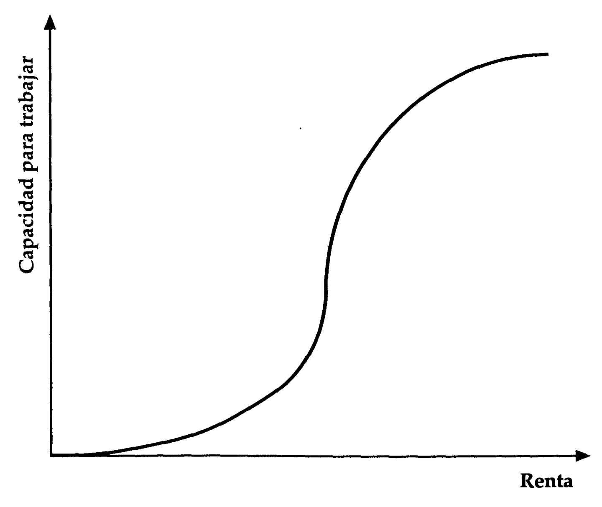
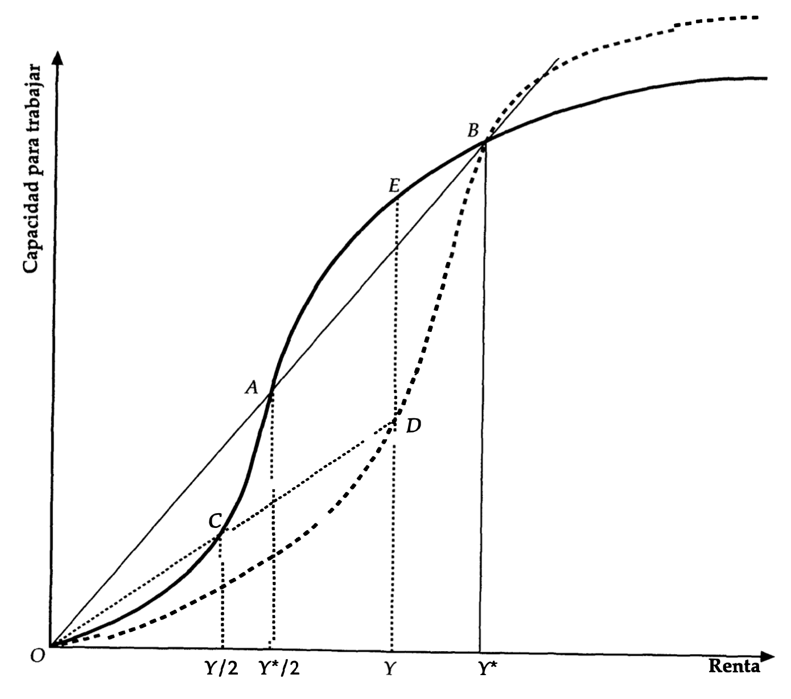
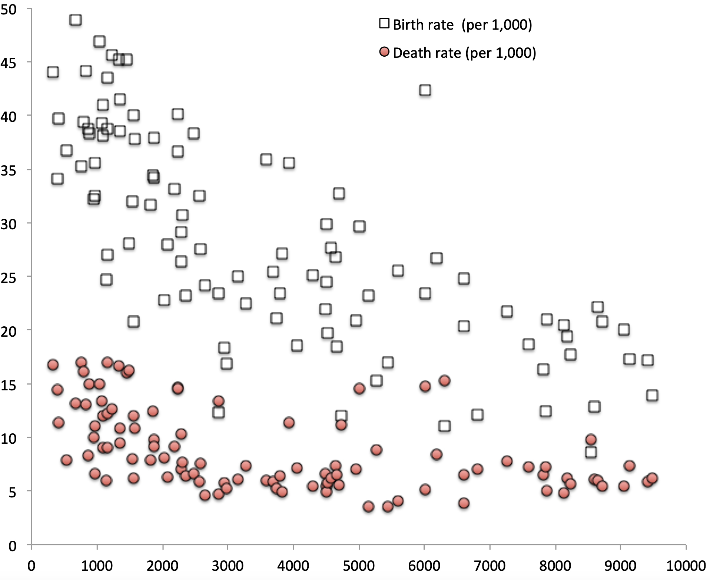
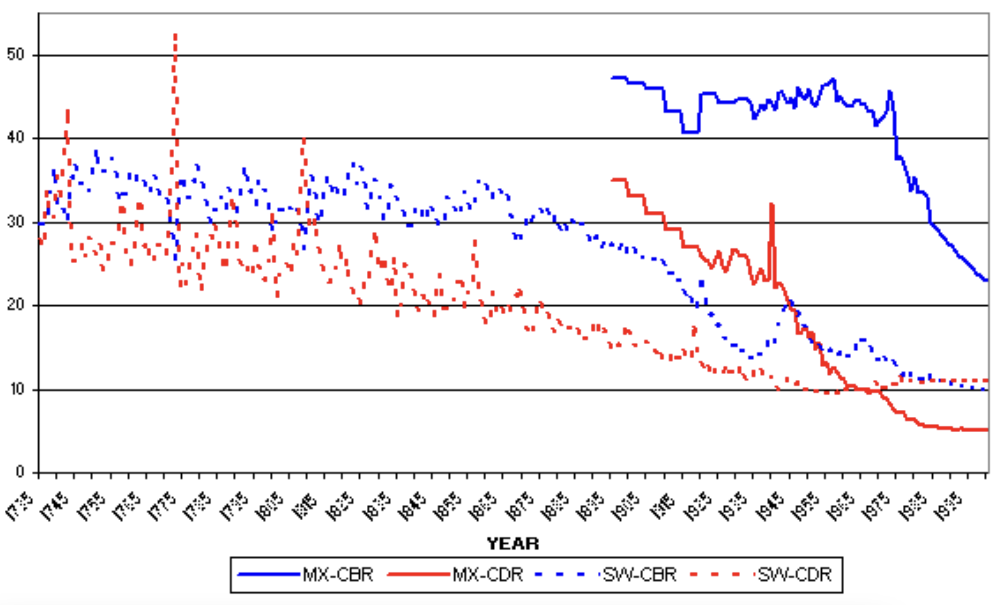
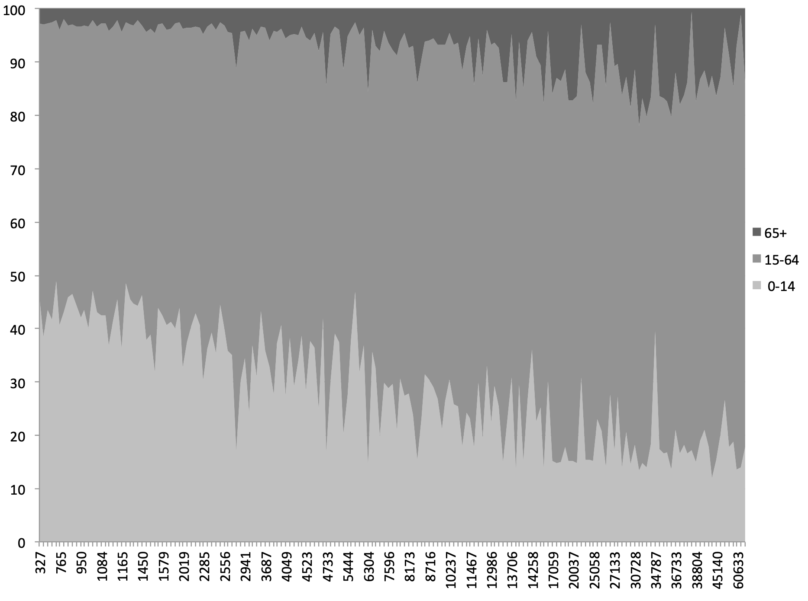
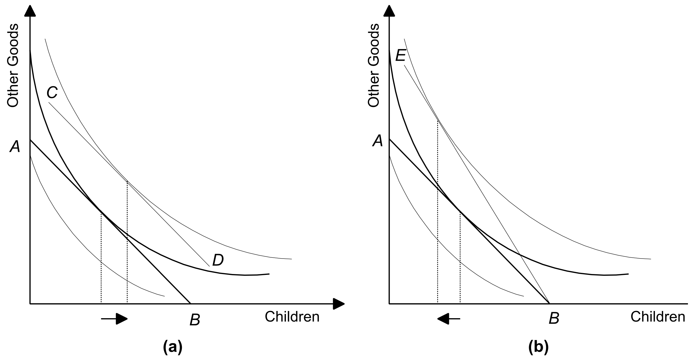
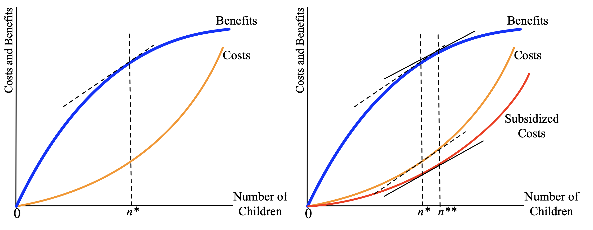
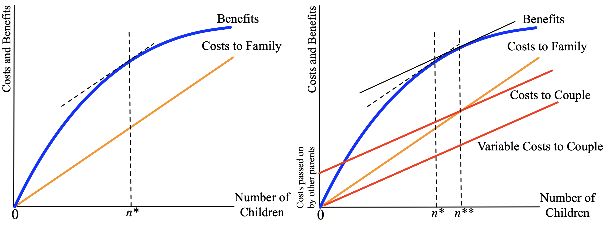

```{r setup, include=FALSE}
# Opciones solo para las figuras generadas en R (usar opts.label="modelo").
# Las figuras PNG existentes mantienen sus opciones.
knitr::opts_template$set(modelo = list(
  echo = FALSE, message = FALSE, warning = FALSE,
  fig.align = "center", fig.retina = 2
))

# ---- Parámetros de los modelos ----------------------------------------------
# Cambiar un valor aquí actualiza las figuras y los ejemplos numéricos.

# Modelo 1: inversión con complementariedades (kappa = c/b)
m1 <- list(kappa_hom = 1,     # caso 1: empresas homogéneas
           kappa     = 0.2,   # caso 3: múltiples equilibrios (kappa < 1/2)
           kappa_alt = 0.4)   # caso 3 antes de la política (kappa más alto)

# Modelo 2: big push
m2 <- list(L = 100, A = 2, w = 1.5, Fc = 20)

# Modelo 3: Solow sin progreso técnico (g_A = 0)
# (el texto de las slides menciona alpha = 1/3; revisarlo si cambia alpha)
m3 <- list(alpha = 1/3, delta = 0.05, gL = 0.02, s = 0.2,
           A1 = 1, A2 = 2, kbar = 7,                        # dos tecnologías
           s1 = 0.1, s2 = 0.3, ybar_s = 1.6,                # ahorro endógeno
           g1 = 0.035, g2 = 0.005, ybar_g = 1.7)            # población endógena

# ---- Funciones de los modelos -----------------------------------------------
# Modelo 1: mapa de complementariedad
x_map <- function(n, kappa, theta) n^theta / (n^theta + kappa * (1 - n^theta))

# Modelo 2: ingreso agregado, beneficio de invertir y masa crítica
Y_bp  <- function(n, p = m2) p$A * (p$L - n * p$Fc) / (p$A - (p$A - 1) * n)
pi_bp <- function(n, p = m2) (1 - p$w / p$A) * Y_bp(n, p) - p$w * p$Fc
n_bar <- function(p = m2) {
  (p$A * p$w * p$Fc - (p$A - p$w) * p$L) / (p$A * (p$w - 1) * p$Fc)
}

# Modelo 3: crecimiento del capital, estados estacionarios y producto
g_K  <- function(k, A, s, p = m3) s * (A / k)^(1 - p$alpha) - p$delta
k_ee <- function(A, s, gL, p = m3) A * (s / (gL + p$delta))^(1 / (1 - p$alpha))
y_ee <- function(A, s, gL, p = m3) A * (s / (gL + p$delta))^(p$alpha / (1 - p$alpha))
y_k  <- function(k, A, p = m3) k^p$alpha * A^(1 - p$alpha)

# Formato de números en el texto
num <- function(x, d = 2) formatC(x, format = "f", digits = d)

# ---- Estilo de las figuras (como las de la parte de crecimiento) ------------
estilo <- function(mar = c(4.6, 4.8, 1, 1)) {
  par(family = "serif", mar = mar, bty = "l", las = 1, mgp = c(2.9, 0.9, 0),
      cex.lab = 1.7, cex.axis = 1.5, xaxs = "i", yaxs = "i")
}

# Lienzo para el mapa de complementariedad, con la recta de 45 grados
lienzo_mapa <- function() {
  estilo()
  plot(NA, xlim = c(0, 1.05), ylim = c(0, 1.05), xaxt = "n", yaxt = "n",
       xlab = expression(italic(n)), ylab = expression(italic(x)(italic(n))))
  axis(1, at = c(0, 1))
  axis(2, at = c(0, 1))
  segments(0, 0, 1, 1, lwd = 1.5)
}

# Lienzo para la dinámica del capital: tasa de crecimiento contra k
lienzo_solow <- function(xlim, ylim) {
  estilo()
  plot(NA, xlim = xlim, ylim = ylim, xaxt = "n", yaxt = "n",
       xlab = expression(italic(k) == italic(K)/italic(L)), ylab = "Tasa de crecimiento")
  axis(2, at = 0)
  abline(h = 0, lwd = 1)
}

# Flechas de la dinámica, dibujadas sobre el eje horizontal
flechas <- function(desde, hasta, y = par("usr")[3]) {
  arrows(desde, y, hasta, y, length = 0.14, lwd = 2.5, angle = 22, xpd = NA)
}
```

# Trampas para el Desarrollo: Introducción {background-color="#CED3DC"}


## Los datos muestran muy poca convergencia

**Se observa muy poca convergencia, a menos que condicionemos en ...**

- ...tasas de ahorro, tasa de crecimiento poblacional, capital humano;

- variables políticas: como democracia, estabilidad;

- variables culturales: corrupción o ética laboral;

- variables religiosas ... y un largo etc.

[¿Realmente queremos una teoría del subdesarrollo basada en la presunción de que los individuos en diferentes partes del mundo tienen alguna diferencia intrínseca en su disposición —o capacidad— para ahorrar, trabajar o procrear?]{.emph}

**Esto no parece correcto!**

- Nos gustaría tener una teoría que, aunque no menosprecie ni minimice el papel de los factores sociales, culturales y políticos, no se detenga simplemente ahí.

## Causalidad bidireccional puede ser fundamental para nuestras vidas

[El **subdesarrollo** no se ve como una falla de algunos parámetros económicos fundamentales o valores socioculturales, sino mas bien como el **resultado de la interacción de un conjunto factores**, tal vez precipitados por un **sistema de creencias** o por **condiciones históricas**.]{.emph}

\ 

Razones para usar este enfoque:

1. Conduce a una teoría en la que la "convergencia" económica (de ingresos, riqueza, bienestar) entre países no es automática (o quizá no existe: divergencia).

2. No se basa en diferencias “fundamentales” entre pueblos o culturas. 

3. Tampoco permite el “cualquier cosa puede pasar”. Solo ciertas configuraciones de variables pueden ocurrir en la teoría (esto es, debemos eliminar primero la posibilidad de algunos/muchos resultados).

4. Implica un papel muy diferente para la política gubernamental (políticas temporales con efecto permanente).

## Pregunta central

[¿Si las personas de todo el mundo son intrínsecamente iguales (todos son seres humanos, con las mismas esperanzas y deseos), por qué las culturas y las economías, nacidas del mismo material intrínseco, funcionan de manera tan diferente?]{.emph}

\ 

Don conceptos centrales para responder a esta pregunta, ambos relacionados con la posible existencia de **múltiples equilibrios**:

- En un momento dado la sociedad podría verse atrapada en uno de varios posibles resultados, esto dependiendo de las **creencias** individuales sobre las acciones de los demás.

- Los **eventos históricos** (tecnologías iniciales, normas sociales o instituciones) pueden tener un impacto muy persistente/duradero, atrapando a la sociedad en el presente en uno de varios posibles resultados.

Note que este enfoque rompe con la idea de convergencia desde el principio: [La posibilidad de divergencia (o trampas del desarrollo), diferentes resultados dentro de la misma estructura, ocupa un lugar central]{.emph}.

# Trampas para el Desarrollo: Complementariedad y multiplicidad de equilibrios {background-color="#CED3DC"}

## QUERTY vs DVORAK

::: {.callout-important title="Definición: Complementariedad" icon=false}
Situación en la que la realización de alguna acción por parte de un número mayor de individuos anima a más individuos a adoptar dicha acción.
:::

:::: {.columns}

::: {.column width="50%"}
```{r querty, echo=FALSE, out.width="90%"}
knitr::include_graphics("figs/qwerty.jpg")
```
:::

::: {.column width="50%"}
```{r dvorak, echo=FALSE, out.width="90%"}
knitr::include_graphics("figs/dvorak.png")
```
:::

::::

*El ejemplo Qwerty ilustra una complementariedad. El número de adoptantes de un sistema depende de cuántos se espera que lo adopten. Dependiendo de la historia inicial, múltiples configuraciones de adopción son posibles.*

## Anticomplemetariedad: Congestión como un ejemplo de convergencia

:::{.center-x}
**Historia de dos carreteras**
```{r fig1, echo=FALSE, out.width="53%"}
knitr::include_graphics("figs/fig1.png")
```
:::

\ 

**Definición**: $r_j(n)$, $j=F,W$, es el retorno neto dado el número de usuarios $n$. Clave: $r_j'(n)<0$

## Anticomplemetariedad: Congestión como un ejemplo de convergencia

:::{.center-x}
**Historia de dos carreteras**
```{r fig2, echo=FALSE, out.width="53%"}
knitr::include_graphics("figs/fig2.png")
```
:::

\ 

**Definición**: $r_j(n)$, $j=F,W$, es el retorno neto dado el número de usuarios $n$. Clave: $r_j'(n)<0$  

## Complemetariedad: QWERTY como un ejemplo de divergencia

:::{.center-x}
**Historia de dos tecnologías**
```{r fig3, echo=FALSE, out.width="53%"}
knitr::include_graphics("figs/fig3.png")
```
:::

\ 

**Definición**: $r_j(n)$, $j=Q,D$, es el retorno neto dado el número de usuarios $n$. Clave: $r_j'(n)>0$  


## Complemetariedad: QWERTY como un ejemplo de divergencia

:::{.center-x}
**Historia de dos tecnologías**
```{r fig4, echo=FALSE, out.width="53%"}
knitr::include_graphics("figs/fig4.png")
```
:::

\ 

**Definición**: $r_j(n)$, $j=Q,D$, es el retorno neto dado el número de usuarios $n$. Clave: $r_j'(n)>0$ 

## Un modelo de inversión con complementariedades

Queremos un modelo simple en el que la decisión de invertir de una empresa dependa de cuántas otras empresas invierten.

- Hay un continuo de empresas indexadas por $x \in [0,1]$. Cada una decide si **invierte** o **no invierte** en un proyecto.
- No invertir entrega un pago de $0$.
- Si invierte y el proyecto **tiene éxito**, la empresa $x$ gana $B(x)$, con $B'(x)<0$: las empresas están ordenadas de mayor a menor rentabilidad.
- Si invierte y el proyecto **fracasa**, pierde el costo hundido de la inversión, $c$.
- La probabilidad de éxito es $p(n)$, donde $n$ es la fracción de empresas que invierte, con $p'(n)>0$, $p(0)=0$ y $p(1)=1$.
  - Más empresas invirtiendo significa un mercado más grande, más proveedores y mejor infraestructura.

La empresa $x$ invierte si su beneficio esperado es positivo:
$$p(n)\,B(x)-[1-p(n)]\,c \geq 0$$

## Formas paramétricas

Para derivar resultados usamos formas funcionales concretas:
$$B(x)=b\,\frac{1-x}{x} \qquad \text{y} \qquad p(n)=n^{\theta}$$

- $b>0$ mide la rentabilidad de los proyectos exitosos.
- $\theta \geq 1$ mide la intensidad de la complementariedad: con $\theta$ más alto, el éxito requiere que invierta una fracción mayor de las empresas.

La condición para invertir queda
$$n^{\theta}\, b\,\frac{1-x}{x} \geq (1-n^{\theta})\,c \quad \Longrightarrow \quad \frac{1-x}{x} \geq \kappa\,\frac{1-n^{\theta}}{n^{\theta}}$$
donde $\kappa \equiv c/b$ es la razón entre lo que se pierde si el proyecto fracasa y lo que se gana si tiene éxito.

## El mapa de complementariedad

Si se espera que invierta una fracción $n$, invierten todas las empresas con índice menor al de la empresa indiferente, $x(n)$. Resolviendo la condición anterior con igualdad:
$$x(n)=\frac{n^{\theta}}{n^{\theta}+\kappa\,(1-n^{\theta})}$$

- $x(0)=0$ y $x(1)=1$: si nadie invierte, nadie quiere invertir; si todos invierten, todos quieren invertir.
- $x(n)$ cae con $\kappa$: proyectos más riesgosos o menos rentables reducen la inversión.

:::{.callout-important}
## Complementariedad
El mapa es creciente: mientras más empresas se espera que inviertan, más quieren invertir.
$$x'(n)=\frac{\theta\, \kappa\, n^{\theta-1}}{\left[n^{\theta}+\kappa\,(1-n^{\theta})\right]^{2}}>0$$
:::

## Equilibrio y estabilidad

Un **equilibrio** es una fracción $n^*$ en la que las expectativas se cumplen:
$$x(n^*)=n^*$$
Gráficamente es un cruce del mapa de complementariedad con la recta de $45^{\circ}$.

- Si $x(n)>n$, quieren invertir más empresas de las esperadas y $n$ aumenta.
- Si $x(n)<n$, quieren invertir menos empresas de las esperadas y $n$ disminuye.

Un equilibrio es **estable** si la economía vuelve a él después de una pequeña perturbación. Esto ocurre cuando el mapa cruza la recta de $45^{\circ}$ desde arriba:
$$x'(n^*)<1$$

En nuestro modelo $n=0$ y $n=1$ siempre son equilibrios. Las preguntas son cuáles son estables y si existen equilibrios interiores.

## Caso 1: empresas homogéneas

:::: {.columns}

::: {.column width="52%"}
Suponga que todas las empresas ganan lo mismo, $B(x)=b$. Entonces todas toman la misma decisión. Invierten si
$$n^{\theta}\,b \geq (1-n^{\theta})\,c$$
es decir, si
$$n \geq \bar{n} \equiv \left(\frac{\kappa}{1+\kappa}\right)^{1/\theta}$$

- Si se espera $n<\bar{n}$ nadie invierte; si se espera $n \geq \bar{n}$ invierten todas.
- Hay **dos equilibrios estables**: $n=0$ y $n=1$.
- $\bar{n}$ es la **masa crítica** de inversionistas.
:::

::: {.column width="48%"}
```{r m1_homogeneas, opts.label="modelo", fig.dim=c(5, 4.6), out.width="100%"}
nh <- (m1$kappa_hom / (1 + m1$kappa_hom))   # con theta = 1
lienzo_mapa()
segments(nh, 0, nh, 1, lty = 3, lwd = 2, col = "gray40")
segments(0, 0, nh, 0, lwd = 6, xpd = NA)
segments(nh, 1, 1, 1, lwd = 6)
axis(1, at = nh, labels = expression(bar(italic(n))))
points(c(0, 1), c(0, 1), pch = 19, cex = 2, xpd = NA)
```
:::

::::

## Caso 2: empresas heterogéneas con $\theta=1$

:::: {.columns}

::: {.column width="52%"}
Con $p(n)=n$ el mapa es
$$x(n)=\frac{n}{n+\kappa\,(1-n)}$$
Lo comparamos con la recta de $45^{\circ}$:
$$x(n)>n \iff n+\kappa\,(1-n)<1 \iff \kappa<1$$

- Si $\kappa<1$, $x(n)>n$ para todo $n$ interior: el único equilibrio estable es $n=1$.
- Si $\kappa>1$, $x(n)<n$ para todo $n$ interior: el único equilibrio estable es $n=0$.

[Hay complementariedad, pero no multiplicidad: los fundamentales ($\kappa$) determinan el resultado.]{.emph}
:::

::: {.column width="48%"}
```{r m1_theta1, opts.label="modelo", fig.dim=c(5, 4.6), out.width="100%"}
n <- seq(0, 1, length.out = 400)
lienzo_mapa()
lines(n, x_map(n, 0.5, 1), lwd = 6)
lines(n, x_map(n, 2, 1), lwd = 6, lty = 2)
text(0.22, 0.62, expression(kappa < 1), cex = 1.9)
text(0.78, 0.40, expression(kappa > 1), cex = 1.9)
points(c(0, 1), c(0, 1), pch = 19, cex = 2, xpd = NA)
```
:::

::::

## Caso 3: empresas heterogéneas con $\theta=2$

:::: {.columns}

::: {.column width="52%"}
Con $p(n)=n^{2}$ el mapa es
$$x(n)=\frac{n^{2}}{n^{2}+\kappa\,(1-n^{2})}$$
Un equilibrio interior cumple $x(n)=n$:
$$n=n^{2}+\kappa\,(1-n^{2})$$
$$n\,(1-n)=\kappa\,(1-n)(1+n)$$
y por tanto
$$n^*=\frac{\kappa}{1-\kappa}$$

- $n^*$ está entre 0 y 1 solo si $\kappa<1/2$.
- En ese caso hay **tres equilibrios**: $n=0$, $n^*$ y $n=1$.
:::

::: {.column width="48%"}
```{r m1_theta2, opts.label="modelo", fig.dim=c(5, 4.6), out.width="100%"}
n  <- seq(0, 1, length.out = 400)
ns <- m1$kappa / (1 - m1$kappa)
lienzo_mapa()
segments(ns, 0, ns, ns, lty = 3, lwd = 2, col = "gray40")
lines(n, x_map(n, m1$kappa, 2), lwd = 6)
axis(1, at = ns, labels = expression(italic(n)^"*"))
flechas(ns - 0.05, 0.09)
flechas(ns + 0.05, 0.91)
points(c(0, 1), c(0, 1), pch = 19, cex = 2, xpd = NA)
points(ns, ns, pch = 21, bg = "white", cex = 2, lwd = 2.5)
```
:::

::::

## Estabilidad y masa crítica

Evaluamos la pendiente del mapa, $x'(n)=\dfrac{2\,\kappa\, n}{\left[n^{2}+\kappa\,(1-n^{2})\right]^{2}}$, en cada equilibrio cuando $\kappa<1/2$:

| Equilibrio | Pendiente del mapa | Estabilidad |
| :--- | :---: | :---: |
| $n=0$ | $0$ | Estable |
| $n^*=\dfrac{\kappa}{1-\kappa}$ | $2\,(1-\kappa)>1$ | Inestable |
| $n=1$ | $2\,\kappa<1$ | Estable |

- $n^*$ es la **masa crítica**: si se espera $n>n^*$ la economía termina en $n=1$; si se espera $n<n^*$ termina en $n=0$.
- Dos economías con los mismos parámetros pueden terminar en lugares distintos: las **expectativas** se autocumplen.
- Si $\kappa \geq 1/2$ el único equilibrio estable es $n=0$. En ese caso el problema no es de coordinación, es de fundamentales.

## Estática comparativa

La masa crítica en términos de los parámetros originales es
$$n^*=\frac{\kappa}{1-\kappa}=\frac{c}{b-c}$$

- $n^*$ aumenta con $c$: si fracasar es más costoso, se necesita que más empresas inviertan para que valga la pena invertir.
- $n^*$ disminuye con $b$: proyectos más rentables hacen más fácil la coordinación.

:::{.callout-important}
## Masa crítica
Mientras menor es $n^*$, más fácil es que la economía termine en el equilibrio bueno: basta con que una fracción pequeña de las empresas espere que las demás inviertan.
:::

## Política: una garantía temporal

:::: {.columns}

::: {.column width="54%"}
Una garantía estatal reduce la pérdida en caso de fracaso de $c_0$ a $c_1$. La masa crítica baja de $n_0^*$ a $n_1^*$.

- Si las expectativas están entre $n_1^*$ y $n_0^*$, la economía deja de ir hacia $n=0$ y converge a $n=1$.
- En $n=1$ ningún proyecto fracasa: la garantía no se usa y puede retirarse.
- Sin la garantía la economía sigue en $n=1$, que es un equilibrio estable.

[Una política temporal tiene efectos permanentes.]{.emph}
:::

::: {.column width="46%"}
```{r m1_politica, opts.label="modelo", fig.dim=c(5, 4.6), out.width="100%"}
n   <- seq(0, 1, length.out = 400)
n0s <- m1$kappa_alt / (1 - m1$kappa_alt)
n1s <- m1$kappa / (1 - m1$kappa)
lienzo_mapa()
segments(c(n0s, n1s), 0, c(n0s, n1s), c(n0s, n1s), lty = 3, lwd = 2, col = "gray40")
lines(n, x_map(n, m1$kappa_alt, 2), lwd = 6, lty = 2)
lines(n, x_map(n, m1$kappa, 2), lwd = 6)
axis(1, at = c(n1s, n0s), labels = expression(italic(n)[1]^"*", italic(n)[0]^"*"))
text(0.30, 0.74, expression(italic(c)[1] < italic(c)[0]), cex = 1.9)
text(0.80, 0.46, expression(italic(c)[0]), cex = 1.9)
points(c(n0s, n1s), c(n0s, n1s), pch = 21, bg = "white", cex = 2, lwd = 2.5)
points(c(0, 1), c(0, 1), pch = 19, cex = 2, xpd = NA)
```
:::

::::

## Lecciones del modelo de inversión

- La **complementariedad** es necesaria para que haya múltiples equilibrios, pero no es suficiente (caso 2).
- La multiplicidad requiere que el mapa cruce la recta de $45^{\circ}$ desde abajo en algún punto: la complementariedad debe ser suficientemente fuerte.
- Los equilibrios se pueden **ordenar**: en $n=1$ cada empresa gana $B(x)\geq 0$, mientras que en $n=0$ todas ganan $0$.
- Ninguna empresa puede sacar a la economía de $n=0$ por sí sola: es una [falla de coordinación]{.emph}.

:::{.callout-important}
## Trampa de subdesarrollo
Una economía puede quedar atrapada en el equilibrio malo aunque sus parámetros fundamentales sean idénticos a los de una economía que está en el equilibrio bueno.
:::

# Trampas para el Desarrollo: Relaciones intersectoriales y big push {background-color="#CED3DC"}

## Inversiones y complementariedades en la demanda

- Las complementariedades generalizadas pueden conducir a la economía a entramparse en un **equilibrio malo o de bajo nivel**, siendo que existe otro mejor si todos los agentes pudieran coordinar sus acciones para alcanzarlo.

- El subdesarrollo es el resultado de una [falla de coordinación]{.emph}, en la cual la inversión no ocurre porque otras inversiones no han sido hechas.

- Rosenstein-Rodan (1943) y Murphy-Shleifer-Vishny (1989): La expansión industrial aumenta los ingresos, lo cual genera demanda de otras industrias.

- La inversión industrial genera [**externalidades**]{.emph}:

  1. Beneficio de la empresa $\mapsto$ mayor ingreso nacional.

  2. Salarios más altos para los trabajadores, $\mapsto$ mayor ingreso nacional.

  3. La demanda de insumos (ganancias de otras empresas) $\mapsto$ mayor ingreso nacional.

- Una empresa que invierte lo hace fijándose en los **retornos privados** y no se preocupa directamente por estos **efectos nacionales**. 

## Inversiones y complementariedades en la demanda


**Vínculos intersectoriales y complementariedades** (Rosenstein-Rodan 1943, Hirschman 1958)

:::: {.columns}

::: {.column width="40%"}
- **vínculos hacia adelante**: 

  Inversión $\downarrow$ $\Rightarrow$ producción $\downarrow$ se propaga “hacia adelante” $\Rightarrow$ escasez de insumos para otros sectores $\Rightarrow$ inversión otros sectores $\downarrow$ (y viceversa).

- **vínculos hacia atrás**:

  Inversión $\downarrow$ $\Rightarrow$ producción $\downarrow$ se propaga “hacia atrás” $\Rightarrow$ sectores que usan mi producto como insumo tendrán baja demanda $\Rightarrow$ inversión en mi sector $\downarrow$ (y viceversa).
:::

::: {.column width="60%"}
```{r fig2_1, echo=FALSE, out.width="100%"}
knitr::include_graphics("figs/fig2_1.png")
```
:::

::::

## Un modelo de big push

Formalizamos la idea de Rosenstein-Rodan (1943) siguiendo a Murphy, Shleifer y Vishny (1989), en la versión simplificada de Krugman (1995).

- La economía tiene un continuo de sectores indexados por $i \in [0,1]$. Cada sector produce un bien distinto.
- Hay $L$ trabajadores, que son también los consumidores y los dueños de las empresas.
- Los consumidores gastan la misma fracción de su ingreso en cada bien.
  - Si el ingreso agregado es $Y$ y el precio de cada bien es 1, **cada sector vende $Y$ unidades**.
- La demanda que enfrenta un sector depende del ingreso que se genera en todos los demás. Este es el vínculo entre sectores.

En cada sector se puede producir con una tecnología **tradicional** o invertir en una tecnología **moderna**.

## Dos tecnologías

**Tecnología tradicional**

- Un trabajador produce una unidad del bien.
- Hay muchos productores: el precio es 1, el salario es 1 y el beneficio es 0.

**Tecnología moderna**

- Requiere una inversión inicial: un costo fijo de $F$ trabajadores.
- Después cada trabajador produce $A>1$ unidades.
- Paga un salario $w \geq 1$: trabajar en la fábrica exige un premio salarial.
- Solo una empresa por sector tiene acceso a ella. No puede cobrar más de 1 porque compite con los productores tradicionales.

Suponemos $A>w$: la tecnología moderna deja un margen positivo por unidad vendida.

## El beneficio de invertir

Una empresa moderna vende $Y$ unidades a precio 1. Para producirlas necesita $Y/A$ trabajadores, más los $F$ del costo fijo. Su beneficio es
$$\pi = Y - w\left(F+\frac{Y}{A}\right) = \left(1-\frac{w}{A}\right)Y - wF$$

- $\left(1-\frac{w}{A}\right)$ es el margen por unidad vendida.
- $wF$ es el costo de la inversión.
- El beneficio depende del **ingreso agregado** $Y$.

Pero el ingreso agregado depende de cuántos sectores invierten. Sea $n$ la fracción de sectores que usa la tecnología moderna. Necesitamos encontrar $Y(n)$.

## El ingreso agregado

El ingreso es la suma de beneficios y salarios. Si $L_M = n\left(F + \frac{Y}{A}\right)$ trabajadores están en los sectores modernos:
$$Y = \underset{\text{Beneficios}}{n\,\pi} + \underset{\text{Salarios modernos}}{w\,L_M} + \underset{\text{Salarios tradicionales}}{(L-L_M)}$$
Como $n\,\pi = nY - w\,L_M$, el premio salarial se cancela (es una transferencia de las empresas a los trabajadores):
$$Y = nY + L - nF - \frac{nY}{A}$$
Resolviendo para $Y$:
$$Y(n)=\frac{A\,(L-nF)}{A-(A-1)\,n}$$

- Sin industrialización: $Y(0)=L$.
- Con industrialización completa: $Y(1)=A\,(L-F)$.

## Complementariedad entre sectores

El ingreso aumenta con el número de sectores que invierten si
$$Y'(n)=\frac{A\left[(A-1)L-AF\right]}{\left[A-(A-1)\,n\right]^{2}}>0 \iff A\,(L-F)>L$$
Suponemos que esto se cumple: la industrialización es socialmente eficiente.

Entonces el beneficio de invertir también aumenta con $n$:
$$\pi(n)=\left(1-\frac{w}{A}\right)Y(n)-wF \qquad \Longrightarrow \qquad \pi'(n)=\left(1-\frac{w}{A}\right)Y'(n)>0$$

:::{.callout-important}
## Complementariedad en la demanda
Cuando un sector invierte aumenta el ingreso agregado, lo que aumenta la demanda y el beneficio de invertir en todos los demás sectores.
:::

## Beneficio e ingreso según cuántos sectores invierten

```{r m2_beneficio_ingreso, opts.label="modelo", fig.dim=c(10.5, 4.4), out.width="92%"}
nn <- seq(0, 1, length.out = 200)
nh <- n_bar()
par(mfrow = c(1, 2))

# Beneficio de invertir
estilo(mar = c(4.6, 5.2, 3, 1.5))
rango <- range(pi_bp(c(0, 1)))
plot(NA, xlim = c(0, 1.04), ylim = rango + c(-0.25, 0.15) * diff(rango),
     xaxt = "n", yaxt = "n", xlab = expression(italic(n)), ylab = expression(pi(italic(n))))
abline(h = 0, lty = 2, lwd = 3, col = "gray50")
segments(nh, par("usr")[3], nh, 0, lty = 3, lwd = 2, col = "gray40")
lines(nn, pi_bp(nn), lwd = 6)
axis(1, at = c(0, nh, 1), labels = expression(0, bar(italic(n)), 1))
axis(2, at = c(pi_bp(0), 0, pi_bp(1)), labels = round(c(pi_bp(0), 0, pi_bp(1)), 1))
title(main = "Beneficio de invertir", font.main = 1, cex.main = 1.8)

# Ingreso agregado
estilo(mar = c(4.6, 5.2, 3, 1.5))
rango <- range(Y_bp(c(0, 1)))
plot(NA, xlim = c(0, 1.04), ylim = rango + c(-0.25, 0.15) * diff(rango),
     xaxt = "n", yaxt = "n", xlab = expression(italic(n)), ylab = expression(italic(Y)(italic(n))))
segments(nh, par("usr")[3], nh, Y_bp(nh), lty = 3, lwd = 2, col = "gray40")
lines(nn, Y_bp(nn), lwd = 6)
axis(1, at = c(0, nh, 1), labels = expression(0, bar(italic(n)), 1))
axis(2, at = Y_bp(c(0, 1)), labels = round(Y_bp(c(0, 1))))
title(main = "Ingreso agregado", font.main = 1, cex.main = 1.8)
```

Ejemplo con $L=`r m2$L`$, $A=`r m2$A`$, $w=`r m2$w`$ y $F=`r m2$Fc`$. Si invierten pocos sectores el beneficio es negativo; sobre $\bar{n}$ es positivo.

## Equilibrios

Como todos los sectores son iguales, buscamos equilibrios con $n=0$ o con $n=1$.

**Sin industrialización** ($n=0$) es un equilibrio si a una empresa no le conviene invertir sola:
$$\pi(0)=\left(1-\frac{w}{A}\right)L-wF<0 \iff F>\frac{(A-w)\,L}{A\,w}$$

**Industrialización completa** ($n=1$) es un equilibrio si conviene invertir cuando todos invierten:
$$\pi(1)=A\,(L-F)-wL \geq 0 \iff F \leq \frac{(A-w)\,L}{A}$$

:::{.callout-important}
## Múltiples equilibrios
Ambos equilibrios coexisten si el costo fijo es intermedio:
$$\frac{(A-w)\,L}{A\,w}<F\leq\frac{(A-w)\,L}{A}$$
:::

## ¿Cuándo basta el mercado?

**Sin premio salarial** ($w=1$) las dos cotas coinciden y el equilibrio es único:
$$\text{se invierte} \iff F<\frac{(A-1)\,L}{A} \iff A\,(L-F)>L$$

- Se invierte exactamente cuando la industrialización aumenta el ingreso: el mercado coordina bien.
- La única externalidad pasa por los beneficios, y una empresa con pérdidas reduce el ingreso de los demás.

**Con premio salarial** ($w>1$) una empresa que invierte sola cambia el ingreso en
$$\underset{\text{Efecto sobre el ingreso}}{\left(1-\frac{1}{A}\right)L-F} = \underset{\text{Beneficio privado}}{\pi(0)} + \underset{\text{Mayores salarios}}{(w-1)\left(F+\frac{L}{A}\right)}$$

- El beneficio privado puede ser negativo aunque el efecto sobre el ingreso sea positivo.
- La empresa no considera los mayores salarios que paga: es una [externalidad]{.emph}.

## Masa crítica y PIB en cada equilibrio

El beneficio de invertir es cero cuando invierte una fracción $\bar{n}$ de los sectores. De $\pi(\bar{n})=0$:
$$\bar{n}=\frac{A\,w\,F-(A-w)\,L}{A\,(w-1)\,F}$$
Si se espera $n>\bar{n}$ todos invierten; si se espera $n<\bar{n}$ nadie invierte.

| | Equilibrio bajo ($n=0$) | Equilibrio alto ($n=1$) |
| :--- | :---: | :---: |
| PIB | $L$ | $A\,(L-F)$ |
| Salario | $1$ | $w$ |
| Beneficio por sector | $0$ | $A\,(L-F)-wL$ |

- La masa crítica es menor si el mercado es más grande ($L$) o la tecnología es más productiva ($A$), y mayor si el costo fijo ($F$) es más alto.
- En el ejemplo: $\bar{n}=`r num(n_bar(), 2)`$ y el PIB pasa de $`r num(Y_bp(0), 0)`$ a $`r num(Y_bp(1), 0)`$.
- Todos están mejor en el equilibrio alto, pero ningún sector quiere invertir primero.

## Rompiendo un mal equilibrio: Debate de política

[Los equilibrios o estados estacionarios **múltiples**  que surgen a partir de **complementariedades** tienen una característica distintiva: las **políticas temporales** pueden tener **efectos permanentes**.]{.emph}

\

- Estos modelos sientan una base (limitada) para los debates políticos (Rosenstein-Rodan, 1943,1961; Nurkse, 1952,1953; Hirschman, 1958):

- **Política del big push de Rosenstein-Rodan**: Una política capaz de aumentar simultáneamente la inversión en muchos sectores diferentes de la economía.

  - En el modelo: coordinar la inversión de al menos una fracción $\bar{n}$ de los sectores.

- **Características**:

  (1) Requiere una inversión masiva (presumiblemente pública) en muchos sectores diferentes de la economía a la vez.

  (2) Es necesario tener una idea cuantitativa de la distribución de la inversión entre los sectores (mezcla correcta de inversiones).

## Rompiendo un mal equilibrio: Debate de política

- Algunos problemas con la idea Rosenstein-Rodan:

  - Los requerimientos informacionales y el tamaño de las inversiones (en ese orden) son problemáticos.

  - La política no explota el hecho que el resultado deseado también es un equilibrio (incentivos que corrijan la falla de coordinación).

- **Propuesta de Hirschman**: En lugar de usar el big push (homólogo de crecimiento equilibrado), usar una política deliberada de crecimiento desequilibrado.

- Promover el desarrollo de ciertos sectores de la economía de tal manera que los vínculos generen inversiones espontáneas.

- ¿Cómo elegir un sector líder?:

  (1) Vínculos y fuerza de los vínculos.

  (2) Invertir en la actividad menos rentable (que tenga vínculos).

## Transiciones: ¿por qué la historia importa?

Externalidades rezagadas; nadie quiere ir primero...

```{r fig2_5, echo=FALSE, out.width="72%"}
knitr::include_graphics("figs/fig2_5.png")
```

- **La historia es el punto inicial** ¿Quién se mueve de al equilibrio si los rendimientos tardan en acumularse? QWERTY vs. moda (historia vs. creencias)

- Si $n$ es lo que **se espera**, hablamos de equilibrios múltiples. Si $n$ es lo que **ya ocurrió**, hablamos de estados estacionarios múltiples y de dependencia histórica.

## Resumen

- Complementariedades y equilibrios (o estados estacionarios) múltiples.

  - Equilibrios típicamente rankeados según Pareto.

   - Dos sociedades fundamentalmente idénticas pueden comportarse de manera diferente.

- Las complementariedades cambian la forma en que pensamos acerca de la política pública.

  - Intervenciones temporales versus permanentes; p.ej.: amnistías, salario mínimo, multas temporales, big push, acción afirmativa.


# Trampas para el Desarrollo: Dependencia histórica {background-color="#CED3DC"}

## Dependencia histórica

Murray Gell-Mann, Premio Nobel de Física 1969:

> Jorge Luis Borges escribió una historia sobre alguien que hizo un modelo con posibles historias alternativas para el universo, en forma de un jardín de senderos que se bifurcan... La historia que realmente se observa está co-determinada por simples leyes fundamentales y por una secuencia inconcebiblemente larga de accidentes o eventos fortuitos, que pueden ocurrir de varias maneras y sólo se puede predecir de antemano las probabilidades de ocurrencia de los diferentes resultados... algunos de estos accidentes producen una gran cantidad de impacto en el futuro. A esos los podemos llamar **accidentes congelados**.

## Dependencia histórica

- **Retroalimentación macroeconómica**

  - Resultados que afectan parámetros aparentemente exógenos, como $s$ o $g_L$.

  - Desigualdad autosostenida.

- **Rendimientos crecientes a escala**

  - Costos fijos para iniciar un negocio o emprendimiento.

  - Aprendizajes en la práctica (*learning by doing*).

- **Sesgos por el statu quo**

  - Afecta la dirección del cambio.

- **Industrias extractivas e instituciones coloniales**

  - Influencia sobre los esquemas políticos y legales posteriores.

Nos concentramos en las dos primeras, usando el modelo de Solow.

## Punto de partida: el modelo de Solow

Usamos el modelo de Solow de la parte de crecimiento, con $Y_t=K_t^{\alpha}(A L_t)^{1-\alpha}$. Para concentrarnos en los niveles suponemos que no hay progreso técnico, $g_A=0$.

Con $k=K/L$, la tasa de crecimiento del capital es
$$g_K = s\left(\frac{A}{k}\right)^{1-\alpha}-\delta$$
El capital por trabajador es constante cuando $g_K=g_L$. Resolviendo:
$$k^*=A\left(\frac{s}{g_L+\delta}\right)^{\frac{1}{1-\alpha}} \qquad \text{y} \qquad y^*=A\left(\frac{s}{g_L+\delta}\right)^{\frac{\alpha}{1-\alpha}}$$

- El estado estacionario es **único y estable**.
- La historia no importa: cualquiera sea el capital inicial $k_0$, la economía llega al mismo $y^*$.

## Punto de partida: el modelo de Solow

```{r m3_base, opts.label="modelo", fig.dim=c(8, 4.9), out.width="72%"}
kk <- seq(0.8, 13.5, length.out = 400)
ks <- k_ee(1, m3$s, m3$gL)
lienzo_solow(xlim = c(0, 13.5), ylim = c(-0.03, 0.2))
abline(h = m3$gL, lty = 2, lwd = 3, col = "gray50")
segments(ks, par("usr")[3], ks, m3$gL, lty = 3, lwd = 2, col = "gray40")
lines(kk, g_K(kk, 1, m3$s), lwd = 6)
axis(1, at = ks, labels = expression(italic(k)^"*"))
flechas(1, ks - 0.5)
flechas(13, ks + 0.5)
text(12.3, m3$gL + 0.012, expression(italic(g)[italic(L)]), cex = 1.8)
text(6.6, 0.12, expression(italic(g)[italic(K)] == italic(s) * bgroup("(", frac(italic(A), italic(k)), ")")^{1 - alpha} - delta), cex = 1.8)
```

Con un solo cruce, toda economía converge a $k^*$: hay convergencia.

## Retroalimentación macroeconómica: Endogeneidad de $s$


:::: {.columns}

::: {.column width="40%"}
```{r fig3_1, echo=FALSE, out.width="85%"}
knitr::include_graphics("figs/fig3_1.png")
```
:::

::: {.column width="60%"}
- Línea Azul: Cómo se ve afectado $s$ por el ingreso en estado estacionario $y^{*}$.

  - bajo ingreso (subsistencia) $\Rightarrow$ bajo ahorro.

  - ingreso medio (aspiraciones) $\Rightarrow$ aumenta el ahorro.

  - ingreso alto (aspiraciones alcanzadas) $\Rightarrow$ baja el ahorro.

- Línea Roja: cómo el ingreso $y^{*}$ está determinado por $s$.

  - Modelo de Solow.
:::

::::

## Endogeneidad de $s$: una versión paramétrica

Suponga que la tasa de ahorro depende del ingreso: cerca de la subsistencia se ahorra poco y sobre un umbral $\bar{y}$ se ahorra más.
$$s(y)=\begin{cases} s_1 & \text{si } y<\bar{y} \\ s_2 & \text{si } y\geq\bar{y} \end{cases} \qquad \text{con } s_2>s_1$$
Hay un estado estacionario para cada tasa de ahorro:
$$y_1^*=A\left(\frac{s_1}{g_L+\delta}\right)^{\frac{\alpha}{1-\alpha}} \qquad \text{y} \qquad y_2^*=A\left(\frac{s_2}{g_L+\delta}\right)^{\frac{\alpha}{1-\alpha}}$$

- Ambos existen si $y_1^*<\bar{y}\leq y_2^*$: cada nivel de ingreso justifica la tasa de ahorro que lo genera.
- La brecha de ingreso es $\dfrac{y_2^*}{y_1^*}=\left(\dfrac{s_2}{s_1}\right)^{\frac{\alpha}{1-\alpha}}$. Con $\alpha=1/3$, pasar de $s_1=`r m3$s1`$ a $s_2=`r m3$s2`$ multiplica el ingreso por $`r num((m3$s2 / m3$s1)^(m3$alpha / (1 - m3$alpha)))`$.

## Endogeneidad de $s$: dinámica

```{r m3_s_endogeno, opts.label="modelo", fig.dim=c(8, 4.9), out.width="72%"}
kb <- m3$ybar_s^(1 / m3$alpha)                 # umbral en términos de k (A = 1)
kL <- k_ee(1, m3$s1, m3$gL)
kH <- k_ee(1, m3$s2, m3$gL)
ka <- seq(0.45, kb, length.out = 300)
kc <- seq(kb, 13.5, length.out = 300)
lienzo_solow(xlim = c(0, 13.5), ylim = c(-0.03, 0.13))
abline(h = m3$gL, lty = 2, lwd = 3, col = "gray50")
segments(c(kL, kH), par("usr")[3], c(kL, kH), m3$gL, lty = 3, lwd = 2, col = "gray40")
segments(kb, par("usr")[3], kb, g_K(kb, 1, m3$s2), lty = 3, lwd = 2, col = "gray40")
lines(ka, g_K(ka, 1, m3$s1), lwd = 6)
lines(kc, g_K(kc, 1, m3$s2), lwd = 6)
axis(1, at = c(kL, kb, kH), labels = expression(italic(k)[1]^"*", bar(italic(k)), italic(k)[2]^"*"))
flechas(0.4, kL - 0.4); flechas(kb - 0.25, kL + 0.4)
flechas(kb + 0.25, kH - 0.4); flechas(13.2, kH + 0.4)
text(12.6, m3$gL + 0.009, expression(italic(g)[italic(L)]), cex = 1.8)
text(2.3, 0.075, expression(italic(s) == italic(s)[1]), cex = 1.8)
text(7.2, 0.075, expression(italic(s) == italic(s)[2]), cex = 1.8)
```

En $\bar{k}$ el ingreso alcanza $\bar{y}$ y la tasa de ahorro salta: la curva $g_K$ cruza dos veces a $g_L$.

## Retroalimentación macroeconómica: Endogeneidad de $g_L$

:::: {.columns}

::: {.column width="40%"}
```{r fig3_2, echo=FALSE, out.width="85%"}
knitr::include_graphics("figs/fig3_2.png")
```
:::

::: {.column width="60%"}
- Línea Azul: Cómo $g_L$ se ve afectado por el ingreso de estado estacionario $y^{*}$ (en la figura, $n$ denota a $g_L$).

  - bajo ingreso $\Rightarrow$ mortalidad alta y natalidad alta.

  - ingreso medio $\Rightarrow$ mortalidad cae y natalidad se ajusta lentamente.

  - ingreso alto $\Rightarrow$ mortalidad baja y natalidad baja.

- Línea Roja: Cómo $y^{*}$ está determinado por $g_L$.

  - Modelo de Solow.
:::

::::

## Endogeneidad de $g_L$: una versión paramétrica

Suponga ahora que el crecimiento de la población depende del ingreso: sobre un umbral $\bar{y}$ la economía completa su transición demográfica.
$$g_L(y)=\begin{cases} g_1 & \text{si } y<\bar{y} \\ g_2 & \text{si } y\geq\bar{y} \end{cases} \qquad \text{con } g_1>g_2$$
Los estados estacionarios son
$$y_1^*=A\left(\frac{s}{g_1+\delta}\right)^{\frac{\alpha}{1-\alpha}} \qquad \text{y} \qquad y_2^*=A\left(\frac{s}{g_2+\delta}\right)^{\frac{\alpha}{1-\alpha}}$$

- Ambos existen si $y_1^*<\bar{y}\leq y_2^*$.
- La brecha de ingreso es $\dfrac{y_2^*}{y_1^*}=\left(\dfrac{g_1+\delta}{g_2+\delta}\right)^{\frac{\alpha}{1-\alpha}}$. Con $\alpha=1/3$ y $\delta=`r m3$delta`$, pasar de $g_1=`r m3$g1`$ a $g_2=`r m3$g2`$ multiplica el ingreso por $`r num(((m3$g1 + m3$delta) / (m3$g2 + m3$delta))^(m3$alpha / (1 - m3$alpha)))`$.

## Endogeneidad de $g_L$: dinámica

```{r m3_gl_endogeno, opts.label="modelo", fig.dim=c(8, 4.9), out.width="72%"}
kb <- m3$ybar_g^(1 / m3$alpha)                 # umbral en términos de k (A = 1)
kL <- k_ee(1, m3$s, m3$g1)
kH <- k_ee(1, m3$s, m3$g2)
kk <- seq(1.15, 10, length.out = 400)
lienzo_solow(xlim = c(0, 10), ylim = c(-0.03, 0.13))
segments(0, m3$g1, kb, m3$g1, lty = 2, lwd = 3, col = "gray50")
segments(kb, m3$g2, 10, m3$g2, lty = 2, lwd = 3, col = "gray50")
segments(kL, par("usr")[3], kL, m3$g1, lty = 3, lwd = 2, col = "gray40")
segments(kH, par("usr")[3], kH, m3$g2, lty = 3, lwd = 2, col = "gray40")
segments(kb, par("usr")[3], kb, m3$g1, lty = 3, lwd = 2, col = "gray40")
lines(kk, g_K(kk, 1, m3$s), lwd = 6)
axis(1, at = c(kL, kb, kH), labels = expression(italic(k)[1]^"*", bar(italic(k)), italic(k)[2]^"*"))
flechas(0.4, kL - 0.3); flechas(kb - 0.2, kL + 0.3)
flechas(kb + 0.2, kH - 0.3); flechas(9.8, kH + 0.3)
text(1.2, m3$g1 + 0.009, expression(italic(g)[italic(L)] == italic(g)[1]), cex = 1.8)
text(9, m3$g2 + 0.009, expression(italic(g)[italic(L)] == italic(g)[2]), cex = 1.8)
text(3.0, 0.078, expression(italic(g)[italic(K)]), cex = 1.8)
```

En $\bar{k}$ el ingreso alcanza $\bar{y}$ y el crecimiento poblacional cae: de nuevo hay dos cruces.

## Retroalimentación macroeconómica: balance

- Con $s$ o $g_L$ endógenos el modelo de Solow tiene **dos estados estacionarios estables**, separados por un umbral.
- [La historia importa]{.emph}: una economía que parte bajo el umbral se queda en $y_1^*$; una que parte sobre el umbral llega a $y_2^*$.
- Pero las brechas de ingreso que resultan son modestas. El exponente $\frac{\alpha}{1-\alpha}$ es solo $1/2$ cuando $\alpha=1/3$.
  - Es la misma lección de la parte de crecimiento: las diferencias en $s$ y $g_L$ explican poco de las diferencias de ingreso entre países.
- Para generar brechas grandes necesitamos diferencias en **productividad**. Eso nos lleva a los rendimientos crecientes.

## Rendimientos crecientes: Modelo de crecimiento

- Función de producción: $y=f(k)$, pero $f$ tiene dos tecnologías integradas.

- La tecnología moderna ($f_2$) es más productiva que la tradicional ($f_1$), pero exige pagar un costo hundido: solo conviene a partir de cierta escala.

```{r fig3_3, echo=FALSE, out.width="85%"}
knitr::include_graphics("figs/fig3_3.png")
```

## Dos tecnologías: versión paramétrica

Para obtener soluciones cerradas representamos el costo hundido como una **escala mínima**: la tecnología moderna solo puede usarse si el capital por trabajador es al menos $\bar{k}$.
$$Y=\begin{cases} K^{\alpha}(A_1 L)^{1-\alpha} & \text{si } k<\bar{k} \quad \text{(tradicional)} \\ K^{\alpha}(A_2 L)^{1-\alpha} & \text{si } k\geq\bar{k} \quad \text{(moderna)} \end{cases} \qquad \text{con } A_2>A_1$$

- Cada tecnología tiene rendimientos constantes a escala, como en Solow.
- En conjunto hay **rendimientos crecientes**: al cruzar $\bar{k}$ el producto por trabajador salta de $\bar{k}^{\alpha}A_1^{1-\alpha}$ a $\bar{k}^{\alpha}A_2^{1-\alpha}$.
- El resto del modelo no cambia: $s$, $g_L$ y $\delta$ son constantes y $g_A=0$.

La tasa de crecimiento del capital ahora depende de la tecnología en uso:
$$g_K=s\left(\frac{A_j}{k}\right)^{1-\alpha}-\delta \qquad \text{con } j=1 \text{ si } k<\bar{k} \text{ y } j=2 \text{ si } k\geq\bar{k}$$

## Dos tecnologías: dinámica

```{r m3_dos_tecnologias, opts.label="modelo", fig.dim=c(8, 4.9), out.width="72%"}
kb  <- m3$kbar
k1s <- k_ee(m3$A1, m3$s, m3$gL)
k2s <- k_ee(m3$A2, m3$s, m3$gL)
ka  <- seq(1.2, kb, length.out = 300)
kc  <- seq(kb, 14.5, length.out = 300)
lienzo_solow(xlim = c(0, 14.5), ylim = c(-0.03, 0.13))
abline(h = m3$gL, lty = 2, lwd = 3, col = "gray50")
segments(c(k1s, k2s), par("usr")[3], c(k1s, k2s), m3$gL, lty = 3, lwd = 2, col = "gray40")
segments(kb, par("usr")[3], kb, g_K(kb, m3$A2, m3$s), lty = 3, lwd = 2, col = "gray40")
lines(ka, g_K(ka, m3$A1, m3$s), lwd = 6)
lines(kc, g_K(kc, m3$A2, m3$s), lwd = 6)
axis(1, at = c(k1s, kb, k2s), labels = expression(italic(k)[1]^"*", bar(italic(k)), italic(k)[2]^"*"))
flechas(0.5, k1s - 0.4); flechas(kb - 0.25, k1s + 0.4)
flechas(kb + 0.25, k2s - 0.4); flechas(14.2, k2s + 0.4)
text(0.75, m3$gL + 0.01, expression(italic(g)[italic(L)]), cex = 1.8)
text(5.3, 0.092, expression("Tradicional (" * italic(A)[1] * ")"), cex = 1.7)
text(10.4, 0.06, expression("Moderna (" * italic(A)[2] * ")"), cex = 1.7)
```

Bajo $\bar{k}$ la economía converge a $k_1^*$; sobre $\bar{k}$ adopta la tecnología moderna y converge a $k_2^*$.

## PIB per cápita en ambos estados estacionarios

Cada tecnología $j=1,2$ tiene su propio estado estacionario, con la fórmula de Solow de siempre:
$$k_j^*=A_j\left(\frac{s}{g_L+\delta}\right)^{\frac{1}{1-\alpha}} \qquad \text{y} \qquad y_j^*=A_j\left(\frac{s}{g_L+\delta}\right)^{\frac{\alpha}{1-\alpha}}$$

- **Estado estacionario bajo**: $y_1^*$, con la tecnología tradicional. Existe si $k_1^*<\bar{k}$.
- **Estado estacionario alto**: $y_2^*$, con la tecnología moderna. Existe si $k_2^*\geq\bar{k}$.

:::{.callout-important}
## Brecha de ingreso
Con los mismos $s$, $g_L$ y $\delta$, y con acceso a las mismas tecnologías, dos economías pueden diferir de forma permanente en su PIB per cápita:
$$\frac{y_2^*}{y_1^*}=\frac{A_2}{A_1}$$
:::

## ¿Cuándo hay trampa?

Los dos estados estacionarios coexisten si $k_1^*<\bar{k}\leq k_2^*$. En términos de la tasa de ahorro, si $s_{\min}\leq s<s_{\max}$, donde
$$s_{\min}=(g_L+\delta)\left(\frac{\bar{k}}{A_2}\right)^{1-\alpha} \qquad \text{y} \qquad s_{\max}=(g_L+\delta)\left(\frac{\bar{k}}{A_1}\right)^{1-\alpha}$$

| Tasa de ahorro | Estados estacionarios | Resultado |
| :--- | :---: | :--- |
| $s<s_{\min}$ | Solo el bajo | Pobreza por fundamentales |
| $s_{\min}\leq s<s_{\max}$ | Bajo y alto | Trampa: la historia decide |
| $s\geq s_{\max}$ | Solo el alto | No hay trampa |

- Un mayor $g_L$ o una mayor escala mínima $\bar{k}$ suben ambas cotas: es más difícil escapar.
- Un aumento temporal de $s$ por sobre $s_{\max}$, sostenido hasta cruzar $\bar{k}$, saca a la economía de la trampa.
- Ejemplo con $\alpha=1/3$, $s=`r m3$s`$, $g_L=`r m3$gL`$, $\delta=`r m3$delta`$, $A_1=`r m3$A1`$, $A_2=`r m3$A2`$ y $\bar{k}=`r m3$kbar`$: $y_1^*=`r num(y_ee(m3$A1, m3$s, m3$gL))`$, $y_2^*=`r num(y_ee(m3$A2, m3$s, m3$gL))`$, $s_{\min}=`r num((m3$gL + m3$delta) * (m3$kbar / m3$A2)^(1 - m3$alpha))`$ y $s_{\max}=`r num((m3$gL + m3$delta) * (m3$kbar / m3$A1)^(1 - m3$alpha))`$.

## La historia importa

:::: {.columns}

::: {.column width="50%"}
- El capital inicial decide: con $k_0<\bar{k}$ la economía converge a $y_1^*$; con $k_0\geq\bar{k}$, a $y_2^*$.
- Suponga que una economía en $y_1^*$ recibe una transferencia de capital:
  - Si no alcanza a cruzar $\bar{k}$, el efecto se disipa y la economía vuelve a $y_1^*$.
  - Si cruza $\bar{k}$, adopta la tecnología moderna y converge a $y_2^*$.
- En el modelo de Solow estándar esto no ocurre: después de la guerra, Alemania volvió a su misma senda.

[Un shock temporal puede tener efectos permanentes.]{.emph}
:::

::: {.column width="50%"}
```{r m3_trayectorias, opts.label="modelo", fig.dim=c(5.2, 4.6), out.width="100%"}
# Economía en el estado estacionario bajo que recibe una transferencia de capital
simular <- function(transferencia, T = 110, dt = 0.25, t0 = 15) {
  t <- seq(0, T, by = dt)
  k <- numeric(length(t))
  k[1] <- k_ee(m3$A1, m3$s, m3$gL)
  for (i in 2:length(t)) {
    A    <- if (k[i - 1] >= m3$kbar) m3$A2 else m3$A1
    k[i] <- k[i - 1] * (1 + dt * (g_K(k[i - 1], A, m3$s) - m3$gL))
    if (i == which.min(abs(t - t0))) k[i] <- k[i] + transferencia
  }
  data.frame(t = t, y = y_k(k, ifelse(k >= m3$kbar, m3$A2, m3$A1)))
}
brecha  <- m3$kbar - k_ee(m3$A1, m3$s, m3$gL)
chica   <- simular(0.7 * brecha)
grande  <- simular(1.1 * brecha)
y1s <- y_ee(m3$A1, m3$s, m3$gL)
y2s <- y_ee(m3$A2, m3$s, m3$gL)
estilo(mar = c(4.6, 4.8, 1, 1))
plot(NA, xlim = c(0, 112), ylim = c(y1s - 0.45, y2s + 0.35), xaxt = "n", yaxt = "n",
     xlab = "Tiempo", ylab = "PIB per cápita")
abline(h = c(y1s, y2s), lty = 3, lwd = 2, col = "gray40")
lines(chica$t, chica$y, lwd = 6, lty = 2)
lines(grande$t, grande$y, lwd = 6)
axis(1, at = 15, labels = "Transferencia")
axis(2, at = c(y1s, y2s), labels = expression(italic(y)[1]^"*", italic(y)[2]^"*"))
text(72, y2s - 0.38, "Transferencia grande", cex = 1.6)
text(72, y1s + 0.24, "Transferencia chica", cex = 1.6)
```
:::

::::

## Resumen: trampas para el desarrollo

:::{.small}
| | Inversión | Big push | Solow con dos tecnologías |
| :--- | :---: | :---: | :---: |
| **Mecanismo** | Complementariedad en la probabilidad de éxito | Complementariedad en la demanda | Rendimientos crecientes |
| **Resultado bajo** | $n=0$ | $Y=L$ | $y_1^*=A_1\left(\frac{s}{g_L+\delta}\right)^{\frac{\alpha}{1-\alpha}}$ |
| **Resultado alto** | $n=1$ | $Y=A\,(L-F)$ | $y_2^*=A_2\left(\frac{s}{g_L+\delta}\right)^{\frac{\alpha}{1-\alpha}}$ |
| **Umbral** | $n^*=\frac{\kappa}{1-\kappa}$ | $\bar{n}=\frac{AwF-(A-w)L}{A(w-1)F}$ | $\bar{k}$ |
| **Qué decide** | Expectativas | Expectativas | Historia ($k_0$) |
| **Política** | Garantía temporal | Inversión coordinada | Transferencia de capital |
:::

- Economías con los mismos parámetros fundamentales pueden terminar en lugares muy distintos: la convergencia no es automática.
- El subdesarrollo puede ser un equilibrio, no la consecuencia de una diferencia intrínseca entre países.
- Las políticas temporales pueden tener efectos permanentes.

# Distribución del Ingreso y Desigualdad {background-color="#CED3DC"}

## El retorno de la desigualdad

- La crisis financiera de 2008 despertó un **nuevo interés por la desigualdad**. La pandemia del COVID-19 también dio un impulso al estudio de esta materia.

- Si bien este renovado interés es relativamente nuevo, la desigualdad tiene larga data y ha sido **históricamente alta**.

- De hecho ha venido creciendo de forma constante hasta finales del siglo XX (Wolff, Piketty, Saez, Atkinson, y muchos otros)

- **Libro reciente**: Piketty, T. (2014) Capital in the Twenty-First Century. Harvard University Press, Cambridge, MA. [http://piketty.pse.ens.fr/capital21c](http://piketty.pse.ens.fr/capital21c).

- El trabajo de Piketty:

  - Trajo la creciente desigualdad a la conciencia pública.

  - Resumió la evidencia de forma convincente y útil.

  - Fue un gran éxito en los Estados Unidos porque tocó un nervio dentro de la sociedad estadounidense. No obstante, el fenómeno es más extendido que solo EEUU.

## El retorno de la desigualdad

```{r fig4_3, echo=FALSE, out.width="73%"}
knitr::include_graphics("figs/fig4_3.png")
```

[*Fuente: Piketty (2014)*]{.small}

## El retorno de la desigualdad

```{r fig4_4, echo=FALSE, out.width="73%"}
knitr::include_graphics("figs/fig4_4.png")
```

[*Fuente: Piketty (2014)*]{.small}

## Intrínseco vs. instrumental 

- El interes por el estudio de la desigualdad es tanto **intrínseco** como **instrumental** (o funcional).

- [**Interéses intrínsecos**]{.emph}:
  
  - Medición de la desigualdad: evaluar y comparar (rankear) distribuciones.

  - Evolución de la desigualdad en las sociedades (por ejemplo, Piketty)

- [**Interéses instrumentales**]{.emph}:
  
  - Desigualdad y varios resultados: crecimiento, nutrición, empleo.

  - Desigualdad y dependencia histórica.

  - Desigualdad e incentivos.

## Conceptualizar y medir la desigualdad

- Sea la siguiente [distribución del ingreso]{.emph} $\left(y_{1}, \ldots, y_{N}\right)$.

- Una medida de desigualdad asigna cada vector $\left(y_{1}, \ldots, y_{N}\right)$ a un número.

- Las clasificaciones/rankings importan, no los números absolutos/exactos.

- Enfoque axiomático.

- [**Principio de anonimato**]{.emph}: 
  
  - Los nombres no importan.

  - Reescribamos la distribución de ingresos como $$\left(y_{1}, N_{1} ; y_{2}, N_{2} ; \ldots ; y_{m}, N_{m}\right)$$ 
  
  - $m$ es el número de ingresos distintos, con $y_{1}<y_{2}<\cdots<y_{m}$.

  - $N_{i}$ es población con ingresos $y_{i}$.

  - Las permutaciones de ingresos entre las personas no deberían importar para juicios de desigualdad.

## Conceptualizar y medir la desigualdad

- [**Principio de población**]{.emph}: 
  
  - La clonación de toda la población (y sus ingresos) no altera la desigualdad.

  - Solo es relevante la participación de la población $n_{i}=\frac{N_{i}}{N}$ con $\sum_{i=1}^{m} n_{i}=1$.

  - Clonar solo un segmento de la población y mantener el resto inalterado bien puede afectar la desigualdad.

- [**Principio de Renta Relativa**]{.emph}:  
  
  - Escalar hacia arriba o hacia abajo los ingresos no afecta la desigualdad.

  - Las medidas de desigualdad de $\left(y_{1}, \ldots, y_{N}\right)$ y $\left(\lambda y_{1}, \ldots, \lambda y_{N}\right)$, $\lambda>0$, son las mismas.

  - Por supuesto, los ingresos absolutos son centrales en la evaluación general del desarrollo.

## Conceptualizar y medir la desigualdad

- [**Principio de Transferencias de Pigou-Dalton**]{.emph}: 
  
  - Una transferencia de ingresos de los individuos relativamente pobres a los relativamente ricos debe aumentar la desigualdad (*transferencias regresivas*).

  - El principio Se aplica siempre que podamos ver dos distribuciones de ingresos conectadas por una cadena de transferencias regresivas, hayan sucedido o no esas transferencias.

:::{.callout-important icon=false title="Resumen"}

Sea $I(\mathbf{y})$ una medida de desigualdad, donde $\mathbf{y}=\left(y_{1}, \ldots, y_{N}\right)$
  
- Anonimato: $I(\mathbf{y})=I(\sigma \mathbf{y})$, donde $\sigma$ es una permutación.

- Población: $I(\mathbf{y})=I(\mathbf{y}, \mathbf{y})$.

- Ingreso relativo: $I(\mathbf{y})=I(\lambda \mathbf{y})$ para todos los $\lambda>0$.

- Transferencias: $I(\mathbf{y})<I\left(y_{1}, \ldots, y_{i}-\delta, \ldots, y_{j}+\delta, \ldots, y_{N }\right)$
:::
  
## La Curva de Lorenz
  
:::{.emph}
Supongamos que ordenamos los miembros de una población en sentido ascendente según su ingreso. En el eje de abscisas representamos los porcentajes acumulados de la población ordenada en sentido ascendente según su ingreso. En el eje de ordenadas, medimos el porcentaje del ingreso nacional correspondiente a cada porcentaje de la población así ordenada. El gráfico resultante se denomina **curva de Lorenz**.
:::
  
```{r fig4_5, echo=FALSE, out.width="83%"}
knitr::include_graphics("figs/fig4_5.png")
```

## La Curva de Lorenz

- Un ejemplo concreto ayuda:
  
```{r ejercicio_lorenz, echo=FALSE, out.width="95%"}
knitr::include_graphics("figs/ejercicio_lorenz.png")
```

## El criterio de Lorenz
  
:::: {.columns}

::: {.column width="50%"}
- Establece que si la curva de Lorenz de una distribución $L(2)$ se encuentra siempre abajo (a la derecha) de la curva de Lorenz de otra $L(1)$, la primera debe considerarse más desigual que la segunda.
    
- Si $L(2)$ representa a la distribución $\left(y_{1}, y_{2}, \ldots, y_{n}\right)$, y $L(1)$ representa a la distribución $\left(z_{1}, z_{2}, \ldots, z_{m}\right)$, entonces:
$$\begin{equation}
    I\left(y_{1}, y_{2}, \ldots, y_{n}\right) \geq I\left(z_{1}, z_{2}, \ldots, z_{m}\right)
\end{equation}$$
      
:::

::: {.column width="50%"}
```{r fig4_6, echo=FALSE, out.width="90%"}
knitr::include_graphics("figs/fig4_6.png")
```
:::
::::
  
## El criterio de Lorenz
  
- Una medida de desigualdad $I$ es **consistente en el sentido de Lorenz** si concuerda con el criterio de Lorenz siempre que una curva de Lorenz se encuentre completamente debajo de la otra (incluso podría tocarse en partes, pero no se cruzan).

::: {.callout-important icon=false title="Teorema 1"}
*La medida de desigualdad $I$ es consistente en el sentido de Lorenz si y solo si satisface los principios de anonimato, de población, de ingreso relativo y de transferencias de Pigou-Dalton.*
:::

- **Ejemplo**. Suponga 3 grupos del mismo tamaño:
  
  - Situación 1: Ingresos $(10,20,30)$. 

  - situación 2: Ingresos $(14,44,62)$.

- Re-escale y tenga en cuenta que el principio de transferencias se puede aplicar aquí.

## El criterio de Lorenz
  
:::: {.columns}

::: {.column width="50%"}
```{r fig4_7, echo=FALSE, out.width="90%"}
knitr::include_graphics("figs/fig4_7.png")
```
:::

::: {.column width="50%"}  
- Muy buena noticia, los axiomas y el criterio de Lorenz son lo mismo!!
    
- Ahora, note que también nos dice que los axiomas no cubren todos los casos, porque las curvas de Lorenz se pueden cruzar.
:::
::::

## El criterio de Lorenz
  
- **Ejemplo**: Compare las distribuciones $(75,125,200,600)$ y $(25,175,400,400)$.

:::{.center-x}
```{r cruce_lorenz, echo=FALSE, out.width="65%"}
knitr::include_graphics("figs/cruce_lorenz.png")
```
:::

- Pasamos de la 1ra a la 2da distribución con una transferencia regresiva y una progresiva. Los 4 principios no son suficientes para comparar. Tenemos que sopesar costos-beneficios de transf. regresivas y progresivas.

## Medidas completas de la desigualdad
  
- Las curvas de Lorenz representan gráficamente el grado de desigualdad de una sociedad. Dos problemas:
  
  - Los responsables de política económica y los investigadores les interesa resumir la desigualdad en una cifra.

  - Cuando las curvas de Lorenz se cortan, no pueden suministrar una ordenación útil de la desigualdad.

- También queremos medidas que aprovechen al máximo la información disponible:
  
- [**Notación**]{.emph}: 
  
  - $m$ grupos, cada grupo con $N_j$ individuos, $i=1,...,m$. Distribución: 
  $$\mathbf{y}=\left(y_{1}, \ldots y_{m}\right),\left(N_{1}, \ldots, N_{m}\right)$$
  
  - $n_{i}=\frac{N_{i}}{N}$ es la participación del grupo $i$ en la población. 

  - El ingreso medio es $\mu=\left(\sum_{i=1}^{m} N_{i} y_{i}\right) / N$.

## Medidas completas de la desigualdad
  
- [**Rango**]{.emph}: Usa información sólo del primer y el último nivel de ingreso. Simple pero limitada.
$$\left(y_{m}-y_{1}\right) / \mu$$
  
- [**Índices de Kuznets**]{.emph}: Los índices son esencialmente "segmentos" de la curva de Lorenz. Muy populares pero también limitados.
$$x \% \ más \ rico /  y \% \ más\  pobre$$ Por ejemplo, $20 \% / 80 \%$.

- [**La desviación absoluta medía**]{.emph}: La desigualdad es proporcional a la distancia con respecto al ingreso medio. Primera medida que usa información de toda la distribución. 
$$\frac{1}{\mu} \sum_{j=1}^{m} \frac{N_{j}}{N}\left|y_{j}-\mu\right|=\frac{1}{\mu} \sum_{j=1}^{m} n_{j}\left|y_{j}-\mu\right|$$
  ¿Es esta medida consistente en el sentido de Lorenz? Comprobar axiomas.


## Medidas completas de la desigualdad
  
- [**Coefficient of variation**]{.emph}: Una manera de evitar la insensibilidad de la desviación absoluta media es dar más peso a las mayores desviaciones de la media. La desviación típica hace precisamente eso.
$$\frac{1}{\mu} \sqrt{\sum_{j=1}^{m} \frac{N_{j}}{N}\left(y_{j}-\mu\right)^{2}}=\frac{1}{\mu} \sqrt{\sum_{j=1}^{m} n_{j}\left(y_{j}-\mu\right)^{2}}$$
  ¿Es esta medida consistente en el sentido de Lorenz? Comprobar axiomas.

- [**El coeficiente de Gini**]{.emph}: Parte de una base que es totalmente diferente. En lugar de tomar las desviaciones con respecto al ingreso medio, toma la diferencia entre todos los pares de ingreso.
$$\frac{1}{2 \mu} \sum_{j=1}^{m} \sum_{k=1}^{m} \frac{N_{j} N_{k}}{N^{2}}\left|y_{j}-y_{k}\right|=\frac{1}{2 \mu} \sum_{j=1}^{m} \sum_{k=1}^{m} n_{j} n_{k}\left|y_{j}-y_{k}\right|$$

¿Es esta medida consistente en el sentido de Lorenz? Comprobar axiomas.

## Medidas completas de la desigualdad
  
*El coeficiente de Gini y la curva de Lorenz: El coeficiente de Gíni es precisamente el cociente entre el área situada entre la curva de Lorenz y la recta de 45 °, y el área del triángulo situado debajo de la recta de 45°.*

\ 

- [**Variante del coeficiente de Gini**]{.emph}: Existen 13 variaciones de este índice. Esta es una de ellas.
$$\frac{1}{2 \mu} \sum_{j=1}^{m} \sum_{k=1}^{m} \frac{N_{j} N_{k}}{N(N-1)}\left|y_{j}-y_{k}\right|$$
  En este caso una sociedad de dos personas puede exhibir una desigualdad perfecta, pero falla el principio de población.

## Comparando el coeficiente de Gini con el coeficiente de variación
  
- $(G)$ y $(CoV)$ pueden no estar de acuerdo si las curvas de Lorenz se cruzan.

- Ejemplo: Compararemos dos distribuciones: $A=(3,12,12)$ y $B=(4,9,14)$.
$$\operatorname{CoV}(A)= \frac{1}{9} \sqrt{\frac{1}{3}(3-9)^{2}+\frac{2}{3}(12- 9)^{2}}=\frac{1}{9} \sqrt{18}$$
  $$\operatorname{CoV}(B)= \frac{1}{9} \sqrt{\frac{1}{3}(4-9)^{2}+\frac{1}{3}(14- 9)^{2}}=\frac{1}{9} \sqrt{\frac{50}{3}}$$
  Entonces el COV cae al pasar de $A$ a $B$.

- Ahora el Gini:
  $$G(A)= \frac{[2|3-12|+2|12-3|]}{2 \times 3^2 \times 9}=\frac{18}{81}$$
  $$G(B)= \frac{[|4-9|+|4-14|+|9-4|+|9-14|+|14-4|+|14-9|]}{2 \times 3^2 \times 9}=\frac{20}{81}$$
  Entonces el Gini sube al pasar de $A$ a $B$.

## GINI y CoV: Desacuerdos en la vida real

:::{.center-x}  
```{r fig4_15, echo=FALSE, out.width="50%"}
knitr::include_graphics("figs/fig4_15.png")
```
:::
- Desigualdad en tres países (Weisskoff (1970), Fields (1980)).

- Las flechas $\uparrow$ y $\downarrow$ muestran la dirección de la desigualdad relativa al año base.

## Más allá de la desigualdad económica
  
> "A medida que avanza la lucha, toda la sociedad se divide en dos campos hostiles, dos grandes clases directamente antagónicas... Las clases se polarizan, de modo que se vuelven internamente más homogéneas y se diferencian cada vez más entre sí en riqueza y poder." (Deutsch 1971, p.44)

```{r fig4_16, echo=FALSE, out.width="83%"}
knitr::include_graphics("figs/fig4_16.png")
```

## Polarización
  
- como el Gini, la polarización suma alienaciones individuales (en un sentido de aislamiento).

- Pero las alienaciones individuales están determinadas por el tamaño del grupo: 
  
- $n_{i}\left|y_{i}-y_{j}\right|$ en lugar de $\left|y_{i}-y_{j}\right|$.

- Agreguando estas dos ideas tenemos el **Índice de Polarización**:
  $$P=\frac{1}{\mu} \sum_{i=1}^{m} \sum_{j=1}^{m} n_{i}^{2} n_{j}\left|y_{i}-y_{j}\right|$$
  
- Se puede aplicar para estudiar la conexión entre distribución y conflicto por ejemplo.

## Desigualdad y desarrollo: Interconecciones

- Los [individuos poseen dotaciones]{.emph}: bienes, factores de producción potenciales (trabajo, capital, tierra, etc), y participaciones en empresas.

```{r fig5_1, echo=FALSE, out.width="70%"}
knitr::include_graphics("figs/fig5_1.png")
```

- Dada la distribución actual de las dotaciones y las [interacciones económicas actuales en el mercado]{.emph} se genera una [nueva distribución]{.emph} de las dotaciones de mañana.

- La distribución actual de la riqueza da lugar, por medio de las interacciones económicas, a su futura distribución.  

  - El crecimiento económico y la desigualdad económica evolucionan conjuntamente.

## Desigualdad y desarrollo: El contexto macroeconómico

- Consideremos primero las relaciones empíricas entre la desigualdad y la renta per cápita.

- Hipótesis de la [U invertida de Kuznets]{.emph}: Dicurso presidencia AEA 1954.

:::: {.columns}

::: {.column width="50%"}
*Observación 1: Los porcentajes de la renta obtenidos por los grupos de renta más alta eran significativamente menores en los países desarollados que en los países en vías de desarrollo.*
:::

::: {.column width="50%"}
```{r fig5_2, echo=FALSE, out.width="85%"}
knitr::include_graphics("figs/fig5_2.png")
```
:::
::::

## Desigualdad y desarrollo: El contexto macroeconómico

- Consideremos primero las relaciones empíricas entre la desigualdad y la renta per cápita.

- Hipótesis de la [U invertida de Kuznets]{.emph}: Dicurso presidencia AEA 1954.


:::: {.columns}

::: {.column width="50%"}
*Observación 2: El progreso económico, medido por medio de la renta per cápita, va acompañado inicialmente de un aumento de la desigualdad, pero estas disparidades acaban desapareciendo a medida que los beneficios del desarrollo llegan a más personas.*
:::

::: {.column width="50%"}
```{r fig5_3, echo=FALSE, out.width="85%"}
knitr::include_graphics("figs/fig5_3.png")
```
:::

::::

## El gran cambio de sentido

- Después de la década de 1970 se ha producido un verdadero recrudecimiento de la desigualdad económica: *La opinión de que “el crecimiento se encargará de la desigualdad” se ha evaporado.*

:::: {.columns}

::: {.column width="50%"}
**3 tipos de crecimiento** (que ocurren en diferentes medidas):

1. Acumulación de riqueza y habilidades y ganancias de productividad.

2. Crecimiento concentrado en algunos sectores (con demandas por habilidades particulares).

3. Crecimiento compensatorio de 2. Aumento de la demanda de todos los bienes de la economía.
:::

::: {.column width="50%"}
```{r fig5_4, echo=FALSE, out.width="90%"}
knitr::include_graphics("figs/fig5_4.png")
```
:::
::::

## Conceptos microeconómicos: Acumulación individual de riqueza

- Qué aspectos del comportamiento individual y la estructura del mercado son relevantes
un estudio detallado de la desigualdad y su evolución? 

  - **Volvamos a un modelo similar al de crecimiento pero a nivel individual**.

- Ecuación de acumulación individual:
$$k_{t+1}=y_{t}-c_{t}+k_{t}$$
donde $k$ es la riqueza (o capital), $y$ es el ingreso, y $c$ es el consumo. 

- El ingreso evoluciona en función de la riqueza y de factores que el individuo no controla:
$$y_{t}=f\left(k_{t}, \theta_{t}\right)$$
donde $\theta_{t}$ es un vector de variables de estado:

  - Shocks aggregados (a nivel de la economía).

  - Shocks idiosincráticos (a nivel individual pero exógenos al individuo).

## Conceptos microeconómicos: Acumulación individual de riqueza

- Algunos ejemplos:

  - Ingreso puro de capital: $f\left(k_{t}\right)=r\left(\theta_{t}\right) k_{t}$.

  - Salarios + ingreso de capital: $f\left(k_{t}\right)=w\left(\theta_{t}\right)+r\left(\theta_{t}\right) k_{t}$.

  - Acumulación de habilidades sobre ocupaciones (reinterpretamos $k$ como capital humano):
$$\begin{aligned}
f(k) &=w_{u}(\theta) \text { for } k<\bar{x} \\
&=w_{s}(\theta) \text { for } k>\bar{x}
\end{aligned}$$

  - También podríamos interpretar la ecuación anterior para un emprendedor. En este caso $\bar{x}$ son costos de instalación (ingresos por emprendimientos por ejemplo).

- Las oportunidades de generación de ingresos pueden **parecer exógenas al individuo**, pero en realidad son el **resultado endógeno en una economía** con muchos actores.

  - **Ejemplo**: La oferta laboral de todos afecta el salario que enfrenta cada individuo.

## Taxonomía para las fuentes de desigualdad

:::{.emph}
Cuando pensamos en desigualdad, podemos visualizar varias copias de las ecuaciones descritas antes evolucionando una al lado de la otra (un par de ecuaciones para cada persona). Dicha evolución genera distribuciones de ingresos, riquezas, habilidades, etc. 
:::

1. **Ahorros**: Diferencias en las tasas de ahorro entre individuos harán que sus ingresos relativos cambien con el tiempo.

2. **Rendimientos de los activos**: Variaciones en la tasa de rendimiento del capital entre personas y niveles de riqueza.

3. **Elección ocupacional**: La desigualdad de ingresos afecta el acceso a los mercados de capitales, y con ello a la conexión entre la riqueza y capital humano, la elección ocupacional (calificada) o el emprendimiento.

4. **Demanda**: Las distribuciones de ingresos afectan el patrón y la composición de la demanda de productos y, por lo tanto, los ingresos individuales (vía retornos a las habilidades).

5. **Políticas y política**: Las distribuciones de ingresos afectan las decisiones del gobierno sobre impuestos al trabajo y a los ingresos de capital. Grupos de presión políticos pueden ser relevantes. 

# Pobreza

## Pobreza

- La [pobreza]{.emph} es una característica del subdesarrollo económico.

- Problemas que lleva aparejada: analfabetismo, desnutrición, mala salud y unas perspectivas futuras sombrías.

- Privar al ser humano de gozar de salud, educación y disfrutar de un nivel de nutrición suficiente, destruye sus aspiraciones y sus esperanzas.

- El mundo ha generado un gran crecimiento del ingreso per cápita, pero su historial en lo que se refiere a la pobreza es bastante patético

- Al igual que la desigualdad, la pobreza tiene:

	- [Valor intrínseco]{.emph}: La mayoría de la gente diría que la erradicación de la pobreza es un objetivo fundamental del desarrollo económico.

	- [Valor funcional]{.emph}: Tiene enormes consecuencias sobre el propio funcionamiento de la economía.
	
## Elementos básicos de la pobreza

- [**Umbral de pobreza**]{.emph}: nivel mínimo de participación económica "aceptable" en una determinada sociedad y en un determinado momento.

- Típicamente este umbral se basa en nutrición: gastos necesarios para garantizar un consumo mínimo de calorías.

- Promover el concepto de umbral más allá de la nutrición, para tener en cuenta otros gastos, plantea una serie de problemas.

## Elementos básicos de la pobreza

- [**Gasto total o consumo de diversos artículos?**]{.emph}: 

	- Pobre es aquel que su cesta de consumo es inferior a un umbral o su gasto total (o su ingreso total) is inferior a un mínimo necesario para consumir.
	
	- Dos enfoques con resultados distintos. Ejemplo: Los alimentos enlatados pueden ser bastante populares en ciertos niveles de renta, incluso aunque su valor nutritivo sea discutible.
	
	- Es posible que la elasticidad ingreso sea alta, mientras que la elasticidades nutrientes no tanto.
	
	- El ingreso representa la capacidad para consumir, no el propio consumo. Ahora, en la práctica es más fácil utilizar umbrales de pobreza basados en el ingreso o el gasto (agregado), dada la escasez de datos

## Elementos básicos de la pobreza

- [**¿Absoluta o relativa?**]{.emph}:

	- La pobreza tiene algún  componente absoluto (la gente necesita unos niveles suficientes de alimentos, de ropa y de vivienda), pero también existen diferencias de opinión de lo que se considera "suficiente".

	- No está claro que la expresión "niveles aceptables de participación en la sociedad" tengan un significado absoluto.

	- En algunas sociedades es necesario tener un televisor para vivir una vida "plena", tener un nivel mínimo de ocio, tener acceso a la educación científica, tener propiedad de medios privados de transporte, etc.

	- Deben evaluarse los niveles de pobreza en relación con el nivel socioeconómicos de la sociedad.

	- Aunque los umbrales de pobreza deben incluir (e incluyen) conceptos relativos de lo que constituye una "necesidad", tienen que satisfacer alguna noción absoluta de la capacidad de funcionar en una sociedad.
	
## Elementos básicos de la pobreza

- [**¿Temporal o crónica?**]{.emph}:

	- La pobreza es temporal cuando a causa de perturbaciones económicas negativas. Grupos de gente entran temporalmente a formar parte de los pobres.

	- Las medidas necesarias para luchar contra la pobreza temporal son muy distintas que las usadas contra la pobreza crónica.

	- El concepto está estrechamente relacionada con el enfoque del ingreso temporal y el permanente.

## Elementos básicos de la pobreza

- [**¿Hogares o individuos?**]{.emph}:

	- A menudo sólo se dispone de datos sobre los gastos y los ingresos de los hogares.
	
	- Expresar el consumo de los hogares en forma de medias individuales para tener en cuenta el tamaño del hogar (per cápita), no tiene en cuenta la distribución de los gastos al interior del hogar suele ser muy desigual.
	
	- Es deseable tener en cuenta la presencia de hijos, ya que consumen algo menos que los adultos (escalas de equivalencia: hijos en porcentaje de un adulto representativo).
	
	- La creación y gestión de un hogar tiene costos fijos, y hogares más pequeños no pueden repartir estos costos fijos entre muchos miembros (desventaja).
	
## Medición de la pobreza

- [Umbral de pobreza]{.emph}: Nivel de gasto mínimo necesario para participar "aceptablemente" en la vida económica. Las personas situadas por debajo de este umbral son *pobres*.

- Definimos: $y$ ingreso (o gasto), $i$ índices para denotar individuos, $p$ umbral de pobreza, $m$ ingreso medio de la economía, $n$ número total de individuos.

- Conteo de personas bajo el umbral de pobreza: $$NP=\sum I[y_i<p]$$

- Tasa de pobreza (mide la incidencia relativa de los pobres): $$TP=NP/n$$

## Medición de la pobreza

- [Problema]{.emph}: Estas medidas no recogen el grado en que el ingreso (o el gasto) individual se encuentra por debajo del umbral de pobreza.

	- [La utilización del recuento para medir la pobreza sesga sistemáticamente la política que se adopte en favor de las personas que se encuentran muy cerca del umbral de pobreza (políticamente: resultados).]{.emph}

- Contrarrestar parcialmente el sesgo: Brecha relativa de pobreza BRP (toma en cuenta la distancia entre la renta y el umbral de pobreza). $$BRP=\frac{\sum_{y_i<p} (p-y_i)}{n\times m}$$

	- cociente entre el ingreso (o consumo adicional) media necesaria para situar a todos los pobres en el umbral de pobreza y el ingreso (o consumo) media de la sociedad (recursos potencialmente disponibles para eliminar la pobreza).

## Medición de la pobreza

- Brecha relativa de ingreso (BRI): $$BRI=\frac{\sum_{y_i<p} (p-y_i)}{p\times NP}$$

	- Dividimos ahora por el ingreso total necesaria para situar a todos los pobres en el umbral de pobreza. Mide la gravedad de la pobreza.
	
- Otras medidas más sofisticadas (generales) han sido propuestas por Foster, Greer y Thorbecke [1984]. $$FGT_\alpha=\frac{1}{n} \sum_{y_i<p} \left(\frac{p-y_i}{p}\right)^\alpha$$ 

  donde $\alpha$ es parámetro que mide la sensibilidad de la pobreza. 

- El problema con estas que no toman en cuenta las privaciones relativas de los pobres (multidiminsionalidad).

## El efecto funcional de la pobreza

- Analizamos los argumentos que relacionan la incidencia de la pobreza con los mecanismos que la provocan.

- También discutimos los mecanismo informales que surgen espontáneamente para hacer frente a la pobreza.

- La característica fundamental de la pobreza es que afecta al acceso de los pobres a los mercados, y esto tiene repercusiones en toda la economía

  - Casi todos los mercados resultan afectados: crédito, trabajo, tierra, etc.
  
## Mercados de Crédito y Pobreza

- El mercado crediticio falla en el caso de los pobres. Tres causas:

1. No existen garantías para avalar el préstamo o proyecto (garantía es un seguro contra fracaso, instrumento para evitar default voluntario, mecanismo de auto-selección de prestatarios de bajo riesgo).
    
    - Surgen fuentes informales: diferentes tipos de tipos de garantías (la más importante es el trabajo)*.

2. Los incentivos de los pobres para devolver los préstamos son limitados, esto independientemente su incapacidad para presentar una garantía
    
    - Cada unidad adicional de dinero significa más para un pobre que para un rico: utilidad marginal decreciente.
      
    - La pérdida de utilidad que experimenta el pobre devolviendo el préstamo es superior a la que experimenta el rico.

## Mercado de Seguros y Pobreza

- El mercado de seguros falla en el caso de los pobres. 

- Los seguros existen porque el futuro es incierto y entraña riesgos.

- Para que un seguro pueda funcionar bien:

  1. El siniestro debe ser verificable.
  2. No debe ser susceptible de plantear un problema del riesgo moral (evitar el riesgo moral: seguros incompletos - copagos y otras restricciones).
  
- Países en vías de desarrollo: es raro que existan sistemas formales de seguro.

  - El sistema jurídico formal es lento (entonces es difícil la verificación). Esto puede agravar el comportamiento asociado al riesgo moral.
  
- Surge una red informal de seguridad: con bajo riesgo moral
  
  - Verificación al interior de la comunidad.
  
  - Menor costo de oportunidad del trabajo (desempleo, subempleo y salarios bajos) y mayor esfuerzo.

## Mercado de Trabajo, Nutrición y Pobreza

- Efectos de la desnutrición son muy diversos:

  - Debilidad muscular

  - Retraso en el crecimiento

  - Enfermedades
  
  - Vulnerabilidad a las infecciones

  - Apatía mental y depresión.
  
  - Reducción de la capacidad intelectual y falta de motivación.

- Disminución de la capacidad para trabajar $\rightarrow$ relación entre el estado de nutrición y la capacidad para trabajar.

 - Círculo vicioso ([trampa de la pobreza.]{.emph}): pobreza $\rightarrow$ desnutrición $\rightarrow$ incapacidad para trabajar $\rightarrow$ pobreza.

- La [desnutrión desempeña un papel funcional]{.emph}.

## Mercado de Trabajo, Nutrición y Pobreza

- *Balance energético dentro del cuerpo humano*: Componentes

  1. [Aporte de energía]{.emph}: El consumo periódico de alimentos es la principal fuente de aporte de energía al cuerpo humano (relación entre nutrición e ingreso).
  
  2. [Metabolismo en reposo]{.emph}: Representa la energía necesaria para mantener las funciones vitales del cuerpo. Para la FAO, para 65 kilos de peso, se requieren 1.700 calorías diarias (Pero una masa corporal mayor eleva el metabolismo en reposo).
  
  3. [Energía necesaria para trabajar]{.emph}: Segundo componente importante relacionado con el trabajo físico. Para la  FAO, para 65 kilos de peso, se requieren 400 calorías diarias para una "actividad moderada".

    - Estimación algo conservadora y para pobres de los países menos desarrollados.
    
    - El trabajo de los pobres suele ser trabajo físico y el trabajo físico exige una considerable cantidad de energía.

  4. [Almacenamiento y uso de reserva]{.emph}: Se requiere un equilibrio entre (1) y la suma de (2) y (3). Las carencias energéticas se satisfacen recurriendo a las reservas del cuerpo.

## Mercado de Trabajo, Nutrición y Pobreza

- Un déficit de energía continuado lleva a la desnutrición. 

- [Curva de capacidad]{.emph}: Relación entre la nutrición y la capacidad para realizar un trabajo productivo.

:::: {.columns}

::: {.column width="50%"}
De izquierda a derecha:

1. Nutrición  $\rightarrow$ mantener el metabolismo en reposo (estructura básica del cuerpo) $\rightarrow$ poca capacidad e trabajo.

2. Una vez atendido el metabolismo en reposo, la capacidad para trabajar aumenta considerablemente (energía usada para el trabajo).

3. Rendimiento decrecientes (límite natural del cuerpo) $\rightarrow$ almacenamiento y potenciales problemas de sobrepeso.

:::

::: {.column width="50%"}
```{r  curva_capacidad, echo=FALSE, out.width="90%"}

```

Nota: renta como proxy de nutrición (1).
:::
::::

## Mercado de Trabajo, Nutrición y Pobreza

Discusión respecto de la trampa de la pobreza:

1. *Si es posible que exista un círculo de baja renta-desnutrición-baja renta en los países pobres, ¿por qué no es posible que exista en el caso de algunos grupos de personas en los países ricos?*

    - En los países desarrollados los mercados de trabajo tienen menos tensiones y existen más oportunidades. 
  
2. *¿No podría la gente pedir un préstamo para salir del círculo vicioso?*

    - Falta de garantías como ya discutimos antes.
    
    - Hay otra respuesta más delicada: Una economía con trampas de desnutrición puede  estar en un óptimo de Pareto (no es posible mejorar el bienestar de los pobres, con redistribución, sin empeorar la situación de los demás miembros de la sociedad) 
  
  
## Mercado de Trabajo, Nutrición y Pobreza

Discusión respecto de la trampa de la pobreza:

3. *Si la capacidad para trabajar afecta a la cantidad de trabajo realizada en el futuro, ¿no desearán los empresarios ofrecer contratos de larga duración para aprovechar esa circunstancia?*

    -  Es improbable que una empresa firme un contrato de larga duración con su empleado simplemente para extraer futuras ganancias del aumento de su capacidad de trabajo. 
    
    - No existe garantía alguna de que el empleado seguirá ahí mañana: podría trabajar para otra empresa o emigrar.
    
4. *Si existieran de alguna manera esas relaciones de larga duración por otros motivos, ¿influiría eso en el estado de nutrición de los trabajadores?*

    - Para que funcine tienen que existir factores de estabilidad en la relación: sustituir al trabajador tiene un costo elevado.
    
    - Algunos ejemplos: economía esclavista, industria y alimentación en el trabajo, y servicio doméstico.
    
## El desigual reparto de la pobreza en el hogar

- Los pobres no pueden repartir su pobreza por igual entre mimebros de un hogar.

- Cada persona (incluido cada niño) requiere nutrición, cuidado y recursos económicos para que su vida sea productiva y sana.

- En situaciones de extrema pobreza, el reparto igualitario de los recursos del hogar podría no ayudar a nadie.

    - La posible ventaja del reparto desigual radica en que ayuda a algunos miembros del hogar a ser mínimamente productivos.

## El desigual reparto de la pobreza en el hogar

- Curva de capacidad de una familia de dos personas:

:::: {.columns}

::: {.column width="50%"}

Ingreso total del hogar $Y^*$ y curvas de capacidad idénticas. Dos opciones: 

1. El ingreso se reparte por por igual $Y^*/2$.

2. Una persona la consume todo el ingreso.

Para $Y^*$ ambas opciones dan el mismo resultado (teorema de los triángulos). Pero su $Y<Y^*$ la segunda opción da más capacidad de trabajo al hogar.
:::

::: {.column width="50%"}
```{r  curva_capacidad_familia, echo=FALSE, out.width="90%"}

```

:::
::::

# Demografía y desarrollo económico {background-color="#CED3DC"}

## Población y desarrollo

| Punto de Referencia Poblacional | Fecha en que se alcanzó | Años necesarios |
|:------------------------------- | -----------------------:| ---------------:|
| 1 billón                       |                    1804 |        $\infty$ |
| 2 billones                     |                    1927 |             123 |
| 3 billones                       |                    1960 |              33 |
| 4 billones                       |                    1974 |              14 |
| 5 billones                       |                    1987 |              13 |
| 6 billones                       |                    1998 |              11 |
| 7 billones                       |                    2011 |              13 |


- Crecimiento demográfico $\Rightarrow$ desarrollo económico

	- Modelos de crecimiento (Solow, Harrod-Domar)

- Desarrollo económico $\Rightarrow$ crecimiento demográfico

	- Transición demográfica

## ¿Los países en desarrollo están tomándose el mundo?

|                            | 1650 | 1750 | 1800 |  1850 |  1900 |  1960 |  2008 |
|:-------------------------- | ----:| ----:| ----:| -----:| -----:| -----:| -----:|
| Pob mundial $(\mathrm{m})$ |  545 |  728 |  906 | 1,171 | 1,608 | 3,023 | 6,750 |
| Porcentajes                |      |      |      |       |       |       |       |
| Europa                     | 18.3 | 19.2 | 20.7 |  22.7 |  24.9 |  20.0 |  10.8 |
| N. America                 |  0.2 |  0.1 |  0.7 |   2.3 |   5.1 |   6.8 |   5.1 |
| Oceania                    |  0.4 |  0.3 |  0.2 |   0.2 |   0.4 |   0.5 |   0.5 |
| L. America                 |  2.2 |  1.5 |  2.1 |   2.8 |   3.9 |   7.3 |   8.5 |
| Africa                     | 18.3 | 13.1 |  9.9 |   8.1 |   7.4 |   9.4 |  14.6 |
| Asia                       | 60.6 | 65.8 | 66.4 |  63.9 |  58.3 |  56.0 |  60.4 |

## Conceptos básicos

- **Tasas de natalidad**: expresadas en número de niños nacidos $x$ por cada mil habitantes.

- **Tasas de mortalidad**: expresadas en número de muertes $y$ por cada mil habitantes.

- **Tasas de crecimiento demográfico**: resta, exprésalas en %.


## Tasas de natalidad y mortalidad para países seleccionados, 1995

| País | Ingreso P.C. | T. Natalidad | T. Mortalidad | Crec. Población |
| :--- | ---: | ---: | ---: | ---: |
| I. |  |  |  |  |
| Mali | 520 | 51 | 20 | 3.1 |
| Malawi | 690 | 51 | 20 | 3.1 |
| Sierra Leone | 750 | 49 | 25 | 2.4 |
| Guinea-Bissau | 840 | 43 | 21 | 2.2 |
| II. |  |  |  |  |
| Kenya | 1,290 | 45 | 12 | 3.3 |
| Nigeria | 1,400 | 45 | 15 | 3.0 |
| Ghana | 1,970 | 42 | 12 | 3.0 |
| Pakistan | 2,170 | 41 | 9 | 3.2 |
| III. |  |  |  |  |
| India | 1,220 | 29 | 10 | 1.9 |
| Bangladesh | 1,290 | 36 | 12 | 2.4 |

## Tasas de natalidad y mortalidad para países seleccionados, 1995

| País | Ingreso P.C. | T. Natalidad | T. Mortalidad | Crec. Población |
| :--- | ---: | ---: | ---: | ---: |
| IV. |  |  |  |  |
| China | 2,330 | 18 | 7 | 1.1 |
| Sri Lanka | 2,990 | 21 | 6 | 1.5 |
| V. |  |  |  |  |
| Nicaragua | 1,900 | 41 | 7 | 3.4 |
| Peru | 3,220 | 27 | 7 | 2.0 |
| Guatemala | 3,350 | 39 | 8 | 3.1 |
| Brazil | 5,370 | 25 | 8 | 1.7 |
| Colombia | 5,490 | 24 | 6 | 1.8 |
| VI. |  |  |  |  |
| Thailand | 6,260 | 19 | 6 | 1.3 |
| Malaysia | 7,930 | 29 | 5 | 2.4 |
| Republic of Korea | 9,630 | 16 | 6 | 1.0 |

## Una mirada al corte transversal, 2009

:::{.center-x}
```{r  fig7_1, echo=FALSE, out.width="70%"}

```
:::

## Transición demográfica

Tres Etapas:

- Inicialmente, **tasas de natalidad y mortalidad elevadas**

	- Las primeras en reacción a las segundas

- Luego, las **tasas de mortalidad disminuyen**

	- Antibióticos, saneamiento, organizaciones de salud pública

- Finalmente, las **tasas de natalidad disminuyen**

	- Pero, ¿por qué es tan lenta la reacción? (inercia macro vs. micro)

- En particular, las tasas de población siguen un patrón de U invertida.

## Transición demográfica

:::{.center-x}
```{r  fig7_2, echo=FALSE, out.width="80%"}

```
:::

http://pages.uwc.edu/keith.montgomery/Demotrans/demtran.htm

## Distribuciones por edades, juventud e inercia

Cómo se distribuye la población en diferentes grupos de edad (%).

\ 

- Varía significativamente a lo largo de la transición demográfica.

- Altas tasas de natalidad y mortalidad correlacionadas con una población más joven. La razón es simple:

  - Las altas tasas de mortalidad favorecen a los jóvenes: los ancianos mueren relativamente más rápido.

  - Las altas tasas de natalidad favorecen a los jóvenes (por supuesto).

## Distribuciones por edades, juventud e inercia

:::{.center-x}
```{r  fig7_3, echo=FALSE, out.width="70%"}

```
:::

## Distribuciones por edades, juventud e inercia

[Macro-Inercia]{.emph}

- El resultado en las distribuciones por edades es extremadamente importante.

- Explica en parte por qué las tasas de mortalidad son tan bajas en los países en desarrollo.

- Explica en parte por qué las tasas de natalidad permanecen tan altas. 

[Micro-Inercia]{.emph}

- "Demanda" de hijos (trabajo infantil, seguridad en la vejez)

- "Oferta" de hijos (costo de oportunidad de tenerlos)

## Micro-inercia

[Seguridad en la Vejez]{.emph}

- $p=$ probabilidad de que el hijo cuide de ti en la vejez.

	- Mortalidad infantil y migración; Bajos ingresos o decisiones de no cuidar a los padres.

- $q=$ probabilidad umbral deseada por la familia/padres para ser cuidados.

	- Seguridad social.

	- Ahorros propios.

- Elige $n$ como el entero más pequeño tal que $1-(1-p)^{n} \geq q$.

	- Por ejemplo, si $p=1 / 2$ y $q=9 / 10$, entonces $n=4$.

	- Si $q=95 / 100$, entonces $n=5$. ¿Irracional? No.

	- ¿Necesitas un hijo (por ejemplo para ayudarte a proteger la propiedad, cuando los derechos de propiedad no están bien definidos)? $n$ aún más alto.

## Micro-inercia

[¿Cómo se estima $p$? A veces, a lo largo de generaciones.]{.emph}

- La historia de Umed Singh según Monica Dasgupta. Sus padres tuvieron 9 hijos, de los cuales 6 fallecieron. Dos niñas y un niño (Umed) sobrevivieron hasta la adultez. Umed se convirtió en policía, un trabajo con pensión. Tuvo dos niñas y luego tres hijos más (dos varones). Todos sobrevivieron.

[Acumulación frente a enfoque selectivo:]{.emph}

- ¿Cuándo se toman las decisiones de fertilidad?

- Se pueden tomar decisiones en respuesta a la mortalidad infantil.

- Es más difícil reaccionar ante la mortalidad infantil.

- Es imposible reaccionar ante la migración.

## Costos de oportunidad

:::{.center-x}
```{r  fig7_4, echo=FALSE, out.width="90%"}

```
:::

(a) ingresos por alquiler, salarios de hombres

(b) salarios de mujeres

## Costos de oportunidad

[¿Los costos de oportunidad afectan empíricamente a la fertilidad?]{.emph}

- Ciertamente, los salarios relativos de las mujeres han aumentado constantemente.

- Pero la regresión de la fertilidad en los salarios está plagada de endogeneidad.

- Causalidad inversa: Baja fertilidad $\Rightarrow$ salarios más altos.

- Variables omitidas: educación, habilidad.

[Schultz (1985) sobre Suecia.]{.emph}

- Entre 1750 y 1850, los precios europeos de los cereales aumentaron, luego colapsaron.

- (Estados Unidos y Rusia exportando grandes cantidades de cereales)

- Entre 1880 y 1900, las exportaciones de mantequilla se multiplicaron por 4.

- (progreso tecnológico en cría de ganado, producción láctea, transporte)

## Costos de oportunidad

[Suecia, continuación.]{.emph}

- La producción de productos lácteos era "trabajo de mujeres" en Suecia.

- Producción de cereales: trabajo masculino.

[Instrumento para los salarios de mujeres/hombres: precio relativo de la mantequilla/cereales.]{.emph}

- (Instrumento acompañante para los salarios masculinos: precio del cerdo/cereales).

- 25 condados en Suecia, 6 observaciones decenales cada una, 1860-1910.

  - Durante este período, la TFR disminuyó en un 28%

  - (en un 43% para mujeres nacidas entre 1840 y 1890).

  - 25 % de la disminución de la TFR explicada por un aumento del 10 %$ en la proporción de salarios de mujeres/hombres.

## ¿Es la fertilidad demasiado alta?

Tres fuentes:

- Información incompleta

  - Ejemplo de Umed Singh; puede que no sepa que las tasas de mortalidad disminuyeron.

- Ex-ante versus ex-post

  - "Demasiados" niños sobrevivientes ex-post

  - (suena cruel, pero captas la idea)

- Externalidades

  - Una introducción a las externalidades e ineficiencia.

  - Ganancia/costo privado versus ganancia/costo social.


## Externalidades, ejemplo 1

[Subsidios:]{.emph} 

:::{.center-x}
```{r  fig7_5, echo=FALSE, out.width="95%"}

```
:::

## Externalidades, ejemplo 2

[Niños vistos como Boletos de Lotería:]{.emph}

- $M$ trabajos disponibles, $N$ solicitantes de empleo.

- $p=$ Probabilidad de conseguir trabajo $=\frac{\text { número total de trabajos }}{\text { número total de solicitantes de empleo }}=\frac{M}{N}$.

- Supongamos que hay $M$ familias en total; una familia por trabajo.

- Pero si tienen $k$ hijos cada una, $N=k M$.

- Supongamos que un niño no cuesta nada: los costos de criar a un hijo son $(k-1)^{2}$ para $k$ niños.

- El resultado perfecto y óptimo: cada familia tiene un hijo.

- pero...

## Externalidades, ejemplo 2

[Externalidad negativa:]{.emph}

- Cada familia maximiza $V p k-(k-1)^{2}$, tomando $p$ como dado.

- El efecto es minúsculo cuando una familia hace esto.

- Pero el efecto general combinado es significativo y negativo.

- Cada familia termina con $k=1+\frac{1}{2} V p=1+\frac{V}{2 k}$ niños.

- El equilibrio de Nash de este "juego" es subóptimo.

- La fertilidad de equilibrio es mayor que la socialmente óptima.

## Externalidades, ejemplo 3

:::{.center-x}
```{r  fig7_6, echo=FALSE, out.width="95%"}

```
:::

- Un argumento similar se sostiene cuando los abuelos cuidan de los niños.

## Del crecimiento poblacional al desarrollo económico

[Efectos negativos]{.emph}

**1. Malthus.**
    
- Siempre que los salarios superan el nivel de subsistencia, aumento de la procreación.

- Todo excedente es finalmente consumido.

- ¿Se ajusta Malthus? Tal vez en una época en la que no había mucho más que hacer que consumir los ingresos, además...

  - Sin seguridad en la vejez.

  - Sin participación femenina en la fuerza laboral no agrícola.

  - Sin transición de familias extensas a nucleares.

  - Alta mortalidad infantil y juvenil.

## Del crecimiento poblacional al desarrollo económico

[Efectos negativos]{.emph}

**2. Crecimiento con rendimientos decrecientes.**
    
- $Y=A K^{\alpha} L^{\beta}$, entonces $y=A K^{\alpha} / L^{1-\beta}$.

- Decreciente en $L$ siempre que $\beta<1$.

- Peste Negra en Gran Bretaña, la población se redujo a la mitad entre 1348-1377.

  - Sufrimiento humano terrible, pero los datos económicos lucen diferentes.
	  
  - $w \uparrow$, participación laboral femenina $\uparrow$, fertilidad $\downarrow$.

  - Altos ingresos duraron 100 años o más.

- Epidemia de VIH-SIDA en Sudáfrica (Young 2005).

  - Reducción de la fertilidad (directa y a través de $\uparrow$ participación femenina).

  - Estándares de vida pronosticados más altos para las generaciones futuras.

## Del crecimiento poblacional al desarrollo económico

[Efectos negativos]{.emph}

**3. Efecto en ahorros y crecimiento.**
    
- El crecimiento demográfico deprime el ingreso per cápita.

- Ingreso per cápita más bajo reduce las tasas de ahorro.

- Tasas de ahorro más bajas reducen las tasas de crecimiento.

**4. Efecto en recursos comunes.**
    
- Medio ambiente: cobertura forestal, contaminación, capa de ozono.

- Los bienes comunes: tierras de pastoreo, poblaciones de peces, aguas subterráneas.

- Peor que el modelo de Solow, porque más población no produce más de estos recursos.

## Del crecimiento poblacional al desarrollo económico

[Efectos positivos]{.emph}

**1. La demanda de innovación.**

- Posiblemente más fuerte en las sociedades agrarias (Boserup, 1981)

  - Densidad de población muy dispersa: Caza y recolección, pastoreo y descanso forestal (uno o dos cultivos, dos décadas de descanso)
  
  - Densidad de población medio dispersa: descanso forestal (uno o dos cultivos, una década de descanso)
  
  - Densidad de población media: descanso forestal corto (uno o dos cultivos, uno o dos años de descanso), cría de animales domésticos.
  
  - Población densa: Cultivo anual con cría de animales intensiva.
  
  - Población muy denso:Multicultivo

## Del crecimiento poblacional al desarrollo económico

[Efectos positivos]{.emph}

**2. La oferta de innovación.**

- Más ideas, más progreso técnico (Kremer 1993).

- Induce un camino que relaciona la población inicial con el crecimiento demográfico.

- Ecuación 1, transición demográfica:

  - El crecimiento de la población es en forma de U invertida en el ingreso per cápita.

- Ecuación 2, progreso técnico:

  - La tasa de progreso técnico aumenta con el tamaño de la población.
