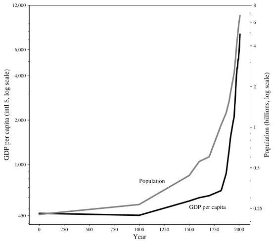
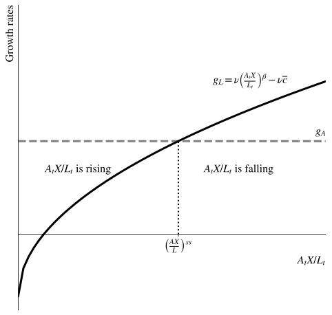
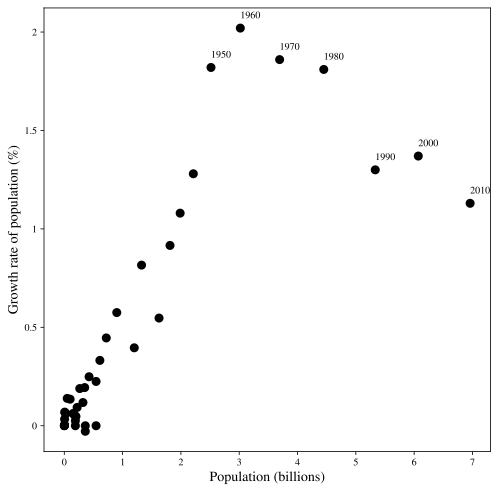
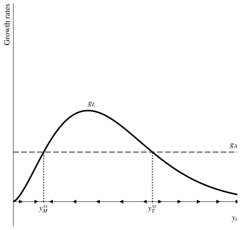
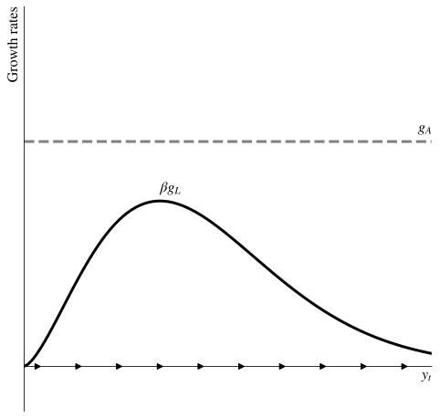

```{r setup, include=FALSE}
knitr::opts_chunk$set(echo = FALSE, fig.align = "center",
                      message = FALSE, warning = FALSE)
knitr::opts_chunk$set(fig.dim=c(9, 6), fig.retina=2, out.width="100%")
```

# La economía Malthusiana

## Despegue histórico

```{r fig1, echo=FALSE, out.width="66%"}

```

## Una economía Malthusiana

Malthus especuló sobre cómo los recursos fijos/limitados influyen en el crecimiento poblacional y los estándares de vida. Sea la producción

$$
Y_t = X^{\beta}\left(A_t^{\beta/(1-\beta)} L_t\right)^{1-\beta}
$$

donde $X$ es la cantidad del recurso fijo.

- $\beta$ es qué tan importante es dicho recurso en la producción.
- $L_t$ es la población.
- $A_t$ es la productividad.

Nota: Los exponentes están definidos así solo para simplificar el problema.

## Estándares de vida

En términos per cápita la producción/ingreso es

$$
y_t = \left(\frac{A_tX}{L_t}\right)^{\beta}
$$ {#eq-y-malthus}

Entonces los estándares de vida dependen

- positivamente de $A_t$
- positivamente de $X_t$
- *negativamente* de $L_t$

## Crecimiento poblacional endógeno

Para Malthus, el crecimiento poblacional no está dado, depende de $y_t$

$$
g_L = \nu (y_t - \overline{c})
$$

donde $\nu$ es un factor de escala y $\overline{c}$ es un nivel de consumo de "subsistencia":

- Si $y_t > \overline{c}$, el crecimiento poblacional es positivo. Menor mortalidad, mayor formación de familias y fertilidad.
- Si $y_t < \overline{c}$, el crecimiento poblacional es negativo. Alta mortalidad, limitada formación de familias y fertilidad.
- A medida que $y_t$ sube, también lo hace $g_L$

## Dinámica de la población

Sustituyendo lo que sabemos sobre $y_t$ tenemos

$$
g_L = \nu \left(\frac{A_tX}{L_t}\right)^{\beta} - \nu \overline{c}
$$ {#eq-gL-malthus}

- Este es un sistema dinámico que nos dice que $g_L$ se relaciona con el ratio $AX/L$.
- $g_L$ está relacionado negativamente con $L$. Más personas, menores estándares de vida, menor crecimiento poblacional.
- Este análisis es similar a Solow/Romer y otros modelos dinámicos.

## Dinámica Malthusiana

```{r fig2, echo=FALSE, out.width="66%"}

```

## Estado estacionario Malthusiano

En el estado estacionario se cumple que $g_L^{ss} = g_A$. De la función de producción tenemos

$$
g_y = \beta(g_A - g_L)
$$ {#eq-gy-malthus}

por lo que en estado estacionario debe ser que $g_y^{ss} = 0$. En el mundo Malthusiano los estándares de vida no crecen.

Si $g_y = 0$, entonces debe ser el caso que

$$
y^{ss} = \frac{g_A}{\nu} + \overline{c}
$$ {#eq-yss-malthus}

ya que esto asegura $g_L = g_A$.

## Estado estacionario Malthusiano

Dado

$$
y^{ss} = \frac{g_A}{\nu} + \overline{c}
$$

- Los estándares de vida son *mayores* que el nivel de subsistencia $\overline{c}$
- Cuánto mayores, depende de $g_A$. El crecimiento de la productividad permite mantenerse con mejores niveles.
- $\overline{c}$ no es un mínimo biológico, depende de la cultura/sociedad tanto como de la biología
- Las economías Malthusianas pueden estar relativamente bien, pero estancadas

## Efectos Malthusianos

La teoría de Malthus es algo deprimente. Una pérdida sustancial de población:

- Eleva los estándares de vida para las personas que quedan.
- Esas personas entonces comienzan a tener más hijos en respuesta.
- Lo anterior reduce los estándares de vida.
- Hasta que los estándares de vida vuelven al nivel previo al shock de población.

Esto ocurrió históricamente con la Peste Negra.

# Tecnología endógena

## Escapando del mundo à la Malthus

La economía mundial no parece estar en una situación Malthusiana, tenemos crecimiento económico sostenido. Dos elementos importantes para escapar de esta dinámica:

- La innovación/tecnología se aceleró.
- El crecimiento poblacional cambió su relación con los estándares de vida.

## Endogenizando la innovación

Nuestra estructura general era

$$
g_A = \theta \frac{(s_R L_t)^{\lambda}}{A_t^{1-\phi}}
$$ {#eq-ga-malthus}

pero aquí sea

- $s_R = 1$, o todos podrían potencialmente innovar
- $\lambda = 1$
- $\phi = 1$. Sabemos que esto es incorrecto en el mundo moderno, pero podría ser aplicable antes por ejemplo de la revolución industrial.

Usando estos supuestos tenemos

$$
g_A = \theta L_t
$$

## Endogenizando la innovación

Hacemos un supuesto adicional de que la economía está siempre "cerca" del equilibrio Malthusiano de modo que

$$
g_L \approx g_A
$$

y entonces con innovación endógena sería que

$$
g_L \approx  \theta L_t
$$

o el crecimiento poblacional debería aumentar con el tamaño de la población. A medida que la escala aumenta, ocurre más innovación, lo que eleva los estándares de vida, lo que eleva el crecimiento poblacional, entonces la escala aumenta, ....

## Desde 1.000.000 a.C. hasta el presente

```{r fig3, echo=FALSE, out.width="66%"}

```

# La transición al crecimiento

## Escapando de Malthus

Tecnología endógena significa que $g_A$ sube a medida que $L$ sube. Por sí mismo eso no puede terminar la trampa Malthusiana.

- $g_A$ mantiene elevando los estándares de vida, sí
- Pero el crecimiento poblacional sigue creciendo
- No puede romper el problema de estancamiento
- Y el crecimiento poblacional no puede, biológicamente, continuar aumentando

¿Cómo se ve una situación más realista?

## Función realista para $g_L$

```{r fig4, echo=FALSE, out.width="66%"}

```

## Escapando de Malthus

Con una función de crecimiento poblacional realista

- Hay un estado estacionario Malthusiano en $y_M^{ss}$.
- Si $y(0) < y^{ss}_T$ al inicio, terminaremos en estado Malthusiano
- Pero si $y_t > y^{ss}_T$, terminamos con crecimiento sostenido ya que $g_A > g_L$ siempre
- ¿Cómo pasamos este punto de inflexión?

## La transición al crecimiento sostenido

```{r fig5, echo=FALSE, out.width="66%"}

```

## Escapando de Malthus

Una historia razonable para la transición al crecimiento sostenido:

- El mundo/economía estaba en/cerca del estado estacionario Malthusiano $y_{ss}^M$
- Pero en este estado estacionario $g_L > 0$, por lo que la población creció
- Porque $L$ creció, por innovación endógena $g_A$ creció
- El nivel de $y_{ss}^M$ creció, entonces mayor $g_L$, etc..
- Y eventualmente $g_A$ fue suficientemente alto que el crecimiento poblacional no pudo seguir el ritmo
- Lo que permitió que el crecimiento continuara más allá del punto de $y_{ss}^T$
- Y entramos al mundo donde el crecimiento poblacional *cae* con los estándares de vida
- Lo que nos pone en el mundo de Solow/Romer/Schumpeter

# Desarrollo comparado

## Escapistas tempranos y tardíos

Algunas áreas escaparon de Malthus antes que otras:

- Inglaterra es el ejemplo típico de primera nación industrializada alrededor de finales de 1700 (quizás antes)
- Pero Inglaterra y Europa eran típicamente mucho más pobres que China o gran parte de Asia históricamente
- ¿Qué tiene sentido para un despegue más temprano en Europa versus Asia?

## Usando el modelo Malthusiano

La *tasa de crecimiento* de la tecnología es más importante que el *nivel* de tecnología:

- El escape de Malthus ocurre cuando $g_A > g_L$ por un período sostenido de tiempo
- Asia tenía grandes poblaciones, por lo que $g_A$ podría ser grande
- Pero Europa pudo haber tenido ventaja en menor $g_L$ a cualquier nivel dado de estándares de vida?
- O un afortunado estallido de innovación, elevando $g_A$ incluso por unas pocas décadas, fue suficiente para superar el obstáculo

# Economía del crecimiento poblacional

## Problema de elección familiar

El crecimiento poblacional es una elección, restringida por los recursos para tener y mantener vivos a los hijos. Sea

$$
U = c^{\gamma}n^{1-\gamma}
$$

y las familias se preocupan por el consumo, $c$, y el número de hijos $n$. $\gamma$ nos dice cuánto se preocupan por cada uno. Su presupuesto es

$$
y = c + p_n n
$$ {#eq-budget-malthus}

y $p_n$ es el "costo" de un hijo en términos de tiempo, recursos, alimento, etc. Hay un trade-off con el consumo.

## Maximización de utilidad

Las condiciones estándar son

$$
\begin{aligned}
UM_c &= \gamma \frac{U}{c} \\
UM_n &= (1-\gamma) \frac{U}{n}
\end{aligned}
$$

y

$$
\frac{UM_n}{UM_c} = \frac{p_n}{1}
$$

lo que puede resolverse con el presupuesto para

$$
n = \frac{(1-\gamma)y}{p_n}
$$ {#eq-n-equil}

Los hijos/crecimiento poblacional dependen positivamente del ingreso y negativamente de su costo relativo.

## El costo de los hijos

Sea el costo de los hijos

$$
p_n = \overline{c}e^{\eta y}
$$ {#eq-pn-function}

- Hay algún costo de subsistencia, $\overline{c}$
- Su costo sube con el ingreso, $y$
- Debido al $e^{\eta y}$ el costo es "convexo" o aumenta más rápido a medida que $y$ sube
- Esto captura que a medida que los ingresos suben, tomar tiempo para los hijos es más costoso (las personas postergan la formación familiar)
- También captura que a medida que $y$ sube podrías invertir más en los hijos (escuela, salud) entonces tener más hijos se vuelve aún más caro (enviar 2 hijos a la universidad en lugar de 4 a la secundaria).

## Crecimiento poblacional

Juntando esto tenemos

$$
n = \frac{(1-\gamma)y}{\overline{c}e^{\eta y}}
$$

- El crecimiento poblacional depende de dos formas de los estándares de vida, $y$
- $n$ sube debido a $y$ porque las familias tienen más recursos
- $n$ baja con $y$ porque el precio de los hijos aumenta

## Crecimiento poblacional

Los dos efectos de $y$ cambian en qué tan fuertes son, llevando a

$$
\begin{aligned}
\frac{\partial g_L}{\partial y} &> 0 \text{ si } y < \frac{1}{\eta} \\
\frac{\partial g_L}{\partial y} &= 0 \text{ si } y = \frac{1}{\eta} \\
\frac{\partial g_L}{\partial y} &< 0 \text{ si } y > \frac{1}{\eta}
\end{aligned}
$$

A niveles bajos de $y$, mayor $y$ eleva el crecimiento poblacional. A niveles altos, mayor $y$ reduce el crecimiento poblacional. Esto crea la forma de "joroba" que permite el crecimiento sostenido.
